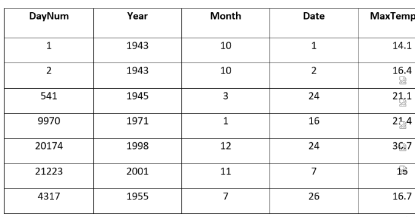
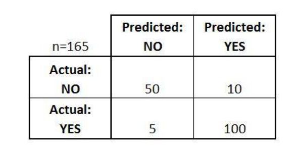
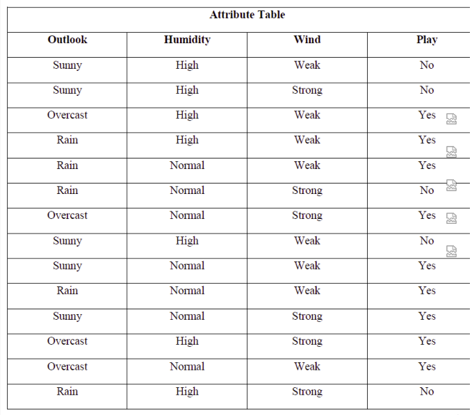
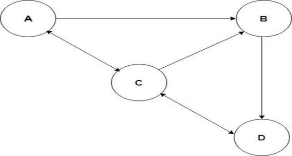

# Big Data Computing: Previous-Year Question Bank

460 unique questions from NPTEL assignments 2019, 2021-2026 (repeats merged; `asked Nx` shows how often one came up). Open `index.html` for filters and practice mode.
Answers marked `*` were not in the source key and were solved or inferred (see flags in the HTML).

## Week 0 · Prerequisites

**2019-W0-Q1** (MCQ, asked 1x: 2019 W0) Which of the following is a characteristic of Big Data?

- A. Huge volume of data
- B. Complexity of data types and structures
- C. Speed of data creation and growth
- D. All of the mentioned

**Answer:** D

**2019-W0-Q2** (MCQ, asked 1x: 2019 W0) Concurrent access to shared data may result in _________________

- A. Data consistency
- B. Data insecurity
- C. Data inconsistency
- D. None of the mentioned

**Answer:** C

**2019-W0-Q3** (MCQ, asked 1x: 2019 W0) The following three conditions must be satisfied to solve the critical section problem ____________

- A. Mutual exclusion, progress and bounded waiting
- B. Mutual exclusion only
- C. Progress only
- D. All of the mentioned

**Answer:** D

**2019-W0-Q4** (MCQ, asked 1x: 2019 W0) Mutual exclusion implies that :

- A. If a process is executing in its critical section, then no other process must be executing in their critical sections
- B. If a process is executing in its critical section, then other processes must be executing in their critical sections
- C. If a process is executing in its critical section, then all the resources of the system must be blocked until it finishes execution
- D. None of the mentioned

**Answer:** A

**2019-W0-Q5** (MCQ, asked 1x: 2019 W0) In the memory hierarchy, as the speed of operation increases the memory size also increases.

- A. True
- B. False

**Answer:** B

**2019-W0-Q6** (MCQ, asked 1x: 2019 W0) To use a _______________________network service, the service user first establishes a connection, uses the connection, and terminates the connection.

- A. Connection-oriented
- B. Connection-less
- C. Service-oriented
- D. Service-less

**Answer:** A

**2019-W0-Q7** (MCQ, asked 1x: 2019 W0) Which layer is responsible for the process-to-process delivery ?

- A. Network
- B. Transport
- C. Application
- D. Physical

**Answer:** B

**2021-W0-Q11** (MCQ, asked 1x: 2021 W0) Which of the following page replacement algorithms suffers from Belady's anomaly?

- A. FIFO
- B. LRU
- C. Optimal Page Replacement
- D. Both LRU and FIFO

**Answer*:** A

**2021-W0-Q12** (MCQ, asked 1x: 2021 W0) Suppose the numbers 7, 5, 1, 8, 3, 6, 0, 9, 4, 2 are inserted in that order into an initially empty binary search tree. The binary search tree uses the usual ordering on natural numbers. What is the in-order traversal sequence of the resultant tree ?

- A. 7 5 1 0 3 2 4 6 8 9
- B. 0 2 4 3 1 6 5 9 8 7
- C. 0 1 2 3 4 5 6 7 8 9
- D. 9 8 6 4 2 3 0 1 5 7

**Answer*:** C

**2023-W0-Q1** (MCQ, asked 2x: 2021 W0, 2023 W0)  The maximum number of super keys for the relation schema R(E,F,G,H) with E as the key is

- A. 5
- B. 6
- C. 7
- D. 8

**Answer:** D

**2023-W0-Q2** (MCQ, asked 2x: 2021 W0, 2023 W0) Consider the following relational schemas for a library database: Book (Title, Author, Catalog_no, Publisher, Year, Price) Collection (Title, Author, Catalog_no) with in the following functional dependencies: I. Title Author --&gt; Catalog_no II. Catalog_no --&gt; Title, Author, Publisher, Year III. Publisher Title Year --&gt; Price Assume {Author, Title} is the key for both schemas. Which of the following statements is true?

- A. Both Book and Collection are in BCNF
- B. Both Book and Collection are in 3NF only
- C. Book is in 2NF and Collection is in 3NF
- D. Both Book and Collection are in 2NF only

**Answer:** C

**2023-W0-Q3** (MCQ, asked 2x: 2021 W0, 2023 W0) Consider a B+-tree in which the maximum number of keys in a node is 5. What is the minimum number of keys in any non-root node ?

- A. 1
- B. 2
- C. 3
- D. 4

**Answer:** B

**2023-W0-Q4** (MCQ, asked 2x: 2021 W0, 2023 W0) Consider the join of a relation R , with a relation S . If R has m number of tuples and S has n number of tuples then the maximum and minimum sizes of the join respectively are:

- A. m + n & 0
- B. mn & 0
- C. m + n & | m – n |
- D. mn & m + n

**Answer:** B

**2023-W0-Q5** (MCQ, asked 2x: 2021 W0, 2023 W0) Which one of the following is NOT a part of the ACID properties of database transactions ?

- A. Atomicity
- B. Consistency
- C. Isolation
- D. Deadlock-freedom

**Answer:** D

**2023-W0-Q6** (MCQ, asked 2x: 2021 W0, 2023 W0) In the IPv4 addressing format, the number of networks allowed under Class C addresses is

- A. 2^14
- B. 2^7
- C. 2^21
- D. 2^24

**Answer:** C

**2023-W0-Q7** (MCQ, asked 2x: 2021 W0, 2023 W0) One of the header fields in an IP datagram is the Time to Live (TTL) field. Which of the following statements best explains the need for this field ?

- A. It can be used to prioritize packets
- B. It can be used to reduce delays
- C. It can be used to optimize throughput
- D. It can be used to prevent packet looping

**Answer:** D

**2023-W0-Q8** (MCQ, asked 2x: 2021 W0, 2023 W0) The address resolution protocol (ARP) is used for

- A. Finding the IP address from the DNS
- B. Finding the IP address of the default gateway
- C. Finding the IP address that corresponds to a MAC address
- D. Finding the MAC address that corresponds to an IP address

**Answer:** D

**2023-W0-Q9** (MCQ, asked 2x: 2021 W0, 2023 W0) Consider different activities related to email: m1: Send an email from a mail client to a mail server m2: Download an email from mailbox server to a mail client m3: Checking email in a web browser Which is the application level protocol used in each activity?

- A. m1: HTTP m2: SMTP m3: POP
- B. m1: SMTP m2: FTP m3: HTTP
- C. m1: SMTP m2: POP m3: HTTP
- D. m1: POP m2: SMTP m3: IMAP

**Answer:** C

**2023-W0-Q10** (MCQ, asked 2x: 2021 W0, 2023 W0) A process executes the code fork(); fork(); fork(); The total number of child processes created is

- A. 3
- B. 4
- C. 7
- D. 8

**Answer:** C

**2024-W0-Q1** (MCQ, asked 1x: 2024 W0)  What defines Big Data?

- A. Volume, Variety, Velocity
- B. Veracity, Velocity, Value
- C. Volume, Veracity, Value
- D. Value, Versatility, Volume

**Answer:** A

**2024-W0-Q2** (MCQ, asked 1x: 2024 W0) Which technology is commonly used for processing and analyzing Big Data?

- A. Hadoop
- B. SQL
- C. Python
- D. Excel

**Answer:** A

**2024-W0-Q3** (MCQ, asked 1x: 2024 W0) Which of the following is a challenge associated with Big Data?

- A. Low storage requirements
- B. Limited data sources
- C. Slow data processing
- D. Predictable data patterns

**Answer:** C

**2024-W0-Q4** (MCQ, asked 1x: 2024 W0) Which programming language is commonly used in Hadoop development?

- A. Java
- B. Python
- C. C++
- D. Ruby

**Answer:** A

**2024-W0-Q5** (MCQ, asked 1x: 2024 W0) What is the primary purpose of Hadoop's HDFS?

- A. Data visualization
- B. Data storage
- C. Data querying
- D. Data modeling

**Answer:** B

**2024-W0-Q6** (MCQ, asked 1x: 2024 W0) Which component of Hadoop is responsible for job scheduling and resource management?

- A. YARN
- B. HDFS
- C. MapReduce
- D. Pig

**Answer:** A

**2024-W0-Q7** (MCQ, asked 2x: 2024 W0, 2024 W4) What is Apache Zookeeper primarily used for in Big Data ecosystems?

- A. Data storage
- B. Data processing
- C. Configuration management
- D. Data visualization

**Answer:** C

**2024-W0-Q8** (MCQ, asked 1x: 2024 W0) What is the default block size in HDFS?

- A. 128 MB
- B. 256 MB
- C. 64 MB
- D. 512 MB

**Answer:** A

**2024-W0-Q9** (MCQ, asked 1x: 2024 W0) CAP theorem states that a distributed system cannot simultaneously guarantee?

- A. Consistency, Accessibility, Partition tolerance
- B. Consistency, Atomicity, Partition tolerance
- C. Consistency, Atomicity, Availability
- D. Consistency, Availability, Reliability

**Answer:** A

**2024-W0-Q10** (MCQ, asked 1x: 2024 W0) Which of the following is NOT a role of Apache Zookeeper?

- A. Data storage
- B. Data processing
- C. Configuration management
- D. Data visualization

**Answer:** C

**2025-W0-Q1** (MCQ, asked 1x: 2025 W0) According to the CAP theorem, a distributed system can guarantee at most how many of the following three properties: Consistency, Availability, and Partition Tolerance?

- A. 1
- B. 2
- C. 3
- D. None

**Answer:** B

**2025-W0-Q2** (MCQ, asked 1x: 2025 W0) In the context of CAP theorem, which of the following best describes "Consistency"?

- A. Every request receives a response, without guarantee it contains the latest data
- B. All nodes see the same data at the same time
- C. The system continues to function despite network partitions
- D. All writes are acknowledged immediately

**Answer:** B

**2025-W0-Q3** (MCQ, asked 1x: 2025 W0) What happens in a distributed system when a network partition occurs, based on the CAP theorem?

- A. The system becomes faster
- B. The system loses all data
- C. A choice must be made between consistency and availability
- D. None of the above

**Answer:** C

**2025-W0-Q4** (MCQ, asked 1x: 2025 W0) What is the default block size in HDFS (as of Hadoop 2.x)?

- A. 64 KB
- B. 128 MB
- C. 256 MB
- D. 1 GB

**Answer:** B

**2025-W0-Q5** (MCQ, asked 1x: 2025 W0) Which component of HDFS stores the actual data blocks? (the printed stem repeats the block-size question)

- A. NameNode
- B. JobTracker
- C. DataNode
- D. TaskTracker

**Answer:** C

**2025-W0-Q6** (MCQ, asked 1x: 2025 W0) What is the role of the NameNode in HDFS?

- A. Executes MapReduce programs
- B. Stores actual data
- C. Manages the file system namespace and metadata
- D. Compresses the data blocks

**Answer:** C

**2025-W0-Q7** (MCQ, asked 1x: 2025 W0) In HDFS, if a DataNode fails, what happens to its data?

- A. It is lost permanently
- B. NameNode replicates it from other nodes
- C. System crashes
- D. JobTracker handles the recovery

**Answer:** B

**2025-W0-Q8** (MCQ, asked 1x: 2025 W0) ZooKeeper is primarily used for which of the following in a distributed system?

- A. File storage
- B. Data analysis
- C. Coordination and configuration management
- D. Data visualization

**Answer:** C

**2025-W0-Q9** (MCQ, asked 1x: 2025 W0) What is the purpose of the "Znode" in ZooKeeper?

- A. A storage location for Hadoop blocks
- B. A processing unit
- C. A node that stores metadata and configuration information
- D. A container for YARN jobs

**Answer:** C

**2025-W0-Q10** (MCQ, asked 1x: 2025 W0) Which of the following ensures high availability in ZooKeeper?

- A. DataNode replication
- B. Leader election among ZooKeeper nodes
- C. HDFS balancer
- D. TaskTracker backup

**Answer:** B

## Week 1 · Introduction to Big Data

**2019-W1-Q4** (MCQ, asked 1x: 2019 W1) What are the main components of Hadoop Ecosystem?

- A. MapReduce, HDFS, YARN
- B. MLlib, GraphX
- C. Gelly, Table, CEP
- D. None of the mentioned

**Answer:** A

**2019-W1-Q6** (MCQ, asked 1x: 2019 W1) Which of the following is guaranteed by Zookeeper?

- A. Interactivity
- B. Flexibility
- C. Scalability
- D. Reliability

**Answer:** D

**2019-W1-Q8** (MCQ, asked 1x: 2019 W1) ____________ is a distributed machine learning framework on top of Spark.

- A. MLlib
- B. Spark Streaming
- C. GraphX
- D. RDDs

**Answer:** A

**2019-W1-Q9** (MCQ, asked 1x: 2019 W1) ________________is a resource management platform responsible for managing compute resources in the cluster and using them in order to schedule users and applications.

- A. Hadoop Common
- B. Hadoop Distributed File System (HDFS)
- C. Hadoop YARN
- D. Hadoop MapReduce

**Answer:** C

**2021-W1-Q1** (MCQ, asked 1x: 2021 W1) ________________ is responsible for allocating system resources to the various applications running in a Hadoop cluster and scheduling tasks to be executed on different cluster nodes.

- A. Hadoop Common
- B. Hadoop Distributed File System (HDFS)
- C. Hadoop YARN
- D. Hadoop MapReduce

**Answer:** C

> Hadoop Common: It contains libraries and utilities needed by other Hadoop modules. Hadoop Distributed File System (HDFS): It is a distributed file system that stores data on a commodity machine. Providing very high aggregate bandwidth across the entire cluster. Hadoop YARN: It is a resource management platform responsible for managing compute resources in the cluster and using them in order to schedule users and applications. YARN is responsible for allocating system resources to the various applications running in a Hadoop cluster and scheduling tasks to be executed on different cluster nodes Hadoop MapReduce: It is a programming model that scales data across a lot of different processes.

**2021-W1-Q2** (MCQ, asked 2x: 2019 W1, 2021 W1) Which of the following tool is designed for efficiently transferring bulk data between Apache Hadoop and structured datastores such as relational databases ?

- A. Pig
- B. Mahout
- C. Apache Sqoop
- D. Flume

**Answer:** C

> Apache Sqoop is a tool designed for efficiently transferring bulk data between Apache Hadoop and structured datastores such as relational databases

**2021-W1-Q4** (MCQ, asked 2x: 2019 W1, 2021 W1) _______________refers to the connectedness of big data.

- A. Value
- B. Veracity
- C. Velocity
- D. Valence

**Answer:** D

> Valence refers to the connectedness of big data. Such as in the form of graph networks

**2021-W1-Q5** (MCQ, asked 2x: 2019 W1, 2021 W1) Consider the following statements: Statement 1: Volatility refers to the data velocity relative to timescale of event being studied Statement 2: Viscosity refers to the rate of data loss and stable lifetime of data

- A. Only statement 1 is true
- B. Only statement 2 is true
- C. Both statements are true
- D. Both statements are false

**Answer:** D

> The correct statements are: Statement 1: Viscosity refers to the data velocity relative to timescale of event being studied Statement 2: Volatility refers to the rate of data loss and stable lifetime of data

**2021-W1-Q6** (MCQ, asked 2x: 2019 W1, 2021 W1) ________________refers to the biases, noise and abnormality in data, trustworthiness of data.

- A. Value
- B. Veracity
- C. Velocity
- D. Volume

**Answer:** B

> Veracity refers to the biases ,noise and abnormality in data, trustworthiness of data.

**2021-W1-Q8** (MCQ, asked 2x: 2019 W1, 2021 W1) True or False ? NoSQL databases store unstructured data with no particular schema

- A. True
- B. False

**Answer:** A

> While the traditional SQL can be effectively used to handle large amount of structured data, we need NoSQL (Not Only SQL) to handle unstructured data. NoSQL databases store unstructured data with no particular schema

**2021-W1-Q10** (MCQ, asked 1x: 2021 W1) True or False ? MapReduce is a programming model and an associated implementation for processing and generating large data sets.

- A. True
- B. False

**Answer:** A

**2022-W1-Q1** (MCQ, asked 1x: 2022 W1) True or False ? Big Data is a collection of data that is huge in volume, yet growing exponentially with time. It is a data with so large size and complexity that none of traditional data management tools can store it or process it efficiently.

- A. True
- B. False

**Answer:** A

**2022-W1-Q2** (MCQ, asked 1x: 2022 W1) What does “Velocity” in Big Data mean?

- A. Speed of input data generation
- B. Speed of individual machine processors
- C. Speed of storing and processing data
- D. Speed of ONLY storing data

**Answer:** C

> Velocity is the speed at which data is processed. This includes input such as processing of social media posts and output such as the processing required to produce a report or execute a process.

**2022-W1-Q3** (MCQ, asked 1x: 2022 W1) _______________ refers to the accuracy and correctness of the data relative to a particular use.

- A. Value
- B. Veracity
- C. Velocity
- D. Validity

**Answer:** D

> Validity refers to the accuracy and correctness of the data relative to a particular use.

**2022-W1-Q4** (MCQ, asked 1x: 2022 W1) Consider the following statements: Statement 1: Viscosity refers to the connectedness of big data. Statement 2: Volatility refers to the rate of data loss and stable lifetime of data.

- A. Only statement 1 is true
- B. Only statement 2 is true
- C. Both statements are true
- D. Both statements are false

**Answer:** B

> The correct statements are: Statement 1: Viscosity refers to the data velocity relative to timescale of event being studied Statement 2: Volatility refers to the rate of data loss and stable lifetime of data

**2022-W1-Q5** (MCQ, asked 1x: 2022 W1) ______________ is a programming model and an associated implementation for processing and generating large data sets.

- A. HDFS
- B. YARN
- C. Map Reduce
- D. PIG

**Answer:** C

> Map Reduce is a programming model and an associated implementation for processing and generating large data sets.

**2022-W1-Q6** (MCQ, asked 1x: 2022 W1) _______________is an open source software framework for big data. It has two basic parts: HDFS and Map Reduce.

- A. Spark
- B. HBASE
- C. HIVE
- D. Apache Hadoop

**Answer:** D

> Apache Hadoop is an open source software framework for big data It has two basic parts: a) Hadoop Distributed File System (HDFS) is the storage system of Hadoop which splits big data and distribute across many nodes in a cluster b) MapReduce: Programming model that simplifies parallel programming

**2022-W1-Q7** (MCQ, asked 1x: 2022 W1) The fundamental idea of __________________ is to split up the functionalities of resource management and job scheduling/monitoring into separate daemons. The idea is to have a global Resource Manager (RM) and per-application Application Master (AM). An application is either a single job or a DAG of jobs.

- A. Hadoop Common
- B. Hadoop Distributed File System (HDFS)
- C. Hadoop YARN
- D. Hadoop MapReduce

**Answer:** C

> Hadoop Common: It contains libraries and utilities needed by other Hadoop modules. Hadoop Distributed File System (HDFS): It is a distributed file system that stores data on a commodity machine. Providing very high aggregate bandwidth across the entire cluster. Hadoop YARN: It is a resource management platform responsible for managing compute resources in the cluster and using them in order to schedule users and applications. YARN is responsible for allocating system resources to the various applications running in a Hadoop cluster and scheduling tasks to be executed on different cluster nodes Hadoop MapReduce: It is a programming model that scales data across a lot of different processes.

**2022-W1-Q8** (MCQ, asked 2x: 2021 W1, 2022 W1) ____________is a highly reliable distributed coordination kernel , which can be used for distributed locking, configuration management, leadership election, and work queues etc.

- A. Apache Sqoop
- B. Mahout
- C. Flume
- D. ZooKeeper

**Answer:** D

> ZooKeeper is a central store of key value using which distributed systems can coordinate. Since it needs to be able to handle the load, Zookeeper itself runs on many machines.

**2022-W1-Q9** (MCQ, asked 1x: 2022 W1) ______________ is an open source stream processing software platform developed by the Apache Software Foundation written in Scala and Java.

- A. Hive
- B. Cassandra
- C. Apache Kafka
- D. RDDs

**Answer:** C

> Apache Kafka is an open source stream processing software platform developed by the Apache Software Foundation written in Scala and Java.

**2022-W1-Q10** (MCQ, asked 1x: 2022 W1) True or False ? NoSQL databases are non-tabular databases and store data differently than relational tables. NoSQL databases come in a variety of types based on their data model. The main types are document, key- value, wide-column, and graph. They provide flexible schemas and scale easily with large amounts of data and high user loads.

- A. True
- B. False

**Answer:** A

> While the traditional SQL can be effectively used to handle large amount of structured data, we need NoSQL (Not Only SQL) to handle unstructured data. NoSQL databases store unstructured data with no particular schema

**2023-W1-Q1** (MCQ, asked 1x: 2023 W1) What are the three key characteristics of Big Data, often referred to as the 3V's, according to IBM?

- A. Viscosity, Velocity, Veracity
- B. Volume, Value, Variety
- C. Volume, Velocity, Variety
- D. Volumetric, Visceral, Vortex

**Answer:** C

> Volume: Refers to the massive amount of data generated and collected from various sources. This includes both structured and unstructured data. Velocity: Represents the speed at which data is generated, processed, and analyzed. It emphasizes the real-time nature of data and the need to handle and react to data quickly. Variety: Encompasses the different types and formats of data, including structured, semi- structured, and unstructured data. This diversity challenges traditional data processing methods. Option A is incorrect because "Viscosity" is not one of the 3V's, and "Veracity" relates to the accuracy and trustworthiness of data, not velocity. Option B is incorrect because while "Volume" and "Variety" are correct, "Value" is not one of the 3V's. Option D is incorrect because "Volumetric," "Visceral," and "Vortex" are not the terms used to describe the characteristics of Big Data according to IBM.

**2023-W1-Q2** (MCQ, asked 1x: 2023 W1) What is the primary purpose of the MapReduce programming model in processing and generating large data sets?

- A. To directly process and analyze data without any intermediate steps.
- B. To convert unstructured data into structured data.
- C. To specify a map function for generating intermediate key/value pairs and a reduce function for merging values associated with the same key.
- D. To create visualizations and graphs for large data sets.

**Answer:** C

> MapReduce is a programming model used for processing and generating large data sets. It involves two main steps: mapping and reducing. Users specify a map function that processes a key/value pair to generate a set of intermediate key/value pairs. The map function operates in parallel across the input data. The intermediate key/value pairs are then grouped by key and passed to a reduce function, which merges all intermediate values associated with the same intermediate key. This process allows for distributed and parallel processing of large datasets. Option A is incorrect because MapReduce does involve intermediate steps (mapping and reducing) to process data. Option B is incorrect because while MapReduce is used for processing unstructured data, its primary purpose is not to convert it into structured data. Option D is incorrect because MapReduce is not primarily focused on creating visualizations and graphs; its main focus is on processing and generating large data sets using the map and reduce functions.

**2023-W1-Q3** (MCQ, asked 3x: 2019 W1, 2021 W1, 2023 W1) _________________ is a distributed, reliable, and available service for efficiently collecting, aggregating, and moving large amounts of log data.

- A. Flume
- B. Apache Sqoop
- C. Pig
- D. Mahout

**Answer:** A

> Flume is a distributed, reliable, and available service for efficiently collecting, aggregating, and moving large amounts of log data. It has a simple and very flexible architecture based on streaming data flows. It's quite robust and fall tolerant, and it's really tunable to enhance the reliability mechanisms, fail over, recovery, and all the other mechanisms that keep the cluster safe and reliable. It uses simple extensible data model that allows us to apply all kinds of online analytic applications.

**2023-W1-Q4** (MCQ, asked 1x: 2023 W1) What is the primary role of YARN (Yet Another Resource Manager) in the Apache Hadoop ecosystem?

- A. YARN is a data storage layer for managing and storing large datasets in Hadoop clusters.
- B. YARN is a programming model for processing and analyzing data in Hadoop clusters.
- C. YARN is responsible for allocating system resources and scheduling tasks for applications in a Hadoop cluster.
- D. YARN is a visualization tool for creating graphs and charts based on Hadoop data.

**Answer:** C

> YARN, which stands for "Yet Another Resource Manager," is a key component of the Apache Hadoop ecosystem. Its primary role is resource management and job scheduling. YARN is responsible for efficiently allocating system resources, such as CPU and memory, to various applications running in a Hadoop cluster. It also handles the scheduling of tasks to be executed on different cluster nodes, ensuring optimal utilization of resources and improving overall cluster performance. Option A is incorrect because YARN is not a data storage layer; it focuses on resource management and job scheduling. Option B is incorrect because while YARN plays a role in supporting data processing and analysis, its main function is not to define a programming model. Option D is incorrect because YARN is not a visualization tool; it is a resource management and scheduling technology.

**2023-W1-Q5** (MCQ, asked 1x: 2023 W1) Which of the following statements accurately describes the characteristics and functionality of HDFS (Hadoop Distributed File System)?

- A. HDFS is a centralized file system designed for storing small files and achieving high-speed data processing.
- B. HDFS is a programming language used for writing MapReduce applications within the Hadoop ecosystem.
- C. HDFS is a distributed, scalable, and portable file system designed for storing large files across multiple machines, achieving reliability through replication.
- D. HDFS is a visualization tool that generates graphs and charts based on data stored in the Hadoop ecosystem.

**Answer:** C

> HDFS (Hadoop Distributed File System) is a fundamental component of the Hadoop framework. It is designed to store and manage large files across a distributed cluster of machines. The key features and functionality of HDFS include: Distributed and Scalable: HDFS distributes data across multiple nodes in a cluster, allowing it to handle large datasets that range from gigabytes to terabytes, and even petabytes. It scales horizontally as more nodes are added to the cluster. Reliability Through Replication: HDFS achieves reliability by replicating data blocks across multiple data nodes in the cluster. This replication ensures data availability even in the face of node failures. Single Name Node and Data Nodes: Each Hadoop instance typically includes a single name node, which acts as the metadata manager for the file system, and a cluster of data nodes that store the actual data. Portability: HDFS is written in Java and is designed to be portable across different platforms and operating systems. Option A is incorrect because HDFS is not centralized; it is distributed. It is also designed for storing large files rather than small files. Option B is incorrect because HDFS is not a programming language; it is a file system. Option D is incorrect because HDFS is not a visualization tool; it is a distributed file system for storing and managing data in the Hadoop ecosystem.

**2023-W1-Q6** (MCQ, asked 1x: 2023 W1) Which statement accurately describes the role and design of HBase in the Hadoop stack?

- A. HBase is a programming language used for writing complex data processing algorithms in the Hadoop ecosystem.
- B. HBase is a data warehousing solution designed for batch processing of large datasets in Hadoop clusters.
- C. HBase is a key-value store that provides fast random access to substantial datasets, making it suitable for applications requiring such access patterns.
- D. HBase is a visualization tool that generates charts and graphs based on data stored in Hadoop clusters.

**Answer:** C

> HBase is a NoSQL database that is a key component of the Hadoop ecosystem. Its design focuses on providing high-speed random access to large amounts of data. Key characteristics and roles of HBase include: Key-Value Store: HBase stores data in a distributed, column-family-oriented fashion, similar to a key-value store. It allows you to look up data quickly using a key. Fast Random Access: HBase is optimized for fast read and write operations, particularly random access patterns. This makes it suitable for applications that require quick retrieval of specific data points from massive datasets. Scalability: HBase is designed to scale horizontally, allowing it to handle vast amounts of data by adding more nodes to the cluster. Option A is incorrect because HBase is not a programming language; it's a database system. Option B is incorrect because HBase is not a data warehousing solution; it's designed for real-time, random access to data rather than batch processing. Option D is incorrect because HBase is not a visualization tool; it's a database system focused on high-speed data access.

**2023-W1-Q7** (MCQ, asked 3x: 2019 W1, 2021 W1, 2023 W1) _____________ brings scalable parallel database technology to Hadoop and allows users to submit low latencies queries to the data that's stored within the HDFS or the Hbase without acquiring a ton of data movement and manipulation.

- A. Apache Sqoop
- B. Mahout
- C. Flume
- D. Impala

**Answer:** D

> Cloudera, Impala was designed specifically at Cloudera, and it's a query engine that runs on top of the Apache Hadoop. The project was officially announced at the end of 2012, and became a publicly available, open source distribution. Impala brings scalable parallel database technology to Hadoop and allows users to submit low latencies queries to the data that's stored within the HDFS or the Hbase without acquiring a ton of data movement and manipulation.

**2023-W1-Q8** (MCQ, asked 1x: 2023 W1) What is the primary purpose of ZooKeeper in a distributed system?

- A. ZooKeeper is a data warehousing solution for storing and managing large datasets in a distributed cluster.
- B. ZooKeeper is a programming language for developing distributed applications in a cloud environment.
- C. ZooKeeper is a highly reliable distributed coordination kernel used for tasks such as distributed locking, configuration management, leadership election, and work queues.
- D. ZooKeeper is a visualization tool for creating graphs and charts based on data stored in distributed systems.

**Answer:** C

> ZooKeeper is a distributed coordination service that provides a reliable and efficient way for coordinating various processes and components in a distributed system. It offers functionalities like distributed locking, configuration management, leader election, and work queues to ensure that distributed applications can work together effectively. ZooKeeper acts as a central repository for managing metadata related to the coordination of these distributed tasks. Option A is incorrect because ZooKeeper is not a data warehousing solution; its primary role is distributed coordination. Option B is incorrect because ZooKeeper is not a programming language; it's a coordination service. Option D is incorrect because ZooKeeper is not a visualization tool; it's focused on distributed coordination and management.

**2023-W1-Q9** (MCQ, asked 1x: 2023 W1) ________________ is a distributed file system that stores data on a commodity machine. Providing very high aggregate bandwidth across the entire cluster.

- A. Hadoop Common
- B. Hadoop Distributed File System (HDFS)
- C. Hadoop YARN
- D. Hadoop MapReduce

**Answer:** B

> Hadoop Common: It contains libraries and utilities needed by other Hadoop modules. Hadoop Distributed File System (HDFS): It is a distributed file system that stores data on a commodity machine. Providing very high aggregate bandwidth across the entire cluster. Hadoop YARN: It is a resource management platform responsible for managing compute resources in the cluster and using them in order to schedule users and applications. YARN is responsible for allocating system resources to the various applications running in a Hadoop cluster and scheduling tasks to be executed on different cluster nodes Hadoop MapReduce: It is a programming model that scales data across a lot of different processes.

**2023-W1-Q10** (MCQ, asked 1x: 2023 W1) Which statement accurately describes Spark MLlib?

- A. Spark MLlib is a visualization tool for creating charts and graphs based on data processed in Spark clusters.
- B. Spark MLlib is a programming language used for writing Spark applications in a distributed environment.
- C. Spark MLlib is a distributed machine learning framework built on top of Spark Core, providing scalable machine learning algorithms and utilities for tasks such as classification, regression, clustering, and collaborative filtering.
- D. Spark MLlib is a data warehousing solution for storing and querying large datasets in a Spark cluster.

**Answer:** C

> Spark MLlib (Machine Learning Library) is a component of the Apache Spark ecosystem. It offers a distributed machine learning framework that allows developers to leverage Spark's distributed computing capabilities for scalable and efficient machine learning tasks. Key features and roles of Spark MLlib include: Distributed Machine Learning: MLlib provides a wide range of machine learning algorithms that are designed to work efficiently in a distributed environment. It enables the processing of large datasets across a cluster of machines. Common Learning Algorithms: MLlib includes a variety of common machine learning algorithms, such as classification, regression, clustering, and collaborative filtering. Integration with Spark Core: MLlib is built on top of Spark Core, which provides the underlying distributed processing framework. This integration allows seamless utilization of Spark's data processing capabilities for machine learning tasks. Option A is incorrect because Spark MLlib is not a visualization tool; its focus is on distributed machine learning. Option B is incorrect because Spark MLlib is not a programming language; it's a machine learning library. Option D is incorrect because Spark MLlib is not a data warehousing solution; its primary purpose is machine learning on distributed data.

**2024-W1-Q1** (MCQ, asked 1x: 2024 W1) Which of the following best describes the concept of 'Big Data'?

- A. Data that is physically large in size
- B. Data that is collected from multiple sources and is of high variety, volume, and velocity
- C. Data that requires specialized hardware for storage
- D. Data that is highly structured and easily analyzable

**Answer*:** B

**2024-W1-Q2** (MCQ, asked 1x: 2024 W1) Which technology is commonly used for processing and analyzing Big Data in distributed computing environments?

- A. MySQL
- B. Hadoop
- C. Excel
- D. SQLite

**Answer*:** B

**2024-W1-Q3** (MCQ, asked 1x: 2024 W1) What is a primary limitation of traditional RDBMS when dealing with Big Data?

- A. They cannot handle structured data
- B. They are too expensive to implement
- C. They struggle with scaling to manage very large datasets
- D. They are not capable of performing complex queries

**Answer*:** C

**2024-W1-Q4** (MCQ, asked 1x: 2024 W1) Which component of Hadoop is responsible for distributed storage?

- A. YARN
- B. HDFS
- C. MapReduce
- D. Pig

**Answer*:** B

**2024-W1-Q5** (MCQ, asked 1x: 2024 W1) Which Hadoop ecosystem tool is primarily used for querying and analyzing large datasets stored in Hadoop's distributed storage?

- A. HBase
- B. Hive
- C. Kafka
- D. Sqoop

**Answer*:** B

**2024-W1-Q6** (MCQ, asked 1x: 2024 W1) Which YARN component is responsible for coordinating the execution of tasks within containers on individual nodes in a Hadoop cluster?

- A. NodeManager
- B. ResourceManager
- C. ApplicationMaster
- D. DataNode

**Answer*:** A

**2024-W1-Q7** (MCQ, asked 1x: 2024 W1) What is the primary advantage of using Apache Spark over traditional MapReduce for data processing?

- A. Better fault tolerance
- B. Lower hardware requirements
- C. Real-time data processing
- D. Faster data processing

**Answer*:** D

**2024-W1-Q8** (MCQ, asked 1x: 2024 W1) What is Apache Spark Streaming primarily used for?

- A. Real-time data visualization
- B. Batch processing of large datasets
- C. Real-time stream processing
- D. Data storage and retrieval

**Answer*:** C

**2024-W1-Q9** (MCQ, asked 1x: 2024 W1) Which operation in Apache Spark GraphX is used to perform triangle counting on a graph?

- A. connectedComponents
- B. triangleCount
- C. shortestPaths
- D. pageRank

**Answer*:** B

**2024-W1-Q10** (MCQ, asked 1x: 2024 W1) Which component in Hadoop is responsible for executing tasks on individual nodes and reporting back to the JobTracker?

- A. HDFS Namenode
- B. TaskTracker
- C. YARN ResourceManager
- D. DataNode

**Answer*:** B

**2025-W1-Q1** (MCQ, asked 1x: 2025 W1) What does the 'Variety' aspect of Big Data refer to?

- A. The amount of data being generated
- B. The speed at which data is produced
- C. The types and formats of data
- D. The correctness of data

**Answer:** C

> Variety indicates different types of data—structured, semi-structured, and unstructured—such as text, images, audio, and video.

**2025-W1-Q2** (MCQ, asked 1x: 2025 W1) Which of the following is used in Hadoop for distributed storage?

- A. Hive
- B. HDFS
- C. YARN
- D. Spark

**Answer:** B

> HDFS (Hadoop Distributed File System) is the storage layer of Hadoop, designed to store large datasets across multiple machines.

**2025-W1-Q3** (MCQ, asked 1x: 2025 W1) Which technology enables resource management in a Hadoop cluster?

- A. MapReduce
- B. YARN
- C. HDFS
- D. Pig

**Answer:** B

> YARN (Yet Another Resource Negotiator) manages resources and schedules jobs across the Hadoop cluster.

**2025-W1-Q4** (MCQ, asked 1x: 2025 W1) What is Apache Spark primarily known for?

- A. Real-time processing using batch jobs
- B. Disk-based computation
- C. Resource management
- D. In-memory computation for fast analytics

**Answer:** D

> Apache Spark processes data in-memory, allowing performance up to 100x faster than traditional MapReduce.

**2025-W1-Q5** (MCQ, asked 1x: 2025 W1) What does MapReduce do in the Hadoop ecosystem?

- A. Manages job execution
- B. Provides data security
- C. Splits and processes large data sets in parallel
- D. Stores data

**Answer:** C

> MapReduce is a programming model for processing large datasets by breaking them into smaller chunks (Map) and then combining results (Reduce).

**2025-W1-Q6** (MCQ, asked 1x: 2025 W1) What is the purpose of Apache Zookeeper?

- A. Coordinates and manages distributed applications
- B. Stores massive unstructured data
- C. In-memory computation
- D. Provides SQL support

**Answer:** A

> Zookeeper helps manage configuration, synchronization, and metadata across distributed systems.

**2025-W1-Q7** (MCQ, asked 1x: 2025 W1) Why is traditional RDBMS not suitable for Big Data?

- A. It lacks GUI
- B. It cannot support SQL
- C. It fails to handle large volume, variety, and velocity of data
- D. It is open-source

**Answer:** C

> RDBMS is not designed for the scale, speed, and heterogeneity of Big Data.

**2025-W1-Q8** (MCQ, asked 1x: 2025 W1) A research lab is storing high-resolution satellite images, videos, and sensor data from different instruments. What Big Data characteristic does this scenario highlight?

- A. Volume
- B. Variety
- C. Veracity
- D. Viscosity

**Answer:** B

> This scenario involves multiple data types (images, videos, sensor logs), showing Variety.

**2025-W1-Q9** (MCQ, asked 1x: 2025 W1) You are developing a healthcare monitoring system using wearable sensors that stream data continuously. Which Big Data technologies should you consider for processing this stream?

- A. Spark Streaming and Kafka
- B. Hive and Pig
- C. HDFS and MapReduce
- D. Cassandra and ZooKeeper

**Answer:** A

> Kafka handles high-throughput streaming data; Spark Streaming processes it in real-time.

**2025-W1-Q10** (MCQ, asked 1x: 2025 W1) Which of the following is a NoSQL database suitable for handling unstructured data?

- A. Oracle
- B. Hive
- C. Cassandra
- D. MySQL

**Answer:** C

> Cassandra is a distributed, highly scalable NoSQL database designed for handling huge volumes of unstructured data.

**2026-W1-Q1** (MCQ, asked 1x: 2026 W1) A dataset was highly useful in 2024, but by 2026 the same dataset becomes irrelevant because the information has lost significance. Which "V" best describes this situation?

- A. Validity
- B. Veracity
- C. Volatility
- D. Venue

**Answer:** C

> week-1 Lecture 1 defines Volatility as the rate of data loss and the stable lifetime of data — exactly "data that used to matter but has since lost significance." Trap: Validity is accuracy/correctness for a given use, not loss of relevance over time; Veracity is about noise/trustworthiness, not aging-out.

**2026-W1-Q2** (MCQ, asked 1x: 2026 W1) Which of the following statements about Oozie is CORRECT?

- A. Oozie is a distributed NoSQL database.
- B. Oozie is a workflow scheduler system for Hadoop jobs.
- C. Oozie is used to store data in HDFS.
- D. Oozie is a machine learning library for Spark.

**Answer:** B

> Lecture 3, Core ideas — Oozie is explicitly defined as the workflow scheduler that manages/coordinates Hadoop jobs. Trap: Options a/c/d misassign Oozie's job to HBase/Cassandra (NoSQL), HDFS (storage), and MLlib (ML library) respectively.

**2026-W1-Q3** (MCQ, asked 1x: 2026 W1) Oozie can directly coordinate which of the following Hadoop ecosystem components?

- A. Hive, Pig, Sqoop, and MapReduce
- B. HDFS, NameNode, DataNode, and YARN only
- C. Cassandra, MongoDB, and Redis only
- D. Spark MLlib and GraphX only

**Answer:** A

> Lecture 3 states Oozie "supports MapReduce, Pig, Hive, and Sqoop" as the jobs it coordinates. Trap: b/c/d list components Oozie does not directly schedule (storage/resource internals, NoSQL stores, Spark libraries).

**2026-W1-Q4** (MCQ, asked 1x: 2026 W1) What is the primary purpose of Apache Flume in the Hadoop ecosystem?

- A. Querying data stored in HDFS
- B. Collecting and transferring large amounts of log data
- C. Performing machine learning tasks
- D. Managing cluster resources

**Answer:** B

> Lecture 3 — Flume is "a distributed reliable available service for efficiently collecting, aggregating, moving large amounts of log data into HDFS," i.e., data ingestion. Trap: a is Hive's job, c is MLlib's, d is YARN's.

**2026-W1-Q5** (MCQ, asked 1x: 2026 W1) What is the primary role of Apache ZooKeeper in a Hadoop ecosystem?

- A. Distributed data storage
- B. Workflow scheduling
- C. Distributed coordination and synchronization
- D. SQL query processing

**Answer:** C

> Lecture 2 and 3 both define Zookeeper as the centralized coordination service — configuration, synchronization, naming, group services, leader election. Trap: b is Oozie's role (near-twin covered in week-1 near-twins table); a is HDFS/HBase, d is Hive.

**2026-W1-Q6** (MCQ, asked 1x: 2026 W1) Hive primarily operates on data stored in:

- A. MongoDB
- B. Cassandra
- C. HDFS
- D. Redis

**Answer:** C

> Hive is a distributed data-management/SQL-query layer for Hadoop, running over MapReduce against data stored in HDFS. Trap: MongoDB/Cassandra/Redis are separate NoSQL stores not part of the Hive-over-Hadoop path.

**2026-W1-Q7** (MCQ, asked 1x: 2026 W1) Which of the following best describes Apache Hive?

- A. A distributed coordination service
- B. A workflow scheduler
- C. A data warehouse system built on Hadoop
- D. A NoSQL database

**Answer:** C

> Lecture 2/3 — Hive provides SQL-like queries (HiveSQL) over MapReduce/HDFS for data mining and analysis, i.e., a data-warehouse layer on Hadoop. Trap: a=Zookeeper, b=Oozie, d=HBase/Cassandra — all near-twins from this week's notes.

**2026-W1-Q8** (MCQ, asked 1x: 2026 W1) Which Hadoop module stores metadata?

- A. DataNode
- B. TaskTracker
- C. NameNode
- D. Reducer

**Answer:** C

> Lecture 3 — the NameNode holds filenames and block-location metadata; DataNodes hold the actual data blocks. Trap: DataNode is the classic swapped-pair distractor (holds data, not metadata).

**2026-W1-Q9** (MCQ, asked 1x: 2026 W1) Which pair is correctly matched?

- A. Hive – Stream Processing
- B. Kafka – Distributed Commit Log
- C. Sqoop – Graph Analytics
- D. GraphX – ETL Tool

**Answer:** B

> Lecture 2 only calls Kafka an open-source **distributed stream-processing framework** that feeds Spark Streaming (internals “later”). It never says “commit log.” The portal still pairs Kafka with **Distributed Commit Log** — that one-liner is from the later Kafka lecture, not this week. Pick **b** because the other three pairs are wrong on this week's map. Trap: a/c/d all swap roles: Hive is SQL queries not streaming, Sqoop is RDBMS↔Hadoop transfer not graphs, GraphX is Spark's graph-analytics library not ETL.

**2026-W1-Q10** (MCQ, asked 1x: 2026 W1) Which of the following is the PRIMARY function of Apache ZooKeeper in a distributed Hadoop environment?

- A. Storing large-scale data across cluster nodes
- B. Managing distributed coordination, synchronization, and configuration services
- C. Executing SQL-like queries on HDFS data
- D. Scheduling Hadoop workflows and jobs

**Answer:** B

> Same Zookeeper definition as Q5 — coordination/sync/config service, not storage, querying, or scheduling. Trap: a=HDFS, c=Hive, d=Oozie.

## Week 2 · Hadoop / HDFS / MapReduce

**2019-W2-Q8** (MCQ, asked 1x: 2019 W2) For which of the following operations is NO communication with the NameNode required?

- A. A client writing a file to HDFS.
- B. A client requesting the filename of a given block of data.
- C. A client reading a block of data from the cluster.
- D. A client reading a file from the cluster.

**Answer:** C

**2019-W2-Q9** (MCQ, asked 1x: 2019 W2) Which of the following components reside on a NameNode?

- A. Filenames, blocks and checksums
- B. Blocks and heartbeat messages
- C. Filenames, block locations
- D. Blocks and block locations

**Answer:** C

**2021-W2-Q1** (MCQ, asked 2x: 2019 W2, 2021 W2) Consider the following statements: Statement 1: The Job Tracker is hosted inside the master and it receives the job execution request from the client. Statement 2: Task tracker is the MapReduce component on the slave machine as there are multiple slave machines.

- A. Only statement 1 is true
- B. Only statement 2 is true
- C. Both statements are true
- D. Both statements are false

**Answer:** C

**2021-W2-Q2** (MCQ, asked 2x: 2019 W2, 2021 W2) ________ is the slave/worker node and holds the user data in the form of Data Blocks.

- A. NameNode
- B. Data block
- C. Replication
- D. DataNode

**Answer:** D

> NameNode works as a master server that manages the file system namespace and basically regulates access to these files from clients, and it also keeps track of where the data is on the DataNodes and where the blocks are distributed essentially. On the other hand DataNode is the slave/worker node and holds the user data in the form of Data Blocks.

**2021-W2-Q5** (MCQ, asked 2x: 2019 W2, 2021 W2) True or False ? The main duties of task tracker are to break down the receive job that is big computations in small parts, allocate the partial computations that is tasks to the slave nodes monitoring the progress and report of task execution from the slave.

- A. True
- B. False

**Answer:** B

> The task tracker will communicate the progress and report the results to the job tracker.

**2022-W2-Q1** (MCQ, asked 2x: 2021 W2, 2022 W2) _______________works as a master server that manages the file system namespace and basically regulates access to these files from clients, and it also keeps track of where the data is on the Data Nodes and where the blocks are distributed essentially.

- A. Data Node
- B. Name Node
- C. Data block
- D. Replication

**Answer:** B

> Name Node works as a master server that manages the file system namespace and basically regulates access to these files from clients, and it also keeps track of where the data is on the Data Nodes and where the blocks are distributed essentially. On the other hand Data Node is the slave/worker node and holds the user data in the form of Data Blocks.

**2022-W2-Q2** (MCQ, asked 1x: 2022 W2) - When a client contacts the name node for accessing a file, the name node responds with

- A. Size of the file requested.
- B. Block ID of the file requested.
- C. Block ID and hostname of any one of the data nodes containing that block.
- D. Block ID and hostname of all the data nodes containing that block.

**Answer:** D

> A name node is a master server that manages the file system namespace and basically regulates access to these files from clients, and it also keeps track of where the data is on the DataNodes and where the blocks are distributed essentially.

**2022-W2-Q3** (MCQ, asked 2x: 2021 W2, 2022 W2) The namenode knows that the datanode is active using a mechanism known as

- A. datapulse
- B. h-signal
- C. heartbeats
- D. Active-pulse

**Answer:** C

> In Hadoop Name node and data node do communicate using Heartbeat. Therefore Heartbeat is the signal that is sent by the datanode to the namenode after the regular interval to time to indicate its presence, i.e. to indicate that it is alive.

**2022-W2-Q4** (MCQ, asked 1x: 2022 W2) For reading/writing data to/from HDFS, clients first connect to ______________

- A. NameNode
- B. Checkpoint Node
- C. DataNode
- D. None of the mentioned

**Answer:** A

> To read/write a file in HDFS, a client needs to interact with master i.e. namenode (master).

**2022-W2-Q5** (MCQ, asked 2x: 2021 W2, 2022 W2) True or False ? HDFS performs replication, although it results in data redundancy?

- A. True
- B. False

**Answer:** A

> Once the data is written in HDFS it is immediately replicated along the cluster, so that different copies of data will be stored on different data nodes. Normally the Replication factor is 3 as due to this the data does not remain over replicated nor it is less.

**2022-W2-Q6** (MCQ, asked 1x: 2022 W2) Consider the following statements: Statement 1: Task Tracker is hosted inside the master and it receives the job execution request from the client. Statement 2: Job tracker is the MapReduce component on the slave machine as there are multiple slave machines.

- A. Only statement 1 is true
- B. Only statement 2 is true
- C. Both statements are true
- D. Both statements are false

**Answer:** D

> The correct statements are: The Job Tracker is hosted inside the master and it receives the job execution request from the client. Task tracker is the MapReduce component on the slave machine as there are multiple slave machines.

**2022-W2-Q7** (MCQ, asked 1x: 2022 W2) Consider the following statements: Statement 1: MapReduce is a programming model and an associated implementation for processing and generating large data sets. Statement 2: Users specify a map function that processes a key/value pair to generate a set of intermediate key/value pairs, and a reduce function that merges all intermediate values associated with the same intermediate key.

- A. Only statement 1 is true
- B. Only statement 2 is true
- C. Both statements are true
- D. Both statements are false

**Answer:** C

**2022-W2-Q8** (MCQ, asked 3x: 2019 W2, 2021 W2, 2022 W2) Point out the correct statement in context of YARN:

- A. YARN extends the power of Hadoop to incumbent and new technologies found within the data center
- B. YARN is highly scalable.
- C. YARN enhances a Hadoop compute cluster in many ways
- D. All of the mentioned

**Answer:** D

**2022-W2-Q9** (MCQ, asked 2x: 2019 W2, 2022 W2) Apache Hadoop YARN stands for:

- A. Yet Another Reserve Negotiator
- B. Yet Another Resource Negotiator
- C. Yet Another Resource Network
- D. Yet Another Resource Manager

**Answer:** B

**2022-W2-Q10** (MCQ, asked 1x: 2022 W2) Consider the pseudo-code for MapReduce's WordCount example (not shown here). Let's now assume that you want to determine the average length of all the words in a text file. Which part of the (pseudo-)code do you need to adapt?

- A. Only map()
- B. Only reduce()
- C. map() and reduce()
- D. The code does not have to be changed

**Answer:** C

> The problem statement is: Assume a given file name: sample.txt File contents: This is a sample file Fit for nothing Length of words This = 4, is =2, a=1, sample=6, file=4, fit=3, for=3, nothing=7 Total length of all words=4+2+1+6+4+3+3+7=30 Total number of words=8 Average length of all the words= total length of all the words/total number of words=30/8=3.75 Expected output= 3.75 Programming the Mapper Mapper is programmed to do the following: Step-1: Ignore the key from the recorder Step 2: Split the words in the value (the full line) This is a sample file [this] [is] [a] [sample][file] (line is split) Step 3: Output the number 1 as key each word as value. The sample output of mapper would look like KEY: 1, VALUE: this Step 4: Repeat the above steps for all the words in the line Output of the Mapper after processing the entire file KEY VALUE 1 this 1 is 1 a 1 sample 1 file 1 fit 1 for 1 nothing All the keys are 1 here. So the output would look like… KEY VALUE 1 this is a sample file fit for nothing The reducer would just contain 1 key and a list of values. All the words in the file would indeed be in the list of values passed on to reducer. And finally compute the average length of each word since we know the total length of all the words and also the total count of words. Hence, we need both map() and reduce() to adapt.

**2023-W2-Q1** (MCQ, asked 1x: 2023 W2) What is the primary purpose of the Map phase in the MapReduce framework?

- A. Combining and aggregating data.
- B. Storing intermediate results.
- C. Sorting and shuffling data.
- D. Applying a user-defined function to each input record.

**Answer:** D

> In the MapReduce framework, the Map phase is responsible for applying a user-defined function (often referred to as the "map function") to each input record individually. This function takes the input record as its input and produces a set of key-value pairs as intermediate outputs. The key-value pairs generated by the map function are then grouped by keys and passed on to the Shuffle and Sort phase, which is responsible for sorting and shuffling the data based on the keys. The Shuffle and Sort phase prepares the data for the subsequent Reduce phase. Options A, B, and C are not accurate descriptions of the primary purpose of the Map phase: A) Combining and aggregating data is a task typically performed in the Reduce phase. B) Storing intermediate results is a function of the underlying MapReduce infrastructure and not the primary purpose of the Map phase itself. C) Sorting and shuffling data is performed by the Shuffle and Sort phase, which comes after the Map phase.

**2023-W2-Q2** (MCQ, asked 1x: 2023 W2) Which of the following statements about the components in the MapReduce framework is true? Statement 1: The Job Tracker is hosted inside the master and it receives the job execution request from the client. Statement 2: Task Tracker is the MapReduce component on the slave machine as there are multiple slave machines.

- A. Both statements are true.
- B. Only statement 1 is true.
- C. Only statement 2 is true.
- D. Both statements are false.

**Answer:** A

> Statement 1: The Job Tracker is hosted inside the master and it receives the job execution request from the client. This statement is true. In the Hadoop MapReduce framework, the Job Tracker is a master node component that manages and coordinates the execution of MapReduce jobs. It receives job execution requests from clients and is responsible for assigning tasks to Task Trackers. Statement 2: Task Tracker is the MapReduce component on the slave machine as there are multiple slave machines. This statement is also true. The Task Tracker is a slave node component in the Hadoop MapReduce framework. It runs on each slave machine and is responsible for executing individual tasks assigned to it by the Job Tracker. These tasks include both map tasks and reduce tasks. In summary, both statements accurately describe the roles of the Job Tracker and Task Tracker components within the Hadoop MapReduce framework. Therefore, the correct answer is option A.

**2023-W2-Q3** (MCQ, asked 1x: 2023 W2) Which of the following is the slave/worker node and holds the user data in the form of Data Blocks?

- A. NameNode
- B. Data block
- C. Replication
- D. DataNode

**Answer:** D

> In the Hadoop Distributed File System (HDFS), a DataNode is a slave/worker node responsible for storing the actual user data in the form of Data Blocks. DataNodes manage these data blocks and respond to requests for read and write operations. The NameNode, on the other hand, is the master node responsible for managing the metadata about the data blocks, such as their locations and replication status. Option A (NameNode) is incorrect because the NameNode is the master node that maintains the metadata for the HDFS file system. Option B (Data block) is not the correct answer as it refers to a unit of data storage within HDFS, but it is not a node itself. Option C (Replication) is not the correct answer either. While replication involves creating multiple copies of data blocks for fault tolerance, it is not a node that holds user data. Option D (DataNode) is the correct answer as it is the HDFS slave node responsible for storing user data in the form of data blocks.

**2023-W2-Q4** (MCQ, asked 2x: 2021 W2, 2023 W2) The number of maps in MapReduce is usually driven by the total size of____________.

- A. Inputs
- B. Outputs
- C. Tasks
- D. None of the mentioned

**Answer:** A

> In the MapReduce framework, the number of map tasks is usually determined by the total size of the inputs. The input data is divided into chunks, and each map task processes a portion of these chunks. The goal is to achieve parallelism by processing different portions of the input data simultaneously. Therefore, the larger the input data size, the more map tasks are typically used to process it efficiently. Option B (Outputs) is incorrect because the number of map tasks is not driven by the outputs. Map tasks are responsible for processing input data, not generating outputs. Option C (Tasks) is not the correct answer because while the number of tasks in a MapReduce job can include both map tasks and reduce tasks, the question specifically asks about the number of maps, which is driven by the input data size. Option D (None of the mentioned) is not the correct answer either because the number of maps is indeed influenced by the size of the input data.

**2023-W2-Q5** (MCQ, asked 1x: 2023 W2) Identify the correct statement(s) in the context of YARN (Yet Another Resource Negotiator):

- A. YARN is highly scalable.
- B. YARN enhances a Hadoop compute cluster in many ways.
- C. YARN extends the power of Hadoop to incumbent and new technologies found within the data center. Choose the correct option: A) Only statement A is correct. B) Statements A and B are correct. C) Statements B and C are correct.
- D. All statements A, B, and C are correct.

**Answer:** D

> A. YARN is highly scalable. This statement is correct. YARN (Yet Another Resource Negotiator) is designed to be highly scalable and is capable of managing resources efficiently in large clusters. B. YARN enhances a Hadoop compute cluster in many ways. This statement is correct. YARN enhances a Hadoop compute cluster by separating the resource management and job scheduling aspects from the original MapReduce framework. This separation allows for more diverse and efficient processing frameworks beyond MapReduce to coexist in the same Hadoop cluster. C. YARN extends the power of Hadoop to incumbent and new technologies found within the data center. This statement is correct. YARN's architecture allows it to support not only MapReduce but also other data processing frameworks like Spark, Tez, and more. This flexibility enables Hadoop clusters to accommodate a wide range of data processing technologies and workloads, making it a more versatile platform. Therefore, all three statements A, B, and C are correct.

**2023-W2-Q6** (MCQ, asked 1x: 2023 W2) Which of the following statements accurately describe(s) the role and responsibilities of the Job Tracker in the context of Big Data computing?

- A. The Job Tracker is hosted inside the master and it receives the job execution request from the client.
- B. The Job Tracker breaks down big computations into smaller parts and allocates tasks to slave nodes.
- C. The Job Tracker stores all the intermediate results from task execution on the master node.
- D. The Job Tracker is responsible for managing the distributed file system in the cluster. Choose the correct option: A) Only statement A is correct. B) Statements A and B are correct. C) Statements A, B, and C are correct. D) None of the statements are correct.

**Answer:** B

> A. The Job Tracker is hosted inside the master and it receives the job execution request from the client. This statement is correct. The Job Tracker is a component hosted on the master node in the Big Data computing framework. It is responsible for receiving job execution requests from clients and managing the execution of those jobs. B. The Job Tracker breaks down big computations into smaller parts and allocates tasks to slave nodes. This statement is correct. One of the main responsibilities of the Job Tracker is to divide large computations into smaller tasks and assign these tasks to slave nodes (Task Trackers) for execution in a distributed manner. C. The Job Tracker stores all the intermediate results from task execution on the master node. This statement is not correct. The Job Tracker is primarily responsible for coordinating job execution and managing task allocation, but it does not typically store intermediate results. Intermediate results are often stored on the slave nodes (Data Nodes) where the tasks are executed. D. The Job Tracker is responsible for managing the distributed file system in the cluster. This statement is not correct. The Job Tracker's main focus is on job execution and task allocation, rather than managing the distributed file system. The role of managing the file system is typically handled by other components like the NameNode in Hadoop's HDFS. In summary, statements A and B accurately describe the role and responsibilities of the Job Tracker in the context of Big Data computing.

**2023-W2-Q7** (MCQ, asked 3x: 2019 W2, 2021 W2, 2023 W2) Consider the pseudo-code for MapReduce's WordCount example. Let's now assume that you want to determine the frequency of phrases consisting of 3 words each instead of determining the frequency of single words. Which part of the (pseudo-)code do you need to adapt?

- A. Only map()
- B. Only reduce()
- C. map() and reduce()
- D. None

**Answer:** A

> The map function takes a value and outputs key:value pairs. For instance, if we define a map function that takes a string and outputs the length of the word as the key and the word itself as the value then map(steve) would return 5:steve and map(savannah) would return 8:savannah. This allows us to run the map function against values in parallel. So we have to only adapt the map() function of pseudo code.

**2023-W2-Q8** (MCQ, asked 1x: 2023 W2) How does the NameNode determine that a DataNode is active, using a mechanism known as:

- A. Heartbeats
- B. Datapulse
- C. h-signal
- D. Active-pulse

**Answer:** A

> The NameNode in Hadoop's HDFS determines that a DataNode is active using a mechanism called "Heartbeats." DataNodes periodically send heartbeats to the NameNode to indicate that they are operational and reachable. This heartbeat mechanism allows the NameNode to keep track of the health and status of the DataNodes in the cluster. If the NameNode stops receiving heartbeats from a DataNode, it assumes that the DataNode is unavailable or has failed, and it starts the process of replicating the data stored on that DataNode to maintain data availability and fault tolerance. Options B, C, and D are not accurate terms for describing the mechanism by which the NameNode determines the activity of DataNodes in HDFS. The correct term is "Heartbeats."

**2023-W2-Q9** (MCQ, asked 3x: 2019 W2, 2021 W2, 2023 W2) Which function processes a key/value pair to generate a set of intermediate key/value pairs?

- A. Map
- B. Reduce
- C. Both Map and Reduce
- D. None of the mentioned

**Answer:** A

> In the context of the MapReduce programming model, the Map function processes input key/value pairs and generates a set of intermediate key/value pairs as output. The Map function applies a user-defined operation to each input record and produces intermediate key/value pairs based on the processing. These intermediate pairs are then grouped, shuffled, and sorted before being passed to the Reduce function for further processing. The Reduce function, on the other hand, processes the intermediate key/value pairs generated by the Map function and performs operations to aggregate or combine the data based on the keys. Option B (Reduce) is incorrect because the Reduce function processes intermediate data generated by the Map function, but it doesn't directly generate intermediate key/value pairs. Option C (Both Map and Reduce) is incorrect because while both Map and Reduce functions are integral parts of the MapReduce process, the specific function responsible for generating intermediate key/value pairs is the Map function. Option D (None of the mentioned) is not the correct answer as the Map function is indeed responsible for generating intermediate key/value pairs.

**2023-W2-Q10** (MCQ, asked 1x: 2023 W2) Which of the following options correctly identifies the three main components of the YARN Scheduler in Hadoop?

- A. Global Application Manager (GAM), Cluster Resource Tracker (CRT), Job Task Coordinator (JTC)
- B. Resource Monitor (RM), Cluster Supervisor (CS), Task Executor (TE)
- C. Global Resource Manager (RM), Per server Node Manager (NM), Per application (job) Application Master (AM)
- D. Central Resource Coordinator (CRC), Node Resource Manager (NRM), Application Controller (AC)

**Answer:** C

> Global Resource Manager (RM): Responsible for overall resource allocation and scheduling across the cluster. Per server Node Manager (NM): Monitors resource usage on individual servers, reports it to the RM, and manages containers' lifecycle. Per application (job) Application Master (AM): Manages the negotiation of resource containers with the RM and NM for its tasks. It also monitors task progress and handles task failures for a specific job. Option A, B, and D are incorrect because they do not accurately identify the actual components of the YARN Scheduler in Hadoop.

**2024-W2-Q1** (MCQ, asked 1x: 2024 W2) Which statement best describes the data storage model used by HBase?

- A. Key-value pairs
- B. Document-oriented
- C. Encryption
- D. Relational tables

**Answer*:** A

**2024-W2-Q2** (MCQ, asked 1x: 2024 W2) What is Apache Avro primarily used for in the context of Big Data?

- A. Real-time data streaming
- B. Data serialization
- C. Machine learning
- D. Database management

**Answer*:** B

> Apache Avro is a framework for data serialization. It provides a compact, fast, and efficient way to serialize and deserialize data, making it suitable for communication between different systems or for persisting data in a binary format. Avro is commonly used in Big Data applications for serialization of data in a way that supports schema evolution and provides interoperability across various programming languages.

**2024-W2-Q3** (MCQ, asked 1x: 2024 W2) Which component in HDFS is responsible for storing actual data blocks on the DataNodes?

- A. NameNode
- B. DataNode
- C. Secondary NameNode
- D. ResourceManager

**Answer*:** B

> In the Hadoop Distributed File System (HDFS), DataNodes are responsible for storing the actual data blocks. Each DataNode manages the storage of data blocks and periodically sends heartbeat signals and block reports to the NameNode to confirm its status and the health of the data blocks it stores.

**2024-W2-Q4** (MCQ, asked 1x: 2024 W2) Which feature of HDFS ensures fault tolerance by replicating data blocks across multiple DataNodes?

- A. Partitioning
- B. Compression
- C. Replication
- D. Encryption

**Answer*:** C

> HDFS achieves fault tolerance through the replication of data blocks. Each data block is replicated across multiple DataNodes, which helps in ensuring data availability and reliability even in the event of hardware failures. By default, each block is replicated three times across different nodes to safeguard against data loss.

**2024-W2-Q5** (MCQ, asked 1x: 2024 W2) Which component in MapReduce is responsible for sorting and grouping the intermediate key-value pairs before passing them to the Reducer?

- A. Mapper
- B. Reducer
- C. Partitioner
- D. Combiner

**Answer*:** C

> In the MapReduce framework, the Partitioner is responsible for distributing the intermediate key-value pairs generated by the Mapper to the appropriate Reducer tasks. It handles the sorting and grouping of these pairs to ensure that all values for a given key are sent to the same Reducer. The sorting and grouping happen as part of the shuffle and sort phase of the MapReduce process.

**2024-W2-Q6** (MCQ, asked 1x: 2024 W2) What is the default replication factor in Hadoop Distributed File System (HDFS)?

- A. 1
- B. 2
- C. 3
- D. 4

**Answer*:** C

> The default replication factor in HDFS is 3. This means that each data block is replicated three times across different DataNodes. This default replication factor strikes a balance between data redundancy and storage overhead, providing fault tolerance and high availability for the data.

**2024-W2-Q7** (MSQ, asked 1x: 2024 W2) In a MapReduce job, what is the role of the Reducer?

- A. Sorting input data
- B. Transforming intermediate data
- C. Aggregating results
- D. Splitting input data

**Answer*:** B, C

> The Reducer in a MapReduce job is responsible for aggregating the intermediate data produced by the Mapper. It takes the sorted and grouped key-value pairs from the shuffle and sort phase and performs a reduction operation, which might involve summing up values, calculating averages, or other forms of aggregation depending on the specific job requirements.

**2024-W2-Q8** (MCQ, asked 1x: 2024 W2) Which task can be efficiently parallelized using MapReduce?

- A. Real-time sensor data processing
- B. Single-row database queries
- C. Image rendering
- D. Log file analysis

**Answer*:** D

> MapReduce is particularly well-suited for tasks that can be parallelized across a large number of independent data chunks. Log file analysis is an example of such a task, as log files can be split into segments that can be processed in parallel. Each Mapper processes a chunk of log data to extract relevant information, and the Reducer aggregates and processes the results.

**2024-W2-Q9** (MCQ, asked 1x: 2024 W2) Which MapReduce application involves counting the occurrence of words in a large corpus of text?

- A. PageRank algorithm
- B. K-means clustering
- C. Word count
- D. Recommender system

**Answer*:** C

> The Word Count application is a classic example of a MapReduce job. It involves counting the frequency of each word in a large corpus of text. The Mapper extracts words from the text and emits them as key-value pairs with a count of 1. The Reducer then sums up these counts for each unique word to produce the final word count results.

**2024-W2-Q10** (MCQ, asked 1x: 2024 W2) What does reversing a web link graph typically involve?

- A. Removing dead links from the graph
- B. Inverting the direction of edges
- C. Adding new links to the graph
- D. Sorting links based on page rank

**Answer*:** B

> Reversing a web link graph involves inverting the direction of the edges between nodes (web pages). In a web link graph, each directed edge represents a hyperlink from one page to another. Reversing the graph means changing the direction of these links, so a link from Page A to Page B becomes a link from Page B to Page A. This is useful for various analyses, such as computing PageRank in a different context or understanding link relationships from a different perspective.

**2025-W2-Q1** (MCQ, asked 1x: 2025 W2) Which of the following best describes the reason for data locality in HDFS?

- A. To reduce disk I/O latency
- B. To improve CPU utilization
- C. To increase network throughput
- D. To reduce data transfer latency and improve performance

**Answer*:** D

> A is incorrect: Disk I/O is local to nodes and not the key reason for data locality. B is incorrect: CPU usage is not directly optimized by HDFS. C is incorrect: HDFS aims to minimize network use, not maximize it. D is correct: Data locality brings computation close to data, reducing network transfer and improving performance.

**2025-W2-Q2** (MCQ, asked 1x: 2025 W2) Which feature was introduced in HDFS Federation to overcome scalability issues?

- A. Block-level striping
- B. Multiple NameNodes with independent namespaces
- C. Centralized metadata server
- D. Heterogeneous replication

**Answer*:** B

> A is incorrect: Block striping is not a federation feature. B is correct: Federation allows multiple NameNodes, each managing its namespace to improve scalability. C is incorrect: Centralization reduces scalability. D is incorrect: Replication strategy is not federation-specific.

**2025-W2-Q3** (MCQ, asked 1x: 2025 W2) Why is the HDFS default block size larger than traditional file systems?

- A. It supports better file security
- B. It enables faster metadata lookup
- C. It minimizes disk seek time and maximizes throughput
- D. It reduces replication overhead

**Answer*:** C

> A is incorrect: Security is handled separately. B is incorrect: Metadata lookup isn't directly tied to block size. C is correct: Larger blocks reduce seeks and improve throughput. D is incorrect: Larger blocks mean fewer blocks but replication still applies.

**2025-W2-Q4** (MCQ, asked 1x: 2025 W2) What happens when a DataNode fails to send heartbeat to the NameNode in time?

- A. DataNode is upgraded to active mode
- B. NameNode increases replication factor
- C. DataNode is marked dead, and blocks are re-replicated
- D. System restarts the failed DataNode automatically

**Answer*:** C

> A is incorrect: There’s no “active mode” for DataNodes. B is partially true but misleading; replication is adjusted, not increased. C is correct: Heartbeats are vital; missed ones trigger replication elsewhere. D is incorrect: Manual or admin-defined processes handle node recovery.

**2025-W2-Q5** (MCQ, asked 1x: 2025 W2) Which MapReduce feature makes it highly fault tolerant?

- A. Re-execution of failed tasks on other nodes
- B. Heartbeat mechanism
- C. Vertical scaling
- D. Immediate job termination on failure

**Answer*:** A

> A is correct: Failed tasks are retried on other machines. B is a feature of HDFS, not directly tied to MapReduce fault tolerance. C is incorrect: Hadoop uses horizontal scaling. D is incorrect: Jobs are not terminated on single task failures.

**2025-W2-Q6** (MCQ, asked 1x: 2025 W2) What would be the outcome if the replication factor is set to 1 in HDFS?

- A. No data access will be allowed
- B. Data will be more robust
- C. There will be no tolerance to node failure
- D. Performance will drastically increase

**Answer*:** C

> A is incorrect: Access is allowed until the node fails. B is incorrect: Robustness is reduced. C is correct: With only one replica, any node failure leads to data loss. D is incorrect: Performance may degrade due to lack of locality.

**2025-W2-Q7** (MCQ, asked 1x: 2025 W2) Which of the following is NOT a component of Hadoop 2.x's YARN architecture?

- A. Node Manager
- B. Application Master
- C. Resource Manager
- D. Task Tracker

**Answer*:** D

> A, B, and C are key components of YARN. D is correct: Task Tracker existed in Hadoop 1.x; it was replaced in YARN.

**2025-W2-Q8** (MCQ, asked 1x: 2025 W2) In HDFS, the parameter dfs.blocksize is primarily tuned to:

- A. Reduce network latency
- B. Increase memory size of DataNode
- C. Control the number of blocks a file is divided into
- D. Manage CPU allocation per task

**Answer*:** C

> A is partially true but not primary. B is unrelated. C is correct: Larger block size results in fewer blocks per file. D is incorrect: Not related to block size.

**2025-W2-Q9** (MCQ, asked 1x: 2025 W2) Which MapReduce phase is responsible for combining all values with the same key?

- A. Map
- B. Shuffle
- C. Reduce
- D. Partition

**Answer*:** C

> A generates intermediate key-value pairs. B organizes and transfers data. C is correct: Reduce aggregates values by key. D assigns key groups to reducers but doesn’t merge them.

**2025-W2-Q10** (MCQ, asked 1x: 2025 W2) Why are many small files problematic in HDFS?

- A. They increase disk seek time
- B. They cause NameNode memory overhead
- C. They slow down the replication
- D. They reduce the number of map tasks

**Answer*:** B

> A is less relevant in HDFS context. B is correct: Each file/block metadata consumes NameNode memory. C: Replication is more of a function of number of blocks. D: They actually increase the number of map tasks.

**2026-W2-Q1** (MCQ, asked 1x: 2026 W2) Which HDFS component is primarily responsible for monitoring replica counts and initiating re-replication when a block becomes under-replicated?

- A. DataNode
- B. Client
- C. NameNode
- D. Secondary NameNode

**Answer:** C

> The NameNode tracks block-to-DataNode mappings and replication state; per `notes/week-2/notes.md` Lec 4, it detects under-replication via missing heartbeats and restarts the replication process to restore the configured factor. Trap: DataNode only stores and serves blocks — it doesn't decide replication counts, it just executes what the NameNode instructs.

**2026-W2-Q2** (MCQ, asked 1x: 2026 W2) What is the primary purpose of introducing the HDFS Federation?

- A. Increase replication factor
- B. Increase namespace scalability
- C. Reduce block size
- D. Eliminate DataNodes

**Answer:** B

> Lec 4 of `notes/week-2/notes.md` names namespace scalability as Federation's headline benefit (plus performance/isolation), achieved by splitting one NameNode's namespace into multiple independent NameNode+block-pool pairs. Trap: Federation doesn't touch replication factor or block size — those are separate tuning parameters (`dfs.replication`, `dfs.block.size`).

**2026-W2-Q3** (MCQ, asked 1x: 2026 W2) Which of the following is directly affected by the number of HDFS blocks?

- A. NameNode memory usage
- B. Number of Map tasks
- C. Both A and B
- D. Neither A and B

**Answer:** C

> Lec 4 notes: more blocks per file → more NameNode metadata to hold in memory, and at least one map task is typically needed per block, so both scale together with block count. Trap: Picking just one of A/B misses that the lecture explicitly ties block count to both memory pressure *and* task count in the same trade-off discussion.

**2026-W2-Q4** (MCQ, asked 1x: 2026 W2) What is the default value of the parameter `dfs.replication`?

- A. 1
- B. 2
- C. 3
- D. 4

**Answer:** C

> Directly stated in Lec 4: default replication factor is 3, configured via `dfs.replication`.

**2026-W2-Q5** (MCQ, asked 1x: 2026 W2) (Portal repeats the Q4 stem text, but the options describe DataNode failure handling — treating it as intended: "How does the NameNode respond when it detects a DataNode failure?")

- A. Ignores the failure
- B. Deletes all blocks immediately
- C. Marks the DataNode and initiates re-replication if needed
- D. Restarts the DataNode automatically

**Answer:** C

> Lec 4's fault-tolerance section: a DataNode missing heartbeats is marked down, stops receiving new I/O, and the NameNode re-replicates any blocks that fell below the replication factor. Trap: The NameNode cannot restart a DataNode remotely (d) — recovery is via re-replication onto other live nodes, not reviving the failed one.

**2026-W2-Q6** (MCQ, asked 1x: 2026 W2) Which statement about Reduce tasks is TRUE?

- A. A key can be processed by multiple Reducers.
- B. Each key is assigned to exactly one Reducer.
- C. Reducers execute before Mappers.
- D. Reducers never use partitioning.

**Answer:** B

> Lec 6's Reduce/partitioning section: every key routes to exactly one reduce task (commonly via hash partitioning, `hash(key) % num_reduce_tasks`) so all values for that key land together for correct aggregation. Trap: (a) directly contradicts the "each key → one reducer" rule; (c) reverses the map→shuffle→reduce order; (d) partitioning is exactly the mechanism that assigns keys to reducers.

**2026-W2-Q7** (MCQ, asked 1x: 2026 W2) What is the primary role of a Partitioner in MapReduce?

- A. Sort records within a Reducer
- B. Decide which Reducer receives a key-value pair
- C. Combine Mapper outputs locally
- D. Replicate data blocks across HDFS

**Answer:** B

> Lec 6 notes hash partitioning as `reduce_task_number = hash(key) % number_of_reduce_tasks` — the partitioner's job is routing each key to its designated reducer. Trap: (a) sorting-within-reducer and (c) local combining are related but separate shuffle-stage activities, not the partitioner's defining role.

**2026-W2-Q8** (MCQ, asked 1x: 2026 W2) Which YARN component is responsible for detecting task failures for a specific job?

- A. Resource Manager (RM)
- B. Node Manager (NM)
- C. Application Master (AM)
- D. DataNode

**Answer:** C

> Lec 7's YARN section: the Application Master is scoped to one job and negotiates containers plus detects/handles that job's task failures, distinct from the cluster-wide Resource Manager. Trap: RM schedules cluster-wide but doesn't track per-job task failures; that's delegated to each job's own AM.

**2026-W2-Q9** (MCQ, asked 1x: 2026 W2) Which statement about the Reduce function is TRUE?

- A. It accepts an intermediate key and a set of values.
- B. It processes only one value at a time.
- C. It cannot aggregate values.
- D. It always produces multiple output values.

**Answer:** A

> Lec 6 core ideas: reduce takes an intermediate key and an iterator over all values for that key, then aggregates (e.g., sums) them — matching option (a) exactly. Trap: (d) is backwards — the lecture states reduce typically produces 0 or 1 output values per invocation, not "always multiple."

**2026-W2-Q10** (MCQ, asked 1x: 2026 W2) In the Reverse Web-Link Graph application, the Mapper emits:

- A. (source, target)
- B. (target, source)
- C. (URL, 1)
- D. (target, count)

**Answer:** B

> Lec 7 worked example: for edge (source, target), map emits `<target, source>` so reduce can group all sources per target into `<target, list(source)>` — the whole point of "reversing" the link direction. Trap: (a) is the un-reversed direction (that would just replay the original graph); (c) is the URL-access-frequency pattern from a different application in the same lecture.

## Week 3 · Spark & key-value stores

**2022-W3-Q1** (MCQ, asked 2x: 2021 W3, 2022 W3) Consider the following statements in the context of Spark: Statement 1: Spark improves efficiency through in-memory computing primitives and general computation graphs. Statement 2: Spark improves usability through high-level APIs in Java, Scala, Python and also provides an interactive shell.

- A. Only statement 1 is true
- B. Only statement 2 is true
- C. Both statements are true
- D. Both statements are false

**Answer:** C

> Apache Spark is a fast and general-purpose cluster computing system. It provides high-level APIs in Java, Scala and Python, and an optimized engine that supports general execution graphs. It also supports a rich set of higher-level tools including Spark SQL for SQL and structured data processing, MLlib for machine learning, GraphX for graph processing, and Spark Streaming. Spark comes with several sample programs. Spark provides an interactive shell − a powerful tool to analyze data interactively. It is available in either Scala or Python language. Spark improves efficiency through in memory computing primitives. In in-memory computation, the data is kept in random access memory (RAM) instead of some slow disk drives and is processed in parallel. Using this we can detect a pattern, analyze large data. This has become popular because it reduces the cost of memory. So, in-memory processing is economic for applications.

**2022-W3-Q2** (MCQ, asked 2x: 2021 W3, 2022 W3) True or False ? Resilient Distributed Datasets (RDDs) are fault-tolerant and immutable.

- A. True
- B. False

**Answer:** A

> Resilient Distributed Datasets (RDDs) are: 1. Immutable collections of objects spread across a cluster 2. Built through parallel transformations (map, filter, etc.) 3. Automatically rebuilt on failure 4. Controllable persistence (e.g. caching in RAM)

**2022-W3-Q3** (MCQ, asked 2x: 2021 W3, 2022 W3) In Spark, a ______________________is a read-only collection of objects partitioned across a set of machines that can be rebuilt if a partition is lost.

- A. Spark Streaming
- B. FlatMap
- C. Resilient Distributed Dataset (RDD)
- D. Driver

**Answer:** C

> Resilient Distributed Datasets (RDD) is a fundamental data structure of Spark. It is an immutable distributed collection of objects. Each dataset in RDD is divided into logical partitions, which may be computed on different nodes of the cluster. RDDs can contain any type of Python, Java, or Scala objects, including user-defined classes. Formally, an RDD is a read-only, partitioned collection of records. RDDs can be created through deterministic operations on either data on stable storage or other RDDs.

**2022-W3-Q4** (MCQ, asked 2x: 2021 W3, 2022 W3) Given the following definition about the join transformation in Apache Spark: def join[W](other: RDD[(K, W)]): RDD[(K, (V, W))] Where join operation is used for joining two datasets. When it is called on datasets of type (K, V) and (K, W), it returns a dataset of (K, (V, W)) pairs with all pairs of elements for each key. Output the result of joinrdd, when the following code is run.

- A. Array[(String, (Int, Int))] = Array((m,(55,60)), (m,(55,65)), (m,(56,60)), (m,(56,65)), (s,(59,61)), (s,(59,62)), (h,(63,64)), (s,(54,61)), (s,(54,62)))
- B. Array[(String, (Int, Int))] = Array((m,(55,60)), (m,(55,65)), (m,(56,60)), (m,(56,65)), (s,(59,61)), (s,(59,62)), (s,(54,61)), (s,(54,62)))
- C. Array[(String, (Int, Int))] = Array((m,(55,60)), (m,(55,65)), (m,(56,60)), (m,(56,65)), (s,(59,61)), (s,(59,62)), (e,(57,58)), (s,(54,61)), (s,(54,62)))
- D. None of the mentioned

**Answer:** B

> join() is transformation which returns an RDD containing all pairs of elements with matching keys in this and other. Each pair of elements will be returned as a (k, (v1, v2)) tuple, where (k, v1) is in this and (k, v2) is in other.

**2022-W3-Q5** (MCQ, asked 2x: 2021 W3, 2022 W3) True or False ? Apache Spark potentially run batch-processing programs up to 100 times faster than Hadoop MapReduce in memory, or 10 times faster on disk.

- A. True
- B. False

**Answer:** A

> The biggest claim from Spark regarding speed is that it is able to "run programs up to 100x faster than Hadoop MapReduce in memory, or 10x faster on disk." Spark could make this claim because it does the processing in the main memory of the worker nodes and prevents the unnecessary I/O operations with the disks. The other advantage Spark offers is the ability to chain the tasks even at an application programming level without writing onto the disks at all or minimizing the number of writes to the disks.

**2022-W3-Q8** (MCQ, asked 1x: 2022 W3) Which of the following are the simplest NoSQL databases ?

- A. Wide-column
- B. Key-value
- C. Document
- D. All of the mentioned

**Answer:** B

> Every single item in the database is stored as an attribute name (or “key”), together with its value in Key-value stores.

**2022-W3-Q9** (MCQ, asked 2x: 2021 W3, 2022 W3) Consider the following statements: Statement 1: Scale out means grow your cluster capacity by replacing with more powerful machines. Statement 2: Scale up means incrementally grow your cluster capacity by adding more COTS machines (Components Off the Shelf).

- A. Only statement 1 is true
- B. Only statement 2 is true
- C. Both statements are false
- D. Both statements are true

**Answer:** C

> The correct statements are: Scale up = grow your cluster capacity by replacing with more powerful machines Scale out = incrementally grow your cluster capacity by adding more COTS machines (Components Off the Shelf)

**2022-W3-Q10** (MCQ, asked 2x: 2021 W3, 2022 W3) Point out the incorrect statement in the context of Cassandra:

- A. It is originally designed at Facebook
- B. It is designed to handle large amounts of data across many commodity servers, providing high availability with no single point of failure
- C. It is a centralized key-value store
- D. It uses a ring-based DHT (Distributed Hash Table) but without finger tables or routing

**Answer:** C

> Cassandra is a distributed key-value store.

**2023-W3-Q1** (MCQ, asked 1x: 2023 W3) What is the primary goal of Spark when working with distributed collections?

- A. Achieving real-time data processing
- B. Distributing data across multiple clusters
- C. Working with distributed collections as you would with local ones
- D. Optimizing data storage

**Answer:** C

> The primary goal of Spark is to allow users to work with distributed collections of data in a way that is similar to how they would work with local collections. This is achieved through the concept of Resilient Distributed Datasets (RDDs), which are immutable collections of objects spread across a cluster. RDDs can be built through parallel transformations like map, filter, etc., and they are automatically rebuilt on failure, ensuring fault tolerance. Users can also control the persistence of RDDs, such as caching them in RAM for faster access.

**2023-W3-Q2** (MCQ, asked 1x: 2023 W3) Which of the following is NOT a type of machine learning algorithm available in Spark's MLlib?

- A. Logistic regression
- B. Non-negative matrix factorization (NMF)
- C. Decision tree classification
- D. Convolutional neural network (CNN)

**Answer:** D

> A) This is correct. MLlib includes logistic regression as a classification algorithm. B) This is correct. MLlib includes non-negative matrix factorization (NMF) as a collaborative filtering algorithm. C) This is correct. MLlib includes decision tree classification as a classification algorithm. D) This is the correct answer. MLlib does not include convolutional neural networks (CNNs) in its library. CNNs are typically used for deep learning tasks and are not a part of Spark's MLlib.

**2023-W3-Q3** (MCQ, asked 1x: 2023 W3) Which of the following statements about Apache Cassandra is not accurate?

- A. Cassandra is a distributed key-value store.
- B. It was originally designed at Twitter.
- C. Cassandra is intended to run in a datacenter and across data centers.
- D. Netflix uses Cassandra to keep track of positions in videos.

**Answer:** B

> A) This statement is correct. Apache Cassandra is a distributed NoSQL database that is often described as a distributed key-value store. B) This statement is not accurate. Cassandra was originally designed at Facebook, not Twitter. C) This statement is correct. Cassandra is designed to run in a datacenter and is capable of operating across multiple data centers for high availability and fault tolerance. D) This statement is correct. Netflix is known to use Cassandra to keep track of positions in videos, ensuring that users can resume playback where they left off.

**2023-W3-Q4** (MCQ, asked 1x: 2023 W3) Which of the following statements is true about Apache Spark? Statement 1: Spark improves efficiency through in-memory computing primitives and general computation graphs. Statement 2: Spark improves usability through high-level APIs in Java, Scala, Python, and also provides an interactive shell.

- A. Only Statement 1 is true.
- B. Only Statement 2 is true.
- C. Both Statement 1 and Statement 2 are true.
- D. Neither Statement 1 nor Statement 2 is true.

**Answer:** C

> Statement 1: Spark improves efficiency through in-memory computing primitives and general computation graphs. This statement is true. Spark is designed to efficiently process data by utilizing in-memory computing, which reduces the need to read data from disk repeatedly. It also represents data processing workflows as general computation graphs, allowing for optimizations. Statement 2: Spark improves usability through high-level APIs in Java, Scala, Python, and also provides an interactive shell. This statement is true. Spark provides high-level APIs in multiple programming languages (Java, Scala, Python) to make it accessible to a wide range of developers. Additionally, it offers an interactive shell (Spark Shell) for interactive data exploration and development, enhancing usability.

**2023-W3-Q5** (MCQ, asked 1x: 2023 W3) Which of the following statements is true about Resilient Distributed Datasets (RDDs) in Apache Spark?

- A. RDDs are not fault-tolerant but are mutable.
- B. RDDs are fault-tolerant and mutable.
- C. RDDs are fault-tolerant and immutable.
- D. RDDs are not fault-tolerant and not immutable.

**Answer:** C

> RDDs (Resilient Distributed Datasets) in Apache Spark are designed to be fault-tolerant and immutable: Fault-tolerant: RDDs are resilient to node failures in a cluster. If a partition of an RDD is lost due to a node failure, Spark can recompute it using the lineage information, ensuring fault tolerance. Immutable: Once an RDD is created, it cannot be modified. Any transformation applied to an RDD results in the creation of a new RDD, leaving the original RDD unchanged. This immutability property is crucial for fault tolerance and data consistency. Options A and B are incorrect because RDDs are indeed fault-tolerant but are not mutable. Option D is incorrect because RDDs are fault-tolerant and immutable, as explained above.

**2023-W3-Q6** (MCQ, asked 3x: 2019 W1, 2021 W3, 2023 W3) Which of the following is not a NoSQL database?

- A. HBase
- B. Cassandra
- C. SQL Server
- D. None of the mentioned

**Answer:** C

> NoSQL, which stand for "not only SQL," is an alternative to traditional relational databases in which data is placed in tables and data schema is carefully designed before the database is built. NoSQL databases are especially useful for working with large sets of distributed data.

**2023-W3-Q7** (MCQ, asked 2x: 2023 W3, 2024 W3) How does Apache Spark's performance compare to Hadoop MapReduce?

- A. Apache Spark is up to 10 times faster in memory and up to 100 times faster on disk.
- B. Apache Spark is up to 100 times faster in memory and up to 10 times faster on disk.
- C. Apache Spark is up to 10 times faster both in memory and on disk compared to Hadoop MapReduce.
- D. Apache Spark is up to 100 times faster both in memory and on disk compared to Hadoop MapReduce.

**Answer:** B

> The biggest claim from Spark regarding speed is that it is able to "run programs up to 100x faster than Hadoop MapReduce in memory, or 10x faster on disk." Spark could make this claim because it does the processing in the main memory of the worker nodes and prevents the unnecessary I/O operations with the disks. The other advantage Spark offers is the ability to chain the tasks even at an application programming level without writing onto the disks at all or minimizing the number of writes to the disks.

**2023-W3-Q8** (MCQ, asked 3x: 2021 W3, 2022 W3, 2023 W3) ______________ leverages Spark Core fast scheduling capability to perform streaming analytics.

- A. MLlib
- B. Spark Streaming
- C. GraphX
- D. RDDs

**Answer:** B

> Spark Streaming ingests data in mini-batches and performs RDD transformations on those mini-batches of data.

**2023-W3-Q9** (MCQ, asked 3x: 2021 W3, 2022 W3, 2023 W3) ____________________ is a distributed graph processing framework on top of Spark.

- A. MLlib
- B. Spark streaming
- C. GraphX
- D. All of the mentioned

**Answer:** C

> GraphX is Apache Spark's API for graphs and graph-parallel computation. It is a distributed graph processing framework on top of Spark.

**2023-W3-Q10** (MCQ, asked 1x: 2023 W3) Which statement is incorrect in the context of Cassandra?

- A. It is a centralized key-value store.
- B. It is originally designed at Facebook.
- C. It is designed to handle large amounts of data across many commodity servers, providing high availability with no single point of failure.
- D. It uses a ring-based DHT (Distributed Hash Table) but without finger tables or routing.

**Answer:** A

> Cassandra is not a centralized key-value store; it is a distributed NoSQL database designed to handle large amounts of data across many commodity servers. It follows a decentralized architecture to provide high availability with no single point of failure.

**2024-W3-Q1** (MCQ, asked 1x: 2024 W3) Which abstraction in Apache Spark allows for parallel execution and distributed data processing?

- A. DataFrame
- B. RDD (Resilient Distributed Dataset)
- C. Dataset
- D. Spark SQL

**Answer*:** B

**2024-W3-Q2** (MCQ, asked 1x: 2024 W3) What component resides on top of Spark Core?

- A. Spark Streaming
- B. Spark SQL
- C. RDDs
- D. None of the above

**Answer*:** B

**2024-W3-Q4** (MCQ, asked 1x: 2024 W3) Which of the following is a module for Structured data processing?

- A. GraphX
- B. MLlib
- C. Spark SQL
- D. Spark R

**Answer*:** C

**2024-W3-Q5** (MCQ, asked 1x: 2024 W3) A healthcare provider wants to store and query patient records in a NoSQL database with high write throughput and low-latency access. Which Hadoop ecosystem technology is most suitable for this requirement?

- A. Apache Hadoop
- B. Apache Spark
- C. Apache HBase
- D. Apache Pig

**Answer*:** C

**2024-W3-Q6** (MCQ, asked 1x: 2024 W3) The primary Machine Learning API for Spark is now the _____ based API

- A. DataFrame
- B. Dataset
- C. RDD
- D. All of the above

**Answer*:** A

**2024-W3-Q8** (MCQ, asked 1x: 2024 W3) Which DAG action in Apache Spark triggers the execution of all previously defined transformations in the DAG and returns the count of elements in the resulting RDD or DataFrame?

- A. collect()
- B. count()
- C. take()
- D. first()

**Answer*:** B

**2024-W3-Q9** (MCQ, asked 1x: 2024 W3) What is Apache Spark Streaming primarily used for?

- A. Real-time processing of streaming data
- B. Batch processing of static datasets
- C. Machine learning model training
- D. Graph processing

**Answer*:** A

**2024-W3-Q10** (MCQ, asked 1x: 2024 W3) Which of the following represents the smallest unit of data processed by Apache Spark Streaming?

- A. Batch
- B. Window
- C. Micro-batch
- D. Record

**Answer*:** C

**2025-W3-Q1** (MCQ, asked 1x: 2025 W3) A retail analytics company processes daily sales logs in Spark. They want transformations to execute only when an action is called, avoiding unnecessary computation. Which Spark feature makes this possible?

- A. In-memory caching
- B. Lazy evaluation
- C. DAG scheduling
- D. Broadcast variables

**Answer:** B

> • A: Incorrect — Caching speeds up reuse but doesn’t delay execution. • B: Correct — Lazy evaluation delays execution until an action is invoked. • C: Incorrect — DAG scheduling determines execution order but doesn’t delay it. • D: Incorrect — Broadcast variables optimize shared data, not evaluation timing.

**2025-W3-Q2** (MCQ, asked 1x: 2025 W3) In Spark, which of the following is an action and not a transformation?

- A. map()
- B. filter()
- C. collect()
- D. flatMap()

**Answer:** C

> • A: Incorrect — map() is a transformation. • B: Incorrect — filter() is a transformation. • C: Correct — collect() triggers computation and returns data to the driver. • D: Incorrect — flatMap() is a transformation.

**2025-W3-Q3** (MCQ, asked 1x: 2025 W3) Which transformation will result in a narrow dependency in Spark?

- A. groupByKey()
- B. reduceByKey()
- C. join()
- D. sortByKey()

**Answer:** B

> • A: Incorrect — groupByKey() shuffles all data with the same key → wide dependency. • B: Correct — reduceByKey() can combine values locally before shuffle → narrow dependency. • C: Incorrect — join() causes wide dependency. • D: Incorrect — sortByKey() causes shuffle → wide dependency.

**2025-W3-Q4** (MCQ, asked 1x: 2025 W3) Which Spark feature ensures lineage information is used for fault recovery?

- A. DAG Scheduler
- B. RDD abstraction
- C. Executor memory
- D. Checkpointing

**Answer:** B

> • A: Incorrect — DAG Scheduler handles job stages, not lineage. • B: Correct — RDD maintains lineage to recompute lost partitions. • C: Incorrect — Executor memory is for task execution, not recovery. • D: Incorrect — Checkpointing stores RDD to storage, not just lineage use.

**2025-W3-Q5** (MCQ, asked 1x: 2025 W3) Which is a narrow transformation in Spark?

- A. map()
- B. groupByKey()
- C. sortByKey()
- D. join()

**Answer:** A

> • A: Correct — map() processes each partition independently. • B: Incorrect — groupByKey() shuffles data. • C: Incorrect — sortByKey() shuffles data. • D: Incorrect — join() shuffles data.

**2025-W3-Q6** (MCQ, asked 1x: 2025 W3) Which of these transformations triggers a shuffle?

- A. map()
- B. filter()
- C. reduceByKey()
- D. mapValues()

**Answer:** C

> • A: Incorrect — map() is local. • B: Incorrect — filter() is local. • C: Correct — reduceByKey() may shuffle grouped data by key. • D: Incorrect — mapValues() is local.

**2025-W3-Q7** (MCQ, asked 1x: 2025 W3) In Spark, which component coordinates the execution of tasks across executors?

- A. DAG Scheduler
- B. Cluster Manager
- C. Task Scheduler
- D. Driver Program

**Answer:** C

> • A: Incorrect — DAG Scheduler divides jobs into stages. • B: Incorrect — Cluster Manager allocates resources, not tasks. • C: Correct — Task Scheduler sends tasks to executors for execution. • D: Incorrect — Driver defines the main program, doesn’t assign tasks.

**2025-W3-Q8** (MCQ, asked 1x: 2025 W3) An e-commerce site is processing real-time orders in Spark Streaming. To avoid recomputation in case of node failure, they save intermediate RDDs to HDFS. Which technique are they using?

- A. Lineage recovery
- B. Persistence
- C. Checkpointing
- D. Broadcast variables

**Answer:** C

> • A: Incorrect — Lineage recovery recomputes, doesn’t save to storage. • B: Incorrect — Persistence keeps data in memory/disk, not external storage. • C: Correct — Checkpointing saves RDDs to reliable storage for recovery. • D: Incorrect — Broadcast variables are for distributing static data.

**2025-W3-Q9** (MCQ, asked 1x: 2025 W3) Which statement is true about Spark actions?

- A. They transform one RDD into another
- B. They trigger execution of transformations
- C. They cannot return results to the driver
- D. They always involve shuffle

**Answer:** B

> • A: Incorrect — Transformations convert RDDs, not actions. • B: Correct — Actions trigger the execution plan built by transformations. • C: Incorrect — collect() returns results to driver. • D: Incorrect — Not all actions require shuffle.

**2025-W3-Q10** (MCQ, asked 1x: 2025 W3) In Spark, which persistence level uses serialization to reduce memory usage?

- A. MEMORY_ONLY
- B. MEMORY_AND_DISK
- C. DISK_ONLY
- D. MEMORY_ONLY_SER

**Answer:** B

> • A: Incorrect — MEMORY_ONLY keeps objects in memory in deserialized form. • B: Incorrect — MEMORY_AND_DISK stores in deserialized form first. • C: Incorrect — DISK_ONLY stores data on disk. • D: Correct — MEMORY_ONLY_SER stores serialized objects to save space.

**2026-W3-Q1** (MCQ, asked 1x: 2026 W3) Which statement best explains Spark's fault tolerance mechanism?

- A. Every RDD is replicated across all nodes.
- B. Every transformation result is written to HDFS.
- C. Spark tracks lineage and recomputes lost partitions.
- D. Spark checkpoints every operation by default.

**Answer*:** C

> Lecture 10, "How lineage actually works" — Spark logs the coarse-grained transformations that built each RDD (its lineage); on partition loss it traces the log and recomputes only that partition, at no extra cost when nothing fails. Trap: a/b describe HDFS-style redundancy (block replication / write-through), which is exactly what Spark avoids — that's the "not a backup copy" distinction the notes call out explicitly. d overstates: persistence is opt-in, not automatic.

**2026-W3-Q2** (MCQ, asked 1x: 2026 W3) Which operation below is an Action rather than a Transformation?

- A. collect()
- B. join()
- C. map()
- D. filter()

**Answer*:** A

> Lecture 9 Part B, "Basic actions" — `collect()` pulls the RDD back to the driver, triggering execution. `map`, `filter`, `join` are all lazy transformations that only build the DAG. Trap: join/map/filter are the textbook transformation examples used throughout the notes precisely because they never run until an action like `collect()` forces them.

**2026-W3-Q3** (MCQ, asked 1x: 2026 W3) Which Spark component is responsible for splitting a DAG into stages?

- A. SparkContext
- B. TaskScheduler
- C. DAGScheduler
- D. BlockManager

**Answer*:** C

> Lecture 10, "Execution mechanics" — the DAG scheduler splits the DAG into stages of tasks and submits each stage once ready; the task scheduler then launches those tasks and retries stragglers/failures. Trap: b (TaskScheduler) is the near-twin — it launches/retries tasks *within* a stage, but does not decide the stage boundaries. SparkContext is the entry point, not the scheduler; BlockManager isn't the component the notes name for this job (cache/task execution lives on the executor).

**2026-W3-Q4** (MCQ, asked 1x: 2026 W3) Why is reduceByKey() generally preferred over groupByKey() for aggregation?

- A. It automatically sorts keys.
- B. It uses combiners on the map side.
- C. It creates fewer partitions.
- D. It avoids shuffling completely.

**Answer*:** B

> Lecture 9 Part B, "Key-value pair RDDs" — `reduceByKey` "automatically applies a combiner on the map side," partially summing values before they cross the network, the same optimization idea as a MapReduce combiner. `groupByKey` ships every raw value. Trap: d is wrong — reduceByKey still shuffles, just less data; a/c aren't properties either operation has (no sorting, no partition-count change) per the notes.

**2026-W3-Q5** (MCQ, asked 1x: 2026 W3) In Spark, which operation triggers actual execution of a DAG?

- A. map()
- B. filter()
- C. join()
- D. count()

**Answer*:** D

> Same transformation-vs-action split as Q2 — `count()` is the canonical action used throughout the Lecture 9 log-mining trace ("count is an action, so *this* is the point where Spark actually walks back through the chain and executes everything"). Trap: map/filter/join are all lazy transformations — none of them runs anything by itself.

**2026-W3-Q6** (MCQ, asked 1x: 2026 W3) Which statement about RDDs is FALSE?

- A. RDDs are immutable.
- B. RDDs can be cached for reuse.
- C. RDDs automatically rebuild lost data using lineage.
- D. RDDs support direct modification of existing partitions.

**Answer*:** D

> Lecture 9's RDD definition and the near-twin table both stress RDDs are *immutable* — created only by reading external data or applying coarse-grained transformations, never edited element-by-element/in place. a, b, c are all directly stated properties (immutable, cacheable, lineage-rebuilt). Trap: "Direct modification of existing partitions" is the opposite of coarse-grained, immutable transformations — this is the false statement to pick.

**2026-W3-Q7** (MCQ, asked 1x: 2026 W3) Which feature helps Spark recover lost RDD partitions?

- A. Replication
- B. Lineage
- C. Compression
- D. Scheduling

**Answer*:** B

> Same mechanism as Q1 — lineage is the recorded transformation log Spark replays to recompute a lost partition. Trap: a (Replication) is the HDFS-style mechanism the notes explicitly contrast lineage against; c/d aren't fault-tolerance mechanisms discussed in the notes at all.

**2026-W3-Q8** (MCQ, asked 1x: 2026 W3) SparkContext is:

- A. Storage system
- B. Main entry point to Spark functionality
- C. Worker node
- D. Scheduler

**Answer*:** B

> Lecture 9 Part B and Lecture 10 both define it identically: "A SparkContext ... is the entry point to all Spark functionality," created inside the driver program. Trap: c/d confuse SparkContext with the Worker Nodes / DAGScheduler-TaskScheduler it talks to; a is not a role it has anywhere in the notes.

**2026-W3-Q9** (MCQ, asked 1x: 2026 W3) Which Spark component launches tasks on worker nodes and retries failed tasks?

- A. SparkContext
- B. DAGScheduler
- C. BlockManager
- D. TaskScheduler

**Answer*:** D

> Lecture 10, "Execution mechanics" — "the task scheduler then launches the actual tasks via the cluster manager and retries failed or straggling tasks." This is the mirror of Q3. Trap: b (DAGScheduler) is the near-twin — it splits the DAG into stages but doesn't itself launch/retry individual tasks; that handoff to the task scheduler is exactly what the notes' near-twins section flags.

**2026-W3-Q10** (MCQ, asked 1x: 2026 W3) A Spark application performs multiple iterations over the same dataset. Which feature provides the greatest performance improvement?

- A. HDFS replication
- B. Data compression
- C. Caching/Persistence of RDDs
- D. Increasing block size

**Answer*:** C

> Lecture 9 Part B's PageRank walkthrough is the notes' explicit example: "because `links` and `ranks` are cached RDDs reused every iteration, PageRank is exactly the kind of iterative workload where Spark's in-memory model beats MapReduce" — same logic applies to k-means/logistic regression. Trap: a/b/d are all storage-layer knobs (replication, compression, block size) that don't address the real cost of iterative work — re-reading/recomputing the same data every pass — which only in-memory caching removes.

## Week 4 · Storage: CAP, Cassandra, ZooKeeper

**2019-W4-Q3** (MCQ, asked 1x: 2019 W4) A _________________ is Cassandra's way of mapping a node to a physical location in the network. It helps determine the location of a node relative to another node in order to ensure efficient request routing. The _____________________can only be used if your network IP allocation is divided along octets in your IP address.

- A. Partitioner, SimpleSnitch
- B. Snitch, EC2Snitch
- C. EC2Snitch, PropertyFileSnitch
- D. Snitch, RackInferringSnitch

**Answer:** D

**2019-W4-Q5** (MCQ, asked 1x: 2019 W4) date=26; What is eventual consistency?

- A. At any time, the system is linearizable
- B. At any time, concurrent reads from any node return the same values
- C. If writes stop, all reads will return the same value after a while
- D. If writes stop, a distributed system will become consistent

**Answer:** C

**2019-W4-Q6** (MCQ, asked 1x: 2019 W4) True or False ? Zookeeper is a replicated service that holds the metadata of distributed applications.

- A. True
- B. False

**Answer:** A

**2019-W4-Q9** (MCQ, asked 1x: 2019 W4) ___________________ a distributed indexer that uses ZooKeeper for coordination, and it is an example of a non- Yahoo! application.

- A. Helprace
- B. Neo4j
- C. 101tec
- D. Katta

**Answer:** D

**2019-W4-Q10** (MCQ, asked 1x: 2019 W4) True or False ? In zookeeper, ephermal node can’t be deleted if the session in which the node was created has disconnected.

- A. True
- B. False

**Answer:** B

**2021-W4-Q1** (MCQ, asked 2x: 2019 W4, 2021 W4) Identify the correct choices for the given scenarios: P: The system allows operations all the time, and operations return quickly Q: All nodes see same data at any time, or reads return latest written value by any client R: The system continues to work in spite of network partitions

- A. P: Consistency, Q: Availability, R: Partition tolerance
- B. P: Availability, Q: Consistency, R: Partition tolerance
- C. P: Partition tolerance, Q: Consistency, R: Availability
- D. P: Consistency, Q: Partition tolerance, R: Availability

**Answer:** B

> CAP Theorem states following properties: Consistency: All nodes see same data at any time, or reads return latest written value by any client. Availability: The system allows operations all the time, and operations return quickly. Partition-tolerance: The system continues to work in spite of network partitions.

**2022-W4-Q1** (MCQ, asked 1x: 2022 W4) In Cassandra, ________________ replication strategy treats the entire cluster as a single data center. It is suitable for a single data center and one rack. This is also called as Rack- Unaware Strategy.

- A. Simple strategy
- B. Network topology strategy
- C. Quorum strategy
- D. None of the mentioned

**Answer:** A

> Simple strategy treats the entire cluster as a single data center. It is suitable for a single data center and one rack. This is also called as Rack-Unaware Strategy. Simple Strategy uses the partitioner of which there are two kinds: Random Partitioner and Byte Ordered Partitioner.

**2022-W4-Q2** (MCQ, asked 2x: 2021 W4, 2022 W4) In Cassandra, ____________________ is used to specify data centers and the number of replicas to place within each data center. It attempts to place replicas on distinct racks to avoid the node failure and to ensure data availability.

- A. Simple strategy
- B. Network topology strategy
- C. Quorum strategy
- D. None of the mentioned

**Answer:** B

> Network topology strategy is used to specify data centers and the number of replicas to place within each data center. It attempts to place replicas on distinct racks to avoid the node failure and to ensure data availability. In network topology strategy, the two most common ways to configure multiple data center clusters are: Two replicas in each data center, and Three replicas in each data center.

**2022-W4-Q3** (MCQ, asked 2x: 2021 W4, 2022 W4) True or False ? A Snitch determines which data centers and racks nodes belong to. Snitches inform Cassandra about the network topology so that requests are routed efficiently and allows Cassandra to distribute replicas by grouping machines into data centers and racks.

- A. True
- B. False

**Answer:** A

> A Snitch determines which data centers and racks nodes belong to. Snitches inform Cassandra about the network topology so that requests are routed efficiently and allows Cassandra to distribute replicas by grouping machines into data centers and racks. Specifically, the replication strategy places the replicas based on the information provided by the new snitch. All nodes must return to the same rack and data center. Cassandra does its best not to have more than one replica on the same rack (which is not necessarily a physical location).

**2022-W4-Q4** (MCQ, asked 1x: 2022 W4) Identify the correct choices for the given scenarios: P: All nodes see same data at any time, or reads return latest written value by any client Q: The system allows operations all the time, and operations return quickly R: The system continues to work in spite of network partitions

- A. P: Consistency, Q: Availability, R: Partition tolerance
- B. P: Availability, Q: Consistency, R: Partition tolerance
- C. P: Partition tolerance, Q: Consistency, R: Availability
- D. P: Consistency, Q: Partition tolerance, R: Availability

**Answer:** A

> CAP Theorem states following properties: Consistency: All nodes see same data at any time, or reads return latest written value by any client. Availability: The system allows operations all the time, and operations return quickly. Partition-tolerance: The system continues to work in spite of network partitions.

**2022-W4-Q5** (MCQ, asked 2x: 2021 W4, 2022 W4) Consider the following statements: Statement 1: In Cassandra, during a write operation, when hinted handoff is enabled and If any replica is down, the coordinator writes to all other replicas, and keeps the write locally until down replica comes back up. Statement 2: In Cassandra, Ec2Snitch is important snitch for deployments and it is a simple snitch for Amazon EC2 deployments where all nodes are in a single region. In Ec2Snitch region name refers to data center and availability zone refers to rack in a cluster.

- A. Only Statement 1 is true
- B. Only Statement 2 is true
- C. Both Statements are true
- D. Both Statements are false

**Answer:** C

> Cassandra uses a protocol called gossip to discover location and state information about the other nodes participating in a Cassandra cluster. Gossip is a peer-to-peer communication protocol in which nodes periodically exchange state information about themselves and about other nodes they know about.

**2022-W4-Q6** (MCQ, asked 3x: 2019 W4, 2021 W4, 2022 W4) Cassandra uses a protocol called __________________to discover location and state information about the other nodes participating in a Cassandra cluster.

- A. Key-value
- B. Memtable
- C. Gossip
- D. Heartbeat

**Answer:** C

> Cassandra uses a protocol called gossip to discover location and state information about the other nodes participating in a Cassandra cluster. Gossip is a peer-to-peer communication protocol in which nodes periodically exchange state information about themselves and about other nodes they know about.

**2022-W4-Q7** (MCQ, asked 2x: 2021 W4, 2022 W4) What is Eventual Consistency ?

- A. At any time, the system is linearizable
- B. At any time, concurrent reads from any node return the same values
- C. If writes stop, a distributed system will become consistent
- D. If writes stop, all reads will return the same value after a while

**Answer:** D

> Cassandra offers Eventual Consistency. Is says that If writes to a key stop, all replicas of key will converge automatically.

**2022-W4-Q8** (MCQ, asked 3x: 2019 W4, 2021 W4, 2022 W4) Consider the following statements: Statement 1: When two processes are competing with each other causing data corruption, it is called deadlock Statement 2: When two processes are waiting for each other directly or indirectly, it is called race condition

- A. Only Statement 1 is true
- B. Only Statement 2 is true
- C. Both Statements are false
- D. Both Statements are true

**Answer:** C

> The correct statements are: Statement 1: When two processes are competing with each other causing data corruption, it is called Race Condition Statement 2: When two processes are waiting for each other directly or indirectly, it is called deadlock.

**2022-W4-Q9** (MCQ, asked 1x: 2022 W4) Which of the following is incorrect statement ?

- A. ZooKeeper is a distributed co-ordination service to manage large set of hosts.
- B. ZooKeeper allows developers to focus on core application logic without worrying about the distributed nature of the application.
- C. ZooKeeper solves this issue with its simple architecture and API.
- D. The ZooKeeper framework was originally built at "Google" for accessing their applications in an easy and robust manner.

**Answer:** D

> The ZooKeeper framework was originally built at "Yahoo!" for accessing their applications in an easy and robust manner

**2022-W4-Q11** (MCQ, asked 1x: 2022 W4) ZooKeeper itself is intended to be replicated over a sets of hosts called ____________

- A. Chunks
- B. Ensemble
- C. Subdomains
- D. None of the mentioned

**Answer:** B

> ZooKeeper run on a cluster of machines called an ensemble. As long as a majority of the servers are available, the ZooKeeper service will be available.

**2022-W4-Q12** (MCQ, asked 3x: 2019 W4, 2021 W4, 2022 W4) Consider the Table temperature_details in Keyspace “day3” with schema as follows: temperature_details(daynum, year,month,date,max_temp) with primary key(daynum,year,month,date) DayNum Year Month Date MaxTemp (°C) 1 1943 10 1 14.1 2 1943 10 2 16.4 541 1945 3 24 21.1 9970 1971 1 16 21.4 20174 1998 12 24 36.7 21223 2001 11 7 16 4317 1955 7 26 16.7 There exists same maximum temperature at different hours of the same day. Choose the correct CQL query to: Alter table temperature_details to add a new column called “seasons” using map of type <varint, text> represented as <month, season>. Season can have the following values season={spring, summer, autumn, winter}. Update table temperature_details where columns daynum, year, month, date contain the following values- 4317,1955,7,26 respectively. Use the select statement to output the row after updation. Note: A map relates one item to another with a key-value pair. For each key, only one value may exist, and duplicates cannot be stored. Both the key and the value are designated with a data type.

- A. cqlsh:day3> alter table temperature_details add hours1 set<varint>; cqlsh:day3> update temperature_details set hours1={1,5,9,13,5,9} where daynum=4317; cqlsh:day3> select * from temperature_details where daynum=4317;
- B. cqlsh:day3> alter table temperature_details add seasons map<varint,text>; cqlsh:day3> update temperature_details set seasons = seasons + {7:'spring'} where daynum=4317 and year =1955 and month = 7 and date=26; cqlsh:day3> select * from temperature_details where daynum=4317 and year=1955 and month=7 and date=26;
- C. cqlsh:day3>alter table temperature_details add hours1 list<varint>; cqlsh:day3> update temperature_details set hours1=[1,5,9,13,5,9] where daynum=4317 and year = 1955 and month = 7 and date=26; cqlsh:day3> select * from temperature_details where daynum=4317 and year=1955 and month=7 and date=26;
- D. cqlsh:day3> alter table temperature_details add seasons map<month, season>; cqlsh:day3> update temperature_details set seasons = seasons + {7:'spring'} where daynum=4317; cqlsh:day3> select * from temperature_details where daynum=4317;

**Answer:** B

> The correct steps are: a) Add column “seasons” cqlsh:day3> alter table temperature_details add seasons map<varint,text>; b) Update table cqlsh:day3> update temperature_details set seasons = seasons + {7:'spring'} where daynum=4317 and year =1955 and month = 7 and date=26; c) Select query cqlsh:day3> select * from temperature_details where daynum=4317 and year=1955 and month=7 and date=26; daynum year month date hours hours1 max_temp seasons 4317 1955 7 26 {1,5,9,13} [1,5,9,13,5,9] 16.7 {7:’spring’}

**2023-W4-Q1** (MCQ, asked 1x: 2023 W4) What is the primary role of Snitches in Apache Cassandra?

- A. Data encryption and decryption
- B. Load balancing and distribution of requests
- C. Data compression and decompression
- D. Managing database schema changes

**Answer:** B

> Snitches in Apache Cassandra play a crucial role in determining the network topology and facilitating efficient routing of requests. They help Cassandra distribute replicas by grouping machines into data centers and racks. This information is essential for load balancing and ensuring that requests are routed to the appropriate nodes, which helps in achieving high availability, fault tolerance, and efficient data distribution across the cluster. While encryption, compression, and schema management are important aspects of a distributed database system like Cassandra, these functions are not the primary responsibility of Snitches.

**2023-W4-Q2** (MCQ, asked 2x: 2023 W4, 2024 W3) Which statements about Cassandra and its Snitches are correct? Statement 1: In Cassandra, during a write operation, when hinted handoff is enabled and if any replica is down, the coordinator writes to all other replicas and keeps the write locally until the down replica comes back up. Statement 2: In Cassandra, Ec2Snitch is an important snitch for deployments, and it is a simple snitch for Amazon EC2 deployments where all nodes are in a single region. In Ec2Snitch, the region name refers to the data center, and the availability zone refers to the rack in a cluster.

- A. Only Statement 1 is correct.
- B. Only Statement 2 is correct.
- C. Both Statement 1 and Statement 2 are correct.
- D. Neither Statement 1 nor Statement 2 is correct.

**Answer:** C

> Statement 1 is correct: In Cassandra, when hinted handoff is enabled and a replica is down during a write operation, the coordinator node writes to all other replicas that are available and keeps the write locally. It does this to ensure that the write is not lost and can be delivered to the down replica when it comes back up. Statement 2 is correct: Ec2Snitch is indeed an important Snitch for deployments in Amazon EC2 environments. It is designed for use in Amazon EC2 deployments where all nodes are typically in a single region. In Ec2Snitch, the region name refers to the data center, and the availability zone refers to the rack within a cluster. This snitch helps Cassandra understand the network topology within Amazon EC2, facilitating efficient routing and data replication. Therefore, both statements are correct.

**2023-W4-Q3** (MCQ, asked 3x: 2019 W4, 2021 W4, 2023 W4) ZooKeeper allows distributed processes to coordinate with each other through registers, known as _________________.

- A. znodes
- B. hnodes
- C. vnodes
- D. rnodes

**Answer:** A

> ZooKeeper allows distributed processes to coordinate with each other through registers called "znodes." These znodes act as the basic building blocks in ZooKeeper, providing a distributed and hierarchical namespace where data can be stored and synchronized across a cluster of machines.

**2023-W4-Q4** (MCQ, asked 3x: 2021 W4, 2022 W4, 2023 W4) In Zookeeper, when a _______ is triggered the client receives a packet saying that the znode has changed.

- A. Event
- B. Row
- C. Watch
- D. Value

**Answer:** C

> ZooKeeper supports the concept of watches. Clients can set a watch on a znodes.

**2023-W4-Q5** (MCQ, asked 1x: 2023 W4) What does the CAP theorem, proposed by Eric Brewer and subsequently proved by Gilbert and Lynch, state about distributed systems?

- A. You can always achieve all three guarantees: Consistency, Availability, and Partition tolerance.
- B. In a distributed system, you can satisfy at most 3 out of the 3 guarantees.
- C. In a distributed system, you can satisfy at most 2 out of the 3 guarantees: Consistency, Availability, and Partition tolerance.
- D. The CAP theorem only applies to centralized systems, not distributed systems.

**Answer:** C

> The CAP theorem, proposed by Eric Brewer and subsequently proved by Gilbert and Lynch, states that in a distributed system, you can achieve at most two out of the three guarantees: Consistency, Availability, and Partition tolerance. This theorem highlights the trade-offs that need to be made when designing distributed systems. Depending on the system's requirements and the nature of network partitions, you may prioritize consistency and availability, consistency and partition tolerance, or availability and partition tolerance, but achieving all three simultaneously can be challenging or impossible in certain scenarios.

**2023-W4-Q6** (MCQ, asked 1x: 2023 W4) In Cassandra, what is the purpose of the "QUORUM" consistency level?

- A. It allows the client to read or write data on any server, regardless of whether it's a replica.
- B. It ensures strong consistency by requiring all replicas to respond, making it the slowest option.
- C. It provides the fastest response by caching writes and replying quickly to the client.
- D. It balances between consistency and availability by requiring a quorum of replicas across datacenters.

**Answer:** D

> In Cassandra, consistency levels allow clients to specify the level of consistency they require for read and write operations. The "QUORUM" consistency level ensures a balance between consistency and availability. It requires a quorum of replicas to acknowledge the operation. A quorum is typically calculated as (N/2 + 1) replicas, where N is the total number of replicas. This means that to achieve a successful read or write operation with "QUORUM," the client must receive acknowledgments from a majority of replicas, ensuring a level of data consistency while still allowing for reasonable availability and fault tolerance. Options A, B, and C describe the characteristics of other consistency levels ("ANY," "ALL," and "ONE") in Cassandra, which have different trade-offs in terms of consistency, availability, and speed.

**2023-W4-Q7** (MCQ, asked 1x: 2023 W4) Which strong consistency model ensures that each operation by a client is visible instantaneously to all other clients, with real-time visibility?

- A. Sequential Consistency
- B. Linearizability
- C. Transaction ACID properties
- D. Transaction chains

**Answer:** B

> Linearizability (Option B) is a strong consistency model that guarantees that each operation by a client is visible instantaneously to all other clients, providing real-time visibility. It ensures that operations appear to be executed instantaneously and in a total order, as if they were executed one after the other in real-time, even in a distributed system. This strong consistency model is known for its strict and intuitive guarantees of visibility and consistency. Options A, C, and D refer to other consistency models or properties, but they do not provide the same level of real-time visibility as linearizability.

**2023-W4-Q8** (MCQ, asked 1x: 2023 W4) What is the primary purpose of the gossip protocol in Cassandra?

- A. To facilitate data replication and consistency across the cluster.
- B. To synchronize the clocks of all nodes in the Cassandra cluster.
- C. To discover location and state information about other nodes in the cluster.
- D. To encrypt and secure communication between nodes in the cluster.

**Answer:** C

> In Cassandra, the gossip protocol is primarily used for discovering location and state information about other nodes in the cluster. It is a peer-to-peer communication protocol where nodes periodically exchange information about themselves and the nodes they are aware of in the cluster. Through gossip, nodes learn about the status, health, and metadata of other nodes, helping Cassandra maintain an up-to-date and accurate view of the cluster's topology. While data replication and consistency are important aspects of Cassandra's functionality, these are achieved through other mechanisms like partitioning and consistency levels, not directly through the gossip protocol.

**2023-W4-Q9** (MCQ, asked 1x: 2023 W4) What is the primary objective of the Network Topology Strategy in Cassandra?

- A. To determine the data types to be used in the database schema.
- B. To specify the consistency levels for read and write operations.
- C. To define data centers and the number of replicas to place within each data center.
- D. To optimize query performance by creating secondary indexes.

**Answer:** C

> In Cassandra, the Network Topology Strategy is used to specify the organization of data centers and the number of replicas to place within each data center. It is a crucial strategy for achieving fault tolerance, data availability, and disaster recovery by distributing data across multiple data centers and racks. By defining the placement of replicas on distinct racks, the Network Topology Strategy helps ensure that data remains available even in the event of node or rack failures. Options A, B, and D are not accurate descriptions of the Network Topology Strategy's primary objective. It focuses on data placement and replication, not data types, consistency levels, or query optimization.

**2023-W4-Q10** (MCQ, asked 1x: 2023 W4) How does ZooKeeper achieve high throughput values, including hundreds of thousands of operations per second for read-dominant workloads?

- A. By utilizing a lock-based approach to coordination.
- B. By employing eventual consistency for all operations.
- C. By exposing wait-free objects to clients.
- D. By using fast reads with watches and serving both from local replicas.

**Answer:** D

> ZooKeeper achieves high throughput, including hundreds of thousands of operations per second for read-dominant workloads, through its use of fast reads with watches and serving both from local replicas. Fast reads provide low-latency access to frequently read data, while watches allow clients to receive notifications of changes to data they are interested in, avoiding the need for frequent polling. Serving both reads and watches from local replicas reduces the latency and load on the ZooKeeper ensemble, contributing to high throughput. Options A, B, and C are not accurate descriptions of how ZooKeeper achieves high throughput. ZooKeeper's approach focuses on minimizing latency and optimizing read operations for distributed coordination.

**2024-W4-Q1** (MCQ, asked 1x: 2024 W4) Which of the following statements about Bloom filters is true?

- A. Bloom filters guarantee no false negatives
- B. Bloom filters use cryptographic hashing functions
- C. Bloom filters may produce false positives but no false negatives
- D. Bloom filters are primarily used for sorting large datasets

**Answer*:** C

**2024-W4-Q3** (MCQ, asked 1x: 2024 W4) Which guarantee does the CAP theorem consider as mandatory for a distributed system?

- A. Consistency
- B. Availability
- C. Partition tolerance
- D. Latency tolerance

**Answer*:** C

**2024-W4-Q4** (MCQ, asked 1x: 2024 W4) What consistency level in Apache Cassandra ensures that a write operation is acknowledged only after the write has been successfully written to all replicas?

- A. ONE
- B. LOCAL_ONE
- C. LOCAL_QUORUM
- D. ALL

**Answer*:** D

**2024-W4-Q5** (MCQ, asked 1x: 2024 W4) How does Zookeeper contribute to maintaining consistency in distributed systems?

- A. By managing data replication
- B. By providing a centralized configuration service
- C. By ensuring data encryption
- D. By optimizing data storage

**Answer*:** B

> Centralized Configuration: ZooKeeper acts as a centralized service where distributed applications can store and retrieve configuration information. This helps in ensuring that all nodes in the distributed system have consistent configuration settings, reducing the chances of configuration mismatches or inconsistencies.

**2024-W4-Q6** (MCQ, asked 1x: 2024 W4) A ___________ server is a machine that keeps a copy of the state of the entire system and persists this information in local log files.

- A. Master
- B. Region
- C. Zookeeper
- D. All of the mentioned

**Answer*:** C

> Master Server: A master server typically coordinates tasks within a cluster but doesn't necessarily store the entire system state. Region Server: This term is often used in context of distributed databases like HBase, where region servers manage specific data partitions. They wouldn't hold the entire system state. Zookeeper Zookeeper is a centralized service that coordinates and manages distributed systems. It keeps a copy of the system's state and persists this information in local log files. This allows it to provide services such as naming, configuration management, and synchronization. While a Master node might also have some state information, its primary role is often different, such as coordinating tasks or managing data. A Region node is typically a unit within a larger distributed system, and its role might involve managing specific data or tasks.

**2024-W4-Q8** (MCQ, asked 1x: 2024 W4) Which statement correctly describes CQL (Cassandra Query Language)?

- A. CQL is a SQL-like language used for querying relational databases
- B. CQL is a procedural programming language used for writing stored procedures in Cassandra
- C. CQL is a language used for creating and managing tables and querying data in Apache Cassandra
- D. CQL is a scripting language used for data transformation tasks in Cassandra

**Answer*:** C

**2024-W4-Q9** (MCQ, asked 1x: 2024 W4) Which aspect of CAP theorem refers to a system's ability to continue operating despite network failures?

- A. Consistency
- B. Accessibility
- C. Partition tolerance
- D. Atomicity

**Answer*:** C

**2024-W4-Q10** (MCQ, asked 1x: 2024 W4) Why are tombstones used in distributed databases like Apache Cassandra?

- A. To mark nodes that are temporarily unavailable
- B. To mark data that is stored in multiple replicas
- C. To mark data that has been logically deleted
- D. To mark data that is actively being updated

**Answer*:** C

**2025-W4-Q1** (MCQ, asked 2x: 2025 W4, 2025 W4) What does the "soft state" in BASE mean?

- A. Data remains in permanent state always
- B. State can change over time even without new input
- C. State is soft-deleted
- D. State is unchangeable once written

**Answer:** B

> • A: Incorrect — Soft state means changeable. • B: Correct — System state may change without input due to eventual consistency updates. • C: Incorrect — Not about deletion. • D: Incorrect — That’s immutability.

**2025-W4-Q2** (MCQ, asked 1x: 2025 W4) Which CAP property is most likely reduced when a system uses asynchronous replication?

- A. Availability
- B. Consistency
- C. Partition tolerance
- D. Throughput

**Answer:** B

> • A: Incorrect — Availability is unaffected, may even improve. • B: Correct — Asynchronous replication can cause temporary inconsistency. • C: Incorrect — Partition tolerance remains unaffected. • D: Incorrect — Throughput is not directly a CAP property.

**2025-W4-Q3** (MCQ, asked 1x: 2025 W4) Which of the following systems is an example of CP under CAP theorem?

- A. DNS
- B. MongoDB (default)
- C. HBase
- D. Cassandra

**Answer:** C

> • A: Incorrect — DNS is AP (eventual consistency). • B: Incorrect — MongoDB can be tuned, but default is AP. • C: Correct — HBase prioritizes consistency over availability during partitions. • D: Incorrect — Cassandra is AP.

**2025-W4-Q4** (MCQ, asked 1x: 2025 W4) What does BASE in distributed databases stand for?

- A. Basically Available, Soft state, Eventual consistency
- B. Basic Availability, Secure transactions, Eventual consistency
- C. Basic Analysis, Soft transactions, Eventual consistency
- D. Basically Available, Strong consistency, Eventual consistency

**Answer:** A

> • A: Correct — BASE trades strong consistency for availability. • B: Incorrect — "Secure" is not part of BASE. • C: Incorrect — Not related to analysis. • D: Incorrect — Strong consistency contradicts eventual consistency.

**2025-W4-Q5** (MCQ, asked 1x: 2025 W4) A stock trading platform must ensure that once a transaction is confirmed, all users see the same updated balance immediately, even if it delays responses during network issues. Which CAP property is being prioritized?

- A. Availability
- B. Consistency
- C. Partition tolerance
- D. Durability

**Answer:** B

> • A: Incorrect — Availability ensures quick responses, but here delay is accepted. • B: Correct — Consistency ensures all nodes return the same latest data. • C: Incorrect — Partition tolerance deals with handling network splits. • D: Incorrect — Durability is from ACID properties, not CAP.

**2025-W4-Q6** (MCQ, asked 2x: 2024 W4, 2025 W4) How does CAP theorem impact the design of distributed systems?

- A. It emphasizes data accuracy over system availability
- B. It requires trade-offs between consistency, availability, and partition tolerance
- C. It prioritizes system performance over data security
- D. It eliminates the need for fault tolerance measures

**Answer:** B

> • A: Incorrect — CAP doesn’t always emphasize data accuracy (consistency) over availability; the choice depends on system goals. • B: Correct — CAP theorem states that in the presence of network partitions, a distributed system can only fully guarantee two of the three: Consistency (C), Availability (A), and Partition tolerance (P), requiring trade-offs. • C: Incorrect — CAP is unrelated to performance vs. security. • D: Incorrect — Fault tolerance is still required; CAP doesn’t remove that need.

**2025-W4-Q7** (MCQ, asked 1x: 2025 W4) If a distributed system must always be available, which property will it have to sacrifice during partitions?

- A. Consistency
- B. Partition tolerance
- C. Durability
- D. Reliability

**Answer:** A

> • A: Correct — Availability + Partition tolerance means sacrificing consistency (AP). • B: Incorrect — Partition tolerance is mandatory in real networks. • C: Incorrect — Durability is ACID, not CAP. • D: Incorrect — Reliability is broader than CAP.

**2025-W4-Q9** (MCQ, asked 1x: 2025 W4) Which CAP theorem property ensures the system continues to operate even if some nodes cannot communicate?

- A. Availability
- B. Partition tolerance
- C. Consistency
- D. Fault tolerance

**Answer:** B

> • A: Incorrect — Availability is about response readiness. • B: Correct — Partition tolerance allows system to work during network splits. • C: Incorrect — Consistency ensures same data across nodes. • D: Incorrect — Fault tolerance is broader than partitions.

**2025-W4-Q10** (MCQ, asked 1x: 2025 W4) Why is it impossible to achieve all three CAP properties simultaneously in a distributed system?

- A. Due to hardware limitations
- B. Because of network latency
- C. Because network partitions are inevitable in distributed systems
- D. Because data replication is slow

**Answer:** C

> • A: Incorrect — Not about hardware. • B: Incorrect — Latency impacts speed, not impossibility. • C: Correct — Partitions can always occur; a system must choose between C and A during them. • D: Incorrect — Replication speed is not the fundamental reason.

**2026-W4-Q1** (MCQ, asked 1x: 2026 W4) Which Cassandra replication strategy is specifically designed for multi-datacenter deployments?

- A. Simple Strategy
- B. Network Topology Strategy
- C. Random Partitioner
- D. Byte Ordered Partitioner

**Answer*:** B

> Lec 13 (Data Placement Strategies) — Simple Strategy just uses a partitioner within one ring; Network Topology Strategy is the one that explicitly "requires multiple data center deployments," placing a fixed number of replicas per DC and walking the ring clockwise onto different racks. Trap: Random Partitioner and Byte Ordered Partitioner are the two *partitioner* choices used inside Simple Strategy, not replication strategies themselves.

**2026-W4-Q2** (MCQ, asked 1x: 2026 W4) What is the primary purpose of Cassandra's Bloom Filter?

- A. Store key-value pairs permanently
- B. Compress SSTables
- C. Quickly determine if a key may exist in an SSTable
- D. Replace indexing structures

**Answer*:** C

> Lec 13 — the Bloom filter is checked before touching disk, to find which SSTable a key is likely in; it's a cheap existence pre-check, not storage itself. Trap: It does not replace the index file — the notes explicitly list the SSTable's index file and the Bloom filter as two separate pieces working together.

**2026-W4-Q3** (MCQ, asked 1x: 2026 W4) Which statement about Bloom Filters is TRUE?

- A. They may produce false negatives.
- B. They never produce false positives.
- C. They may produce false positives but never false negatives
- D. They guarantee exact membership testing.

**Answer*:** C

> Lec 13's own definition: checking for existence can say "present" when a key isn't actually there (false positive, ~0.02% in the slide's example) but it never says "absent" for a key that is actually present (no false negatives). Trap: (a) and (d) invert the guarantee; (b) is close but wrong direction — false positives *do* happen, just rarely.

**2026-W4-Q4** (MCQ, asked 1x: 2026 W4) In Cassandra, why are writes generally faster than reads?

- A. Reads use only memory.
- B. Writes avoid disk operations entirely.
- C. Writes are append-oriented using Commit Logs and MemTables
- D. Reads bypass SSTables.

**Answer*:** C

> Lec 13 — a write only needs to append to the commit log and update the in-memory Memtable (write-back) before acking; it doesn't need to touch an SSTable on the critical path. Reads, by contrast, may have to check Memtable, row cache, Bloom filter, key cache, and one or more SSTables (Lec 17's read path). Trap: (b) overstates it — the commit log write *is* a disk operation, just a fast sequential append, not the slower flush/compaction path.

**2026-W4-Q5** (MCQ, asked 1x: 2026 W4) Which Cassandra consistency level is the FASTEST for writes?

- A. ALL
- B. QUORUM
- C. ONE
- D. ANY

**Answer*:** D

> Lec 14 — ANY lets any server (not even necessarily a replica) ack the write, so the coordinator can cache it and reply immediately; the notes list ANY explicitly as "fastest." Trap: ONE is faster than ALL/QUORUM but still requires an actual replica to be updated, so it's slower than ANY.

**2026-W4-Q6** (MCQ, asked 1x: 2026 W4) According to CAP theorem, Cassandra primarily chooses:

- A. Consistency and Availability
- B. Consistency and Partition Tolerance
- C. Availability and Partition Tolerance
- D. Atomicity and Durability

**Answer*:** C

> Lec 14 — the CAP Theorem Fallout slide places Cassandra in the AP camp (Availability + Partition tolerance) with eventual/weak consistency, alongside Dynamo and Voldemort. Trap: (b) is HBase/BigTable/Spanner's choice, not Cassandra's; (d) mixes in ACID terms that belong to RDBMS, not CAP.

**2026-W4-Q7** (MCQ, asked 1x: 2026 W4) Which property defines Eventual Consistency?

- A. All replicas are instantly synchronized.
- B. Replicas converge if updates stop.
- C. Reads always return latest value.
- D. No stale reads are possible.

**Answer*:** B

> Lec 14/15 — eventual consistency's defining guarantee is that "if all writes to a key stop, all its replicas will eventually converge"; while writes continue, reads can lag behind (the "moving wave" described in Lec 14). Trap: (a), (c), (d) all describe strong/linearizable consistency, the opposite end of the spectrum from eventual consistency.

**2026-W4-Q8** (MCQ, asked 1x: 2026 W4) What happens if a ZooKeeper ensemble loses majority availability?

- A. A new leader is elected immediately.
- B. Remaining node becomes leader.
- C. No leader can be elected.
- D. System switches to standalone mode.

**Answer*:** C

> Lec 16, Part B — the worked example (3 nodes, 2 die) shows that with only a minority surviving, Zookeeper deliberately elects no leader at all, rather than risk a split-brain scenario; a leader is only elected/kept when a majority (2f+1 for f failures) is available. Trap: (b) contradicts the majority rule — a single surviving node out of three is not enough to become leader.

**2026-W4-Q9** (MCQ, asked 1x: 2026 W4) Which ZooKeeper design goal ensures that all updates are processed in a globally agreed order?

- A. Ordered
- B. Replicated
- C. Fast
- D. Atomic

**Answer*:** A

> Lec 16, Part A lists Zookeeper's four design goals (Simple, Replicated, Ordered, Fast) separately; "Ordered" is specifically the one where "Zookeeper will timestamp each update with a number... reflects the order of the transaction." Trap: Atomicity (from the guarantees list, not the design-goals list) is about an update being all-or-nothing, not about global ordering across updates.

**2026-W4-Q10** (MCQ, asked 1x: 2026 W4) What is the default type of znode in ZooKeeper?

- A. Ephemeral
- B. Sequential
- C. Temporary
- D. Persistent

**Answer*:** D

> Lec 16, Part A — the notes state persistent znodes are "the default type of znode," remaining until explicitly deleted, as opposed to ephemeral (tied to a session) or sequential (auto-numbered). Trap: "Temporary" isn't one of the three znode types the lecture names at all (Persistent, Ephemeral, Sequential).

## Week 5 · Streaming: HBase, Kafka, Spark Streaming

**2019-W5-Q8** (MCQ, asked 1x: 2019 W5) Dstream internally is _____________________

- A. Continuous Stream of DataFrame
- B. Continuous Stream of DataSet
- C. Continuous Stream of Resilient Distributed Datasets (RDD)
- D. None of the mentioned

**Answer:** C

**2019-W5-Q10** (MCQ, asked 1x: 2019 W5) Consider the following dataset Customers (Name, Date, AmountSpent): Alice 2016-05-01 50; Bob 2016-05-04 29; Bob 2016-05-01 25; Alice 2016-05-04 55; Alice 2016-05-03 45; Bob 2016-05-06 27. Using the Customers table calculate the moving average for the following pseudo code using spark streaming fundamentals: val wSpec1 = Window.partitionBy("name").orderBy("date").rowsBetween(-1, 1); customers.withColumn("movingAvg", avg(customers("amountSpent")).over(wSpec1)).show()

- A. MovingAvg column (rows in the order Alice 05-01, Bob 05-04, Bob 05-01, Alice 05-04, Alice 05-03, Bob 05-06): 50, 29, 54, 105, 150, 81
- B. MovingAvg column (same row order as option A): 47.5, 27, 27, 50, 50, 28
- C. MovingAvg column holds the previous row's amount: Alice 05-01 Null, 05-03 50, 05-04 45; Bob 05-01 Null, 05-04 25, 05-06 29
- D. (option D is a table image that is cut off in the source PDF)

**Answer*:** B

**2021-W5-Q1** (MCQ, asked 2x: 2019 W5, 2021 W5) Columns in HBase are organized to___________________________

- A. Column group
- B. Column list
- C. Column base
- D. Column families

**Answer:** D

> An HBase table is made of column families which are the logical and physical grouping of columns. The columns in one family are stored separately from the columns in another family.

**2021-W5-Q2** (MCQ, asked 2x: 2019 W5, 2021 W5) HBase is a distributed ________ database built on top of the Hadoop file system.

- A. Row-oriented
- B. Tuple-oriented
- C. Column-oriented
- D. None of the mentioned

**Answer:** C

> A distributed column-oriented data store that can scale horizontally to 1,000s of commodity servers and petabytes of indexed storage.

**2021-W5-Q6** (MCQ, asked 2x: 2019 W5, 2021 W5) HBase stores data in_______________________

- A. As many filesystems as the number of region servers
- B. One filesystem per column family
- C. A single filesystem available to all region servers
- D. One filesystem per table.

**Answer:** C

**2021-W5-Q7** (MCQ, asked 2x: 2019 W5, 2021 W5) Kafka is run as a cluster comprised of one or more servers each of which is called___________________

- A. cTakes
- B. Chunks
- C. Broker
- D. None of the mentioned

**Answer:** C

> A Kafka broker allows consumers to fetch messages by topic, partition and offset. Kafka broker can create a Kafka cluster by sharing information between each other directly or indirectly using Zookeeper. A Kafka cluster has exactly one broker that acts as the Controller.

**2021-W5-Q10** (MCQ, asked 2x: 2019 W5, 2021 W5) What are the parameters defined to specify window operation ?

- A. State size, window length
- B. State size, sliding interval
- C. Window length, sliding interval
- D. None of the mentioned

**Answer:** C

> Following parameters are used to specify window operation: i) Window length: duration of the window (ii) Sliding interval: interval at which the window operation is performed Both the parameters must be a multiple of the batch interval

**2021-W5-Q11** (MCQ, asked 1x: 2021 W5) Consider the following dataset Customers (Name, Date, AmountSpent in Rs.): Alice 2020-05-01 50; Bob 2020-05-04 29; Bob 2020-05-01 25; Alice 2020-05-04 55; Alice 2020-05-03 45; Bob 2020-05-06 27. Using the following pseudo code, find the rank of each customer visiting the supermarket: val wSpec3 = Window.partitionBy("name").orderBy("date"); customers.withColumn("rank", rank().over(wSpec3)).show()

- A. Rank column (rows in the order Alice 05-01, Bob 05-04, Bob 05-01, Alice 05-04, Alice 05-03, Bob 05-06): 1, 1, 1, 2, 2, 2
- B. Rank column holds the previous visit's amount instead: Alice 05-01 Null, 05-03 50, 05-04 45; Bob 05-01 Null, 05-04 25, 05-06 29
- C. Rank column (same row order as option A): 3, 3, 2, 2, 2, 1
- D. Alice 05-01 = 1, 05-03 = 2, 05-04 = 3; Bob 05-01 = 1, 05-04 = 2, 05-06 = 3

**Answer:** D

> In this question, we want to know the order of a customer’s visit (whether this is their first, second, or third visit). // Create a window spec. val wSpec3 = Window.partitionBy(“name”).orderBy(“date”) In this window spec, the data is partitioned by customer. Each customer’s data is ordered by date. // The rank function returns what we want. customers.withColumn( "rank", rank().over(wSpec3) ).show() Name Date AmountSpent (In Rs.) Rank Alice 2020-05-01 50 1 Alice 2020-05-03 45 2 Alice 2020-05-04 55 3 Bob 2020-05-01 25 1 Bob 2020-05-04 29 2 Bob 2020-05-06 27 3

**2022-W5-Q1** (MCQ, asked 1x: 2022 W5) True or False ? Apache HBase is a column-oriented, NoSQL database designed to operate on top of the Hadoop distributed file system (HDFS).

- A. True
- B. False

**Answer:** A

> Apache HBase is a column-oriented NoSQL database that runs on top of the Hadoop Distributed File System, a main component of Apache Hadoop

**2022-W5-Q2** (MCQ, asked 3x: 2019 W5, 2021 W5, 2022 W5) A small chunk of data residing in one machine which is part of a cluster of machines holding one HBase table is known as__________________

- A. Rowarea
- B. Tablearea
- C. Region
- D. Split

**Answer:** C

> In HBase, table Split into regions and served by region servers.

**2022-W5-Q3** (MCQ, asked 1x: 2022 W5) In HBase, what is the number of MemStore per column family ?

- A. 1
- B. 2
- C. 3
- D. Equal to as many columns in the column family

**Answer:** A

> There is only one Memstore per column family.

**2022-W5-Q6** (MCQ, asked 1x: 2022 W5) True or False ? Kafka is a high performance, real time messaging system. It is an open source tool and is a part of Apache projects.

- A. True
- B. False

**Answer:** A

> Apache Kafka is an open-source distributed event streaming platform used by thousands of companies for high-performance data pipelines, streaming analytics, data integration, and mission-critical applications.

**2022-W5-Q7** (MCQ, asked 2x: 2019 W5, 2022 W5) Kafka maintains feeds of messages in categories called___________________

- A. Chunks
- B. Domains
- C. Messages
- D. Topics

**Answer:** D

> A topic is a category or feed name to which messages are published. For each topic, the Kafka cluster maintains a partitioned log

**2022-W5-Q8** (MCQ, asked 3x: 2019 W5, 2021 W5, 2022 W5) True or False ? Statement 1: Batch Processing provides ability to process and analyze data at-rest (stored data) Statement 2: Stream Processing provides ability to ingest, process and analyze data in- motion in real or near-real-time.

- A. Only statement 1 is true
- B. Only statement 2 is true
- C. Both statements are true
- D. Both statements are false

**Answer:** C

**2022-W5-Q9** (MCQ, asked 1x: 2022 W5) What exactly Kafka key capabilities?

- A. Publish and subscribe to streams of records, similar to a message queue or enterprise messaging system
- B. Store streams of records in a fault-tolerant durable way
- C. Process streams of records as they occur
- D. All of the mentioned

**Answer:** D

**2022-W5-Q10** (MCQ, asked 1x: 2022 W5) __________________is a framework to import event streams from other source data systems into Kafka and export event streams from Kafka to destination data systems.

- A. Kafka Core
- B. Kafka Connect
- C. Kafka Streams
- D. None of the mentioned

**Answer:** B

> Kafka connect is a framework to import event streams from other source data systems into Kafka and export event streams from Kafka to destination data systems.

**2022-W5-Q11** (MCQ, asked 2x: 2021 W5, 2022 W5) ________________is a central hub to transport and store event streams in real time.

- A. Kafka Core
- B. Kafka Connect
- C. Kafka Streams
- D. None of the mentioned

**Answer:** A

> Kafka Core is a central hub to transport and store event streams in real time.

**2022-W5-Q12** (MCQ, asked 2x: 2021 W5, 2022 W5) ________________is a Java library to process event streams live as they occur.

- A. Kafka Core
- B. Kafka Connect
- C. Kafka Streams
- D. None of the mentioned

**Answer:** C

> Kafka Streams is a Java library to process event streams live as they occur.

**2023-W5-Q1** (MCQ, asked 1x: 2023 W5) Where are Bloom Filters generated and used in the context of HBase?

- A. Bloom Filters are generated when an HFile is persisted and stored at the end of each HFile.
- B. Bloom Filters are loaded into memory during HBase operations.
- C. Bloom Filters allow checking on row and column levels within the HBase store.
- D. Bloom Filters are useful when data is grouped and many misses are expected during reads.

**Answer:** A

> In HBase, Bloom Filters are generated when an HFile is persisted, and they are stored at the end of each HFile. This allows HBase to use Bloom Filters to optimize read operations. Option B is not entirely accurate because while Bloom Filters are used during HBase operations, they are generated and stored persistently in HFiles. Option C is not a complete description of Bloom Filters; they are primarily used for filtering at the row level to determine whether data might exist for a particular row and column. Option D mentions scenarios where Bloom Filters are useful but doesn't describe their generation and storage process.

**2023-W5-Q2** (MCQ, asked 1x: 2023 W5) What is the primary purpose of data streaming technologies?

- A. To transfer data in large, irregular chunks for batch processing.
- B. To ensure that data is transferred in a lossless manner over the internet.
- C. To process data as a continuous and steady stream.
- D. To reduce the growth of data on the internet.

**Answer:** C

> Data streaming is a technique used to transfer data in a continuous and uninterrupted flow, allowing it to be processed as a steady and continuous stream. Streaming technologies are essential for scenarios where data arrives continuously, such as real-time analytics, monitoring, and IoT applications. Options A, B, and D do not accurately describe the primary purpose of data streaming technologies, which is to enable the processing of data as a continuous stream.

**2023-W5-Q3** (MCQ, asked 1x: 2023 W5) What is the primary purpose of column families in HBase?

- A. To group rows together for efficient storage.
- B. To define the data type of each column.
- C. To enable efficient grouping and storage of columns.
- D. To encrypt columns for enhanced security.

**Answer:** C

> In HBase, column families are used to logically and physically group related columns together. Columns within the same column family are stored separately from columns in other families, allowing for efficient storage and retrieval. This grouping helps optimize storage, retrieval, and scans, as it allows HBase to read data efficiently at the column-family level. Options A, B, and D do not accurately describe the primary purpose of column families in HBase, which is to enable efficient grouping and storage of columns.

**2023-W5-Q4** (MCQ, asked 1x: 2023 W5) Which of the following statements accurately describes HBase?

- A. HBase is a relational database management system (RDBMS) designed for structured data.
- B. HBase is a distributed Column-oriented database built on top of the Hadoop file system.
- C. HBase is a NoSQL database designed exclusively for document storage.
- D. HBase is a standalone database that does not require any distributed computing framework.

**Answer:** B

> HBase is a distributed, scalable, and column-oriented database that is designed to run on top of the Hadoop Distributed File System (HDFS). It is not a traditional relational database management system (RDBMS) like option A suggests. While it is a NoSQL database, it is not designed exclusively for document storage, as option C implies. Option D is incorrect because HBase is built for distributed computing and relies on Hadoop's infrastructure for distributed storage and processing.

**2023-W5-Q5** (MCQ, asked 1x: 2023 W5) What is a "Region" in the context of HBase?

- A. It refers to a single machine that holds an entire HBase table.
- B. It is a small chunk of data residing in one machine, part of a cluster of machines holding one HBase table.
- C. It represents the entire set of data in an HBase table.
- D. It is a backup copy of an HBase table stored on a remote server.

**Answer:** B

> In HBase, a "Region" is a small chunk of data that is part of a cluster of machines holding one HBase table. HBase divides tables into regions to allow for horizontal scalability and efficient data distribution across the cluster. Option A is not correct because a single machine typically does not hold an entire HBase table; rather, tables are divided into regions distributed across multiple machines. Option C is not accurate; a table consists of multiple regions. Option D is not a valid description of a region in HBase. Regions are not backup copies but rather partitions of data in the table.

**2023-W5-Q6** (MCQ, asked 3x: 2021 W5, 2022 W5, 2023 W5) In HBase, __________________is a combination of row, column family, column qualifier and contains a value and a timestamp.

- A. Cell
- B. Stores
- C. HMaster
- D. Region Server

**Answer:** A

> Data is stored in HBASE tables Cells and Cell is a combination of row, column family, column qualifier and contains a value and a timestamp.

**2023-W5-Q7** (MCQ, asked 3x: 2021 W5, 2022 W5, 2023 W5) HBase architecture has 3 main components:

- A. Client, Column family, Region Server
- B. Cell, Rowkey, Stores
- C. HMaster, Region Server, Zookeeper
- D. HMaster, Stores, Region Server

**Answer:** C

> HBase architecture has 3 main components: HMaster, Region Server, Zookeeper. i. HMaster: The implementation of Master Server in HBase is HMaster. It is a process in which regions are assigned to region server as well as DDL (create, delete table) operations. It monitor all Region Server instances present in the cluster. ii. Region Server: HBase Tables are divided horizontally by row key range into Regions. Regions are the basic building elements of HBase cluster that consists of the distribution of tables and are comprised of Column families. Region Server runs on HDFS DataNode which is present in Hadoop cluster. iii. Zookeeper: It is like a coordinator in HBase. It provides services like maintaining configuration information, naming, providing distributed synchronization, server failure notification etc. Clients communicate with region servers via zookeeper.

**2023-W5-Q8** (MCQ, asked 1x: 2023 W5) What is the role of a Kafka broker in a Kafka cluster?

- A. A Kafka broker manages the replication of messages between topics.
- B. A Kafka broker allows consumers to fetch messages by topic, partition, and offset.
- C. A Kafka broker is responsible for maintaining metadata about the Kafka cluster.
- D. A Kafka broker is in charge of processing and transforming messages before they are consumed.

**Answer:** B

> In Kafka, a Kafka broker is a server that stores and manages Kafka topics, allowing producers to write messages to topics and consumers to fetch messages from topics. Option B is the correct choice because Kafka brokers play a central role in allowing consumers to fetch messages by specifying the topic, partition, and offset. Kafka brokers do not manage message replication directly (Option A), maintain cluster metadata (Option C), or process/transform messages before consumption (Option D). Replication is managed by Kafka itself, metadata is managed collectively, and message processing typically occurs on the consumer side.

**2023-W5-Q9** (MCQ, asked 1x: 2023 W5) Which of the following statements accurately describes the characteristics of batch and stream processing? Statement 1: Batch Processing provides the ability to process and analyze data at-rest (stored data). Statement 2: Stream Processing provides the ability to ingest, process, and analyze data in- motion in real or near-real-time.

- A. Only Statement 1 is correct.
- B. Only Statement 2 is correct.
- C. Both Statement 1 and Statement 2 are correct.
- D. Neither Statement 1 nor Statement 2 is correct.

**Answer:** C

> Statement 1 accurately describes Batch Processing, which involves processing and analyzing data that is already at rest or stored. Batch processing is typically used for tasks that do not require real-time processing, such as data warehousing, reporting, and ETL (Extract, Transform, Load) jobs. Statement 2 accurately describes Stream Processing, which is designed for ingesting, processing, and analyzing data in-motion, often in real-time or near-real-time. Stream processing is used for applications like real-time analytics, monitoring, and processing of streaming data sources. Both batch and stream processing have their unique use cases and characteristics, and both statements correctly capture these distinctions.

**2023-W5-Q10** (MCQ, asked 1x: 2023 W5) What is Kafka Streams primarily used for?

- A. Kafka Streams is a Java library to process event streams live as they occur.
- B. Kafka Streams is a SQL database for querying event data.
- C. Kafka Streams is a message broker for pub-sub messaging.
- D. Kafka Streams is a distributed file storage system.

**Answer:** A

> Kafka Streams is a Java library and framework for building real-time stream processing applications. Option A accurately describes its primary purpose, which is to process event streams live as they occur, enabling developers to build applications that consume, process, and produce event data in real-time. Kafka Streams is not a SQL database (Option B), message broker (Option C), or distributed file storage system (Option D). Its main focus is stream processing within the Kafka ecosystem.

**2024-W5-Q1** (MCQ, asked 1x: 2024 W5) What distributed graph processing framework operates on top of Spark?

- A. MLlib
- B. GraphX
- C. Spark streaming
- D. ALL

**Answer*:** B

**2024-W5-Q2** (MCQ, asked 1x: 2024 W5) Which of the following frameworks is best suited for fast, in-memory data processing and supports advanced analytics such as machine learning and graph processing?

- A. Apache Hadoop MapReduce
- B. Apache Flink
- C. Apache Storm
- D. Apache Spark

**Answer*:** D

**2024-W5-Q3** (MCQ, asked 1x: 2024 W5) A financial institution needs to analyze historical stock market data to predict market trends and make investment decisions. Which Big Data processing framework is best suited for this scenario?

- A. Apache Spark
- B. Apache Storm
- C. Hadoop MapReduce
- D. Apache Flume

**Answer*:** A

> Apache Spark is well-suited for analyzing historical data due to its fast in-memory processing capabilities. It supports a variety of data analytics tasks and is ideal for predictive analytics and machine learning. b) Incorrect- Apache Storm: This is for real-time stream processing, which is less suited for historical data analysis. c) Incorrect- Hadoop MapReduce: While it can handle large-scale data processing, it is slower than Spark for iterative algorithms used in predictive modeling. d) Incorrect- Apache Flume: It is primarily used for data ingestion, not analysis.

**2024-W5-Q4** (MCQ, asked 1x: 2024 W5) A telecommunications company needs to process real-time call logs from millions of subscribers to detect network anomalies. Which combination of Big Data tools would be appropriate for this use case?

- A. Apache Hadoop and Apache Pig
- B. Apache Kafka and Apache HBase
- C. Apache Spark and Apache Hive
- D. Apache Storm and Apache pig

**Answer*:** B

**2024-W5-Q5** (MCQ, asked 1x: 2024 W5) Do many people use Kafka as a substitute for which type of solution?

- A. log aggregation
- B. Compaction
- C. Collection
- D. all of the mentioned

**Answer*:** A

**2024-W5-Q6** (MCQ, asked 1x: 2024 W5) Which of the following features of Resilient Distributed Datasets (RDDs) in Apache Spark contributes to their fault tolerance?

- A. DAG (Directed Acyclic Graph)
- B. In-memory computation
- C. Lazy evaluation
- D. Lineage information

**Answer*:** D

**2024-W5-Q7** (MCQ, asked 1x: 2024 W5) Point out the correct statement.

- A. Hadoop do need specialized hardware to process the data
- B. Hadoop allows live stream processing of real-time data
- C. In the Hadoop mapreduce programming framework output files are divided into lines or records
- D. None of the mentioned a. Hadoop do need specialized hardware to process the data

**Answer*:** C

**2024-W5-Q8** (MCQ, asked 1x: 2024 W5) Which of the following statements about Apache Pig is true?

- A. Pig Latin scripts are compiled into HiveQL for execution.
- B. Pig is primarily used for real-time stream processing.
- C. Pig Latin provides a procedural data flow language for ETL tasks.
- D. Pig uses a schema-on-write approach for data storage.

**Answer*:** C

**2024-W5-Q9** (MCQ, asked 1x: 2024 W5) An educational institution wants to analyze student performance data stored in HDFS and generate personalized learning recommendations. Which Hadoop ecosystem components should be used?

- A. Apache HBase for storing student data and Apache Pig for processing.
- B. Apache Kafka for data streaming and Apache Storm for real-time analytics.
- C. Hadoop MapReduce for batch processing and Apache Hive for querying.
- D. Apache Spark for data processing and Apache Hadoop for storage.

**Answer*:** D

**2024-W5-Q10** (MCQ, asked 1x: 2024 W5) A company is analyzing customer behavior across multiple channels (web, mobile app, social media) to personalize marketing campaigns. Which technology is best suited to handle this type of data processing?

- A. Hadoop MapReduce
- B. Apache Kafka
- C. Apache Spark
- D. Apache Hive

**Answer*:** C

**2025-W5-Q1** (MCQ, asked 1x: 2025 W5) HBase is primarily designed to run on top of:

- A. MySQL
- B. Hadoop Distributed File System (HDFS)
- C. MongoDB
- D. PostgreSQL

**Answer:** B

**2025-W5-Q2** (MCQ, asked 1x: 2025 W5) HBase prefers __________ over availability in the CAP theorem.

- A. Availability
- B. Consistency
- C. Partition Tolerance
- D. Durability

**Answer:** B

**2025-W5-Q3** (MCQ, asked 1x: 2025 W5) Kafka guarantees message order within:

- A. A Topic
- B. A Partition
- C. A Consumer Group
- D. Entire Cluster

**Answer:** B

**2025-W5-Q4** (MCQ, asked 1x: 2025 W5) Kafka was originally developed by:

- A. Google
- B. Facebook
- C. LinkedIn
- D. Twitter

**Answer:** C

**2025-W5-Q5** (MCQ, asked 1x: 2025 W5) Which of the following is a feature of Spark Streaming?

- A. Cannot integrate with batch processing
- B. High latency
- C. Second-scale latency with fault tolerance
- D. Works only with Storm

**Answer:** C

**2025-W5-Q6** (MCQ, asked 1x: 2025 W5) DStream in Spark Streaming is:

- A. Distributed Database
- B. A sequence of RDDs
- C. A Hadoop file
- D. A Kafka broker

**Answer:** B

**2025-W5-Q7** (MCQ, asked 1x: 2025 W5) Zookeeper in HBase is used for:

- A. Data Storage
- B. Distributed Coordination
- C. Caching
- D. Query Execution

**Answer:** B

**2025-W5-Q8** (MCQ, asked 1x: 2025 W5) In HBase, a Cell contains:

- A. Only a Row Key
- B. Row Key + Column Family + Column Qualifier + Value + Timestamp
- C. Column Family + Row Key
- D. Region + Store + Memstore

**Answer:** B

**2025-W5-Q9** (MCQ, asked 1x: 2025 W5) A company stores billions of sensor readings in HBase. Each reading is identified by a unique sensor ID and timestamp. The application frequently queries by sensor ID and requires strong consistency. Which HBase feature makes this possible?

- A. Bloom Filters
- B. Row Key
- C. HFile Compression
- D. MemStore

**Answer:** B

**2025-W5-Q10** (MCQ, asked 1x: 2025 W5) A bank uses Spark Streaming to detect fraudulent transactions in real-time. They need results within a few seconds and must combine both streaming (transactions as they occur) and historical batch data (customer profile). Which Spark feature enables this?

- A. Micro-batching
- B. HDFS-only storage
- C. Column Families
- D. Replication Factor

**Answer:** A

**2026-W5-Q1** (MCQ, asked 1x: 2026 W5) What is the fundamental processing model used by Spark Streaming?

- A. Record-at-a-time processing
- B. Micro-batch processing
- C. Batch-only processing
- D. Pipeline processing

**Answer*:** B

> Lec 19/20 — Spark Streaming runs a streaming computation "as a series of very small, deterministic batch jobs," chopping the live stream into X-second batches and treating each as an RDD. Trap: (a) is Storm's model, explicitly contrasted against Spark Streaming's approach; (c) ignores that it processes *live* data, not just static batches; (d) is a generic term, not the model this course names.

**2026-W5-Q2** (MCQ, asked 1x: 2026 W5) Which abstraction represents a stream of data in Spark Streaming?

- A. DataFrame
- B. RDD
- C. DStream
- D. Dataset

**Answer*:** C

> Lec 20 — a DStream (Discretized Stream) is defined as the sequence of RDDs, one per batch interval, that together represent the stream over time. Trap: An RDD (b) is what *each individual batch* of a DStream becomes, not the stream abstraction itself; DataFrame/Dataset belong to the later Structured Streaming API, not this lecture's DStream-based model.

**2026-W5-Q3** (MCQ, asked 1x: 2026 W5) Which of the following is NOT a supported Spark Streaming input source?

- A. Kafka
- B. Flume
- C. Twitter
- D. HDFS Block Replicator

**Answer*:** D

> Lec 19/20 list the built-in receivers/sources explicitly: Kafka, Flume, Twitter, ZeroMQ, Kinesis, TCP sockets, HDFS (as a data source, not a "Block Replicator"). "HDFS Block Replicator" is not a named component anywhere in the notes. Trap: HDFS itself is a valid source; the fabricated qualifier "Block Replicator" is what makes this option wrong, not HDFS being excluded.

**2026-W5-Q4** (MCQ, asked 1x: 2026 W5) Why is maintaining two separate stacks for batch and streaming considered problematic?

- A. Reduces throughput
- B. Doubles implementation and operational effort
- C. Prevents fault tolerance
- D. Eliminates scalability

**Answer*:** B

> Lec 19 — the lecture states plainly that two different stacks "require different programming models and also different efforts... and requires an operational cost," which is the motivation for Spark Streaming's unified engine. Trap: (a), (c), (d) are all overstatements the notes never make — separate stacks were called inefficient and costly, not literally incapable of throughput, fault tolerance, or scale.

**2026-W5-Q5** (MCQ, asked 1x: 2026 W5) What is the main advantage of Spark Streaming's micro-batch architecture?

- A. Eliminates RDDs
- B. Supports only offline processing
- C. Provides fault tolerance and scalability
- D. Requires no cluster

**Answer*:** C

> Lec 19/20 — the recurring requirements list (scale to hundreds/thousands of nodes, second-scale latency, efficient failure recovery) is exactly what the micro-batch/RDD design was built to satisfy; fault tolerance comes from block replication + RDD lineage, scalability from treating each batch as a normal distributable RDD. Trap: (a) is backwards — micro-batches *are* RDDs, not an alternative to them; (b) and (d) contradict the entire premise of Spark Streaming being for live, clustered processing.

**2026-W5-Q6** (MCQ, asked 1x: 2026 W5) Which Spark Streaming feature helps recover lost data after worker failure?

- A. Replicated input data and RDD lineage
- B. ZooKeeper election
- C. Kafka partitions
- D. SQL optimizer

**Answer*:** A

> Lec 20 — "RDDs remember the sequence of operations... and batches of input data are replicated in the memory of multiple worker nodes," so lost data from a worker failure is recomputed using lineage from the (replicated) input. Trap: ZooKeeper election (b) is how Kafka/HBase choose a new leader, not how Spark Streaming recovers a worker's lost data; Kafka partitions (c) belong to Lec 22, a different system in this same week, not Spark Streaming's own fault-tolerance mechanism.

**2026-W5-Q7** (MCQ, asked 1x: 2026 W5) Which function maintains arbitrary state across batches?

- A. `updateStateByKey()`
- B. `reduceByKey()`
- C. `union()`
- D. `collect()`

**Answer*:** A

> Lec 20 — `updateStateByKey` is defined as the operation for "arbitrary stateful computation," maintaining per-key state across the entire life of the stream (e.g., tracking a per-user mood as new tweets arrive), unlike a window which only looks at a bounded recent range. Trap: `reduceByKey` (b) only reduces within a single batch/RDD, not across the stream's history; `union` and `collect` are ordinary RDD operations with no stateful memory at all.

**2026-W5-Q8** (MCQ, asked 1x: 2026 W5) In Spark Streaming, every interval results in:

- A. A new ZooKeeper node
- B. An RDD graph computation
- C. A new Kafka broker
- D. A new DataNode

**Answer*:** B

> Lec 20 — "every interval an RDD graph is computed from [the] DStream graph... for each action a Spark job is computed," directly naming the per-interval RDD graph computation. Trap: (a), (c), (d) confuse Spark Streaming's own execution cycle with infrastructure from other systems this week (Zookeeper znodes, Kafka brokers, HDFS DataNodes) that aren't created per batch interval.

**2026-W5-Q9** (MCQ, asked 1x: 2026 W5) Which statement about Spark Streaming fault tolerance is TRUE?

- A. Lost data cannot be recovered.
- B. Transformations are exactly-once and fault-tolerant
- C. Only input data is fault tolerant.
- D. Failures require manual data recreation.

**Answer*:** B

> Lec 20 states directly: "all transformations are fault tolerant and follow the exactly once transformations," achieved via input replication plus checkpointing/lineage-based recomputation. Trap: (a) and (d) contradict the lecture's explicit recovery mechanisms (replication, lineage, checkpointing); (c) is too narrow — the notes state transformations themselves are fault tolerant, not just the raw input.

**2026-W5-Q10** (MCQ, asked 1x: 2026 W5) Which requirement is NOT listed for a stream-processing framework in Spark Streaming?

- A. Second-scale latency
- B. Efficient fault tolerance
- C. Scalability
- D. Fixed single-node execution

**Answer*:** D

> Lec 19 lists the requirements explicitly: scale to hundreds/thousands of nodes, achieve second-scale latency, recover efficiently from failures, and integrate batch with interactive processing. "Fixed single-node execution" is the opposite of the scale-out requirement actually stated. Trap: (a), (b), (c) are each named requirements almost verbatim in the notes; only (d) inverts the lecture's actual point about needing to scale *out*, not stay single-node.

## Week 6 · ML basics

**2022-W6-Q2** (MCQ, asked 3x: 2019 W6, 2021 W6, 2022 W6) Identify the correct statement in context of Regressive model of Machine Learning.

- A. Regressive model predicts a numeric value instead of category.
- B. Regressive model organizes similar item in your dataset into groups.
- C. Regressive model comes up with a set of rules to capture associations between items or events.
- D. None of the Mentioned

**Answer:** A

> When your model has to predict a numeric value instead of a category, then the task becomes a regression problem. An example of regression is to predict the price of a stock. The stock price is a numeric value, not a category. So this is a regression task instead of a classification task.

**2022-W6-Q3** (MCQ, asked 1x: 2022 W6) ___________ refers to a model that can neither model the training data nor generalize to new data.

- A. Good fitting
- B. Overfitting
- C. Underfitting
- D. All of the mentioned

**Answer:** C

> An underfit machine learning model is not a suitable model and will be obvious as it will have poor performance on the training data. Usually, a model that is underfit will have high training and high testing error.

**2022-W6-Q4** (MCQ, asked 3x: 2019 W6, 2021 W6, 2022 W6) Which of the following is required by K-means clustering ?

- A. Defined distance metric
- B. Number of clusters
- C. Initial guess as to cluster centroids
- D. All of the mentioned

**Answer:** D

> K-means clustering follows partitioning approach.

**2022-W6-Q5** (MCQ, asked 3x: 2019 W6, 2021 W6, 2022 W6) Imagine you are working on a project which is a binary classification problem. You trained a model on training dataset and get the below confusion matrix on validation dataset. Based on the above confusion matrix, choose which option(s) below will give you correct predictions ? 1. Accuracy is ~0.91 2. Misclassification rate is ~ 0.91 3. False positive rate is ~0.95 4. True positive rate is ~0.95

- A. 1 and 3
- B. 1 and 4
- C. 2 and 4
- D. 2 and 3

**Answer:** B

> The Accuracy (correct classification) is (50+100)/165 which is nearly equal to 0.91. The true Positive Rate is how many times you are predicting positive class correctly so true positive rate would be 100/105 = 0.95 also known as “Sensitivity” or “Recall”

**2022-W6-Q6** (MCQ, asked 3x: 2019 W6, 2021 W6, 2022 W6) Identify the correct method for choosing the value of ‘k’ in k-means algorithm ?

- A. Dimensionality reduction
- B. Elbow method
- C. Both Dimensionality reduction and Elbow method
- D. Data partitioning

**Answer:** C

**2022-W6-Q7** (MCQ, asked 2x: 2019 W6, 2022 W6) True or False ? If your model has very low training error but high generalization error, then it is overfitting.

- A. True
- B. False

**Answer:** A

> A related concept to generalization is overfitting. If your model has very low training error but high generalization error, then it is overfitting. This means that the model has learned to model the noise in the training data, instead of learning the underlying structure of the data.

**2022-W6-Q8** (MCQ, asked 1x: 2022 W6) Identify the correct statement(s) in context of overfitting in decision trees: Statement I: The idea of Post-pruning is to grow a tree to its maximum size and then remove the nodes using a top-bottom approach. Statement II: The idea of Pre-pruning is to stop tree induction before a fully grown tree is built, that perfectly fits the training data.

- A. Only Statement I is true
- B. Only Statement II is true
- C. Both Statements are true
- D. Both Statements are false

**Answer:** B

> In post-pruning, the tree is grown to its maximum size, then the tree is pruned by removing nodes using a bottom up approach. With pre-pruning, the idea is to stop tree induction before a fully grown tree is built that perfectly fits the training data.

**2022-W6-Q9** (MCQ, asked 3x: 2019 W6, 2021 W6, 2022 W6) Which of the following options is/are true for K-fold cross-validation ? 1. Increase in K will result in higher time required to cross validate the result. 2. Higher values of K will result in higher confidence on the cross-validation result as compared to lower value of K. 3. If K=N, then it is called Leave one out cross validation, where N is the number of observations.

- A. 1 and 2
- B. 2 and 3
- C. 1 and 3
- D. 1, 2 and 3

**Answer:** D

> Larger k value means less bias towards overestimating the true expected error (as training folds will be closer to the total dataset) and higher running time (as you are getting closer to the limit case: Leave-One-Out CV). We also need to consider the variance between the k folds accuracy while selecting the k.

**2023-W6-Q1** (MCQ, asked 1x: 2023 W6) What is Distributed K-Means Iterative Clustering?

- A. A single-node clustering algorithm
- B. A clustering algorithm that uses distributed computing to improve scalability
- C. A supervised machine learning algorithm
- D. A dimensionality reduction technique

**Answer:** B

> Distributed K-Means Iterative Clustering is a clustering algorithm that leverages distributed computing resources to improve the scalability of the traditional K-Means clustering algorithm. It allows the clustering process to be performed across multiple nodes or machines, making it suitable for handling large datasets and improving computational efficiency.

**2023-W6-Q2** (MCQ, asked 1x: 2023 W6) What is the primary goal of the K-Means clustering algorithm?

- A. Classification of data points
- B. Regression analysis
- C. Finding the nearest neighbor for each data point
- D. Partitioning data points into clusters based on similarity

**Answer:** D

> The primary goal of the K-Means clustering algorithm is to partition a given dataset into clusters such that data points within the same cluster are more similar to each other than to data points in other clusters. It does not involve classification, regression analysis, or finding nearest neighbors; its main purpose is unsupervised clustering based on similarity.

**2023-W6-Q3** (MCQ, asked 1x: 2023 W6) What is the main objective of using Parallel K-Means with MapReduce for Big Data Analytics?

- A. To reduce the dimensionality of the data
- B. To classify data points into predefined categories
- C. To efficiently cluster large datasets in a distributed manner
- D. To perform regression analysis on big data

**Answer:** C

> The main objective of using Parallel K-Means with MapReduce for Big Data Analytics is to efficiently perform clustering on large datasets in a distributed and scalable manner, not to reduce dimensionality, classify data points, or perform regression analysis.

**2023-W6-Q4** (MCQ, asked 1x: 2023 W6) What is the primary goal of using Parallel K-Means with MapReduce in Big Data Analytics?

- A. To perform regression analysis
- B. To classify data points into predefined categories
- C. To efficiently handle large-scale clustering tasks
- D. To visualize data patterns

**Answer:** C

> The primary goal of using Parallel K-Means with MapReduce in Big Data Analytics is to efficiently and effectively cluster large-scale datasets, not to perform regression analysis, classify data points, or visualize data patterns.

**2023-W6-Q5** (MCQ, asked 3x: 2021 W6, 2022 W6, 2023 W6) Which of the following tasks can be best solved using Clustering?

- A. Predicting the amount of rainfall based on various cues
- B. Training a robot to solve a maze
- C. Detecting fraudulent credit card transactions
- D. All of the mentioned

**Answer:** C

> Credit card transactions can be clustered into fraud transactions using unsupervised learning.

**2023-W6-Q6** (MCQ, asked 3x: 2019 W6, 2021 W6, 2023 W6) Identify the correct statement(s) in context of overfitting in decision trees: Statement I: The idea of Pre-pruning is to stop tree induction before a fully grown tree is built, that perfectly fits the training data. Statement II: The idea of Post-pruning is to grow a tree to its maximum size and then remove the nodes using a top-bottom approach.

- A. Only statement I is true
- B. Only statement II is true
- C. Both statements are true
- D. Both statements are false

**Answer:** A

> With pre-pruning, the idea is to stop tree induction before a fully grown tree is built that perfectly fits the training data. In post-pruning, the tree is grown to its maximum size, then the tree is pruned by removing nodes using a bottom up approach.

**2023-W6-Q7** (MCQ, asked 4x: 2019 W6, 2021 W6, 2022 W6, 2023 W6) Identify the correct statement(s) in context of machine learning approaches: Statement I: In supervised approaches, the target that the model is predicting is unknown or unavailable. This means that you have unlabeled data. Statement II: In unsupervised approaches the target, which is what the model is predicting, is provided. This is referred to as having labeled data because the target is labeled for every sample that you have in your data set.

- A. Only Statement I is true
- B. Only Statement II is true
- C. Both Statements are false
- D. Both Statements are true

**Answer:** C

> The correct statements are: Statement I: In supervised approaches the target, which is what the model is predicting, is provided. This is referred to as having labeled data because the target is labeled for every sample that you have in your data set. Statement II: In unsupervised approaches, the target that the model is predicting is unknown or unavailable. This means that you have unlabeled data.

**2023-W6-Q8** (MCQ, asked 1x: 2023 W6) What is the primary focus of Machine Learning?

- A. Accessing data from databases
- B. Extracting meaning from big data
- C. Learning from data
- D. Predicting future outcomes

**Answer:** C

> Machine Learning is a field of artificial intelligence that focuses on developing algorithms and models that enable computers to learn from data. It involves the creation of mathematical and statistical models that can identify patterns, make predictions, or make decisions without being explicitly programmed for each task. Here's a breakdown of the options and why "Learning from data" is the correct choice: (A) Accessing data from databases: While accessing data is an important part of the ML process, it is not the primary focus. ML is more concerned with what you do with the data once you have it, such as training models and making predictions. (B) Extracting meaning from big data: Extracting meaning from data is certainly a goal of ML, but it is a step within the broader process of learning from data. ML involves not only extracting meaning but also using that meaning to make predictions or decisions. (D) Predicting future outcomes: Predicting future outcomes is one of the key applications of ML, but it is an outcome of the learning process. ML models learn from historical data to make predictions about future events. Therefore, predicting future outcomes is a result of learning from data.

**2023-W6-Q9** (MCQ, asked 1x: 2023 W6) Which of the following is an essential activity in the Machine Learning process?

- A. Writing code for specific tasks
- B. Designing graphical user interfaces
- C. Collecting and preprocessing data
- D. Creating beautiful data visualizations

**Answer:** C

> Data is the fundamental building block of Machine Learning. Without high-quality, relevant data, it is impossible to train models that can make meaningful predictions or decisions. Here's why data collection and preprocessing are crucial: (A) Writing code for specific tasks: While writing code is important in the ML process, it is not the essential starting point. Before writing code for specific tasks, you need to have the right data to work with. (B) Designing graphical user interfaces: Designing user interfaces may be necessary for deploying ML models in applications, but it is not a fundamental activity in the initial stages of the ML process. (D) Creating beautiful data visualizations: Data visualization is a valuable skill for understanding data and presenting results, but it is typically a later-stage activity in the ML process, often used for communicating findings and insights. Collecting data involves gathering relevant datasets that represent the problem you want to solve. Preprocessing data includes tasks like cleaning, transforming, and organizing the data to make it suitable for model training. These activities set the foundation for successful machine learning projects, as the quality of your data and how well it is prepared directly impact the performance and accuracy of the models you build.

**2023-W6-Q10** (MCQ, asked 1x: 2023 W6) Which distance measure calculates the distance along strictly horizontal and vertical paths, consisting of segments along the axes?

- A. Euclidean distance
- B. Manhattan distance
- C. Cosine similarity
- D. Minkowski distance

**Answer:** B

> Euclidean distance (option A) measures the straight-line distance (the shortest path) between two points in a two-dimensional or multi-dimensional space. It considers both horizontal and vertical movements as well as diagonal movements. Manhattan distance (option B), on the other hand, calculates the distance by summing up the absolute differences in the x and y coordinates (or dimensions) between two points. It forces movement only along the axes (horizontal and vertical), resembling the grid-like layout of streets in Manhattan, hence the name. Cosine similarity (option C) measures the cosine of the angle between two vectors in a multi-dimensional space. It doesn't measure distance in the same way as Manhattan or Euclidean distance but instead assesses the direction or orientation of vectors. Minkowski distance (option D) is a generalized distance measure that includes both Manhattan (when the exponent is 1) and Euclidean (when the exponent is 2) distance as special cases. It allows you to control the level of emphasis on different dimensions based on the chosen exponent. So, the correct answer is (B) Manhattan distance, which is explicitly defined to measure distances along strictly horizontal and vertical paths, making it ideal for scenarios where movement is constrained to grid-like patterns.

**2024-W6-Q1** (MCQ, asked 1x: 2024 W6) Point out the wrong statement.

- A. Replication Factor can be configured at a cluster level (Default is set to 3) and also at a file level
- B. Block Report from each DataNode contains a list of all the blocks that are stored on that DataNode
- C. User data is distributed across multiple DataNodes in the cluster and is managed by the NameNode.
- D. DataNode is aware of the files to which the blocks stored on it belong to

**Answer*:** D

**2024-W6-Q2** (MCQ, asked 1x: 2024 W6) What is the primary technique used by Random Forest to reduce overfitting?

- A. Boosting
- B. Bagging
- C. Pruning
- D. Neural networks

**Answer*:** B

**2024-W6-Q3** (MCQ, asked 1x: 2024 W6) What statements accurately describe Random Forest and Gradient Boosting ensemble methods? S1: Both methods can be used for classification task S2: Random Forest is use for regression whereas Gradient Boosting is use for Classification task S3: Random Forest is use for classification whereas Gradient Boosting is use for regression task S4: Both methods can be used for regression

- A. S1 and S2
- B. S2 and S4
- C. S3 and S4
- D. S1 and S4

**Answer*:** D

**2024-W6-Q4** (MCQ, asked 1x: 2024 W6) In the context of K-means clustering with MapReduce, what role does the Map phase play in handling very large datasets?

- A. It reduces the size of the dataset by removing duplicates
- B. It distributes the computation of distances between data points and centroids across multiple nodes
- C. It initializes multiple sets of centroids to improve clustering accuracy
- D. It performs principal component analysis (PCA) on the data

**Answer*:** B

**2024-W6-Q5** (MCQ, asked 1x: 2024 W6) What is a common method to improve the performance of the K-means algorithm when dealing with large-scale datasets in a MapReduce environment?

- A. Using hierarchical clustering before K-means
- B. Reducing the number of clusters
- C. Employing mini-batch K-means
- D. Increasing the number of centroids

**Answer*:** C

**2024-W6-Q6** (MCQ, asked 1x: 2024 W6) Which similarity measure is often used to determine the similarity between two text documents by considering the angle between their vector representations in a high-dimensional space?

- A. Manhattan Distance
- B. Cosine Similarity
- C. Jaccard Similarity
- D. Hamming Distance

**Answer*:** B

**2024-W6-Q7** (MCQ, asked 1x: 2024 W6) Which distance measure calculates the distance along strictly horizontal and vertical paths, consisting of segments along the axes? A)Minkowski distance B) Cosine similarity c) Manhattan distance D) Euclidean distance

- A. Minkowski distance
- B. Cosine similarity
- C. Manhattan distance
- D. Euclidean distance

**Answer*:** C

**2024-W6-Q8** (MCQ, asked 1x: 2024 W6) What is the purpose of a validation set in machine learning?

- A. To train the model on unseen data
- B. To evaluate the model’s performance on the training data
- C. To tune hyperparameters and prevent overfitting
- D. To test the final model’s performance

**Answer*:** C

**2024-W6-Q9** (MCQ, asked 1x: 2024 W6) In K-fold cross-validation, what is the purpose of splitting the dataset into K folds?

- A. To ensure that every data point is used for training only once
- B. To train the model on all the data points
- C. To test the model on the same data multiple times
- D. To evaluate the model’s performance on different subsets of data

**Answer*:** D

**2024-W6-Q10** (MCQ, asked 1x: 2024 W6) Which of the following steps is NOT typically part of the machine learning process?

- A. Data Collection
- B. Model Training
- C. Model Deployment
- D. Data Encryption

**Answer*:** D

**2025-W6-Q1** (MCQ, asked 1x: 2025 W6) Which is an example of classification?

- A. Predicting next day’s temperature in °C
- B. Identifying whether a tumor is malignant or benign
- C. Estimating sales revenue for next month
- D. Predicting rainfall in millimeters

**Answer:** B

**2025-W6-Q2** (MCQ, asked 1x: 2025 W6) In regression tasks, the output is:

- A. A discrete label
- B. A probability distribution
- C. A continuous numeric value
- D. A similarity score

**Answer:** A

**2025-W6-Q3** (MCQ, asked 1x: 2025 W6) In K-means clustering, the elbow method is used for:

- A. Choosing the number of clusters (k)
- B. Reducing dimensionality
- C. Selecting features
- D. Measuring classification accuracy

**Answer:** A

**2025-W6-Q4** (MCQ, asked 1x: 2025 W6) Which similarity measure is not a proper distance metric but efficient for sparse vectors?

- A. Euclidean distance
- B. Manhattan distance
- C. Cosine similarity
- D. Jaccard distance

**Answer:** C

**2025-W6-Q5** (MCQ, asked 1x: 2025 W6) Which evaluation metric measures exactness of predictions?

- A. Recall
- B. Precision
- C. Accuracy
- D. F-measure

**Answer:** A

**2025-W6-Q6** (MCQ, asked 1x: 2025 W6) Which method divides data into k partitions and uses each once for validation?

- A. Holdout method
- B. Leave-one-out validation
- C. K-fold cross-validation
- D. Random subsampling

**Answer:** A

**2025-W6-Q7** (MCQ, asked 1x: 2025 W6) What technique helps to avoid overfitting in decision trees?

- A. Increasing tree depth indefinitely
- B. Using pre-pruning or post-pruning
- C. Using noisy data intentionally
- D. Removing validation set

**Answer:** A

**2025-W6-Q8** (MCQ, asked 1x: 2025 W6) An e-commerce company wants to recommend related items when a customer buys something (e.g., “Customers who bought X also bought Y”). Which ML technique should be used?

- A. Classification
- B. Regression
- C. Association analysis
- D. Clustering

**Answer:** A

**2025-W6-Q9** (MCQ, asked 1x: 2025 W6) A weather department wants to group weather patterns into categories like monsoon, snowy, dry, and humid without prior labels. Which technique is best?

- A. Regression
- B. Classification
- C. Clustering
- D. Precision-recall analysis

**Answer:** A

**2025-W6-Q10** (MCQ, asked 1x: 2025 W6) A company is using K-means clustering to segment customers. After plotting WSSE for different values of k, they notice the curve bends (forms an elbow) at k = 4. What does this suggest?

- A. The best number of clusters is likely 4
- B. They should always increase k for better results
- C. Clustering is not possible with this data
- D. WSSE does not apply to K-means

**Answer:** A

**2026-W6-Q1** (MCQ, asked 1x: 2026 W6) Cluster analysis is primarily a:

- A. Supervised learning technique
- B. Reinforcement learning technique
- C. Unsupervised learning technique
- D. Deep learning technique

**Answer:** C

> Lec 23/25 — clustering data has no target label, so cluster analysis and association analysis are the unsupervised techniques (notes: Lec 23 "Supervised vs unsupervised"). Trap: (a) classification and regression are the supervised ones.

**2026-W6-Q2** (MCQ, asked 1x: 2026 W6) What is the main goal of cluster analysis?

- A. Predict future values
- B. Organize similar items into groups
- C. Classify labeled data
- D. Reduce storage space

**Answer:** B

> Lec 23/25 — the slide definition: "organize similar items in your dataset into groups" (segmentation). Trap: (a) is regression/predictive analytics, (c) is classification.

**2026-W6-Q3** (MCQ, asked 1x: 2026 W6) Which similarity measure calculates straight-line distance between two points?

- A. Manhattan Distance
- B. Cosine Similarity
- C. Euclidean Distance
- D. Hamming Distance

**Answer:** C

> Lec 25 similarity-measures slide: Euclidean = distance along a straight line between A and B. Trap: Manhattan only moves along the axes (horizontal/vertical path); Hamming is not on the slide.

**2026-W6-Q4** (MCQ, asked 1x: 2026 W6) Which similarity measure is based on the angle between vectors?

- A. Euclidean Distance
- B. Manhattan Distance
- C. Cosine Similarity
- D. Jaccard Distance

**Answer:** C

> Lec 25 — cosine similarity is the cosine of the angle between two vectors (normalised dot product), good for sparse document vectors.

**2026-W6-Q5** (MCQ, asked 1x: 2026 W6) What is a common application of cluster analysis?

- A. Customer segmentation
- B. Sorting algorithms
- C. Compiler optimization
- D. CPU scheduling

**Answer:** A

> Lec 23/25 — customer segmentation is the headline application (also crime hotspots, weather patterns, news grouping).

**2026-W6-Q6** (MCQ, asked 1x: 2026 W6) Which algorithm is most commonly associated with cluster analysis?

- A. Decision Tree
- B. Naïve Bayes
- C. K-Means
- D. Logistic Regression

**Answer:** C

> Lec 25/26 — K-means is the classical clustering algorithm taught this week; decision tree, Naïve Bayes and logistic regression are classification methods.

**2026-W6-Q7** (MCQ, asked 1x: 2026 W6) What is the first step of the K-Means algorithm?

- A. Compute accuracy
- B. Select initial centroids
- C. Normalize output
- D. Remove outliers

**Answer:** B

> Lec 25 — select K initial centroids, then iterate (assign to closest centroid, recompute centroids as means).

**2026-W6-Q8** (MCQ, asked 1x: 2026 W6) Which metric is commonly used to evaluate K-Means clustering quality?

- A. Accuracy
- B. Recall
- C. WSSE
- D. Precision

**Answer:** C

> Lec 25 — WSSE (within-cluster sum of squared error) is the sum of squared distances from each sample to its centroid. Accuracy/precision/recall need labels, which clustering does not have. Trap: (a), (b), (d) are classification metrics from Lec 24.

**2026-W6-Q9** (MCQ, asked 1x: 2026 W6) If WSSE decreases, it generally indicates:

- A. Better cluster compactness
- B. Worse clustering
- C. More classification errors
- D. Data loss

**Answer:** A

> Lec 25 — lower WSSE means samples sit closer to their centroids, i.e. more compact clusters. Slide caution: lower WSSE is numerically better, not automatically "more correct", and a bigger K always lowers it.

**2026-W6-Q10** (MCQ, asked 1x: 2026 W6) K-Means stops iterating when:

- A. No changes occur in centroids
- B. Accuracy becomes 100%
- C. Dataset becomes empty
- D. Number of features decreases

**Answer:** A

> Lec 25 stopping criteria — no change in centroids (so no sample changes cluster), or relaxed: fewer than a threshold (e.g. 1%) of samples change clusters. Trap: (b) clustering has no labels, so no accuracy.

## Week 7 · ML with Spark: trees & ensembles

**2019-W7-Q3** (MCQ, asked 1x: 2019 W7) Given an attribute table shown below, which stores the basic information of attribute a, including the row identifier of instance row_id , values of attribute values (a) and class labels of instances c. Which of the following attribute will first provide the pure subset ?

- A. Humidity
- B. Wind
- C. Outlook
- D. None of the mentioned

**Answer:** C

**2021-W7-Q1** (MCQ, asked 2x: 2019 W7, 2021 W7) Suppose you are using a bagging based algorithm say a Random Forest in model building. Which of the following can be true? 1 Number of tree should be as large as possible 2 You will have interpretability after using Random Forest

- A. Only 1
- B. Only 2
- C. Both 1 and 2
- D. None of these

**Answer:** A

> Since Random Forest aggregate the result of different weak learners, If It is possible we would want more number of trees in model building. Random Forest is a black box model you will lose interpretability after using it.

**2021-W7-Q6** (MCQ, asked 2x: 2019 W7, 2021 W7) True or False ? Bagging provides an averaging over a set of possible datasets, removing noisy and non-stable parts of models.

- A. True
- B. False

**Answer:** A

**2022-W7-Q1** (MCQ, asked 1x: 2022 W7) True or False ? The bootstrap sampling method is a resampling method that uses random sampling with replacement.

- A. True
- B. False

**Answer:** A

> The bootstrap method is a resampling technique used to estimate statistics on a population by sampling a dataset with replacement. It can be used to estimate summary statistics such as the mean or standard deviation. It is used in applied machine learning to estimate the skill of machine learning models when making predictions on data not included in the training data.

**2022-W7-Q2** (MCQ, asked 1x: 2022 W7) True or False ? Statement 1: Maximum likelihood estimation is a method that determines values for the parameters of a model. The parameter values are found such that they maximize the likelihood that the process described by the model produced the data that were actually observed. Statement 2: Bagging provides an averaging over a set of possible datasets, removing noisy and non-stable parts of models.

- A. Only statement 1 is true
- B. Only statement 2 is true
- C. Both statements are true
- D. Both statements are false

**Answer:** C

> Maximum likelihood estimation (MLE) is a method of estimating the parameters of a probability distribution by maximizing a likelihood function, so that under the assumed statistical model the observed data is most probable. The point in the parameter space that maximizes the likelihood function is called the maximum likelihood estimate. Bootstrap aggregating, also called bagging (from bootstrap aggregating), is a machine learning ensemble meta-algorithm designed to improve the stability and accuracy of machine learning algorithms used in statistical classification and regression. It also reduces variance and helps to avoid overfitting. Although it is usually applied to decision tree methods, it can be used with any type of method. Bagging is a special case of the model averaging approach.

**2022-W7-Q4** (MCQ, asked 2x: 2021 W7, 2022 W7) Given an attribute table shown below, which stores the basic information of attribute a, including the row identifier of instance row_id , values of attribute values (a) and class labels of instances c. Attribute Table Outlook Humidity Wind Play Sunny High Weak No Sunny High Strong No Overcast High Weak Yes Rain High Weak Yes Rain Normal Weak Yes Rain Normal Strong No Overcast Normal Strong Yes Sunny High Weak No Sunny Normal Weak Yes Rain Normal Weak Yes Sunny Normal Strong Yes Overcast High Strong Yes Overcast Normal Weak Yes Rain High Strong No Which of the following attribute will first provide the pure subset ?

- A. Humidity
- B. Outlook
- C. Wind
- D. None of the mentioned

**Answer:** B

> To measure the pureness or uncertainty of a subset, we need to provide a quantitative measure so that the Decision Tree algorithm can be objective when choosing the best attribute and condition to split on. There are different ways to measure the uncertainty in a set of values, but for the purposes of this example, we will use Entropy (represented by “H”). Where X is the resulting split, n is the number of different target values in the subset, and pi is the proportion of the ith target value in the subset. For example, the entropy will be the following. The log is base 2. Entropy (Sunny) = -2/5 * log(2/5) – 3/5 log(3/5) =0.159+0.133= 0.292 (Impure subset) Entropy (Overcast) = -4/4 * log 1 = 0 (Pure subset) Entropy (Rain) = -3/5 * log(3/5) – 2/5 log(2/5) = 0.292 (Impure subset) Entropy (High) = -3/7 * log(3/7) – 4/7 log(4/7) = 0.158+0.138=0.296 (Impure subset) Entropy (Normal) = -6/7 * log(6/7) – 1/7 log(1/7) = 0.057+0.121=0.177 (Impure subset) Entropy (Weak) = -6/8 * log(6/8) – 2/8 log(2/8) = 0.093+0.150=0.243 (Impure subset) Entropy (Strong) = -3/6 * log(3/6) – 3/6 log(3/6) = 0.15+0.15=0.30 (Impure subset)

**2022-W7-Q8** (MCQ, asked 3x: 2019 W7, 2021 W7, 2022 W7) To apply bagging to regression trees which of the following is/are true in such case? 1. We build the N regression with N bootstrap sample 2. We take the average the of N regression tree 3. Each tree has a high variance with low bias

- A. 1 and 2
- B. 2 and 3
- C. 1 and 3
- D. 1, 2 and 3

**Answer:** D

> All of the options are correct and self-explanatory

**2023-W7-Q1** (MCQ, asked 1x: 2023 W7) What is a decision tree primarily used for in machine learning?

- A. Clustering
- B. Regression
- C. Classification
- D. Dimensionality reduction

**Answer:** C

> A decision tree is primarily used for classification in machine learning.

**2023-W7-Q2** (MCQ, asked 1x: 2023 W7) In the context of utilising a bagging-based algorithm like Random Forest for model development, which of the following statements is accurate? 1) Number of tree should be as large as possible 2) You will have interpretability after using Random Forest

- A. Only 1
- B. Only 2
- C. Both 1 and 2
- D. None of these

**Answer:** A

> Since Random Forest aggregate the result of different weak learners, If It is possible we would want more number of trees in model building. Random Forest is a black box model you will lose interpretability after using it.

**2023-W7-Q3** (MCQ, asked 1x: 2023 W7) Which of the following statements about decision trees is accurate?

- A. Decision trees can automatically handle interactions of features and build complex functions involving multiple splitting criteria.
- B. Decision trees are highly scalable for very large datasets with many features.
- C. A single decision tree is typically a very good predictor.
- D. Decision trees are not interpretable, and it is not possible to visualize the decision tree or analyze its criteria.

**Answer:** A

> A. Decision trees can automatically handle interactions of features and build complex functions involving multiple splitting criteria: This statement is generally true. Decision trees are capable of capturing interactions between features by recursively splitting the data based on different criteria at each node. They can create complex decision boundaries by combining multiple splitting criteria in a hierarchical manner. This is one of the strengths of decision trees in modeling complex relationships in the data. B. Decision trees are highly scalable for very large datasets with many features: This statement is not entirely accurate. While decision trees are relatively fast to build, they may not be the most scalable option for very large datasets with many features. Random Forest and other ensemble methods are often preferred in such cases to improve predictive accuracy. C. A single decision tree is typically a very good predictor: This statement is generally not true. While decision trees can model relationships in the data, a single decision tree is prone to overfitting, which can lead to poor predictive performance on new, unseen data. Ensemble methods like Random Forest, which combine multiple decision trees, are often used to enhance predictive power. D. Decision trees are not interpretable, and it is not possible to visualize the decision tree or analyze its criteria: This statement is not accurate. Decision trees are known for their interpretability. They can be visualized to understand the splitting criteria at each node, the values in the leaves, and the decision-making process. This interpretability is one of the advantages of using decision trees in machine learning. So, option A is the correct statement about decision trees.

**2023-W7-Q4** (MCQ, asked 1x: 2023 W7) Which statement accurately describes the role of bootstrapping in the context of the random forest algorithm?

- A. Bootstrapping generates replicas of the dataset without replacement, ensuring diversity in the random forest.
- B. Bootstrapping is not used in the random forest algorithm, it is only employed in decision tree construction.
- C. Bootstrapping produces replicas of the dataset by random sampling with replacement, which is essential for the random forest algorithm.
- D. Bootstrapping creates additional features to augment the dataset for improved random forest performance.

**Answer:** C

> A. Bootstrapping generates replicas of the dataset without replacement, ensuring diversity in the random forest: This statement is not accurate. Bootstrapping involves random sampling with replacement, which means that some data points in the original dataset may appear multiple times in each replica. This process creates diversity in the data subsets used to train individual trees in a random forest. B. Bootstrapping is not used in the random forest algorithm; it's only employed in decision tree construction: This statement is incorrect. Bootstrapping is a fundamental technique used in the random forest algorithm. It is used to create multiple random subsets of the dataset, each of which is used to train a separate decision tree in the forest. C. Bootstrapping produces replicas of the dataset by random sampling with replacement, which is essential for the random forest algorithm: This statement is correct. Bootstrapping is a process in which random samples are drawn from the original dataset with replacement. These samples are used to create diverse training datasets for individual decision trees in the random forest. The combination of bootstrapping and ensemble averaging makes random forests robust and effective. D. Bootstrapping creates additional features to augment the dataset for improved random forest performance: This statement is not accurate. Bootstrapping does not create additional features but rather generates multiple subsets of the original dataset, each with some degree of overlap with the others. So, option C is the correct description of the role of bootstrapping in the random forest algorithm.

**2023-W7-Q5** (MCQ, asked 1x: 2023 W7) Which of the following statements about bagging is accurate in the context of understanding the random forest algorithm?

- A. Bagging is primarily used to average predictions of decision trees in the random forest algorithm.
- B. Bagging is a technique exclusively designed for reducing the bias in predictions made by decision trees.
- C. Bagging, short for Bootstrap Aggregation, is a general method for averaging predictions of various algorithms, not limited to decision trees, and it works by reducing the variance of predictions.
- D. Bagging is a method specifically tailored for improving the interpretability of decision trees in the random forest algorithm.

**Answer:** C

> A. Bagging is primarily used to average predictions of decision trees in the random forest algorithm: This statement is not accurate. While bagging is used in the random forest algorithm, it is not limited to decision trees. Bagging can be applied to a variety of algorithms to improve prediction accuracy by reducing variance. B. Bagging is a technique exclusively designed for reducing the bias in predictions made by decision trees: This statement is not accurate. Bagging is primarily used to reduce the variance in predictions, not bias. It aims to improve the stability and generalization of predictive models, including decision trees. C. Bagging, short for Bootstrap Aggregation, is a general method for averaging predictions of various algorithms, not limited to decision trees, and it works by reducing the variance of predictions: This statement is correct. Bagging involves creating multiple subsets of the dataset through bootstrapping (random sampling with replacement). These subsets are used to train different models (which can be any algorithm), and their predictions are aggregated to reduce variance and enhance overall model performance. D. Bagging is a method specifically tailored for improving the interpretability of decision trees in the random forest algorithm: This statement is not accurate. While bagging can be used in conjunction with decision trees in the random forest, its primary purpose is to enhance predictive accuracy and model robustness, not interpretability. So, option C accurately describes bagging in the context of understanding the random forest algorithm.

**2023-W7-Q6** (MCQ, asked 4x: 2019 W7, 2021 W7, 2022 W7, 2023 W7) In which of the following scenario a gain ratio is preferred over Information Gain?

- A. When a categorical variable has very small number of category
- B. Number of categories is the not the reason
- C. When a categorical variable has very large number of category
- D. None of the mentioned

**Answer:** C

> When high cardinality problems, gain ratio is preferred over Information Gain technique.

**2023-W7-Q7** (MCQ, asked 4x: 2019 W7, 2021 W7, 2022 W7, 2023 W7) Which of the following is/are true about Random Forest and Gradient Boosting ensemble methods? 1) Both methods can be used for classification task 2) Random Forest is use for classification whereas Gradient Boosting is use for regression task 3) Random Forest is use for regression whereas Gradient Boosting is use for Classification task 4) Both methods can be used for regression task

- A. 1 and 2
- B. 2 and 3
- C. 2 and 4
- D. 1 and 4

**Answer:** D

> Both algorithms are design for classification as well as regression task.

**2023-W7-Q8** (MCQ, asked 1x: 2023 W7) What is the primary benefit of bagging in machine learning?

- A. Bagging increases the complexity of individual models, leading to more accurate predictions.
- B. Bagging provides an averaging over a set of possible datasets, removing noisy and non- stable parts of models.
- C. Bagging generates diverse features to improve model robustness.
- D. Bagging ensures that models do not overfit the training data.

**Answer:** B

> Bagging (Bootstrap Aggregation) is a technique in machine learning that involves creating multiple subsets of the original dataset through bootstrapping (random sampling with replacement). These subsets are used to train different models, and their predictions are combined or averaged to produce the final prediction. The primary benefit of bagging is that it reduces variance and increases model stability by averaging over these different datasets.

**2023-W7-Q9** (MCQ, asked 4x: 2019 W7, 2021 W7, 2022 W7, 2023 W7) Hundreds of trees can be aggregated to form a Random forest model. Which of the following is true about any individual tree in Random Forest? 1) Individual tree is built on a subset of the features 2) Individual tree is built on all the features 3) Individual tree is built on a subset of observations 4) Individual tree is built on full set of observations

- A. 1 and 3
- B. 1 and 4
- C. 2 and 3
- D. 2 and 4

**Answer:** A

> Random forest is based on bagging concept, that consider faction of sample and faction of feature for building the individual trees.

**2023-W7-Q10** (MCQ, asked 4x: 2019 W7, 2021 W7, 2022 W7, 2023 W7) Boosting any algorithm takes into consideration the weak learners. Which of the following is the main reason behind using weak learners? Reason I: To prevent overfitting Reason II: To prevent underfitting

- A. Reason I
- B. Reason II
- C. Both Reason I and Reason II
- D. None of the Reasons

**Answer:** A

> To prevent overfitting, since the complexity of the overall learner increases at each step. Starting with weak learners implies the final classifier will be less likely to overfit.

**2024-W7-Q1** (MCQ, asked 1x: 2024 W7) What is the primary purpose of using a decision tree in regression tasks within big data environments?

- A. To classify data into distinct categories
- B. To predict continuous values based on input features
- C. To reduce the dimensionality of the dataset
- D. To perform clustering of similar data points

**Answer*:** B

**2024-W7-Q2** (MCQ, asked 1x: 2024 W7) Which statement accurately explains the function of bootstrapping within the random forest algorithm?

- A. Bootstrapping creates additional features to augment the dataset for improved random forest performance.
- B. Bootstrapping is not used in the random forest algorithm, it is only employed in decision tree construction.
- C. Bootstrapping produces replicas of the dataset by random sampling with replacement, which is essential for the random forest algorithm.
- D. Bootstrapping generates replicas of the dataset without replacement, ensuring diversity in the random forest.

**Answer*:** C

**2024-W7-Q3** (MCQ, asked 1x: 2024 W7) In a big data scenario using MapReduce, how is the decision tree model typically built?

- A. By using a single-node system to fit the model
- B. By distributing the data and computations across multiple nodes for parallel processing
- C. By manually sorting data before applying decision tree algorithms
- D. By using in-memory processing on a single machine

**Answer*:** B

**2024-W7-Q4** (MCQ, asked 1x: 2024 W7) In Apache Spark, what is the primary purpose of using cross-validation in machine learning pipelines?

- A. To reduce the number of features used in the model
- B. To evaluate the model's performance by partitioning the data into training and validation sets multiple times
- C. To speed up the data preprocessing phase
- D. To increase the size of the training dataset by generating synthetic samples

**Answer*:** B

**2024-W7-Q5** (MCQ, asked 1x: 2024 W7) How does gradient boosting in machine learning conceptually resemble gradient descent in optimization theory?

- A. Both techniques use large step sizes to quickly converge to a minimum
- B. Both methods involve iteratively adjusting model parameters based on the gradient to minimize a loss function
- C. Both methods rely on random sampling to update the model
- D. Both techniques use a fixed learning rate to ensure convergence without overfitting

**Answer*:** B

**2024-W7-Q6** (MCQ, asked 1x: 2024 W7) Which statement accurately describes one of the benefits of decision trees?

- A. Decision trees always outperform other models in predictive accuracy, regardless of the complexity of the dataset.
- B. Decision trees can automatically handle feature interactions by combining different features within a single tree, but a single tree’s predictive power is often limited.
- C. Decision trees cannot handle large datasets and are not computationally scalable.
- D. Decision trees require a fixed set of features and cannot adapt to new feature interactions during training.

**Answer*:** B

**2024-W7-Q8** (MCQ, asked 1x: 2024 W7) Which of these statements accurately describes bagging in the context of understanding the random forest algorithm?

- A. Bagging is primarily used to average predictions of decision trees in the random forest algorithm.
- B. Bagging is a technique exclusively designed for reducing the bias in predictions made by decision trees.
- C. Bagging, short for Bootstrap Aggregation, is a general method for averaging predictions of various algorithms, not limited to decision trees, and it works by reducing the variance of predictions.
- D. Bagging is a method specifically tailored for improving the interpretability of decision trees in the random forest algorithm.

**Answer*:** C

> • Bagging (Bootstrap Aggregation) is indeed a technique designed to improve the stability and accuracy of machine learning algorithms by reducing variance. It involves generating multiple subsets of the data (through bootstrapping) and then training a separate model on each subset. The final prediction is typically an average (for regression) or a majority vote (for classification) of the predictions from each model. This method can be applied to various algorithms, not just decision trees, although it is particularly effective with high-variance models like decision trees. d) Incorrect - Bagging is a method specifically tailored for improving the interpretability of decision trees in the random forest algorithm. • This is incorrect. Bagging is not focused on improving interpretability but rather on improving the overall performance and stability of the model by reducing variance.

**2024-W7-Q9** (MCQ, asked 1x: 2024 W7) What is a key advantage of using regression trees in a big data environment when combined with MapReduce?

- A. They require less computational power compared to other algorithms
- B. They can handle both classification and regression tasks effectively
- C. They automatically handle large-scale datasets by leveraging distributed processing
- D. They eliminate the need for data preprocessing

**Answer*:** C

**2024-W7-Q10** (MCQ, asked 1x: 2024 W7) When implementing a regression decision tree using MapReduce, which technique helps in managing the data that needs to be split across different nodes?

- A. Feature scaling
- B. Data shuffling
- C. Data partitioning
- D. Model pruning

**Answer*:** C

**2025-W7-Q1** (MCQ, asked 1x: 2025 W7) Which is generally considered the best predictive method for classification/regression?

- A. Single Decision Tree
- B. Bagging
- C. Gradient Boosted Trees
- D. Random Forest

**Answer:** A

**2025-W7-Q2** (MCQ, asked 1x: 2025 W7) Why do Random Forests lose interpretability compared to single trees?

- A. They prune nodes
- B. They contain hundreds of trees
- C. They use PCA internally
- D. They are only regression models

**Answer:** A

**2025-W7-Q3** (MCQ, asked 1x: 2025 W7) Cross-validation in Spark ML is used for:

- A. Building deeper trees
- B. Improving feature scaling
- C. Selecting best model parameters
- D. Reducing overfitting by pruning

**Answer:** C

**2025-W7-Q4** (MCQ, asked 1x: 2025 W7) Which of the following is true for Gradient Boosting?

- A. Combines weak classifiers iteratively
- B. Uses bagging of decision trees
- C. Selects features randomly
- D. Cannot be used for regression

**Answer:** A

**2025-W7-Q5** (MCQ, asked 1x: 2025 W7) Random Forest differs from Bagging by:

- A. Selecting random features for each split
- B. Using pruning
- C. Building only shallow trees
- D. Handling missing values

**Answer:** A

**2025-W7-Q6** (MCQ, asked 1x: 2025 W7) What is Bagging mainly used for?

- A. Reducing bias
- B. Reducing variance
- C. Improving interpretability
- D. Feature selection

**Answer:** A

**2025-W7-Q7** (MCQ, asked 1x: 2025 W7) What is the purpose of entropy in decision trees?

- A. Measure the number of attributes
- B. Measure dataset purity/impurity
- C. Reduce dimensionality
- D. Increase interpretability

**Answer:** A

**2025-W7-Q8** (MCQ, asked 1x: 2025 W7) In regression trees, what happens if no split is made?

- A. Model predicts the median of targets
- B. Model predicts the average of targets
- C. Model predicts the mode of targets
- D. Model predicts randomly

**Answer:** A

**2025-W7-Q9** (MCQ, asked 1x: 2025 W7) A bank wants to predict whether a loan applicant will default or not. They use a decision tree, but the model is overfitting badly. Which strategy should they apply?

- A. Allow the tree to grow deeper
- B. Use pruning or set maxDepth
- C. Remove the validation set
- D. Train on fewer features

**Answer:** A

**2025-W7-Q10** (MCQ, asked 1x: 2025 W7) A retail chain uses Spark ML to analyze the Breast Cancer dataset. They split data into training and test sets (70/30). After training a Decision Tree, accuracy is low. What is the next best step?

- A. Use cross-validation to tune hyperparameters
- B. Reduce dataset size
- C. Train without a test set
- D. Randomly drop features

**Answer:** A

**2026-W7-Q1** (MCQ, asked 1x: 2026 W7) Random Forest is best described as:

- A. A single deep decision tree
- B. A clustering algorithm
- C. A neural network ensemble
- D. A bagging of de-correlated decision trees

**Answer:** D

> Lec 28 slide: "Random Forest algorithm is a bagging of de-correlated decision trees" (bootstrap samples + a random subset of features at each split).

**2026-W7-Q2** (MCQ, asked 1x: 2026 W7) What is the main purpose of Bagging?

- A. Increase bias
- B. Reduce prediction variance
- C. Reduce dataset size
- D. Increase overfitting

**Answer:** B

> Lec 28 — bagging (bootstrap aggregation) averages many models, so noisy parts cancel; "bagging works because it reduces the variance of the predictions" (bias–variance trade-off).

**2026-W7-Q3** (MCQ, asked 1x: 2026 W7) Bootstrap in Bagging refers to:

- A. Sampling with replacement
- B. Feature scaling
- C. Gradient computation
- D. Data normalization

**Answer:** A

> Lec 28 — a bootstrap dataset is a same-size replica of the data made by random sampling **with replacement** (rows may repeat or be missing).

**2026-W7-Q4** (MCQ, asked 1x: 2026 W7) In Random Forest, at each split:

- A. All features are always evaluated
- B. Random subset of features is selected
- C. Features are ignored
- D. Only one feature exists

**Answer:** B

> Lec 28 — select m out of p input variables at random as split candidates (m = √p classification, p/3 regression); this is what makes the trees de-correlated. Trap: (a) describes an ordinary decision tree.

**2026-W7-Q5** (MCQ, asked 1x: 2026 W7) Random Forest can naturally support parallel processing because:

- A. Trees are built independently
- B. Trees share memory
- C. Trees use one processor
- D. Trees require sequential execution

**Answer:** A

> Lec 28 — each tree is trained on its own bootstrap sample independent of the others, so forests train in a distributed environment with a high degree of parallelism. Trap: (d) describes boosting, where each tree depends on the previous one.

**2026-W7-Q6** (MCQ, asked 1x: 2026 W7) Boosting combines:

- A. Strong classifiers only
- B. Weak classifiers into a strong ensemble
- C. Clusters into datasets
- D. Databases into warehouses

**Answer:** B

> Lec 29 slide: "Boosting is a method for combining outputs of many weak classifiers to produce a powerful ensemble."

**2026-W7-Q7** (MCQ, asked 1x: 2026 W7) Gradient Boosting builds models:

- A. In a single step
- B. Iteratively
- C. Randomly
- D. Without training

**Answer:** B

> Lec 29 — the complex model is built iteratively; each step fits a simple tree to the current residuals (or gradients) and adds it to the ensemble.

**2026-W7-Q8** (MCQ, asked 1x: 2026 W7) In Gradient Boosted Trees, the base learners are usually:

- A. Decision Trees
- B. Neural Networks
- C. K-Means Clusters
- D. Support Vectors

**Answer:** A

> Lec 29 — f(x) = h₁(x) + … + h_M(x) where each h_m is a decision tree. Trap: (b) the lecture contrasts boosting with neural networks, which start from a very complex model.

**2026-W7-Q9** (MCQ, asked 1x: 2026 W7) Cross-validation is mainly used to:

- A. Increase dataset size
- B. Assess model quality and select best parameters
- C. Reduce number of features
- D. Perform clustering

**Answer:** B

> Lec 29 — cross-validation "helps to assess the quality of a machine learning model and to find the best model among the family of models" (Spark: `CrossValidator` + `ParamGridBuilder`, e.g. maxDepth 1–8, 10 folds).

**2026-W7-Q10** (MCQ, asked 1x: 2026 W7) Recommended learning rate for Gradient Boosting is:

- A. Greater than 1
- B. Equal to 5
- C. Less than or equal to 0.1
- D. Equal to 10

**Answer:** C

> Lec 29 GBT algorithm slide: v (regularization / learning rate) recommended ≤ 0.1; small steps, like gradient descent, need more iterations but give a better model.

## Week 8 · Graph processing

**2019-W8-Q1** (MCQ, asked 1x: 2019 W8) Match the following: A. Dataflow Systems i. Vertex Programs B. Graph Systems ii. Parameter Servers C. Shared Memory Systems iii. Guinea Pig

- A. A:ii, B: i, C: iii
- B. A:iii, B: i, C: ii
- C. A:ii, B: iii, C: i
- D. A:iii, B: ii, C: i

**Answer:** B

**2019-W8-Q3** (MCQ, asked 1x: 2019 W8) What is the PageRank score of vertex B after the second iteration? (Without damping factor) Hint: the basic PageRank formula is PR(t+1)(u) = sum over v of PR(t)(v) / C(v), where PR(t+1)(u) is the page rank of node u under consideration, PR(t)(v) is the previous page rank of node v pointing to node u, and C(v) is the outgoing degree of vertex v.

- A. 1/6
- B. 1.5/12
- C. 2.5/12
- D. 1/3

**Answer:** A

**2021-W8-Q2** (MCQ, asked 2x: 2019 W8, 2021 W8) Which of the following statement(s) is/are true in the context of Apache Spark GraphX operators ? S1: Property operators modify the vertex or edge properties using a user defined map function and produces a new graph. S2: Structural operators operate on the structure of an input graph and produces a new graph. S3: Join operators add data to graphs and produces a new graphs.

- A. Only S1 is true
- B. Only S2 is true
- C. Only S3 is true
- D. All of the mentioned

**Answer:** D

**2021-W8-Q3** (MCQ, asked 2x: 2019 W8, 2021 W8) True or False ? The outerJoinVertices() operator joins the input RDD data with vertices and returns a new graph. The vertex properties are obtained by applying the user defined map() function to the all vertices, and includes ones that are not present in the input RDD.

- A. True
- B. False

**Answer:** A

**2021-W8-Q7** (MCQ, asked 2x: 2019 W8, 2021 W8) Which of the following statement(s) is/are true in context of Parameter Servers. S1: A machine learning framework S2: Distributes a model over multiple machines S3: It offers two operations: (i) Pull for query parts of the model (ii) Push for update parts of the model.

- A. Only S1 is true
- B. Only S2 is true
- C. Only S3 is true
- D. All of the mentioned

**Answer:** D

**2022-W8-Q1** (MCQ, asked 1x: 2022 W8) Which of the following statement(s) is/are true in the context of Apache Spark GraphX operators ? S1: Structural operators operate on the structure of an input graph and produces a new graph. S2: Property operators modify the vertex or edge properties using a user defined map function and produces a new graph. S3: Join operators add data to graphs and produces a new graphs.

- A. Only statement S1 is true
- B. Only statement S2 is true
- C. Only statement S3 is true
- D. All of the mentioned

**Answer:** D

**2022-W8-Q2** (MCQ, asked 3x: 2019 W8, 2021 W8, 2022 W8) GraphX provides an API for expressing graph computation that can model the __________ abstraction.

- A. GaAdt
- B. Pregel
- C. Spark Core
- D. None of the mentioned

**Answer:** B

> GraphX implements a Pregel-like bulk-synchronous message-passing API. Unlike the original Pregel API, the GraphX Pregel API factors the sendMessage computation over edges, enables the message sending computation to read both vertex attributes, and constrains messages to the graph structure. These changes allow for substantially more efficient distributed execution while also exposing greater flexibility for graph-based computation.

**2022-W8-Q3** (MCQ, asked 2x: 2021 W8, 2022 W8) Match the following:

- A. Dataflow Systems i. Vertex Programs
- B. Graph Systems ii. Parameter Servers
- C. Shared Memory Systems iii. GuineaPig A. A:ii, B: i, C: iii B. A:iii, B: i, C: ii C. A:ii, B: iii, C: i
- D. A:iii, B: ii, C: i

**Answer:** B

> First, dataflow systems such as Hadoop and spark. Data is independent records and push through a processing pipeline. Graph systems like Graphlab, etc. Problem is modeled as a graph, each node communicates with its neighbors. Distributed shared memory systems like Bosen, etc. Model is globally accessible and changed by external workers. Each of these types of systems offer a different abstraction as well such as: Dataflow Systems  PIG, GuineaPig Graph Systems  Vertex-Programs Shared Memory Systems  Parameter Servers

**2022-W8-Q4** (MCQ, asked 2x: 2021 W8, 2022 W8) What is the PageRank score of vertex B after the second iteration? (Without damping factor) Hint:- The basic PageRank formula is: Where, PRt+1(u): page rank of node u under consideration PRt(v): previous page rank of node ‘v’ pointing to node ‘u’ C(v): outgoing degree of vertex ‘v’

- A. 1/6
- B. 1.5/12
- C. 2.5/12
- D. 1/3

**Answer:** A

> The Page Rank score of all vertex is calculated as follows:

**2022-W8-Q5** (MCQ, asked 1x: 2022 W8) Which of the following statement(s) is/are true in context of Parameter Servers. S1: A machine learning framework S2: Distributes a model over multiple machines S3: It offers two operations: (i) Pull for query parts of the model (ii) Push for update parts of the model.

- A. Only statement S1 is true
- B. Only statement S2 is true
- C. Only statement S3 is true
- D. All of the mentioned

**Answer:** D

> Parameter Server is a machine learning framework. It distributes a model over multiple machines. It offers two operations: 1. Pull: query parts of the model 2. Push: update parts of the model

**2022-W8-Q6** (MCQ, asked 1x: 2022 W8) Identify the correct statement for Stale synchronous process (SSP): Statement 1: SSP interpolates between BSP (Bulk synchronous parallel) and Asynchronous and subsumes both. Statement 2: SSP allows usually workers to run at own pace

- A. Only statement 1 is true
- B. Only statement 2 is true
- C. Both statements are true
- D. Both statements are false

**Answer:** C

> Following are the features for Stale Synchronous Parallel (SSP): 1. Interpolate between BSP and Async and subsumes both 2. Allow workers to usually run at own pace 3. Fastest/slowest threads not allowed to drift >s clocks apart 4. Efficiently implemented: Cache parameters

**2022-W8-Q7** (MCQ, asked 3x: 2019 W8, 2021 W8, 2022 W8) Which of the following are provided by spark API for graph parallel computations: i. joinVertices ii. subgraph iii. aggregateMessages

- A. Only (i)
- B. Only (i) and (ii)
- C. Only (ii) and (iii)
- D. All of the mentioned

**Answer:** D

**2022-W8-Q8** (MCQ, asked 3x: 2019 W8, 2021 W8, 2022 W8) Which of the following statement(s) is/are true ? S1: Apache Spark GraphX provides the following property operators - mapVertices(), mapEdges(), mapTriplets() S2: The RDDs in Spark, depend on one or more other RDDs. The representation of dependencies in between RDDs is known as the lineage graph. Lineage graph information is used to compute each RDD on demand, so that whenever a part of persistent RDD is lost, the data that is lost can be recovered using the lineage graph information.

- A. Only S1 is true
- B. Only S2 is true
- C. Both S1 and S2 are true
- D. None of the mentioned

**Answer:** C

**2023-W8-Q1** (MCQ, asked 1x: 2023 W8) Which of the following functionalities are provided by the Spark API for graph parallel computations?

- A. joinVertices
- B. subgraph
- C. aggregateMessages
- D. All of the above

**Answer:** D

> joinVertices: This function is provided by the Spark API for graph parallel computations. It allows you to join the vertices of the graph with data from another DataFrame or RDD, updating the vertex attributes accordingly. This is useful for enriching the graph's vertex properties based on external data. subgraph: The Spark API also provides the subgraph function, which allows you to create a subgraph of the original graph by specifying a subset of vertices and edges. This is useful when you want to work with a smaller portion of the graph for specific computations. aggregateMessages: This is another functionality provided by the Spark API for graph parallel computations. It allows you to perform message aggregation across the edges of the graph and apply user-defined functions to update vertex attributes. It's a fundamental operation for graph algorithms such as PageRank and connected components. So, all three options (i. joinVertices, ii. subgraph, iii. aggregateMessages) are provided by the Spark API for graph parallel computations, making option D the correct answer.

**2023-W8-Q2** (MCQ, asked 1x: 2023 W8) Which of the following statement(s) is/are true in the context of Apache Spark GraphX operators?

- A. Property operators modify the vertex or edge properties using a user-defined map function and produce a new graph.
- B. Structural operators operate on the structure of an input graph and produce a new graph.
- C. Join operators add data to graphs and produce new graphs.
- D. All of the above

**Answer:** D

> A) Property operators in Apache Spark GraphX are used to modify the vertex or edge properties using a user-defined map function, and they produce a new graph with the updated properties. This allows you to transform the properties of vertices and edges in the graph. B) Structural operators work on the structure of the input graph, such as subgraph extraction, and they produce a new graph that represents the modified structure. These operators help you analyze and manipulate the structure of the graph. C) Join operators in GraphX are used to add data to graphs, typically by joining external datasets with vertices or edges. They produce new graphs with the additional data incorporated, allowing you to enrich the graph with external information. So, all three statements (A, B, and C) are true, making option D the correct answer.

**2023-W8-Q3** (MCQ, asked 1x: 2023 W8) Why are graph-structured data increasingly common in data science contexts?

- A. Because they are easy to model and analyze.
- B. Because they are rare and unique in real-world applications.
- C. Because they are commonly used to model communication between entities in various contexts.
- D. Because they are limited to social networks only.

**Answer:** C

> Graph-structured data, represented as networks of nodes and edges, are becoming increasingly common in data science for several reasons: Communication Between Entities: Graphs are an effective way to model and analyze communication and interactions between entities, such as people in social networks, computers in Internet communication, cities and countries in transportation networks, and corporations in financial transactions. Real-World Applications: Graphs are not limited to a single domain. They are versatile and applicable to a wide range of real-world scenarios where entities and their relationships need to be understood and analyzed. Ubiquity: Graphs are ubiquitous in the sense that they naturally represent relationships in various domains, making them a valuable tool for data scientists to gain insights and make predictions. Option C accurately captures the reason for the increasing popularity of graph-structured data in data science contexts.

**2023-W8-Q4** (MCQ, asked 1x: 2023 W8) What is the purpose of indexing and bitmaps in the context of graph processing?

- A. To create colorful visual representations of graphs.
- B. To accelerate joins across graphs.
- C. To alphabetically organize graph data.
- D. To improve the aesthetics of graph presentations.

**Answer:** B

> Indexing and bitmaps play a crucial role in optimizing graph processing for various purposes: 1) Accelerating Joins Across Graphs: Indexing and bitmaps are used to speed up the process of joining data from different graphs or subgraphs. By creating efficient data structures and indices, it becomes quicker and more efficient to identify and combine related data elements from multiple sources, which is especially useful for complex analytical tasks. 2) Efficiently Constructing Subgraphs: Bitmaps, in particular, can be used to efficiently construct subgraphs by representing which vertices or edges belong to a specific subset. This allows for the rapid extraction of relevant portions of a graph without the need to traverse the entire graph, improving performance when dealing with large-scale graphs. Options A, C, and D do not accurately describe the primary purpose of indexing and bitmaps in graph processing, making option B the correct answer.

**2023-W8-Q5** (MCQ, asked 1x: 2023 W8) What is the significance of substantial index and data reuse in graph processing?

- A. To create decorative elements within graphs.
- B. To increase the file size of graphs for better storage.
- C. To save memory and processing resources by reusing routing tables and edge adjacency information.
- D. To add redundancy to graphs for fault tolerance.

**Answer:** C

> Substantial index and data reuse in graph processing is essential for optimizing memory usage and processing efficiency. Here's why it's significant: Reuse Routing Tables Across Graphs and Subgraphs: By reusing routing tables, you can avoid the unnecessary duplication of data structures, which saves memory and reduces the overhead of maintaining multiple copies of the same information. This is crucial when working with large graphs or subgraphs, as it helps conserve resources. Reuse Edge Adjacency Information and Indices: Reusing edge adjacency information and indices means that you don't need to recreate these structures every time you perform graph operations. This leads to faster graph traversals and computations because you can build on existing data rather than starting from scratch. Options A, B, and D do not accurately describe the significance of substantial index and data reuse in graph processing. Option C is the correct answer, as it highlights the benefits of saving memory and processing resources through reuse.

**2023-W8-Q6** (MCQ, asked 1x: 2023 W8) What is the purpose of the outerJoinVertices() operator in Apache Spark GraphX?

- A. It removes all vertices that are not present in the input RDD.
- B. It returns a new graph with only the vertices from the input RDD.
- C. It joins the input RDD data with vertices and includes all vertices, whether present in the input RDD or not.
- D. It creates a subgraph from the input RDD and vertices.

**Answer:** C

> The outerJoinVertices() operator in Apache Spark GraphX serves the purpose of joining the input RDD data with the graph's vertices. However, it differs from a standard join in that it includes all vertices, whether they have matching data in the input RDD or not. The key points to note are: It performs a join operation between the existing graph's vertices and the data in the input RDD. It applies a user-defined map() function to all vertices, allowing you to update their properties. Importantly, it includes vertices that may not have corresponding data in the input RDD, ensuring that all vertices are retained in the resulting graph. Options A, B, and D do not accurately describe the purpose or behavior of the outerJoinVertices() operator, making option C the correct answer.

**2023-W8-Q7** (MCQ, asked 1x: 2023 W8) Which of the following statements regarding Apache Spark and its components are true? S1: Apache Spark GraphX provides the following property operators - mapVertices(), mapEdges(), mapTriplets(). S2: The RDDs in Spark depend on one or more other RDDs. The representation of dependencies between RDDs is known as the lineage graph. Lineage graph information is used to compute each RDD on demand, so that whenever a part of a persistent RDD is lost, the data that is lost can be recovered using the lineage graph information.

- A. Only S1 is true.
- B. Only S2 is true.
- C. Both S1 and S2 are true.
- D. Neither S1 nor S2 are true.

**Answer:** C

> S1: Apache Spark GraphX does indeed provide property operators such as mapVertices(), mapEdges(), and mapTriplets(). These operators allow you to apply user-defined functions to vertices, edges, and combinations of both (triplets) to modify their properties. This statement is correct. S2: In Spark, RDDs (Resilient Distributed Datasets) depend on one or more other RDDs, and the representation of dependencies between RDDs is known as the lineage graph. The lineage graph information is used to compute each RDD on demand. If a portion of a persistent RDD is lost due to a node failure, Spark can use the lineage graph information to recompute the lost data, ensuring fault tolerance and data recovery. This statement accurately describes the concept of lineage in Spark. Therefore, both statements S1 and S2 are true, making option C the correct answer.

**2023-W8-Q8** (MCQ, asked 1x: 2023 W8) What does GraphX provide an API for expressing in terms of graph computation?

- A. Pregel algorithms.
- B. Genetic algorithms.
- C. Natural language processing.
- D. Image recognition.

**Answer:** A

> GraphX, a component of Apache Spark, provides an API for expressing graph computation that can model the "Pregel" abstraction. The Pregel abstraction, based on Google's Pregel paper, is a programming model for expressing distributed, iterative graph algorithms. It simplifies the development of large-scale graph algorithms by allowing developers to express algorithms as a series of iterations, where messages are sent along edges and aggregated at vertices. This approach is particularly well-suited for solving complex graph problems efficiently in distributed computing environments. Therefore, option A is the correct answer.

**2023-W8-Q9** (MCQ, asked 1x: 2023 W8) What are the characteristics of a Parameter Server in the context of distributed machine learning? S1: Distributes a model over multiple machines. S2: It offers two operations: (i) Pull for query parts of the model (ii) Push for update parts of the model.

- A. Only S1 is true.
- B. Only S2 is true.
- C. Both S1 and S2 are true.
- D. Neither S1 nor S2 are true.

**Answer:** C

> S1: A Parameter Server is designed to distribute a machine learning model over multiple machines. This distribution allows for parallelism and distributed training, making it possible to work with large-scale machine learning models on clusters of machines. S2: Parameter Servers typically offer two fundamental operations: "Pull" and "Push." These operations are essential for distributed machine learning. "Pull" is used to query parts of the model for inference or use, and "Push" is used to update parts of the model during training. These operations facilitate the coordination and synchronization of model parameters across multiple machines in a distributed environment. Both statements accurately describe the characteristics and functionality of a Parameter Server, making option C the correct answer.

**2023-W8-Q10** (MCQ, asked 2x: 2023 W8, 2024 W7) What has driven the development of specialized graph computation engines capable of inferring complex recursive properties of graph structured data?

- A. Increasing demand for social media analytics
- B. Growing scale and importance of graph data
- C. Advances in machine learning algorithms
- D. Expansion of blockchain technology

**Answer:** B

> The correct answer is B) Growing scale and importance of graph data. The statement in the question highlights that the development of specialized graph computation engines has been driven by the increasing size and significance of graph data. Graph data structures are used to represent complex relationships and connections, such as social networks, recommendation systems, and knowledge graphs. As these datasets have grown in scale and importance, there has been a need for specialized engines capable of efficiently inferring complex recursive properties from them. These engines are essential for tasks like graph analytics, network analysis, and various applications in fields like social media, biology, and finance.

**2024-W8-Q1** (MCQ, asked 1x: 2024 W8) Which of the following statements accurately describes the functionality of a Parameter Server in the context of distributed machine learning?

- A. The Parameter Server handles data preprocessing by scaling features and normalizing values before training.
- B. The Parameter Server distributes a model over multiple machines and provides two main operations: Pull (to query parts of the model) and Push (to update parts of the model).
- C. The Parameter Server exclusively supports model training using (Stochastic) gradient descent and does not handle other machine learning algorithms.
- D. The Parameter Server uses the Collapsed Gibbs Sampling method to update model parameters by aggregating push updates via subtraction.

**Answer*:** B

> Data preprocessing is generally performed by data processing pipelines or workers before the model is distributed to the Parameter Server, not by the Parameter Server itself. B) Correct - The Parameter Server distributes a model over multiple machines and provides two main operations: Pull (to query parts of the model) and Push (to update parts of the model). Explanation: A Parameter Server is a distributed system architecture that manages model parameters in a machine learning context. It enables multiple worker nodes to access and update the model parameters efficiently. The Pull operation allows workers to fetch the latest parameters, while the Push operation lets them send back the updates, such as gradients, to the server for model synchronization. C) Incorrect - The Parameter Server exclusively supports model training using (Stochastic) gradient descent and does not handle other machine learning algorithms. Explanation: Parameter Servers are versatile and can support various machine learning algorithms beyond gradient descent. D) Incorrect - The Parameter Server uses the Collapsed Gibbs Sampling method to update model parameters. Explanation: Parameter Servers typically rely on gradient-based optimization methods, not specifically on Gibbs Sampling.

**2024-W8-Q2** (MCQ, asked 1x: 2024 W8) Why is PageRank considered important in the context of information retrieval on the World Wide Web?

- A. It helps to categorize web pages based on the quality of their content, thus improving the accuracy of search results.
- B. It provides an objective and mechanical method for rating the importance of web pages based on the link structure of the web, addressing challenges of page relevance amidst a large number of web pages.
- C. It ensures that all web pages are indexed equally, regardless of their content or link structure.
- D. It automatically filters out irrelevant web pages by analyzing their content and metadata.

**Answer*:** B

> PageRank does not categorize pages based on content quality; instead, it focuses on their link structure. B) Correct - It provides an objective and mechanical method for rating the importance of web pages based on the link structure of the web, addressing challenges of page relevance amidst a large number of web pages. Explanation: PageRank assesses the importance of web pages by analyzing the structure of links between them. It ranks pages based on the quantity and quality of links they receive, helping search engines deliver relevant results in a vast and complex web landscape. C) Incorrect - It ensures that all web pages are indexed equally, regardless of their content or link structure. Explanation: PageRank prioritizes pages linked by other significant pages, meaning not all pages are treated equally. D) Incorrect - It automatically filters out irrelevant web pages by analyzing their content and metadata. Explanation: While content and metadata are considered in some search algorithms, PageRank primarily operates on link structure.

**2024-W8-Q3** (MCQ, asked 1x: 2024 W8) What role does the outerJoinVertices() operator serve in Apache Spark's GraphX?

- A. It removes all vertices that are not present in the input RDD.
- B. It returns a new graph with only the vertices from the input RDD.
- C. It joins the input RDD data with vertices and includes all vertices, whether present in the input RDD or not.
- D. It creates a subgraph from the input RDD and vertices.

**Answer*:** C

> This operator does not exclude vertices; it retains them regardless of whether they have matching data. B) Incorrect - It does not return a new graph with only the vertices from the input RDD. Explanation: It includes all vertices from the original graph. C) Correct - It joins the input RDD data with vertices and includes all vertices, whether present in the input RDD or not. Explanation: The outerJoinVertices() operator allows for a join between vertex properties and RDD data, including all vertices in the graph. This is useful when you want to retain vertices that may not have corresponding data in the input RDD. D) Incorrect - It does not create a subgraph from the input RDD and vertices. Explanation: It creates a new graph that retains all vertices from the original graph and merges them with input data.

**2024-W8-Q4** (MCQ, asked 1x: 2024 W8) Which of the following statements accurately describes a key feature of GraphX, a component built on top of Apache Spark Core?

- A. GraphX focuses exclusively on performing machine learning tasks and does not support graph processing.
- B. GraphX allows for efficient graph processing and analysis, supports high-level graph measures like triangle counting, and integrates the Pregel API for graph traversal.
- C. GraphX is primarily used for data ingestion and preprocessing and does not provide functionalities for graph algorithms or analytics.
- D. GraphX provides only basic graph visualization capabilities and does not include algorithms like PageRank or triangle counting.

**Answer*:** B

> GraphX is primarily focused on graph processing and not solely on machine learning tasks. B) Correct - GraphX allows for efficient graph processing and analysis, supports high-level graph measures like triangle counting, and integrates the Pregel API for graph traversal. Explanation: GraphX is designed for processing graphs at scale and includes functionalities for both analytical and algorithmic operations, such as triangle counting and custom graph traversals using the Pregel API. C) Incorrect - GraphX is primarily used for data ingestion and preprocessing and does not provide functionalities for graph algorithms or analytics. Explanation: While it can handle data ingestion, its main purpose is graph processing and analysis. D) Incorrect - GraphX provides only basic graph visualization capabilities and does not include algorithms like PageRank or triangle counting. Explanation: GraphX includes a variety of advanced graph algorithms, not just basic visualization capabilities.

**2024-W8-Q5** (MCQ, asked 1x: 2024 W8) Why are substantial indexes and data reuse important in graph processing?

- A. To create decorative elements within graphs.
- B. To save memory and processing resources by reusing routing tables and edge adjacency information.
- C. To add redundancy to graphs for fault tolerance.
- D. To increase the file size of graphs for better storage.

**Answer*:** B

> Indexes and data reuse are focused on computational efficiency, not aesthetics. B) Correct - To save memory and processing resources by reusing routing tables and edge adjacency information. Explanation: Efficient graph processing relies on reducing redundancy and optimizing memory usage. Substantial indexes allow for quicker access to data without requiring excessive memory or processing power, leading to more efficient computations. C) Incorrect - To add redundancy to graphs for fault tolerance. Explanation: While redundancy can provide fault tolerance, substantial indexes are more about optimizing resource usage. D) Incorrect - To increase the file size of graphs for better storage. Explanation: Increasing file size is not a goal of using indexes or data reuse; rather, the aim is to reduce unnecessary data duplication.

**2024-W8-Q6** (MCQ, asked 1x: 2024 W8) Which of the following statement(s) accurately describe the functionality of operators in Apache Spark's GraphX?

- A. Join operators add data to graphs and produce new graphs.
- B. Structural operators operate on the structure of an input graph and produce a new graph.
- C. Property operators modify the vertex or edge properties using a user-defined map function and produce a new graph.
- D. All of the above

**Answer*:** D

> Each type of operator serves to extend the capabilities of graph processing in GraphX, enabling various transformations and manipulations of graph data.

**2024-W8-Q7** (MCQ, asked 1x: 2024 W8) Which RDD operator would you use to combine two RDDs by aligning their keys and producing a new RDD with tuples of corresponding values?

- A. union
- B. join
- C. sample
- D. partitionBy

**Answer*:** B

> The union operator combines two RDDs without regard to key relationships; it simply appends the elements of both RDDs. B) Correct - join. Explanation: The join operator is specifically designed for combining two RDDs based on their keys, resulting in an RDD of key-value pairs where the keys are aligned. C) Incorrect - sample. Explanation: The sample operator creates a new RDD by taking a random sample from an existing RDD, without combining two RDDs. D) Incorrect - partitionBy. Explanation: The partitionBy operator is used to control how data is partitioned across nodes, not for combining RDDs.

**2024-W8-Q8** (MCQ, asked 1x: 2024 W8) Which of the following is a primary benefit of using graph-based methods in data mining and machine learning?

- A. Reducing the dimensionality of the data
- B. Identifying influential people and information, and finding communities
- C. Improving the speed of data retrieval from databases
- D. Enhancing the accuracy of linear regression models

**Answer*:** B

> While graph methods can assist in dimensionality reduction, techniques like PCA are more directly aimed at this task. B) Correct - Identifying influential people and information, and finding communities. Explanation: Graph-based methods excel in analyzing relationships and interactions within data. They help identify key players in a network and can reveal clusters or communities based on connectivity. C) Incorrect - Improving the speed of data retrieval from databases. Explanation: Graph methods are not primarily focused on data retrieval speed; database indexing is more relevant for that purpose. D) Incorrect - Enhancing the accuracy of linear regression models. Explanation: Graph-based methods are not designed to specifically improve the accuracy of linear regression; they focus on relationships in the data.

**2024-W8-Q9** (MCQ, asked 1x: 2024 W8) Which of the following accurately describes a strategy used to optimize graph computations in distributed systems?

- A. Recasting graph systems optimizations as distributed join optimization and incremental materialized maintenance
- B. Encoding graphs as simple arrays and using linear algebra operations
- C. Expressing graph computation in sequential algorithms and optimizing with single-node processing
- D. Implementing graph algorithms using recursive function calls and minimizing parallelism

**Answer*:** A

> Treating graph operations similarly to joins allows for better optimization strategies, which can reduce computational overhead and improve efficiency. B) Incorrect - Encoding graphs as simple arrays and using linear algebra operations. Explanation: While some algorithms may leverage linear algebra, this is not a universal strategy for optimizing graph computations. C) Incorrect - Expressing graph computation in sequential algorithms and optimizing with single-node processing. Explanation: Distributed systems benefit from parallel processing; sequential approaches do not effectively utilize the capabilities of distributed systems. D) Incorrect - Implementing graph algorithms using recursive function calls and minimizing parallelism. Explanation: Recursive calls can be inefficient for large datasets; parallelism is crucial for effective distributed graph processing.

**2024-W8-Q10** (MCQ, asked 1x: 2024 W8) What are the defining traits of a Parameter Server in distributed machine learning? S1: Distributes a model over multiple machines. S2: It offers two operations: (i) Pull for query parts of the model (ii) Push for update parts of the model.

- A. Only S1 is true.
- B. Only S2 is true.
- C. Both S1 and S2 are true.
- D. NeitherS1 nor S2 are true.

**Answer*:** C

**2025-W8-Q1** (MCQ, asked 1x: 2025 W8) Which of the following is the main purpose of a Parameter Server in machine learning?

- A. Store raw datasets for training
- B. Store and update distributed model parameters
- C. Visualize the training process
- D. Replace gradient descent

**Answer:** A

**2025-W8-Q2** (MCQ, asked 1x: 2025 W8) Which operation in a Parameter Server retrieves the latest parameters?

- A. Add
- B. Push
- C. Pull
- D. Update

**Answer:** A

**2025-W8-Q3** (MCQ, asked 1x: 2025 W8) Which of the following is a problem with asynchronous execution in parameter servers?

- A. Requires GPUs
- B. Lacks theoretical convergence guarantee
- C. Needs MapReduce
- D. Cannot handle large datasets

**Answer:** A

**2025-W8-Q4** (MCQ, asked 1x: 2025 W8) If a page has fewer outgoing links, its PageRank contribution to each link is:

- A. Higher
- B. Lower
- C. Zero
- D. Independent of number of links

**Answer:** A

**2025-W8-Q5** (MCQ, asked 1x: 2025 W8) Which framework is specifically designed for large-scale graph analytics and integrates with Spark?

- A. GraphX
- B. Pregel
- C. GraphLab
- D. Hadoop

**Answer:** A

**2025-W8-Q6** (MCQ, asked 1x: 2025 W8) GraphX introduces which two main abstractions?

- A. VertexRDD and EdgeRDD
- B. Map and Reduce
- C. Datasets and DataFrames
- D. Triplets and Tuples

**Answer:** A

**2025-W8-Q7** (MCQ, asked 1x: 2025 W8) Why is MapReduce inefficient for PageRank?

- A. It cannot store graphs
- B. It redundantly shuffles graph structure each iteration
- C. It cannot perform joins
- D. It does not support parallelism

**Answer:** A

**2025-W8-Q8** (MCQ, asked 1x: 2025 W8) A tech company trains a deep learning model across multiple GPUs in a data center. They need a way for each worker to update and retrieve model parameters efficiently. Which architecture should they use?

- A. Parameter Server
- B. MapReduce
- C. GraphX
- D. Pregel

**Answer:** A

**2025-W8-Q9** (MCQ, asked 1x: 2025 W8) A flight network graph represents airports as vertices and flights as edges. A company wants to find the most influential airport (hub) in the network. Which algorithm in GraphX should they use?

- A. K-means
- B. PageRank
- C. Logistic Regression
- D. Linear Regression

**Answer:** A

**2025-W8-Q10** (MCQ, asked 1x: 2025 W8) Which algorithm can GraphX execute for graph analytics?

- A. PageRank
- B. Triangle Counting
- C. Shortest Path
- D. All of the above

**Answer:** A

**2026-W8-Q1** (MCQ, asked 1x: 2026 W8) What is the main goal of GraphX?

- A. Database management
- B. Unify data-parallel and graph-parallel analytics
- C. Replace Spark SQL
- D. Replace HDFS

**Answer:** B

> Lec 32/34 — GraphX is a distributed framework that unifies graph-parallel and data-parallel computation so the whole analytics pipeline runs in one system (tables and graphs as views of the same data).

**2026-W8-Q2** (MCQ, asked 1x: 2026 W8) Which phase is NOT part of the Graph-Parallel Pattern?

- A. Gather
- B. Apply
- C. Scatter
- D. Shuffle Sort

**Answer:** D

> Lec 32 — the graph-parallel pattern is Gather (collect from neighbours), Apply (compute the new value), Scatter (send to neighbours). Shuffle Sort belongs to MapReduce.

**2026-W8-Q3** (MCQ, asked 1x: 2026 W8) Which GraphX operator joins vertices and edges together?

- A. `mapV()`
- B. `subgraph()`
- C. `triplets`
- D. `reverse()`

**Answer:** C

> Lec 33 — the `triplets` operator joins vertices and edges: an edge plus both its end vertices. Trap: `subgraph` filters, `reverse` flips edge direction, `mapV` transforms vertex properties.

**2026-W8-Q4** (MCQ, asked 1x: 2026 W8) In GraphX, a Property Graph consists of:

- A. Only vertices
- B. Only edges
- C. Vertices and edges with properties
- D. Tables only

**Answer:** C

> Lec 33 — a property graph is a vertex property table (ID + property) and an edge property table (source ID, destination ID, property).

**2026-W8-Q5** (MCQ, asked 1x: 2026 W8) Which graph algorithm is commonly used to identify influential vertices?

- A. K-Means
- B. PageRank
- C. Apriori
- D. Frequent Pattern Growth

**Answer:** B

> Lec 31/32/34 — PageRank scores vertices by the links pointing to them (links from many pages and from high-rank pages); the flight case study uses it to list the most influential airports.

**2026-W8-Q6** (MCQ, asked 1x: 2026 W8) Triangle Counting is mainly used for:

- A. Sorting vertices
- B. Community detection
- C. Data compression
- D. Replication

**Answer:** B

> Lec 32/33 — counting triangles through a vertex measures the cohesiveness of its community: more triangles = a stronger community, fewer = weaker.

**2026-W8-Q7** (MCQ, asked 1x: 2026 W8) Which optimization reduces communication by avoiding unnecessary joins?

- A. Join Elimination
- B. Data Duplication
- C. Replication Factor
- D. Hash Partitioning

**Answer:** A

> Lec 33 — join elimination identifies and bypasses the join for unused triplet fields (PageRank reads only the source attribute), giving about a 2× reduction in communication.

**2026-W8-Q8** (MCQ, asked 1x: 2026 W8) Which GraphX feature helps accelerate joins and construct subgraphs efficiently?

- A. Bloom Filters
- B. Indexing and Bitmaps
- C. Commit Logs
- D. MemTables

**Answer:** B

> Lec 33 "Additional Query Optimizations" — indexing and bitmaps accelerate joins across graphs and efficiently construct subgraphs. Trap: (c) and (d) are not GraphX features.

**2026-W8-Q9** (MCQ, asked 1x: 2026 W8) Which statement best describes GraphX?

- A. Graph-only processing framework
- B. Batch-only processing framework
- C. Unified analytics framework for graph and data processing
- D. SQL replacement system

**Answer:** C

> Lec 32/34 — tables and graphs are composable views of the same physical data; GraphX unifies data-parallel and graph-parallel processing in one system.

**2026-W8-Q10** (MCQ, asked 1x: 2026 W8) Which GraphX optimization reuses routing tables, edge adjacency information, and indices across graphs and subgraphs?

- A. Substantial Index and Data Reuse
- B. Active Edge Indexing
- C. Join Elimination
- D. Pregel Messaging

**Answer:** A

> Lec 33 — "Substantial index and data reuse: reuse routing tables across graphs and sub-graphs; reuse edge adjacency information and indices." Trap: (b) active-edge indexing avoids scanning all edges each iteration; it is a different optimisation.
