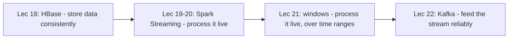
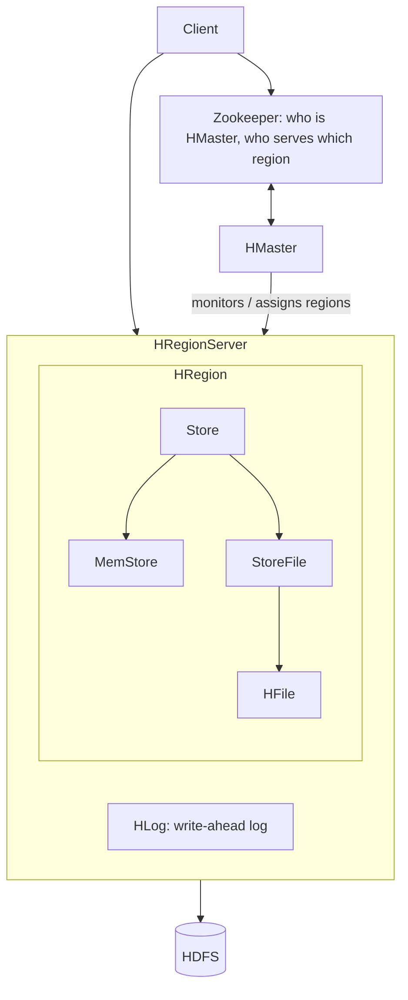
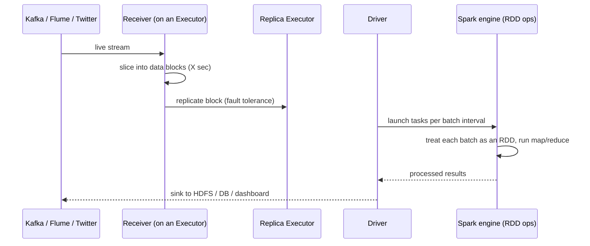
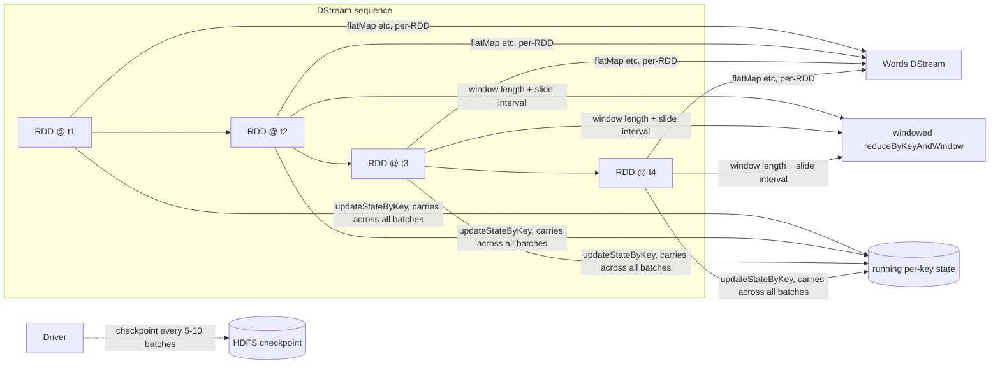
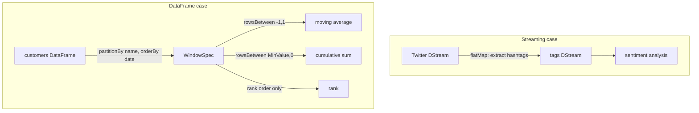
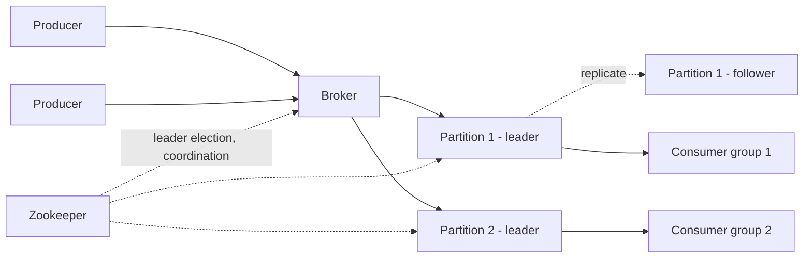
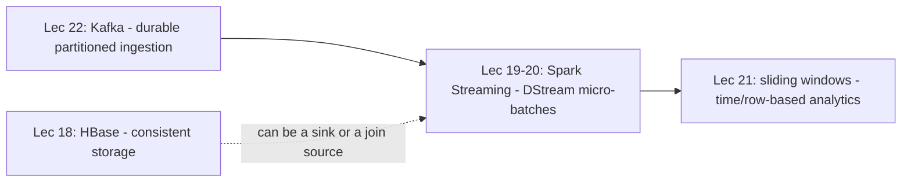

# Week 5 — Streaming / fast data

> Goal: finish this week without the video or the raw PDF. Exam first, then a first reading that actually makes sense.
> Time budget: about 75–100 minutes for a normal week (teaching paragraphs + mermaid, not a glossary dump). Split long lectures.

## One-page cheat sheet

**If you remember only 7 things this week**

1. HBase chooses **consistency** over availability (CP); Cassandra chose availability (AP) — same CAP fork, opposite pick.
2. HBase writes go **HLog → MemStore → StoreFile/HFile**; HLog first is what makes a crash recoverable by replay.
3. Spark Streaming turns a live stream into a **DStream**: a sequence of RDDs, one per micro-batch (as low as ~0.5s), so the same Spark engine handles batch and streaming.
4. A sliding window has **window length** (how far back) and **sliding interval** (how often); `reduceByKeyAndWindow` updates incrementally via an inverse function instead of resumming.
5. `updateStateByKey` keeps per-key state for the **whole stream**; a window only sees a bounded recent slice.
6. DataFrame window functions (`partitionBy` + `orderBy` + `rowsBetween`) do row-based windowing — `(-1,1)` = moving average, `(Long.MinValue, 0)` = cumulative sum.
7. Kafka topics split into **partitions** (ordered commit logs, offset-indexed); each partition has one **leader** and replica **followers**, with **Zookeeper** doing leader election — replication factor n tolerates n−1 failures.

**Near-twins (left is not right)**

| This | Is not | Because |
| --- | --- | --- |
| HBase (CP) | Cassandra (AP) | Same CAP triangle, opposite choice between consistency and availability |
| MemStore | StoreFile/HFile | MemStore = hot, unflushed, in-memory; StoreFile/HFile = cold, flushed, on HDFS |
| Window operation | `updateStateByKey` | Window forgets data outside its length; updateStateByKey carries state forever |
| Window length | Sliding interval | Length = how far back it looks; interval = how often it recomputes |
| DataFrame `rowsBetween(-1,1)` | `rowsBetween(Long.MinValue,0)` | First is a fixed local neighborhood (moving avg); second is unbounded look-back (cumulative sum) |
| Kafka topic | Kafka partition | Topic is the logical category; partition is one physical ordered shard of it |
| Publish-subscribe | Queuing | Pub-sub delivers to all subscribers; queuing delivers each message to exactly one consumer |
| Kafka replication (n → n−1 failures) | Zookeeper quorum (2f+1 majority) | Kafka tolerates losing all but one replica; Zookeeper needs a strict majority alive |

**Numbers / defaults this week**

- HBase default cell versions retained per family: **3**.
- HBase Bloom filter benefit: cuts seeks per block lookup from ~6 to ~2.
- Spark Streaming minimum practical batch size: **~0.5s**, giving ~1s end-to-end latency.
- Spark Streaming checkpoint interval: typically **every 5–10 batches**.
- Spark Streaming reported throughput: 60M records/sec (6 GB/sec) on 100 nodes at sub-second latency.
- Kafka: replication factor `n` tolerates `n − 1` broker failures.

**Diagrams** (reuse files from `images/`, do not copy new ones)

## This week's map

| Lec | Title | Why it is on the exam |
| --- | --- | --- |
| 18 | Design of HBase | Consistency-over-availability NoSQL, region-server internals, bloom filter seeks |
| 19 | Spark Streaming (Part I) | DStream/micro-batch model, receivers |
| 20 | Spark Streaming (Part II) | Transformations, checkpointing, fault tolerance |
| 21 | Sliding Window Analytics | Window/slide duration, windowed operators |
| 22 | Introduction to Kafka | Pub-sub log, topics/partitions, producers/consumers/brokers |

One mermaid for the week's story: this week moves from storing data (HBase) into processing data as it arrives (Spark Streaming, windows) fed by a durable queue (Kafka).

---

## Lecture 18: Design of HBase

### Hook (4–6 sentences)

Cassandra (week 4) chose availability over consistency — every replica can answer, but they might disagree for a while. Some workloads can't live with that: a bank balance, or a counter that must never be read stale. HBase is the NoSQL database built for exactly that trade-off. It's Google's Bigtable design, open-sourced first by Yahoo!, and it deliberately gives up some availability to guarantee a client always sees the latest write. It doesn't stand alone either — it's built to sit *on top of* HDFS and lean on Zookeeper for coordination, so this lecture is really "how do you build a strongly consistent database out of the pieces we already covered."

### Slide picture

### Core ideas

**What HBase is, and the one big fork with Cassandra.** HBase is an open-source, distributed, **column-oriented** store — meaning it groups and stores data by column family rather than by whole row, the way a spreadsheet-per-table (RDBMS) does. It scales out to thousands of commodity machines and petabytes of storage, and it's designed to run *on top of* HDFS so it inherits HDFS's fault tolerance instead of reinventing replication. The one line that decides which NoSQL store you pick for a job: **HBase prefers consistency over availability; Cassandra prefers availability over consistency.** Both are valid CAP trade-offs (partition tolerance is assumed as mandatory for any distributed system) — you pick HBase when a stale read is unacceptable (e.g., a ledger), and Cassandra when the system must always answer even during a network split. `EXAM` HBase = CP; Cassandra = AP.

**Who does what — the architecture.** A client never talks to one giant server; it talks to whichever **RegionServer** is currently serving the row range it wants. A **Region** is just a contiguous slice of the table's row-key range (e.g., rows A–M) — it's the *unit of distribution and availability* in HBase, the same way a Cassandra partition was the unit there. Regions are hosted on RegionServers, which live on the cluster's data nodes. One **HMaster** watches over all the RegionServer instances (assigning regions, handling failover) but is not on the read/write critical path — clients go straight to the RegionServer. **Zookeeper** sits above all of this as the coordination service: a small quorum of servers running a Paxos-like consensus protocol (called Zab here) that tracks which RegionServer is serving which region and who the live HMaster is. `PROF` if Zookeeper goes down, HBase stops functioning — it isn't an optional extra, it's load-bearing. `EXAM` Region = unit of availability/distribution; RegionServer = the data-node process that serves regions; HMaster = monitors RegionServers, doesn't serve data itself.

**The data model — rowkey, column family, cell.** Every record is found by its **rowkey**, which plays the role of a primary key — rows are stored in *sorted rowkey order*, unlike an RDBMS where order isn't guaranteed. Data in a row is grouped into **column families** (e.g. "Address", "Order" in the slide); each column family's columns are physically stored together in their own low-level file, an **HFile**. Inside a family, a specific column is named by a **column qualifier**, written as `family:qualifier` (e.g. `personaldata:name`) — the qualifier doesn't need to be declared in advance and can differ row to row, which is the "schema-flexible" part of NoSQL. A **cell** is the actual stored value: it's uniquely identified by (rowkey, column family, column qualifier, timestamp). Because a cell carries a **timestamp**, HBase can keep multiple *versions* of the same cell — by default the version number is just the write timestamp, the latest version is returned if none is specified, and HBase keeps **3 versions per family by default**. `EXAM` default cell versions retained = 3. `EXAM` rowkeys and qualifiers have no data type — always treated as raw byte arrays.

**Storage hierarchy: where a write actually lands.** Zoom into one RegionServer: it holds one or more **HRegions**; each HRegion has a **Store** per column family; each Store has a **MemStore** (in-memory buffer for recent writes — same idea as Cassandra's Memtable: absorb writes fast, flush to disk when full) plus one or more **StoreFiles**; a StoreFile's actual on-disk format is the **HFile**, and HFiles are stored in HDFS. So the full path for one column family's data is: HRegion → Store → MemStore (hot) / StoreFile → HFile (cold, on HDFS). `SLIDE` each HFile is HBase's version of an SSTable from Bigtable — same "immutable sorted file" idea seen with Cassandra's SSTables. Before a write ever touches the MemStore, it is first appended to the **HLog** (a write-ahead log) — this is the fault-tolerance trick: if a RegionServer crashes before the MemStore is flushed, HBase can *replay the HLog* on restart to reconstruct the lost in-memory state, using timestamps to know where the recovery should resume. `EXAM` write order is HLog first, then MemStore — never the reverse; that ordering is what makes the write durable even if the process dies immediately after.

**HFile's actual byte layout.** An HFile isn't just a value dump: it has a data section (a "Magic" marker plus a sequence of (key, value) pairs) and a trailing Meta section (metadata, file info, block indices, and a trailer). Each key inside a (key, value) pair is itself a compound: key length, value length, row length, row, column-family length, column family, column qualifier, timestamp, key type — this whole compound key is what the slide calls the **HBase Key**. Concretely, a slide example keys rows by SSN, puts demographic info in the column family, and ethnicity in the qualifier — i.e. the "key" carries a lot more structure than a plain string.

**Bloom filter — same idea as Cassandra, applied to blocks.** As in Cassandra, a Bloom filter is a cheap pre-check ("might exist" / "definitely doesn't exist") built when an HFile is written and stored at the *end* of that HFile, then loaded into memory. Without it, finding a row means walking the HFile's **block index** and sequentially scanning candidate blocks — the slide's worked example shows this costing up to **6 seeks per block**. With the Bloom filter telling you which blocks can be skipped, that drops to about **2 seeks per block**, because you only open the (at most two) blocks the filter says might contain the key. `EXAM` Bloom filter benefit stated on slide: cuts block-read seeks from 6 to 2 by ruling out blocks that provably don't hold the key.

**Cross-datacenter replication and auto-sharding.** For multi-datacenter durability, one cluster is designated **Master** and others are **Slave** — the Master synchronously ships its HLogs to the Slave clusters, and Zookeeper coordinates the replication state (which peer cluster, which log position) by using its own tree as a small filesystem for control info. Separately, **auto sharding** is how HBase spreads load automatically: a table's row-key range is chopped into contiguous chunks (regions) and each chunk is assigned to a RegionServer; as data grows, a region can auto-split (or be split manually) and the cluster rebalances regions across servers for load balancing and failover — so the table's *effective* capacity is "cluster nodes × regions per node," not a fixed ceiling.

**Fold, store, and shift (time-series wrinkle).** Because every cell version carries its own timestamp, storing time-series data for one rowkey naturally produces many near-duplicate rows/cells at different timestamps (T1, T2, T3…) rather than one row with a time column — the "logical" table (one row per entity) does *not* match the "physical" layout (one row per version, fully qualified by row key + column family + qualifier + timestamp). "Folding" a column into "row per column" makes a missing value cost nothing (nothing is stored for a null), at the price of the version simply becoming another physical row in the folded table.

### How it fits together

Caption: a client goes straight to the RegionServer holding its row range; Zookeeper + HMaster only decide *which* RegionServer that is, and every write is durable the moment it hits the HLog, before it even reaches the MemStore.

### Worked example

A client writes keys K1, K2, K3, K4. Suppose K1, K2 fall in the row range owned by Region A (on RegionServer 1) and K3, K4 fall in Region B (on RegionServer 2, possibly a different machine). For the K1 write: (1) client asks Zookeeper/HMaster which RegionServer serves K1's range, (2) client sends the write to that RegionServer, (3) the RegionServer appends the write to its HLog first, (4) then updates the in-memory MemStore for K1's Store, (5) eventually MemStore is flushed to a new StoreFile (HFile) on HDFS, with a Bloom filter written into that HFile's trailer. If the RegionServer crashes between steps 3 and 5, on restart it replays the HLog from the last known timestamp to rebuild the MemStore contents — no data is lost, because step 3 (not step 4) is what made the write durable.

### Near-twins / traps

- **HBase (CP) is not Cassandra (AP)** — same CAP triangle, opposite choice between the two non-negotiable-partition-tolerance corners: HBase always returns the latest write (blocking during a partition), Cassandra always answers (possibly stale).
- **MemStore is not StoreFile** — MemStore is the in-memory buffer for very recent, unflushed writes; StoreFile (HFile) is the immutable on-disk, already-flushed data. A read may need to check both.
- **HLog is not the Bloom filter** — HLog exists so writes survive a crash *before* they're flushed; Bloom filter exists so *reads* can skip blocks that don't have the key. Different failure/performance problems entirely.
- **Region is not RegionServer** — a Region is a logical row-key range (unit of distribution); a RegionServer is the physical process/data-node that happens to be hosting one or more regions right now, and can change after a rebalance.

### Tiny recap card

- HBase = Bigtable clone, column-oriented, on HDFS, chooses **C** over A in CAP.
- Write path: HLog (durability) → MemStore (speed) → StoreFile/HFile (cold storage) → HDFS.
- Bloom filter at the end of each HFile turns "scan every block" into "check ≤2 candidate blocks."

### Checkpoint

1. Which of the following is TRUE about HBase versus Cassandra?  
   a) Both prefer availability over consistency  
   b) HBase prefers consistency, Cassandra prefers availability  
   c) HBase prefers availability, Cassandra prefers consistency  
   d) Neither tolerates network partitions

2. In the HBase write path, what is written FIRST?  
   a) MemStore  
   b) StoreFile  
   c) HLog  
   d) HFile on HDFS

3. What is the default number of cell versions HBase retains per column family?  
   a) 1  
   b) 3  
   c) 5  
   d) unlimited

4. A column qualifier in HBase is best described as:  
   a) A fixed schema field declared at table-creation time  
   b) A name within a column family that need not be predeclared or consistent across rows  
   c) The same thing as the rowkey  
   d) A replication target

5. What is the "unit of scalability and availability" in HBase's architecture?  
   a) HMaster  
   b) Region  
   c) Zookeeper ensemble  
   d) HFile

6. Why does the Bloom filter reduce disk seeks in HBase reads?  
   a) It caches the actual row data in memory  
   b) It compresses the HFile  
   c) It lets a read skip blocks it can prove don't contain the key, so only candidate blocks are opened  
   d) It replaces the block index entirely

7. If Zookeeper becomes fully unavailable to an HBase cluster, what happens?  
   a) HBase keeps running using cached region assignments indefinitely  
   b) HBase stops functioning — the lecture states it directly  
   c) HMaster takes over Zookeeper's role automatically  
   d) Only writes are affected, reads continue normally

#### Answer key

1. **b** — the lecture states this contrast directly: HBase prefers consistency, Cassandra prefers availability.
2. **c** — writes go to the HLog before the MemStore, so a crash before the flush can still be recovered by replay.
3. **b** — the slide states the default number of cell versions retained is 3.
4. **b** — column qualifiers are not declared in advance and need not be consistent between rows, unlike a fixed RDBMS schema.
5. **b** — the region is explicitly called the basic element of availability and distribution for tables.
6. **c** — the worked example shows seeks per block dropping from 6 to 2 once blocks that can't contain the key are ruled out.
7. **b** — the transcript says plainly that if Zookeeper is not there, HBase will stop functioning.

#### Optional, after you check

- Explain in 30 seconds: what does "column-oriented" buy HBase that a plain key-value store doesn't?
- What breaks if the HLog write were skipped and only the MemStore were updated?

---

## Lecture 19: Spark Streaming and Sliding Window Analytics (Part-I)

### Hook (4–6 sentences)

Fraud detection on a bank transaction, anomaly detection on IoT sensor readings, live sentiment analysis on tweets — none of these can wait for a nightly batch job; the answer has to come back in seconds, on data that never stops arriving. Before Spark Streaming, you'd run one system for batch (Spark, MapReduce) and a *completely separate* system for streaming (Storm), each with its own programming model, its own operational cost, and no shared code between them — so an application needing both batch history and live data had to glue two stacks together. Spark Streaming's pitch is: reuse the exact same Spark engine, same RDD API, for both, so live data and historical batch data can be analyzed with one toolchain instead of two.

### Slide picture

### Core ideas

**Why streaming needs its own thinking, not just "batch but faster."** A stream is "Big Data" precisely because of **velocity** — a fast, unbounded, continuous flow rather than a fixed-size file — and that changes the requirements: you still need to scale to hundreds/thousands of nodes, but now also hit **low (second-scale) latency**, survive node failures *without losing progress*, and ideally still be able to mix in batch data (e.g., join a live stream against a historical table) without maintaining two separate systems. `EXAM` the driving characteristic that makes streaming "big data" is velocity, not volume.

**The fragility of the old (pre-Spark-Streaming) model.** Classic streaming systems (like Storm) process one record at a time through a pipeline of nodes, and each node keeps some **mutable state** (a running count, a running average) that gets updated as records flow through. The problem: node failure is the *norm*, not the exception, on commodity hardware — and when a node holding that mutable state dies, the state is gone. Storm's answer was to *replay* unprocessed records, which only guarantees **at-least-once** semantics — a record might get counted twice if a replay overlaps with a partially-applied update. Some systems (Trident) fixed this with transactional state updates to get **exactly-once**, but paying the cost of a slow transaction to an external database on every update. `EXAM` Storm-style streaming = at-least-once by default; exactly-once was the harder, more expensive goal Spark Streaming was designed to hit differently.

**Spark Streaming's actual trick: turn the stream into a lot of tiny batches.** Instead of processing one record at a time, Spark Streaming chops the live, continuous stream into fixed-size time slices — **micro-batches** — say every X seconds. Each micro-batch of data is treated as an ordinary Spark **RDD**, and the *exact same* RDD operations (map, flatMap, reduceByKey…) you'd write for a batch job run on each micro-batch as it arrives. This is the core unification: because "one chunk of the stream" and "an RDD from a batch job" are the same data structure to Spark, one engine, one API, handles both batch and streaming — there's no second stack. `EXAM` Spark Streaming's execution model = "run the stream as a series of small, deterministic batch jobs," not per-record processing. `PROF` this determinism (same batch, same input records, always produces the same RDD) is also what makes exactly-once easier to reason about than Storm's per-record replay model.

**What "second-scale latency" really means, concretely.** The batch interval **X** has a practical floor — the slide states it can't go below about **half a second**, because that's a system-imposed limit. With a half-second batch size, the observed end-to-end latency comes out to roughly one second. So "near real-time" here means tolerable latency down to ~0.5–1s, not true record-at-a-time (sub-millisecond) latency — that's the tier Storm-class systems still own. `EXAM` minimum practical batch size ≈ 0.5s; resulting end-to-end latency ≈ 1s.

**Where the data comes from and goes.** Spark Streaming ships with built-in **receivers** that plug into common live sources — Kafka, Flume, Twitter, ZeroMQ, Kinesis, and plain TCP sockets — so you don't write your own ingestion layer. Output after processing typically lands in HDFS, a database, or straight onto a live dashboard. (A later, separate, higher-level API called **Structured Streaming** was built in Spark 2.x on top of DataFrames/Datasets, but that's a distinct interface layered above this original RDD-based Spark Streaming.)

**Sitting inside the Spark ecosystem.** Spark Streaming isn't a standalone product — it runs *on top of* the same Spark core engine that MLlib (machine learning), GraphX (graph processing), and Spark SQL sit on. Because they all share one core, a streaming application can call MLlib functions on live data or use Spark SQL to query it, without switching stacks or exporting data to a different system. That shared-stack advantage is the same argument used for batch/stream unification, just extended to Spark's other libraries.

**Driver, executors, and the receiver — who actually does what.** Every Spark application has one **driver program** (holds your code, e.g. the word-count logic) that assigns work to **executors** running across the cluster (launched via YARN, Mesos, or Spark standalone). For a streaming job specifically, the driver runs the **receiver as a long-running task** on one executor; that receiver ingests the live stream (e.g., from Kafka) and slices it into **data blocks**, holding them in memory. For fault tolerance, each data block is **replicated to another executor** before processing — so if the executor holding the original block dies, the replica survives. At each batch interval, the driver launches tasks (e.g., flatMap, then the map+reduceByKey for word count) against the data blocks accumulated in that interval, and the result is written back to a data store. `EXAM` block replication across executors happens *before* processing — it is the streaming-specific fault-tolerance mechanism, distinct from HBase's HLog-then-replay approach in Lecture 18.

**The word-count-over-Kafka example, read as a recipe.** Create a `StreamingContext` with a batch size (e.g. 1 second), attach it to Kafka to get a DStream of lines, `flatMap` each line into words, `map` each word to `(word, 1)`, `reduceByKey` to sum counts per word, print, then call `context.start()` followed by `context.awaitTermination()`. The point the lecture stresses: this reads almost identically to a plain batch word-count program — the streaming machinery (batching, receivers, replication) is fully hidden from the application code.

### How it fits together

Caption: the receiver is the only piece touching the raw stream — everything downstream of "batch of X seconds" is an ordinary RDD job, which is exactly why batch and streaming share one engine.

### Worked example

Word count over a Kafka stream, X = 1 second: at t=0–1s, the receiver buffers whatever lines arrived into data block B1 (and replicates B1 to a second executor). At t=1s, the driver treats B1 as an RDD and launches `flatMap(line → words)`, then `map(word → (word,1))`, then `reduceByKey(sum)` — same code as a static-file word count. The result RDD for that one-second window is emitted (printed / stored) before the next batch (B2, covering t=1–2s) is even closed. No batch "waits" for another — each is an independent, deterministic job, which is why a crash losing block B1 just means replaying it from its replica, not re-deriving global state.

### Near-twins / traps

- **Micro-batch is not per-record streaming** — Spark Streaming's RDD-per-interval model is why it calls itself "near real-time" (≥0.5s latency) rather than true record-at-a-time processing, which systems like Storm are built for.
- **At-least-once (Storm-style replay) is not exactly-once** — replaying an unprocessed record can double-count if the first attempt partially updated mutable state; Spark Streaming's deterministic micro-batches avoid this without paying Trident's per-update transaction cost.
- **Block replication (Spark Streaming) is not the same fault-tolerance trick as HBase's HLog** — Spark Streaming protects against loss by copying the *not-yet-processed* data block to another executor ahead of time; HBase instead logs the *write itself* before applying it, then replays the log on recovery. Different layer, different failure being protected against.
- **Structured Streaming is not "Spark Streaming" itself** — it's a newer, separate, higher-level DataFrame-based API built on top of the same Spark core; this lecture is about the original DStream/RDD-based Spark Streaming.

### Tiny recap card

- Stream → chopped into X-second micro-batches → each batch is an RDD → normal RDD ops run on it → results out.
- Minimum batch size ≈ 0.5s → end-to-end latency ≈ 1s ("near real-time," not sub-millisecond).
- Fault tolerance = receiver replicates each data block to another executor before the driver schedules processing on it.

### Checkpoint

1. What property of streaming data specifically classifies it as a "Big Data" problem?  
   a) Volume  
   b) Velocity  
   c) Variety  
   d) Veracity

2. In Spark Streaming's execution model, each micro-batch of incoming data is treated as a:  
   a) Separate Storm topology  
   b) Spark RDD  
   c) Zookeeper znode  
   d) Kafka partition

3. What is the practical minimum batch interval stated in the lecture, and its resulting end-to-end latency?  
   a) 5 seconds batch, 10 seconds latency  
   b) 0.5 seconds batch, ~1 second latency  
   c) 1 millisecond batch, 1 millisecond latency  
   d) 1 minute batch, 1 minute latency

4. Why does classic Storm-style streaming only offer at-least-once semantics by default?  
   a) It doesn't use receivers  
   b) Replaying an unprocessed record after a node failure can double-apply a state update  
   c) It doesn't support mutable state at all  
   d) It only works with batch data

5. In the Spark Streaming receiver architecture, what happens to a data block right after it's created?  
   a) It's immediately discarded after processing  
   b) It's replicated to another executor for fault tolerance  
   c) It's sent directly to HDFS before any processing  
   d) It's converted into a Zookeeper znode

6. What is the main architectural reason Spark Streaming can unify batch and streaming processing in one engine?  
   a) It uses a completely separate runtime for each  
   b) Both a stream micro-batch and a batch job are represented as the same RDD abstraction  
   c) Streaming data is first converted to HDFS files before processing  
   d) Batch jobs are run on Storm underneath

#### Answer key

1. **b** — the lecture explicitly frames continuous, fast-arriving data as a "Velocity" big-data problem.
2. **b** — Spark treats each chopped-up batch of stream data as an RDD and runs ordinary RDD operations on it.
3. **b** — the slide states batch size can't go below about half a second, giving roughly one second end-to-end latency.
4. **b** — replay-on-failure can reapply a record whose state update had already partially gone through, producing double counts.
5. **b** — the receiver divides the stream into data blocks and those blocks are replicated to another executor before processing.
6. **b** — because both batch data and a streaming micro-batch become ordinary RDDs, the same Spark engine and API process either.

#### Optional, after you check

- Explain in 30 seconds why "at-least-once" and "exactly-once" are different guarantees, using the mutable-state example.
- What breaks if the receiver skipped replicating a data block before the driver scheduled it for processing?

---

## Lecture 20: Spark Streaming and Sliding Window Analytics (Part-II)

### Hook (4–6 sentences)

Part I established the core trick: a stream is just a fast sequence of micro-batch RDDs. But a real application needs a name for "the whole sequence," a way to ask "what happened in the last 10 minutes" (not just the last batch), and a way to remember state across batches (like a running mood score per user) — none of which "just an RDD" gives you by itself. Part II names that sequence (**DStream**), adds a family of window operations for time-range questions, adds stateful updates for running totals, and finally answers the question every fault-tolerance discussion eventually asks: what happens when the driver itself dies mid-stream?

### Slide picture

### Core ideas

**Naming the sequence: DStream.** A **DStream** (Discretized Stream) is simply the sequence of RDDs produced one per batch interval — "RDD at time 1," "RDD at time 2," and so on, stacking up as the stream runs. Transformations on a DStream (map, flatMap, filter, reduceByKey, join…) are just the normal RDD transformation applied independently to each RDD in that sequence — e.g. `flatMap` on a tweet DStream turning "raw tweet" batches into "extracted hashtag" batches, one output RDD per input RDD. `EXAM` DStream = sequence of RDDs, one per batch interval; a transformation on a DStream is that same transformation replayed on every RDD in the sequence.

**Two kinds of upstream sources feed one Spark Streaming job.** The workflow slide splits inputs into **streaming sources** (Kafka, Flume, Akka, AWS/Kinesis, Parquet — genuinely live feeds) and **static/batch sources** (HBase, MySQL, PostgreSQL, MongoDB, Cassandra — data already at rest that you might join against). Both can feed the same Spark Streaming job, which is exactly the "combine batch and stream" promise from Part I — e.g., joining a live tweet DStream against a static spam list stored in HDFS to filter out bad tweets, mixing an RDD (the static file) with a DStream (the live tweets) in one program.

**Window operations — asking about a time range instead of one batch.** A plain DStream transformation only ever sees the current batch. A **window operation** lets you ask about the last *N* time units, refreshed periodically — e.g., "count hashtags over the last 1 minute, refreshed every 5 seconds." That call takes two arguments: **window length** (how much history the window spans — 1 minute here) and **sliding interval** (how often the window's answer is recomputed — every 5 seconds here); both must be declared in multiples of the underlying batch interval. `EXAM` `window(length, slideInterval)` — window length = how far back it looks, sliding interval = how often it recomputes. As the window slides forward, old batches fall out of the window and new batches enter it, so the correct new count is `previous_count - (value from batches that just left) + (value from batches that just entered)` — this incremental update is exactly what `reduceByKeyAndWindow` computes, since counting is a reduce operation that has a matching inverse (subtract) to remove the expired batches cheaply instead of re-summing the whole window from scratch. `PROF` this "smart window reduction" only works for reduce functions that have an invertible counterpart (like sum/count with subtract) — it's an optimization, not something every window operation gets automatically.

**Stateful computation — remembering something across batches, not just within a window.** `updateStateByKey` maintains **arbitrary state per key across the entire life of the stream**, not just within a sliding window — e.g., tracking each user's current "mood" and updating it only when a new tweet from that user arrives. You supply an **update function** that takes the previous state plus new data for that key and returns the new state; Spark Streaming calls it once per key per batch that has new data for that key. `EXAM` window operations answer "what happened in the last N minutes"; `updateStateByKey` answers "what is the current running state for this key," carried indefinitely.

**Fault tolerance — now with a driver in the picture.** Part I covered replicating data blocks across executors (default replication factor: 2) so a lost *executor's* data can be recomputed. But there's exactly **one driver**, and if the driver's node dies, the whole streaming application dies with it unless something can restart it — that's handled by running the driver under YARN or with Zookeeper-based supervision, so it gets relaunched on another node. A relaunched driver needs to know where it left off, which is what **checkpointing** is for: the streaming context periodically (typically **every 5–10 batches**) saves its state to HDFS (or an equivalent durable store); on recovery, only those last 5–10 batches need to be replayed to reconstruct the missing RDDs, instead of the entire stream history. `EXAM` checkpoint interval ≈ every 5–10 batches; recovery = restart driver (via YARN/Zookeeper) + replay the batches since the last checkpoint. Combined with input replication, this is how Spark Streaming claims **exactly-once** semantics for transformations, versus Storm's at-least-once from Lecture 19.

**Performance numbers the slide actually gives.** The system is reported to process **60 million records/sec (6 GB/sec) on 100 nodes at sub-second latency**, and recovers from faults/stragglers **within about one second** — these are the concrete "why bother" numbers the lecture uses to justify the micro-batch design over a naive per-record pipeline.

**Unified code, one more time.** The closing point echoes Part I deliberately: the *same* Spark code — same filters, same context setup, same driver/executor allocation — processes a static Hadoop file in batch mode or a live DStream in streaming mode. The only real difference is which context you construct (`SparkContext` vs `StreamingContext`) and where the input comes from.

### How it fits together

Caption: a window operation looks back over a few recent RDDs in the DStream; `updateStateByKey` instead carries one running value per key forward through *every* RDD; checkpointing is what lets the driver rebuild any of this after a crash.

### Worked example

Continue the hashtag example: `tags.window(Minutes(1), Seconds(5)).countByValue()`. At t=60s the window covers batches from t=0–60s and produces counts. At t=65s (slide interval elapsed) the window shifts to cover t=5–65s: the batch from t=0–5s "expires" and the batch from t=60–65s "enters." Rather than re-summing all 60 seconds of data, `reduceByKeyAndWindow` takes the previous window's per-hashtag counts, subtracts the counts contributed by the expiring t=0–5s batch, and adds the counts from the new t=60–65s batch — an O(one batch) update instead of an O(whole window) recompute.

### Near-twins / traps

- **Window operation is not `updateStateByKey`** — a window answers "what happened in the last N minutes" and forgets anything older; `updateStateByKey` keeps one running value per key for the entire life of the stream, no expiry.
- **Window length is not sliding interval** — length is how far back the window looks; interval is how often it's recomputed. A 1-minute window with a 5-second interval means overlapping windows, each one minute wide, recomputed 12 times a minute.
- **Executor-block replication is not driver fault tolerance** — replicating data blocks (Lecture 19) protects against losing a *worker's* unprocessed data; checkpointing + driver-restart-via-YARN/Zookeeper protects against losing the *driver* itself. Both are needed; neither substitutes for the other.
- **`reduceByKeyAndWindow`'s incremental trick is not automatic for every operation** — it only works when the reduce function has an inverse (like subtract for sum/count); not every windowed aggregate can be updated this cheaply.

### Tiny recap card

- DStream = sequence of per-batch-interval RDDs; every DStream transform is that RDD transform applied per interval.
- `window(length, slideInterval)` = look back `length`, recompute every `slideInterval`; `reduceByKeyAndWindow` updates incrementally via subtract-then-add.
- Fault tolerance = block replication (workers) + checkpointing every 5–10 batches to HDFS + driver restart via YARN/Zookeeper (driver) → exactly-once.

### Checkpoint

1. A DStream is best described as:  
   a) A single very large RDD  
   b) A sequence of RDDs, one per batch interval  
   c) A Zookeeper znode holding streaming state  
   d) A Kafka topic partition

2. In `window(Minutes(1), Seconds(5))`, what does the `Seconds(5)` control?  
   a) How far back the window looks  
   b) How often the windowed result is recomputed  
   c) The batch interval of the underlying DStream  
   d) The checkpoint interval

3. Why can `reduceByKeyAndWindow` update a sliding count incrementally instead of resumming the whole window?  
   a) Because Spark caches every value forever  
   b) Because the reduce function (sum/count) has an inverse (subtract) to remove expired data  
   c) Because window operations don't actually recompute  
   d) Because DStreams are immutable

4. What is the key difference between a window operation and `updateStateByKey`?  
   a) They are identical  
   b) A window forgets data outside its length; `updateStateByKey` carries state across the entire stream  
   c) `updateStateByKey` only works with Kafka  
   d) Windows require checkpointing but `updateStateByKey` does not

5. What does Spark Streaming checkpointing typically save, and how often?  
   a) The entire dataset, every batch  
   b) Streaming context state, roughly every 5–10 batches  
   c) Only the DStream lineage graph, once at startup  
   d) Nothing — checkpointing is only for batch Spark

6. If the Spark Streaming driver node fails, what is required to recover?  
   a) Nothing; executors continue independently forever  
   b) The driver must be restarted (e.g. via YARN/Zookeeper) and replay batches since the last checkpoint  
   c) The entire stream must be reprocessed from the very first batch  
   d) All executors must also be restarted from scratch

#### Answer key

1. **b** — a DStream is explicitly the sequence of RDDs at time 1, time 2, etc.
2. **b** — the second window argument is the sliding interval, how often the window recomputes its answer.
3. **b** — the lecture calls this "smart window reduction," generalizing to reduce operations with an inverse function like subtract-for-counting.
4. **b** — window operations only see a bounded recent range; `updateStateByKey` maintains arbitrary per-key state for the life of the stream.
5. **b** — checkpointing saves state to HDFS roughly every 5 to 10 batches, per the lecture.
6. **b** — the driver must be restarted on another node (via YARN or Zookeeper) and then replay only the batches since the last checkpoint.

#### Optional, after you check

- Explain in 30 seconds why checkpointing every batch would be wasteful, and why checkpointing only once at the very start would be dangerous.
- What breaks if you called `window()` with a sliding interval smaller than the batch interval?

---

## Lecture 21: Sliding Window Analytics

### Hook (4–6 sentences)

Lecture 20 introduced `window()` and `reduceByKeyAndWindow` as one Spark Streaming operator among several. This lecture zooms all the way in on that one idea — sliding windows — because it turns out to be the operator that unlocks an entire category of applications: moving averages, cumulative totals, per-customer visit ranks, and ultimately a full Twitter sentiment-analysis pipeline. The reframing here is important: windowing isn't only a DStream trick for live data — Spark 1.4 brought the *same* windowing idea into DataFrames/Spark SQL, so you can compute a moving average over a static table with the same mental model used for a live stream.

### Slide picture

### Core ideas

**Revisiting window length and sliding interval with a concrete tick-by-tick picture.** The original DStream is chopped into batches at time 1, 2, 3, 4, 5. With **window length = 3** batches and **sliding interval = 2** batches, the windowed DStream produces a result at time 1 (covering batches 1–3), then at time 3 (covering batches 3–5, sliding forward by 2), and so on — note batch 3 is shared by both windows, so consecutive windows *overlap* whenever the sliding interval is smaller than the window length. `EXAM` both window length and sliding interval must be declared as multiples of the batch interval — you can't ask for a window that doesn't align to batch boundaries.

**The same "window" idea, transplanted into DataFrames/Spark SQL.** Spark 1.4 added **window functions** for DataFrames and SQL, and they solve a different-looking but structurally identical problem: instead of "recompute over the last N time units of a live stream," a DataFrame window function computes "one result per row, based on a window of *rows around that row*" — e.g. a moving average, a cumulative sum, or "what was the previous row's value." This is explicitly contrasted with the two tools you already know: an **aggregate** (like `sum`/`avg` in a `GROUP BY`) collapses a whole group into *one* output row, and a **UDF** computes one output value per row using *only that row's* data; a **window function** instead computes one output *per row*, but that output can look at a whole neighborhood of rows around it — the moving average is the running example of exactly this. `EXAM` aggregate = one result per group; UDF = one result per row using that row alone; window function = one result per row using a window of rows around it.

**Specifying a window: three moving parts.** A DataFrame `WindowSpec` needs: (1) **partition by** — how rows are grouped (e.g., by customer name), chosen so that "reasonable" grouping keeps related rows on the same machine — ideally the DataFrame is already partitioned this way, since partition-by and order-by together let Spark optimize away unnecessary data movement across the cluster; (2) **order by** — how rows are ordered *within* a partition (e.g., by date); (3) **frame** — the boundary of the window *relative to the current row* (e.g., "one row before to one row after," written as `rowsBetween(-1, 1)`). `EXAM` the three WindowSpec components are partition by, order by, frame — and frame is expressed relative to the current row, not as absolute row numbers.

**Worked pattern 1 — moving average (`rowsBetween(-1, 1)`).** Partition by customer name, order by date, and for each row average the current row plus its immediate neighbor before and after (three rows total when both neighbors exist, fewer at the boundaries of a customer's own data — a customer's first or last row only has one neighbor, and rows never borrow a neighbor from a *different* customer because of the partition-by). This is the running example the lecture builds row-by-row.

**Worked pattern 2 — cumulative sum (`rowsBetween(Long.MinValue, 0)`).** Same partition-by/order-by, but the frame now runs from the very first row in the partition (`Long.MinValue`, i.e. "no lower bound") up to the current row (`0`) — so each row's `cumSum` is the running total of everything at or before it, restarting at 1 for each new customer because of the partition. `EXAM` `rowsBetween(Long.MinValue, 0)` = cumulative-sum-style frame: unbounded look-back, stops at current row, no look-ahead.

**Worked pattern 3 — rank.** Same partition/order setup, but instead of aggregating values, `rank()` just numbers each row 1, 2, 3… within its partition, in order-by order — answering "is this the customer's 1st, 2nd, 3rd visit?" `PROF` this exact pattern (first-visit vs. repeat-visit ranking) is called out as directly useful for e-commerce promotions — first-time-customer discounts, loyalty tiers for repeat customers — tying the abstract window mechanic to a concrete business use.

**Case study: Twitter sentiment analysis, tying the whole week together.** The pipeline: authenticate to Twitter, open a `StreamingContext` with a small batch window (5 seconds), create a Twitter DStream, `flatMap` it to pull out hashtag entries as a `tags` DStream — the exact same flatMap-on-a-DStream pattern from Lecture 20's hashtag example. The extracted stream is then run through sentiment analysis (the lecture demos this on tweets about a named politician) to gauge public mood on a topic in near real time. The stated business motivations are broader than one demo: trending-topic detection for marketing campaigns, crisis management, service adjustment, and target advertising — sentiment analysis is framed as a capability multiple industries build on top of exactly this Spark Streaming plumbing, not a one-off toy example.

### How it fits together

Caption: the same "define a window, then compute per-row over it" mental model shows up twice this lecture — once against a live DStream (time-based window), once against a static DataFrame (row-based window).

### Worked example

From the cumulative-sum slide's actual data: Alice spends 50 (5/1), 45 (5/3), 55 (5/4); Bob spends 25 (5/1), 29 (5/4), 27 (5/6). With `partitionBy("name").orderBy("date").rowsBetween(Long.MinValue, 0)`, Alice's `cumSum` column reads 50, then 95 (50+45), then 150 (50+45+55); Bob's reads 25, then 54 (25+29), then 81 (25+29+27) — each customer's running total resets because `partitionBy("name")` stops Bob's rows from ever accumulating into Alice's total, even though both customers' rows sit in the same DataFrame.

### Near-twins / traps

- **DStream window (Lecture 20) is not the same mechanism as a DataFrame WindowSpec** — one slides over *time* on a live stream, the other slides over *row position* on a (usually static) table; the "window" name is shared because the underlying idea (local neighborhood of data, not the whole set) is the same, but the parameters (window length/sliding interval vs. partitionBy/orderBy/rowsBetween) are different APIs.
- **Aggregate is not a window function** — an aggregate collapses a group to one row; a window function keeps one row per input row and just enriches it using a neighborhood — don't confuse `GROUP BY avg()` with `avg().over(windowSpec)`.
- **Moving average's `rowsBetween(-1,1)` is not cumulative sum's `rowsBetween(Long.MinValue, 0)`** — the first is a fixed-size local neighborhood (look-behind and look-ahead both bounded); the second is an ever-growing look-back with zero look-ahead. Swapping them is the exam's favorite "which frame produces which output" trap.
- **`partitionBy` is not `orderBy`** — partitionBy decides which rows can ever appear in the same window (Bob's rows never enter Alice's window); orderBy only decides the sequence within that already-fixed group.

### Tiny recap card

- Window function = one output row per input row, computed over a neighborhood of rows (unlike aggregate: one row per group; unlike UDF: only its own row).
- WindowSpec = partitionBy (grouping) + orderBy (sequence within group) + frame (`rowsBetween`, relative to current row).
- Moving average → `rowsBetween(-1,1)`; cumulative sum → `rowsBetween(Long.MinValue, 0)`; rank → ordinal position, no aggregation at all.

### Checkpoint

1. With window length = 3 batches and sliding interval = 2 batches over a 5-batch DStream, at which batch numbers does a new windowed result appear?  
   a) 1, 2, 3, 4, 5  
   b) 1, 3, 5  
   c) 3 only  
   d) 2, 4

2. What distinguishes a window function from a plain aggregate like `GROUP BY avg()`?  
   a) Window functions can only run on streams, never static data  
   b) A window function produces one result per row using a neighborhood of rows; an aggregate collapses a group into one row  
   c) Aggregates are faster in all cases  
   d) There is no difference

3. Which `rowsBetween` specification implements a cumulative sum?  
   a) `rowsBetween(-1, 1)`  
   b) `rowsBetween(0, 1)`  
   c) `rowsBetween(Long.MinValue, 0)`  
   d) `rowsBetween(Long.MinValue, Long.MaxValue)`

4. In a WindowSpec with `partitionBy("name")`, why does Bob's cumulative sum never include Alice's amounts?  
   a) Spark processes customers alphabetically  
   b) `orderBy` prevents it  
   c) `partitionBy` groups rows so a window only ever sees rows from the same partition  
   d) It's a coincidence of the row order in the source data

5. In the Twitter sentiment analysis pipeline described, what DStream transformation extracts hashtags from raw tweets?  
   a) `reduceByKeyAndWindow`  
   b) `flatMap`  
   c) `updateStateByKey`  
   d) `checkpoint`

#### Answer key

1. **b** — the diagram shows windowed results produced at time 1 (batches 1–3) and time 3 (batches 3–5), sliding forward by 2 each time.
2. **b** — the lecture contrasts aggregates (one result per group) and UDFs (one result per row, own data only) against window functions (one result per row, using a window of surrounding rows).
3. **c** — the cumulative sum example explicitly uses `rowsBetween(Long.MinValue, 0)`, unbounded look-back to the current row.
4. **c** — partitionBy groups data (here by customer name) so the window frame never crosses into another customer's rows.
5. **b** — the pipeline applies `flatMap` on the Twitter DStream to extract hashtag entries into the `tags` DStream, the same pattern as Lecture 20's hashtag example.

#### Optional, after you check

- Explain in 30 seconds why `partitionBy` and `orderBy` together let Spark optimize data movement across the cluster.
- What breaks if you used `rowsBetween(-1, 1)` (moving-average frame) where a cumulative sum was intended?

---

## Lecture 22: Introduction to Kafka

### Hook (4–6 sentences)

Every lecture this week assumed a live stream just *arrives* at Spark Streaming's doorstep — Lecture 19's word-count example literally started with "attach to Kafka to get a DStream of lines." This lecture finally opens that box. Kafka is the piece that sits between whatever is generating events (a website's clicks, a bank's transactions, a fleet of IoT sensors) and whatever wants to consume them (Spark Streaming, Hadoop, a dashboard) — durably, in order, at massive scale, and without the producer and consumer needing to run at the same speed or even be online at the same time. Think of it as a distributed, fault-tolerant version of a UNIX pipe: instead of one program's stdout feeding directly into the next program's stdin, Kafka is a durable buffer in between that can hold millions of messages per second and let many different consumers read them independently.

### Slide picture

### Core ideas

**Kafka's job: bridge batch and streaming data at the point of ingestion.** The lecture opens with a "stored water vs. flowing water" picture: consuming already-stored data (a database, a warehouse) is **batch processing**; consuming data as it's produced (a Twitter feed, a socket connection) is **streaming**. A single machine can't compute over fast, unbounded streaming data alone, so you need infrastructure built for it — and Kafka is explicitly positioned as the **data ingestion** layer that can absorb *both* batch and streaming input sources and hand them off for computation downstream (e.g., into Spark Streaming). `EXAM` Kafka's stated primary use in this course = data ingestion for big data computing, feeding both batch and streaming pipelines.

**The UNIX-pipeline analogy, mapped onto Kafka's three components.** Just like UNIX commands compose into a pipeline connected by pipes, Kafka has three pieces that compose the same way: **Kafka Core** is the durable, distributed equivalent of a UNIX pipe — it connects and stores your data application's event streams; **Kafka Streams** plays the role of the commands in the pipeline — it's the library used to transform data that's sitting in Kafka; **Kafka Connect** is the I/O redirection (`<`, `>`) — it moves data *into* and *out of* Kafka from/to external systems. `EXAM` Kafka Core = durable pipe (storage/transport); Kafka Streams = transformation library; Kafka Connect = import/export connector layer.

**What Kafka actually is, and why it scales.** Kafka is a **distributed, partitioned** messaging system — "partitioned" is the key scaling knob, covered in detail below — that's highly fault-tolerant and can process **millions of messages per second** to many receivers. It was originally built at LinkedIn, donated to the Apache Software Foundation (became a top-level Apache project in October 2012), and by the time of this lecture had shipped stable 0.8.2.x releases. Real-world use cases the slide lists: a general **messaging server** (pub-sub at scale), **real-time stream processing** (feeding systems like Storm), **log aggregation** (collecting log files from many machines into one place, e.g. HDFS), acting as an external **commit log** for other distributed systems, and **event sourcing** (keeping a time-ordered sequence of everything that happened). `PROF` the framing "most of what a business does can be thought of as event streams" — retail orders/shipments/returns, financial stock ticks/orders, website page-views/clicks/searches, IoT sensor readings — is why Kafka shows up across so many unrelated industries (the slide names Netflix, eBay, Adobe, Cisco, and 1000+ other companies).

**Data model: messages and topics.** A **message** is one unit of information — a log line, a stock-market row, an error message. Related messages are grouped into a **topic** (e.g., all log messages in one topic, all stock messages in another). The process that publishes messages into a topic is a **producer**; the process that reads messages out of a topic is a **consumer**; the Kafka server processes that actually handle/store the messages are **brokers**, and a **Kafka cluster** is just the set of brokers working together. `EXAM` producer → publishes to a topic; consumer → reads from a topic; broker → the Kafka server process doing the work; cluster → the set of brokers.

**Topics are really partitions, and partitions are commit logs.** A topic isn't one physical structure — it's divided into one or more **partitions**, and each partition is literally a **commit log**: an ordered, append-only sequence of messages, where every message is identified by its position — its **offset** — within that partition. Producers *write* (append) at one end of the partition; consumers *read* from wherever they've gotten to, moving toward the other end. `EXAM` offset = a message's position within its partition; it's how a consumer tracks "how far I've read." `SLIDE` the topic "simple" example shows two partitions (Partition 0, Partition 1), each independently ordered — order is only guaranteed *within* a partition, not across partitions of the same topic.

**Partitions are the unit of parallelism, and they can be spread and replicated.** Because a topic can have many partitions, and each partition can live on (and be processed by) a different server, **partitions are what let a topic's workload be distributed and parallelized** across a cluster — the number of partitions effectively caps how much parallel throughput that topic can get. For fault tolerance, each partition can be **replicated** across several servers: one replica is elected the **leader** (handles all reads and writes for that partition) and the rest are **followers** (just replicate the leader's data). If the leader dies, one follower is automatically promoted — and **Zookeeper** is the one doing that leader election, exactly the coordination role it played for HBase in Lecture 18. `EXAM` leader = handles reads/writes; follower = replicates only; Zookeeper = performs leader election on failure. This is structurally the same leader/follower + Zookeeper-mediated failover pattern seen in HBase's cross-datacenter replication — same coordination tool, same idea, different system.

**Producers, consumers, and consumer groups.** A **producer** creates a message and decides which topic (and which partition within that topic) to place it in — the topic must already exist before a producer can write to it. A **consumer** reads messages, and consumers are organized into **consumer groups** — a consumer specifies which topic(s) it wants, and (depending on the messaging pattern, see below) messages are delivered to consumers within a group. Consumer groups are the control knob for *how* a topic's messages get distributed among a fleet of readers.

**Two messaging patterns, both supported by the same Kafka architecture.** In **publish-subscribe**, every message is delivered to *all* subscribers, and all subscribers see messages in the same produced order — nobody "uses up" a message that others still need. In **queuing**, each message is consumed by exactly *one* consumer (whichever one happens to be free), and messages are consumed in the order they're received — this is how you load-balance work across a pool of identical workers instead of broadcasting to everyone. `EXAM` pub-sub = all subscribers get every message; queue = each message goes to exactly one consumer, chosen from whoever's available. Kafka doesn't have to pick one model — a topic's semantics depend on how consumer groups are set up around it (one group per "subscriber," or many consumers sharing one group to load-balance).

**Broker responsibilities and Kafka's durability guarantees.** A broker takes messages from producers and appends them to the right partition of a topic, and later serves those messages to consumers reading from that partition; each machine in the cluster typically runs one broker, and brokers coordinate with each other via Zookeeper. Kafka states three concrete guarantees: (1) messages sent by a producer to a topic-partition are appended in the order sent; (2) a consumer instance sees messages in the same order they were produced; (3) with a replication factor of `n`, the system tolerates up to `n − 1` failures without losing the partition. `EXAM` replication factor `n` → tolerates `n − 1` failures — same "how many can die before you're in trouble" arithmetic as ZooKeeper's `2f+1` majority rule from Lecture 16, just phrased differently (full replica-count tolerance here vs. majority-quorum tolerance there).

**How replication and persistence actually work under the hood.** Kafka replication uses a **primary-backup** scheme: the leader replica propagates every write to its followers and waits for all of them to acknowledge before considering the write complete (a follower that's down is temporarily skipped and catches up later); if the leader fails, a follower is promoted, and this tolerates `n − 1` failures for a replication factor of `n` — consistent with the guarantee stated above. For durability, Kafka doesn't reinvent storage: it writes messages straight to files on the **Linux file system**, relying on OS page caching for fast reads/writes, and messages are grouped into batched **message sets** for efficient (and optionally compressed) writes — trading a bit of latency for much higher throughput and lower network bandwidth.

### How it fits together

Caption: producers never talk to consumers directly — everything passes through broker-managed, replicated partitions, and Zookeeper is the referee deciding who's the leader for each partition.

### Worked example

Topic "orders" has 2 partitions. Producer A writes order events; Kafka's partitioner sends some to Partition 0 and some to Partition 1 (say, by hashing a customer ID) — each partition is its own ordered commit log, so order is preserved per-customer but not globally across the topic. Partition 0 is replicated 3× (replication factor n=3): Server 1 is the leader, Servers 2 and 3 are followers. A consumer group "fraud-detection" has 2 consumer instances; because there are 2 partitions and 2 consumers in the group, each consumer ends up reading one partition exclusively (queuing-style within the group) — giving 2-way parallelism. If Server 1 (the leader for Partition 0) crashes, Zookeeper detects it and promotes Server 2 to leader; up to n−1 = 2 servers can fail before Partition 0's data is actually lost.

### Near-twins / traps

- **Topic is not partition** — a topic is the logical category messages are grouped under; a partition is one physical, ordered, append-only shard of that topic. A topic "has" partitions, not the reverse.
- **Offset is not a message ID across the whole topic** — offset is scoped to a single partition; the same offset number in two different partitions refers to two unrelated messages.
- **Leader/follower (Kafka partitions) is not the same failover shape as HBase's HMaster/RegionServer** — Kafka's leader actively serves all reads/writes for a partition and followers passively replicate; but the *mechanism choosing the leader* (Zookeeper) is the same tool reused from Lecture 18, just applied to a different role.
- **Publish-subscribe is not queuing** — pub-sub broadcasts every message to every subscriber; queuing hands each message to exactly one consumer from a pool. Same Kafka plumbing underneath, different consumer-group configuration on top.
- **Replication factor `n` tolerating `n − 1` failures is not Zookeeper's `2f+1` majority rule** — Kafka's guarantee is "as long as one replica survives, the partition survives" (full-count tolerance); Zookeeper's is "a strict majority must survive to keep operating" (quorum tolerance). Don't transplant one arithmetic rule onto the other system.

### Tiny recap card

- Kafka = distributed, partitioned, durable pub-sub/queue hybrid, used mainly for data ingestion into big-data pipelines.
- Topic → partitions (ordered commit logs, unit of parallelism) → messages (identified by offset) → leader handles r/w, followers replicate, Zookeeper elects leaders.
- Replication factor `n` tolerates `n − 1` failures; messages persist straight to the Linux file system, batched into message sets for throughput.

### Checkpoint

1. In Kafka's data model, what is a "topic"?  
   a) A single physical machine in the cluster  
   b) A category that groups related messages, divided into one or more partitions  
   c) The offset of a message within a partition  
   d) A synonym for "broker"

2. What is an "offset" in Kafka?  
   a) A replication factor  
   b) A message's position within its partition  
   c) The number of consumer groups reading a topic  
   d) A Zookeeper znode type

3. Which statement about Kafka partition leaders and followers is TRUE?  
   a) Followers handle writes; leaders only replicate  
   b) The leader handles all reads and writes for a partition; followers only replicate its data  
   c) Leaders and followers are chosen randomly for each message  
   d) There is no leader concept in Kafka; it uses only consensus voting per write

4. With a replication factor of n, how many server failures can a Kafka partition tolerate without losing data?  
   a) n  
   b) n + 1  
   c) n − 1  
   d) Exactly 1, regardless of n

5. What is the key difference between Kafka's publish-subscribe mode and its queuing mode?  
   a) Pub-sub delivers each message to all subscribers; queuing delivers each message to exactly one consumer  
   b) Queuing delivers to all consumers; pub-sub delivers to only one  
   c) They are identical in Kafka  
   d) Pub-sub does not preserve message order; queuing does

6. Who performs leader election for a Kafka partition when the current leader fails?  
   a) The producer  
   b) Any consumer in the consumer group  
   c) Zookeeper  
   d) Kafka Connect

7. Which Kafka component is described as playing the role of "I/O redirection" in the UNIX pipeline analogy?  
   a) Kafka Core  
   b) Kafka Streams  
   c) Kafka Connect  
   d) Kafka Broker

#### Answer key

1. **b** — a topic is a category of messages, and it is divided into one or more partitions.
2. **b** — each message is identified by its offset, its position within the partition.
3. **b** — the leader controls read and write operations for the partition; followers only replicate the data.
4. **c** — the lecture states this guarantee directly: a topic with replication factor n tolerates up to n − 1 failures.
5. **a** — publish-subscribe broadcasts every message to every subscriber; queuing hands each message to exactly one available consumer.
6. **c** — Zookeeper is used for the leader selection process when a partition's leader fails.
7. **c** — Kafka Connect is explicitly likened to UNIX I/O redirection, moving data into and out of Kafka.

#### Optional, after you check

- Explain in 30 seconds why more partitions means more parallelism for a Kafka topic.
- What breaks (or changes) if a topic's replication factor is set to 1?

---

## Week wrap

### How the lectures connect

This week traced one continuous problem: how do you store and process data that either must never be stale (HBase) or never stops arriving (everything after it)? Lecture 18 showed the *storage* side of "never stale" — HBase picks consistency over availability, and pays for it with a write-ahead log (HLog) before any in-memory update, plus a Bloom filter to keep reads cheap despite that discipline. Lectures 19–20 then flipped to the *processing* side of "never stops arriving": Spark Streaming's whole trick is to make a live stream look like a sequence of ordinary batch RDDs (a DStream), so the same Spark engine, same API, handles both historical and live data — with fault tolerance built from block replication (workers) plus checkpointing and driver restart (the one driver). Lecture 21 zoomed into the single most productive DStream/DataFrame operator — the sliding window — and showed it powering moving averages, cumulative sums, ranks, and a full Twitter sentiment pipeline. Lecture 22 finally opened the box every prior lecture had glossed over: Kafka is the durable, partitioned, Zookeeper-coordinated ingestion layer that actually feeds those live streams into Spark Streaming (or anything else) in the first place — reusing the exact leader/follower/Zookeeper failover pattern first seen in HBase, just one layer earlier in the pipeline.

### Assignment-shaped mixed quiz

1. Which of the following best explains why HBase chooses consistency over availability while Cassandra chooses the opposite?  
   a) HBase doesn't support replication  
   b) They target different points on the CAP triangle for different workload needs — HBase for workloads that can't tolerate stale reads  
   c) Cassandra is not fault tolerant  
   d) HBase does not use HDFS

2. What does an HBase Bloom filter actually reduce, according to the seek-count example?  
   a) The number of column families  
   b) Disk seeks per block lookup, from about 6 down to about 2  
   c) The size of the MemStore  
   d) The number of Regions per RegionServer

3. In Spark Streaming, what is a DStream?  
   a) A single giant RDD covering the whole stream's lifetime  
   b) A sequence of RDDs, one per batch interval  
   c) A Kafka partition  
   d) A Zookeeper znode

4. Why does Spark Streaming's micro-batch model make exactly-once semantics easier to reason about than Storm's default model?  
   a) Because batches are deterministic and replaying an entire batch is idempotent, unlike per-record replay with partially-applied state  
   b) Because Spark Streaming doesn't use replication  
   c) Because Storm doesn't use nodes  
   d) Because Spark Streaming never fails

5. A sliding window declared as `window(Minutes(1), Seconds(5))` means:  
   a) Recompute every 1 minute over the last 5 seconds  
   b) Recompute every 5 seconds over the last 1 minute  
   c) Wait 5 seconds before starting, then run for 1 minute total  
   d) Batch interval is 5 seconds and window length is irrelevant

6. What does `reduceByKeyAndWindow` do that a plain `reduceByKey` on a window recompute would not do as efficiently?  
   a) It recomputes the entire window sum from scratch every slide  
   b) It incrementally updates the result by subtracting expired data and adding new data, when the reduce function has an inverse  
   c) It removes the need for a sliding interval  
   d) It disables fault tolerance

7. In a Spark DataFrame WindowSpec, what does `rowsBetween(Long.MinValue, 0)` compute?  
   a) A moving average of the 3 nearest rows  
   b) A cumulative/running total from the start of the partition to the current row  
   c) The rank of each row  
   d) A count of all rows in the DataFrame

8. What differentiates a DataFrame window function from an aggregate function like `GROUP BY sum()`?  
   a) A window function returns one row per input row, using a neighborhood of rows; an aggregate collapses a group into one row  
   b) Window functions can only run on Kafka topics  
   c) Aggregates require Zookeeper; window functions do not  
   d) There is no difference

9. What is a Kafka partition, structurally?  
   a) A separate Kafka cluster  
   b) An ordered, append-only commit log identified by message offsets  
   c) A consumer group  
   d) A Zookeeper znode

10. If a Kafka topic's replication factor is 3, how many broker failures can it tolerate without losing that partition's data?  
    a) 0  
    b) 1  
    c) 2  
    d) 3

11. What is the core difference between Kafka's publish-subscribe and queuing messaging modes?  
    a) Pub-sub sends every message to every subscriber; queuing sends each message to exactly one consumer  
    b) Queuing broadcasts to all consumers; pub-sub restricts to one  
    c) They are the same mechanism with different names  
    d) Only queuing preserves message order

12. Which component performs leader election both for Kafka partitions and for HBase's HMaster/RegionServer coordination?  
    a) The producer/client itself  
    b) Zookeeper  
    c) HDFS NameNode  
    d) Spark driver

#### Answer key

1. **b** — CAP forces a trade-off given mandatory partition tolerance; HBase picks consistency for workloads that cannot tolerate stale reads, Cassandra picks availability.
2. **b** — the worked example shows the Bloom filter cutting seeks per block from about 6 to about 2 by ruling out blocks that can't contain the key.
3. **b** — a DStream is defined as the sequence of RDDs, one per batch interval, as the stream progresses.
4. **a** — deterministic micro-batches can be replayed wholesale without the double-counting risk of per-record replay hitting partially-updated mutable state.
5. **b** — the first argument is window length (how far back), the second is sliding interval (how often it recomputes) — so this recomputes every 5 seconds over the trailing 1 minute.
6. **b** — it exploits an invertible reduce function (like sum/count with subtract) to update the window incrementally instead of resumming everything.
7. **b** — `rowsBetween(Long.MinValue, 0)` spans from the very start of the partition to the current row, which is exactly a cumulative/running sum pattern.
8. **a** — the lecture's own contrast: aggregate = one row per group, window function = one row per input row using a neighborhood.
9. **b** — a partition is explicitly called a commit log: an ordered set of messages, each identified by its offset.
10. **c** — replication factor n tolerates n − 1 failures, so factor 3 tolerates 2 broker failures.
11. **a** — publish-subscribe broadcasts to every subscriber; queuing hands each message to exactly one available consumer.
12. **b** — Zookeeper is explicitly used for leader election in both Kafka's partition-leader failover and HBase's cluster coordination.

### Last 5-minute drill

| Term | 6-word answer |
| --- | --- |
| HBase | Column-oriented NoSQL store, chooses consistency (CP) |
| HLog | Write-ahead log written before MemStore update |
| MemStore | In-memory buffer, flushed to StoreFile/HFile |
| Bloom filter (HBase) | Cuts block seeks by ruling out misses |
| Region | Row-key range; HBase's unit of distribution |
| DStream | Sequence of RDDs, one per batch interval |
| Micro-batch | Small deterministic batch job, not per-record |
| Window length | How far back a sliding window looks |
| Sliding interval | How often the window recomputes its answer |
| `reduceByKeyAndWindow` | Incrementally updates window via inverse (subtract) |
| `updateStateByKey` | Per-key state carried across entire stream |
| Checkpointing | Saves state every 5–10 batches, enables recovery |
| WindowSpec (DataFrame) | Partition by, order by, frame (rowsBetween) |
| Cumulative sum frame | `rowsBetween(Long.MinValue, 0)`, unbounded look-back |
| Kafka topic | Named category of messages, split into partitions |
| Kafka partition | Ordered append-only commit log, offset-indexed |
| Kafka leader/follower | Leader serves r/w; followers replicate; Zookeeper elects |
| Replication factor n | Tolerates n − 1 broker failures |
| Pub-sub vs queue | All subscribers get it vs. one consumer only |

Resume at: week complete — all lectures 18–22 finished, cheat sheet still to be filled.
