# Week 6 — Machine learning basics and K-means on MapReduce

> Goal: finish this week without the video or the raw PDF. Exam first, then a first reading that actually makes sense.
> Time budget: about 75–100 minutes. Lecture 24 is long, so it is split into Parts A–D with a quiz after each.

## One-page cheat sheet

**If you remember only 7 things this week**

1. Machine learning = a model **learns from data, with no explicit programming**, finds hidden patterns, and supports data-driven decisions.
2. Four technique families: **classification** (predict a *category*), **regression** (predict a *number*), **cluster analysis** (group similar items), **association analysis** (rules for what occurs together, e.g. market-basket). Classification + regression are **supervised** (labelled target); clustering + association are **unsupervised** (no label).
3. ML process = **Acquire → Prepare (explore + pre-process) → Analyze → Report → Act**, and it is **iterative**.
4. **Overfitting** = low training error but high test (generalization) error — the model learned the *noise*. **Underfitting** = high training *and* high test error. Fix for trees: **pre-pruning** (stop early) or **post-pruning** (grow fully, cut bottom-up). Use **training / validation / test** sets; **K-fold CV** uses each partition as validation exactly once; **LOOCV** is K = N.
5. Confusion matrix: **TP, TN, FP, FN**. Accuracy = correct / total. **Precision** = TP/(TP+FP) (exactness). **Recall** = TP/(TP+FN) (completeness). **F1** = 2·P·R/(P+R).
6. **K-means**: pick k initial centroids → repeat {**assign** each point to nearest centroid; **recompute** centroid = mean of its cluster} → stop when centroids stop changing (or < threshold of points switch). Quality = **WSSE**; lower is more compact, but bigger K *always* lowers WSSE → use the **elbow method** to pick K.
7. **Parallel K-means on MapReduce**: **map** = classification (emit *closest-centroid-ID, point*); **reduce** = recenter (average the points per centroid, emit *centroid-ID, new centroid*). One MR job = one K-means iteration; iterate until convergence.

**Near-twins (left is not right)**

| This | Is not | Because |
| --- | --- | --- |
| Classification | Regression | Category vs numeric value (rain/no-rain vs mm of rain) |
| Supervised | Unsupervised | Labelled target given vs no target |
| Overfitting | Underfitting | Overfit: train error low, test high. Underfit: both high |
| Validation set | Test set | Validation guides training/stops it; test is untouched until the very end |
| Precision | Recall | Precision divides by *predicted* positives (TP+FP); recall by *actual* positives (TP+FN) |
| Pre-pruning | Post-pruning | Stop growing early vs grow fully then trim leaves-up |
| Euclidean | Manhattan / Cosine | Straight line vs axis-only path vs angle between vectors |
| Map step in K-means | Reduce step | Map assigns points to nearest centroid; reduce recomputes means |

**Numbers / defaults this week**

- ML process: 5 steps. ML technique families: 4. Confusion-matrix cells: 4.
- Example classification split in the Spark MLlib demo: **80 % train / 20 % test**; weather data had **1064** rows before dropping missing values.
- LOOCV = K-fold with **K = N**. Stopping rule alternative: stop when **< ~1 %** of samples change cluster.

**Diagrams** (reused from `images/`)

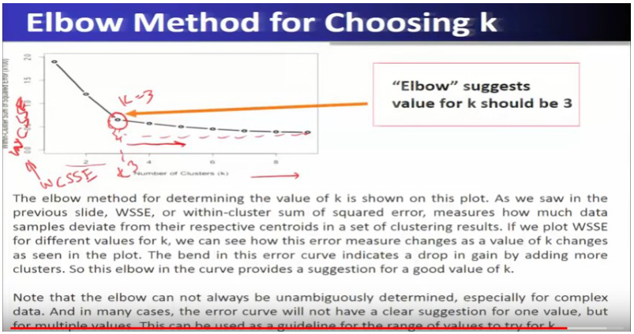

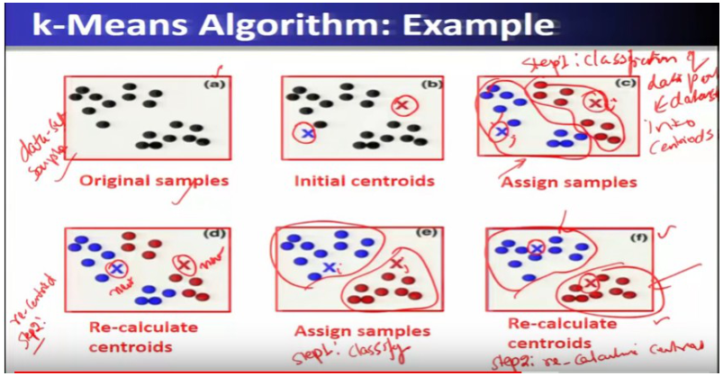

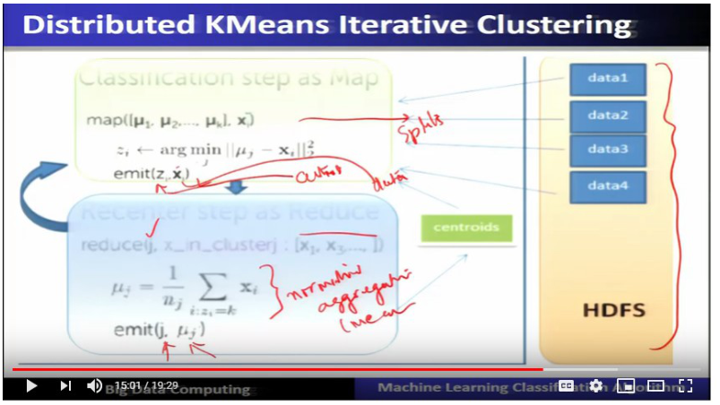

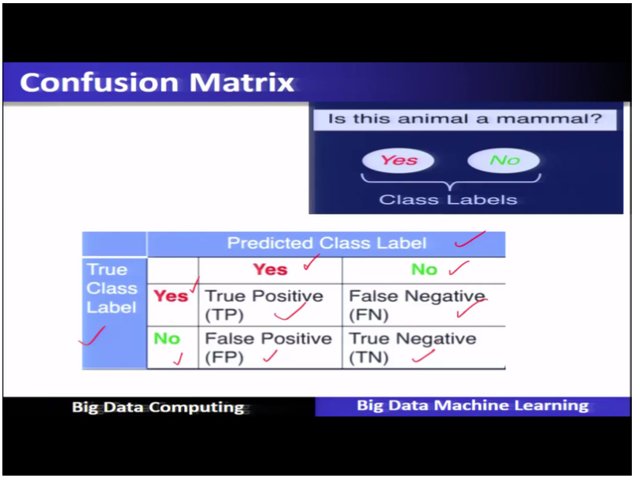

## This week's map

| Lec | Title | Why it is on the exam |
| --- | --- | --- |
| 23 | Big Data Machine Learning (Part-I) | The four technique families, supervised vs unsupervised — classic "which is X?" stems |
| 24 | Big Data Machine Learning (Part-II) | ML process, overfitting, validation/CV, precision/recall, Spark MLlib |
| 25 | K-means using MapReduce | Cluster analysis, similarity measures, K-means steps, WSSE, elbow, stopping rule |
| 26 | Parallel K-means cluster analysis | What the map and reduce functions emit |

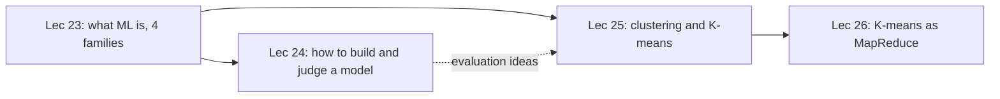

---

## Lecture 23: Big Data Machine Learning (Part-I)

### Hook (4–6 sentences)

Imagine a bank that has ten years of card transactions and wants to catch fraud. Nobody can sit down and write rules for every way a thief might behave, and the data is far too big for a person to eyeball. So instead of programming the answer, you show a program millions of past transactions and let it work out what "normal for this customer" looks like. That is machine learning, and this lecture is the vocabulary for it: what it is, which *kind* of problem you have (four kinds), and whether your data comes with answers attached (supervised) or not (unsupervised). Everything else this week — overfitting, K-means, MapReduce — hangs off these definitions.

### Slide picture

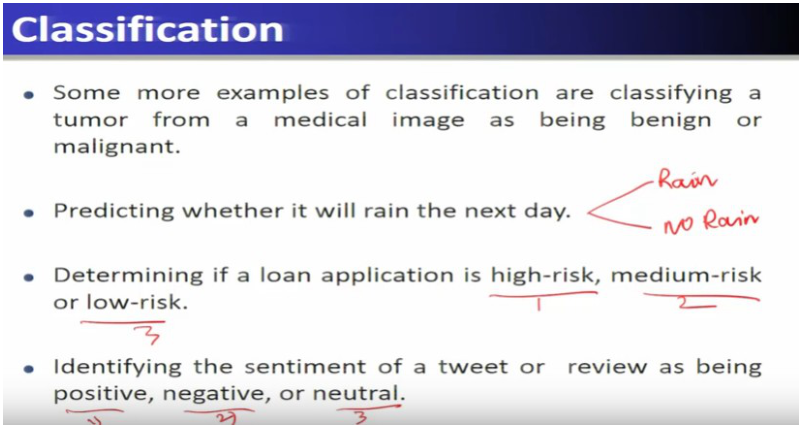

*Classification examples: tumour benign/malignant, rain/no rain, loan high/medium/low risk, tweet positive/negative/neutral — all categories.*

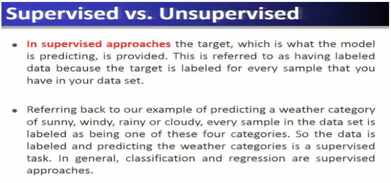

*Supervised = labelled data; classification and regression are supervised.*

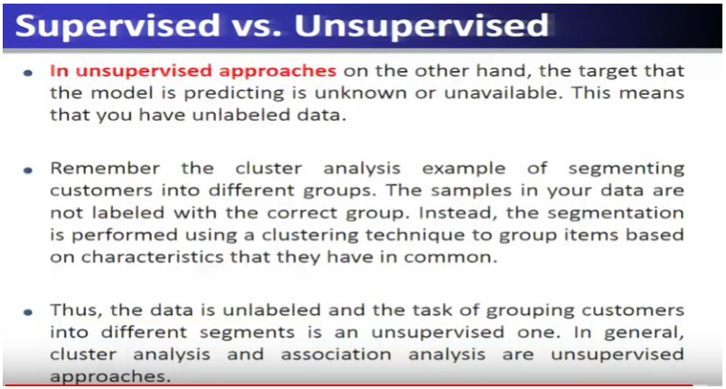

*Unsupervised = no label; cluster analysis and association analysis.*

### Core ideas

**What machine learning is.** A *model* is the thing that comes out of learning: a function fitted to examples that maps new inputs to outputs. Show it thousands of cat pictures and it picks up features (pointy ears, whiskers, tail) without anyone writing "if whiskers then cat". That is the point the professor stresses: ML **learns from data** and involves **no explicit programming** for the task. Because it learns from data it can also expose **hidden patterns and trends** that nobody told it to look for, and those patterns support **data-driven decisions**. The quality and amount of data decide how well it learns.

- `EXAM` ML = study/construction of systems that learn from data without being explicitly programmed; finds hidden patterns and trends; enables data-driven decisions.
- `PROF` ML is **interdisciplinary**: statistics + computer science/AI + **domain knowledge** (understanding the application/business). Without domain knowledge you cannot define the problem or use the outcome.

**Applications the slides list.** Credit-card fraud detection (compare the new purchase to your history; a big-ticket item in a new category, or a sale from another country, is flagged), handwritten digit recognition (ATM cheque amounts), website recommendations ("customers who bought this also bought…"), targeted advertising on mobile apps, sentiment analysis, climate monitoring, crime-pattern detection, drug-effectiveness analysis.

**Neighbouring terms (they get confused).** Think of them as different *contexts* for the same toolbox:

- **Data mining** — older, from the era of databases and data warehouses; finds patterns in stored data and includes the practical side of *accessing* it. Its algorithms are reused by ML.
- **Predictive analytics** — business word for analysing data to predict **future outcomes** (sales forecasting, purchase behaviour). Uses ML.
- **Data science** — newer word, arrived with big data; extracting meaning from big data *including* collecting, storing and managing it. Uses ML.
- `EXAM` ML is *applied in* data science and predictive analytics; ML *draws algorithms from* data mining.

**The four families of ML technique.** Ask one question: *what is the answer supposed to look like?*

1. **Classification** — answer is a **category**. Weather (sunny/rainy/windy/cloudy), will it rain tomorrow (yes/no = binary), loan risk (3 classes), tweet sentiment.
2. **Regression** — answer is a **numeric value**. Stock *price*, product demand by season, a test score, amount of rainfall, how effective a drug will be. The slide's sharp example: predicting that a stock will *rise or fall* is classification; predicting the actual *price* is regression.
3. **Cluster analysis** — **organize similar items into groups**. Customer segmentation (seniors/adults/teenagers), regions of similar topography (desert, grass, mountain), tissue types in medical images, weather-pattern groups, crime hotspots. Also called **clustering**.
4. **Association analysis** — come up with **rules** that capture which items or events occur **together**. Market-basket analysis: customers with certificates of deposit also tend to buy money-market accounts, so cross-sell. Also: items bought together, web pages accessed together.

- `EXAM` Predictive methods = classification + regression. Descriptive methods = clustering + association rules.

**Supervised vs unsupervised.** In **supervised** learning every training sample carries the correct answer (the *target* or *label*), usually put there by a domain expert — every weather record is tagged with one of the four weather categories. In **unsupervised** learning there is no target; the algorithm only sees the features and must find structure itself — customer records are not pre-tagged with a "segment", clustering invents the segments.

- `EXAM` Classification and regression → **supervised**. Cluster analysis and association analysis → **unsupervised**.
- `EXAM` Is the target available in the data? Yes → supervised. No → unsupervised.

### How it fits together

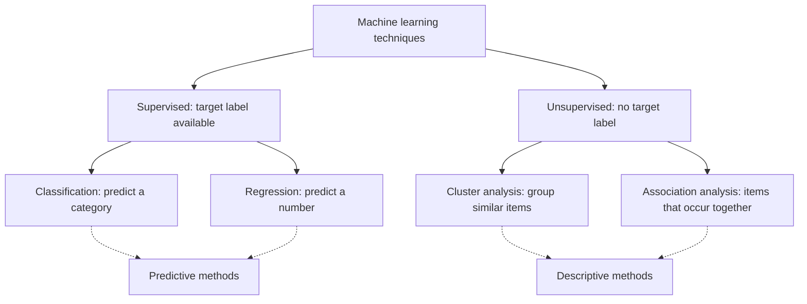

*Exam fact: two supervised (classification, regression), two unsupervised (clustering, association).*

### Worked example

You get four tasks: (a) predict tomorrow's temperature in °C; (b) decide whether an email is spam; (c) split 1 million shoppers into natural groups with no pre-set groups; (d) find that people who buy bread and butter also buy jam.
(a) regression (numeric, supervised). (b) classification (category, supervised). (c) clustering (no labels, unsupervised). (d) association analysis (co-occurrence rule, unsupervised).

### Near-twins / traps

- Rise/fall of a stock → classification. Exact price → regression. Same data, different *answer type*.
- Cluster analysis is *not* classification. Classification needs labelled examples; clustering produces groups with no names.
- Data mining ≠ ML ≠ data science: the slide ties data mining to databases/warehouses, predictive analytics to the business forecasting context, data science to big data.

### Tiny recap card

- ML: learns from data, no explicit programming, finds hidden patterns, data-driven decisions.
- Four families: classification (category), regression (number), clustering (groups), association (together-rules).
- Supervised = labelled (class + regression). Unsupervised = unlabelled (cluster + association).

### Checkpoint

1. A bank wants to decide whether a loan application is high, medium or low risk. This is
   a) regression  b) classification  c) association analysis  d) cluster analysis
2. Predicting the amount of rainfall (in mm) in a region is
   a) classification  b) clustering  c) regression  d) association analysis
3. Which pair contains only unsupervised techniques?
   a) classification, regression  b) regression, clustering  c) clustering, association analysis  d) classification, association analysis
4. Statement 1: Machine learning models are given step-by-step instructions for recognising a cat. Statement 2: ML can discover hidden patterns in data.
   a) both true  b) 1 true, 2 false  c) 1 false, 2 true  d) both false
5. Finding that customers who buy item X also tend to buy item Y is an example of
   a) market-basket (association) analysis  b) regression  c) classification  d) data cleaning
6. Which term is used in business for analysing data to predict future outcomes such as sales forecasting?
   a) data mining  b) predictive analytics  c) clustering  d) data warehousing
7. Predicting whether a stock will *rise or fall* tomorrow is ___, while predicting its exact *price* is ___.
   a) regression; classification  b) classification; regression  c) clustering; association  d) association; regression
8. In which setting is the "target" provided for every training sample?
   a) unsupervised  b) supervised  c) market-basket analysis  d) customer segmentation

#### Answer key

1. **b** — three risk categories → classification.
2. **c** — a numeric value → regression.
3. **c** — clustering and association have no target label.
4. **c** — ML has *no explicit programming*, so statement 1 is false.
5. **a** — "occur together" rules = association analysis.
6. **b** — predictive analytics (business term for future outcomes).
7. **b** — category (rise/fall) = classification; number = regression.
8. **b** — supervised = labelled target.

#### Optional, after you check

- Explain the difference between supervised and unsupervised learning using customer data.
- What goes wrong if you treat "predict the price" as a classification problem?

---

## Lecture 24: Big Data Machine Learning (Part-II)

### Hook (4–6 sentences)

Knowing the four families is not enough; a real project is a *workflow*, and the biggest danger is a model that looks perfect on the data it has seen and falls apart on new data. This long lecture walks you through the five-step ML process, the data preparation that eats most of the time, how overfitting happens and how a validation set protects you from it, the numbers used to score a classifier (accuracy, precision, recall, F1, confusion matrix), and finally how Spark MLlib packages ML for big data. Take it in four parts: A process and data prep, B overfitting and validation, C evaluation metrics, D Spark MLlib.

### Part A — The ML process and data preparation

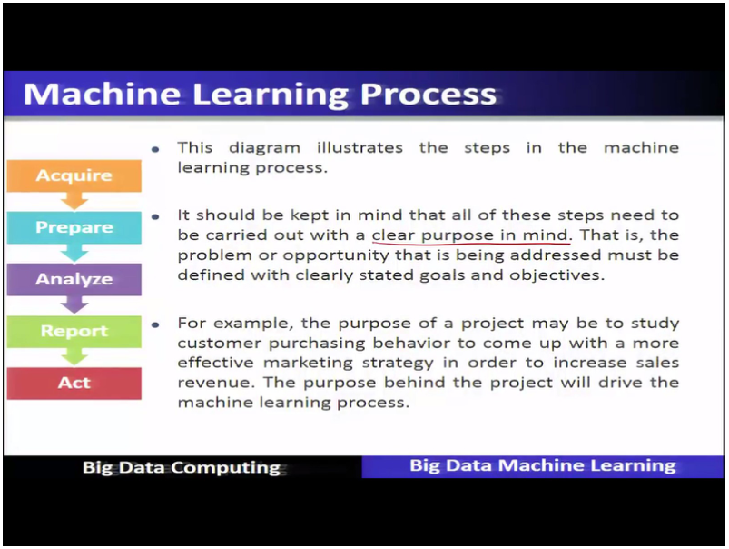

*Five steps, all steered by a clearly stated purpose (e.g. understand customer purchasing behaviour to raise sales).*

#### Core ideas

**Five steps, one purpose.** Before touching data, state the problem or opportunity and the goal; every step is judged against that purpose. Then:

1. **Acquire** — find *all* data sources (files, databases, internet, mobile devices), collect them and **integrate** them. Different sources use different formats and timing/spatial resolution, so you convert and **align**. Data acquisition = gathering, filtering and cleaning before it lands in a warehouse; it is called one of the major big-data challenges.
2. **Prepare** — two sub-parts: **explore** the data, then **pre-process** it.
3. **Analyze** — pick the technique (classification? regression? clustering? association?), pick an algorithm in it, **build (fit) the model** on the data, and **assess the result**.
4. **Report** — communicate results against the goal: what the insight is and what value it adds, using visualisation, with detail tables as backup. Even **negative results** are worth reporting because they suggest where to look next.
5. **Act** — decide and implement the action the insight supports (target a segment, remove an inefficiency), then assess the impact — which may start another cycle.

- `EXAM` Acquire → Prepare → Analyze → Report → Act. The process is **iterative**: a data-quality problem found while preparing may send you back to acquire more data.

**Explore (inside Prepare).** Look first, compute later. You examine **correlations** (how variables relate), **trends** (is transaction volume rising through the year?) and **outliers** (possible errors, or interesting points worth a closer look). Then **summary statistics** squeeze the data into a few numbers: **mean, median, mode** (centre/most-frequent) and **range, standard deviation** (spread). Sanity check example: an age of −5 or 150 means something is wrong. **Visualisation** is the quick way to see it: **histogram** (distribution, skew, outliers), **line plot** (trend, e.g. stock price), **heat map** (hot spots), **scatter plot** (correlation between two variables).

**Pre-process (inside Prepare).** Three jobs: *clean*, *select features*, *transform*.

- **Cleaning** fixes quality problems: **missing values** (income left blank), **duplicates** (same customer, two addresses), **inconsistent/invalid data** (bad zip code), **noise**, **outliers**.
- **Feature selection**: keep the relevant columns. Drop **redundant** ones (price and sales tax are correlated, age and weight are correlated, keep one), drop irrelevant ones, or **combine/create** features (add education level to a loan model).
- **Feature transformation**: **scaling** puts values in a common range so no feature dominates; **filtering or aggregation** reduces noise; **dimensionality reduction** maps data to fewer dimensions to simplify analysis.

- `EXAM` Pre-processing = clean data + select features + transform features.

#### Checkpoint A

1. Which step of the ML process involves identifying all data sources, collecting and integrating them?
   a) Prepare  b) Acquire  c) Analyze  d) Act
2. Which is NOT part of the Prepare step?
   a) exploring the data  b) pre-processing the data  c) deciding the business action  d) cleaning missing values
3. A scatter plot is most useful to show
   a) distribution/skew of one variable  b) correlation between two variables  c) hot spots  d) trend over time
4. Two features are highly correlated (e.g. price and sales tax). The best pre-processing move is
   a) keep both  b) remove one as redundant  c) add a third  d) duplicate the rows
5. Statement 1: The ML process is a one-way sequence that never repeats. Statement 2: Data-quality issues found in Prepare may require going back to Acquire.
   a) both true  b) 1 true, 2 false  c) 1 false, 2 true  d) both false
6. Scaling is a form of
   a) feature selection  b) feature transformation  c) data acquisition  d) reporting

#### Answer key A

1. **b** — that is data acquisition.
2. **c** — deciding action is the Act step.
3. **b** — scatter plot ↔ correlation of two variables.
4. **b** — redundant feature removal simplifies and does not hurt the result.
5. **c** — the process is iterative.
6. **b** — scaling maps values into a common range = transformation.

### Part B — Generalization, overfitting and validation

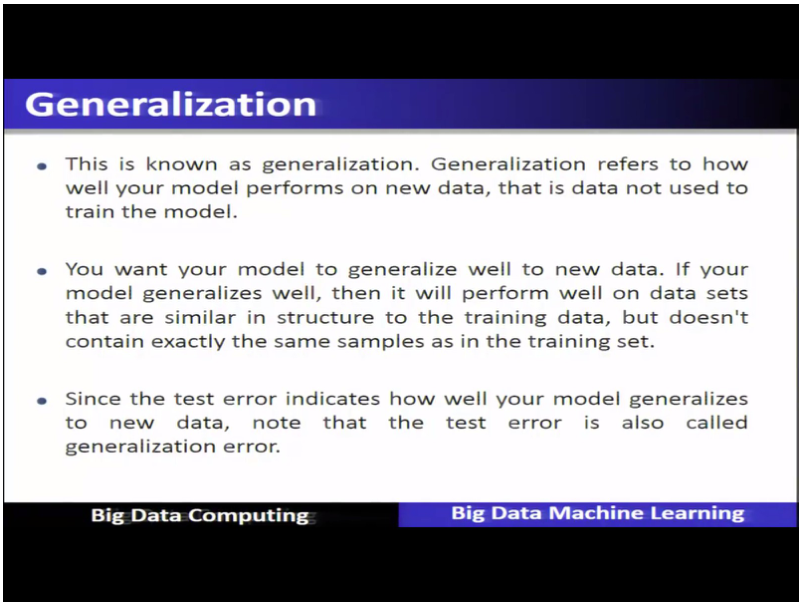

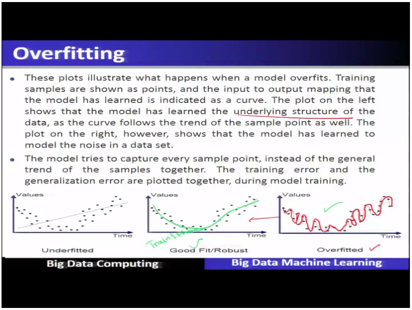

*Overfit = the curve chases every point (the noise). Underfit = the line misses the trend.*

#### Core ideas

**Training vs testing.** A classifier maps input variables to a *predicted label*; the *true label* (target) is known for training data. Same label → success, different → error. **Error rate** (misclassification rate) = errors ÷ total samples. You use two phases: **training** builds the model from labelled **training data** + an algorithm; **testing** feeds it **new data it has never seen** and compares predictions to true labels. So there are two errors: **training error** and **test error**. Test error shows how the model will behave on new data, so it is also called the **generalization error**.

- `EXAM` **Generalization** = how well the model performs on data not used to train it.

**Overfitting and underfitting.** Think of a student who memorises last year's paper answer by answer. Perfect on that paper, lost on a new one. That is overfitting: the model learned the **noise** in the training data instead of the **underlying structure**.

- **Overfitting**: *low training error, high generalization (test) error*. Typical when the model is too complex (too many parameters vs training samples). Keep the model **as simple as possible** while still solving the mapping.
- **Underfitting**: the model has not learned the structure; **high training error and high test error**.
- Both are bad because neither generalises.

**Overfitting in decision trees.** A decision tree grows by repeatedly splitting a node into subsets (**tree induction**). If it keeps splitting until every training point is classified perfectly, it carves up the space around noise. Two defences:

- **Pre-pruning** — *stop growing before the tree is fully grown* with restrictive stopping conditions: stop if a node has fewer samples than a minimum threshold, or if the **improvement in the impurity measure** is below a threshold.
- **Post-pruning** — *grow to maximum size, then trim* **bottom-up from the leaves**: replace a subtree with a leaf if that improves generalization error **or leaves it unchanged**. Subtrees that do not help only add complexity.
- `PROF` In practice post-pruning usually gives better results (decisions use the full tree) but is **more computationally expensive**; pre-pruning may stop too early.

**Validation set.** To know *when* to stop (e.g. how many nodes to grow), split the original training data again into **training** and **validation** data. Watch both errors as complexity grows: training error keeps falling, but **validation error starts to rise** — that turning point is where overfitting begins and where you should stop. Using the validation set to pick when to stop is called **model selection**. The idea applies to any ML model, not only trees.

**Three datasets.**

- **Training set** — adjust the parameters to learn input → output.
- **Validation set** — decide when to stop training to avoid overfitting.
- **Test set** — evaluate the finished model on new data.
- `EXAM` The **test set must never be used to create or tune the model**; it stays untouched until the very end. All three sets should keep the **same distribution of the target class** (if the original is 75 %/25 %, each set should be about 75/25).
- Validation error also gives an **estimate of generalization** (test) error.

**Ways to build a validation set.**

- **Holdout** — reserve part of the training data as validation. **Repeated holdout / random subsampling** — repeat with a different random holdout each time and average the validation errors.
- **K-fold cross-validation** — split the data into **K disjoint partitions**; in each of K iterations a different partition is the validation set (every partition is used for validation **exactly once**); average the K validation errors; choose the model with the **smallest average validation error**. Reduces the luck of a single split. Very common in practice.
- **Leave-one-out CV (LOOCV)** — special case with **K = N** (N = dataset size): each iteration validates on exactly **one** sample, trains on N−1.

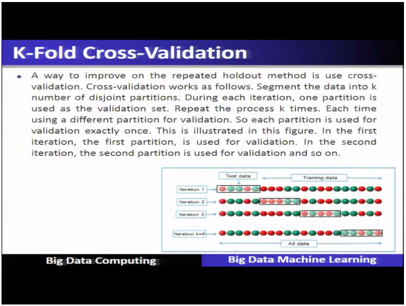

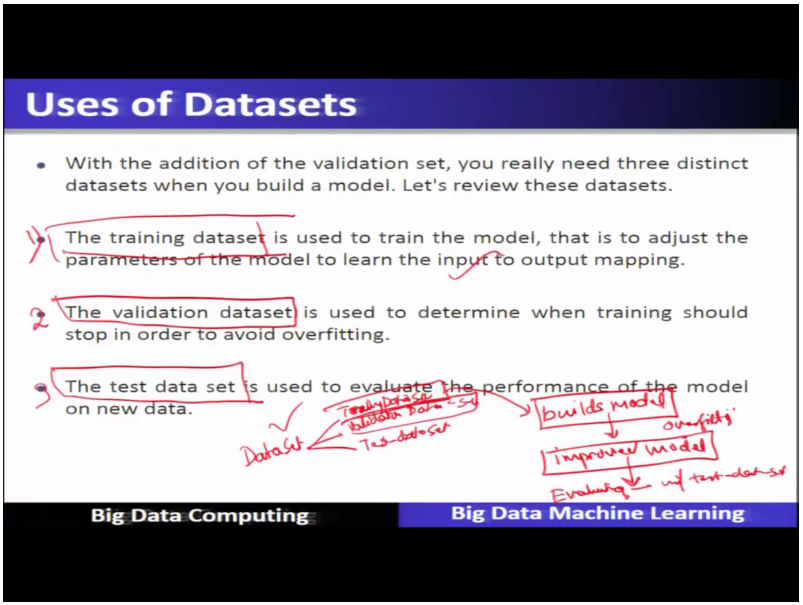

#### How it fits together

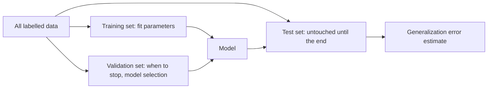

*Exam fact: train fits, validate decides when to stop, test judges on new data and is never used for tuning.*

#### Worked example (K-fold)

Dataset of 100 samples, K = 5. Make 5 partitions of 20. Iteration 1: train on partitions 2–5, validate on 1. Iteration 2: validate on 2, train on the rest… until each partition was validation once. Average the 5 validation errors → one number per candidate model; keep the model with the smallest average. LOOCV on the same data = K = 100 iterations, validating on one sample each time.

#### Near-twins / traps

- Overfit (train low, test high) vs underfit (both high). A model with high training error is *not* overfitting.
- Validation set vs test set: validation influences training decisions; test never does.
- Pre-pruning (stop early by thresholds) vs post-pruning (full tree, bottom-up trimming).
- Holdout vs K-fold: holdout = one split; K-fold = K splits, each partition validates once.

#### Checkpoint B

1. A model has very low training error but high test error. This is
   a) underfitting  b) overfitting  c) a good fit  d) regression
2. Both training error and test error are high. This is
   a) underfitting  b) overfitting  c) good generalization  d) pre-pruning
3. Which technique stops tree growth *before* the tree is fully grown?
   a) post-pruning  b) pre-pruning  c) LOOCV  d) K-fold
4. Post-pruning proceeds by
   a) stopping when a node is small  b) trimming from the leaves up after full growth  c) adding nodes  d) using only the test set
5. In K-fold cross-validation with K partitions, each partition is used for validation
   a) exactly once  b) K times  c) never  d) twice
6. LOOCV is K-fold cross-validation with
   a) K = 1  b) K = 10  c) K = N (number of samples)  d) K = 2
7. The test set should
   a) be used to tune the model  b) stay untouched until training is complete  c) be merged into the training set  d) be used to decide when to stop training
8. Statement 1: Validation error can estimate generalization error. Statement 2: The training, validation and test sets should keep the same target-class distribution.
   a) both true  b) 1 true, 2 false  c) 1 false, 2 true  d) both false
9. As tree complexity grows, training error keeps falling while validation error starts rising. You should
   a) keep growing  b) stop where validation error starts to rise  c) discard validation data  d) use the test set to choose
10. Which statement about pruning is correct?
   a) Post-pruning is cheaper than pre-pruning  b) Pre-pruning may stop prematurely; post-pruning costs more compute but usually gives better results  c) Both ignore tree size  d) Pruning increases overfitting

#### Answer key B

1. **b** — low train, high test = overfitting.
2. **a** — high on both = underfitting.
3. **b** — pre-pruning uses stopping conditions.
4. **b** — grow fully, then replace subtrees with leaves bottom-up.
5. **a** — each partition validates exactly once.
6. **c** — K = N, validation set of one sample.
7. **b** — test set stays independent until the end.
8. **a** — both are slide statements.
9. **b** — that point is where overfitting begins (model selection).
10. **b** — slide: post-pruning better but more expensive.

### Part C — Metrics to evaluate a classifier

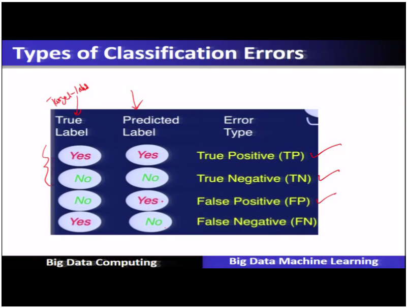

#### Core ideas

Take the slide's question: *is this animal a mammal?* The **class labels** are Yes and No. Compare the **true label** with the **predicted label**:

- **True Positive (TP)** — true Yes, predicted Yes. **True Negative (TN)** — true No, predicted No. Both are correct.
- **False Positive (FP)** — true **No**, predicted **Yes** (a positive that was falsely given).
- **False Negative (FN)** — true **Yes**, predicted **No**.

The **confusion matrix** lays these in a 2×2 table: rows = true class label, columns = predicted class label (TP and FN in the Yes row; FP and TN in the No row).

**Accuracy and error.** **Accuracy** = correct predictions ÷ total predictions = (TP+TN)/total. **Error rate = 1 − accuracy.** The slide's 10-sample example: 3 TP, 4 TN, 1 FP, 2 FN → accuracy 7/10 = 70 %, error 30 %.

**Precision and recall.** Accuracy hides *which* kind of mistake you make, so two finer scores:

- **Precision** = TP ÷ (TP + FP): of everything I *predicted positive*, how much really was? A measure of **exactness**.
- **Recall** = TP ÷ (TP + FN): of everything that *really is positive*, how much did I find? A measure of **completeness**.
- **F-measure** combines them. **F1 = 2 × (precision × recall) / (precision + recall)** weights both equally. **F2** weights **recall** more; **F0.5** weights **precision** more.

Spam analogy: a filter that flags everything has perfect recall (misses no spam) but poor precision (flags good mail). A filter that flags only one sure spam has perfect precision but poor recall.

- `SLIDE` The slide prints the recall denominator with "False Positives" by mistake; the correct recall is TP/(TP+FN), as the transcript also states ("true positives and false negatives"). Use that in the exam.

#### Worked example

Confusion counts: TP = 3, FN = 2, FP = 1, TN = 4 (10 samples).
Accuracy = (3+4)/10 = 0.7. Precision = 3/(3+1) = 0.75. Recall = 3/(3+2) = 0.6. F1 = 2·0.75·0.6 / (0.75+0.6) = 0.9/1.35 ≈ 0.667.

#### Near-twins / traps

- FP: true No, predicted Yes. FN: true Yes, predicted No. Mnemonic: the *second word* (positive/negative) is what the model **predicted**; *True/False* says if it was right.
- Precision denominator = predicted positives (TP+FP). Recall denominator = actual positives (TP+FN).

#### Checkpoint C

1. True label is "No" but the classifier predicts "Yes". This is a
   a) true positive  b) true negative  c) false positive  d) false negative
2. Precision is
   a) TP/(TP+FN)  b) TP/(TP+FP)  c) (TP+TN)/total  d) FP/(FP+TN)
3. Recall measures
   a) exactness  b) completeness  c) total error  d) speed
4. With 4 TP, 4 TN, 1 FP, 1 FN, the accuracy is
   a) 0.4  b) 0.6  c) 0.8  d) 1.0
5. Error rate equals
   a) accuracy  b) 1 − accuracy  c) precision + recall  d) TP/total
6. Which F-measure gives *more* weight to recall?
   a) F0.5  b) F1  c) F2  d) none
7. In the confusion matrix on the slide, rows represent
   a) predicted class labels  b) true class labels  c) algorithms  d) features
8. A model predicts "Yes" for 10 samples, of which 8 are truly Yes; there are 16 truly-Yes samples in total. Precision and recall are
   a) 0.8 and 0.5  b) 0.5 and 0.8  c) 0.8 and 0.8  d) 0.5 and 0.5

#### Answer key C

1. **c** — true No, predicted Yes = FP.
2. **b** — TP over everything predicted positive.
3. **b** — recall = completeness.
4. **c** — (4+4)/10 = 0.8.
5. **b** — error = 1 − accuracy.
6. **c** — F2 weights recall more.
7. **b** — slide: true class label on the rows.
8. **a** — precision = 8/10, recall = 8/16.

### Part D — Spark MLlib and the classification pipeline

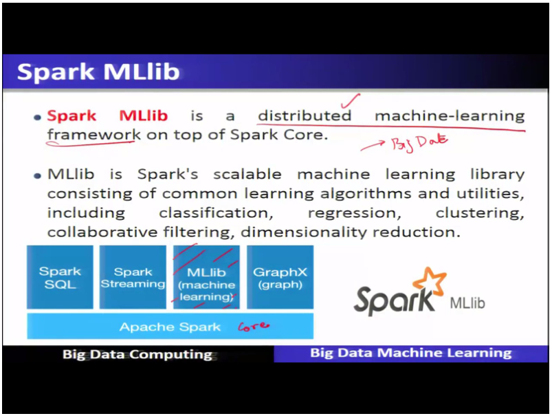

#### Core ideas

Big-data ML needs the data *and* the algorithm to be distributed, because the data does not fit one machine. **Spark MLlib** is Spark's **scalable, distributed machine-learning library** built on top of **Spark Core**. "Scalable" here means it follows the scale-out property: add more machines in the cluster and the algorithms spread across them. It contains common algorithms and utilities for **classification, regression, clustering, collaborative filtering and dimensionality reduction**.

MLlib has four kinds of component:

1. **ML algorithms** — classification, regression, clustering, collaborative filtering.
2. **Pipelines** — chain steps (prepare → feature work → model) so data scientists can build and reuse a full ML workflow on big data.
3. **Featurization** — **feature extraction** and **feature transformation**.
4. **Utilities** — linear algebra and statistics.

**The demo: weather data, decision tree, low-humidity days.** The steps:

1. Load the weather data (a CSV with header, schema inferred) into a **DataFrame** via the SQL context. Columns include air pressure, air temperature, average wind direction/speed, max wind speed, rain accumulation and rain duration (all at 9 am); a humidity column is what the "low humidity" label is built from.
2. **Drop unused and missing data** (1064 rows counted before and after to see how many were dropped).
3. **Create a categorical variable** for low-humidity days (binarise the humidity into a label).
4. **Aggregate the feature columns** used to predict.
5. **Split into training and test** sets (80 % / 20 %, random).
6. **Create and fit a decision tree** (in a pipeline) on the training data → the *model*.
7. **Predict** on the test data, compare labels vs predictions to get accuracy, and **save the predictions** to a CSV file.

- `EXAM` MLlib = distributed/scalable ML library on Spark Core: classification, regression, clustering, collaborative filtering, dimensionality reduction; components = algorithms, pipelines, featurization, utilities.

#### How it fits together

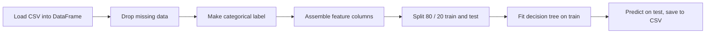

*Exam fact: load → clean → label → features → split → fit → predict. This is the ML process in code.*

#### Checkpoint D

1. Spark MLlib is built on top of
   a) Spark SQL only  b) Spark Core  c) HDFS only  d) Hive
2. Which is NOT a listed MLlib algorithm area?
   a) classification  b) regression  c) clustering  d) sorting algorithms
3. In the classification demo the data was split into training and test sets in the ratio
   a) 50/50  b) 70/30  c) 80/20  d) 90/10
4. Featurization in MLlib covers
   a) extraction and transformation  b) only storage  c) only evaluation  d) pruning
5. "Scalable" ML library means
   a) it only works on one machine  b) it scales out across cluster machines  c) it removes the need for data  d) it is unsupervised only

#### Answer key D

1. **b** — MLlib sits on Spark Core.
2. **d** — sorting is not an MLlib area.
3. **c** — 80 % train, 20 % test.
4. **a** — feature extraction + transformation.
5. **b** — scale-out across the cluster.

### Tiny recap card

- Process: Acquire, Prepare (explore + pre-process), Analyze, Report, Act, iterative.
- Overfit = train low / test high; underfit = both high; prune trees; use validation, K-fold CV, LOOCV (K = N).
- Precision TP/(TP+FP), recall TP/(TP+FN), F1 harmonic combo; MLlib = scalable ML on Spark Core.

---

## Lecture 25: Machine Learning Algorithm K-means using Map Reduce for Big Data Analytics

### Hook (4–6 sentences)

You have a million customers and nobody has told you what kinds of customers exist. If you could just let the data sort itself into groups, you could send each group a different offer. That is cluster analysis, and K-means is the classic algorithm that does it with a repeating two-step dance: assign everyone to the nearest group centre, then move each centre to the middle of its group. Lecture 25 builds the full picture: what clustering is for, how "similar" is measured, the K-means algorithm, how to score a clustering (WSSE), how to choose K (elbow), and when to stop. Lecture 26 then turns it into MapReduce.

### Slide picture

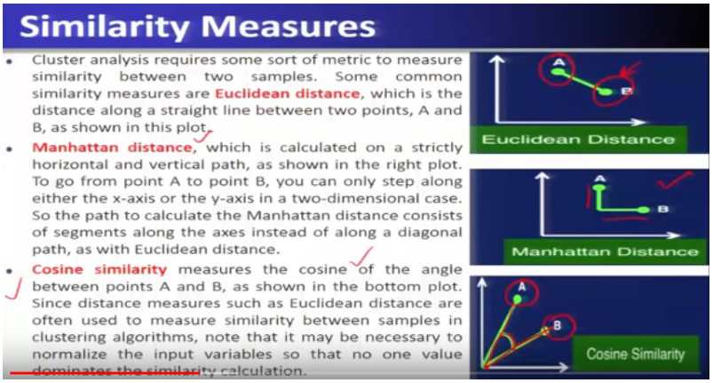

*Euclidean = straight line; Manhattan = only horizontal/vertical steps; Cosine = cosine of the angle between the two vectors.*

*Panels (a)–(f): original samples → initial centroids → assign samples → recalculate centroids → assign → recalculate. Step 1 = classify, Step 2 = recompute centroids.*

### Core ideas

**Cluster analysis in one sentence.** Cluster analysis (clustering) **organizes similar items in a dataset into groups called clusters**. Doing this is called **segmentation**, and you then study each cluster separately. Applications: customer segmentation for targeted ads/promotions, characterising weather patterns of a region, grouping news articles by trending topic, finding **crime hotspots** to place police.

**What "good clusters" means.** Samples in the *same* cluster should differ as little as possible (small **intra-cluster** difference), and samples in *different* clusters should differ as much as possible (large **inter-cluster** difference).

- `EXAM` Minimise differences **within** a cluster, maximise differences **between** clusters.

**Similarity measures — how "close" is defined.** Clustering needs a yardstick between two samples A and B:

- **Euclidean distance** — the straight-line distance between two points. Satisfies the triangle inequality. Because it mixes units, you may need to **normalise inputs** so no single feature dominates.
- **Manhattan distance** — path made only of horizontal and vertical moves (like walking city blocks); no diagonal.
- **Cosine similarity** — cosine of the **angle** between the two vectors (it is a normalised dot product, xᵢᵀx_q / (‖xᵢ‖‖x_q‖)). Small angle → cosine near **1** → very similar; far apart → near 0. Distance is often defined as **1 − similarity**. It is used for **documents** (sparse vectors of word counts), e.g. grouping a corpus of news by topic.
- `EXAM` Straight-line → Euclidean. Angle-based → cosine. Grid path → Manhattan.

**Key points about clustering.** It is **unsupervised** (no target label). There is **no single correct clustering**; clusters come **without labels**, so you must **interpret** them (inspect samples, give them a sensible name) — interpretation is application-specific.

**What you do with clusters.**

1. **Data segmentation** — analyse each segment separately (e.g. book buyers: science fiction, non-science fiction, children's).
2. **Classify new data** — compute the similarity between a new sample and each **cluster centre**; assign it to the closest cluster and give it that cluster's label.
3. **Label data for classification** — cluster membership gives labelled samples (cluster label = target class), which can then train a supervised classifier. So clustering can feed supervised learning.
4. **Anomaly detection** — a sample far from every cluster centre is a **cluster outlier**, flagged as a possible anomaly (e.g. age = 150); it may be noise to remove, which improves prediction quality.

**K-means algorithm.** It is *the* classic clustering algorithm: simple, efficient, easy to interpret. You must **specify K** (number of clusters) up front.

1. **Select K initial centroids** (centroid = cluster centre).
2. **Classify (assign)**: put each sample in the cluster of its **closest centroid** (using the similarity measure).
3. **Recompute (re-centre)**: new centroid of each cluster = **mean** of the samples assigned to it.
4. Repeat steps 2–3 until the **stopping criterion**.

In the slide example: original points → two initial centroids placed → points coloured by nearest centroid → centroids moved to the cluster means → reassign → recompute until nothing changes.

- `EXAM` **First step = select initial centroids.** Then iterate {assign to closest centroid, recompute centroids as cluster means}.
- `EXAM` Final clusters are **very sensitive to the initial centroids**. Fix: **run K-means several times with different random initial centroids** and keep the best result.

**Scoring a clustering — WSSE.** The **error** of a sample is its distance to its own centroid. **WSSE (within-cluster sum of squared error)** = the sum, over all clusters, of the **squared distances** between each sample and its centroid. Lower WSSE means samples sit tighter around their centres — **more compact clusters**. Two warnings from the slide: WSSE1 < WSSE2 means clustering 1 is *numerically* better, **not automatically "more correct"**; and **larger K will always reduce WSSE** (in the extreme, every point its own cluster gives WSSE = 0), so WSSE alone cannot choose K.

**Choosing K.** Three approaches:

1. **Visualisation** — scatter plots (with dimensionality reduction) to see natural groupings.
2. **Application-dependent** — domain knowledge decides: K = number of product categories, or K = number of regions you want to analyse.
3. **Data-driven** — compute a quality measure for different K. The classic is the **elbow method**: plot WSSE (y) against K (x). WSSE drops steeply, then flattens; the bend is the **elbow** and suggests that value of K (slide: **K = 3**). The elbow is not always clear in complex data — treat it as a guideline for a range of values to try.

**When to stop.**

1. **No change in the centroids** (so no sample changes cluster). Extra iterations would change nothing.
2. **Relaxed:** stop when the number of samples changing clusters falls **below a threshold** (e.g. 1 %), because only minimal changes remain.

**Interpreting the result.** Each centroid is the mean of its cluster — a "representative sample". Compare the centroids' variable values (e.g. average age differs across clusters → clusters encode age-based segments).

- `EXAM` K-means summary: classical, simple, efficient; K must be specified; result sensitive to initial centroids.

### How it fits together

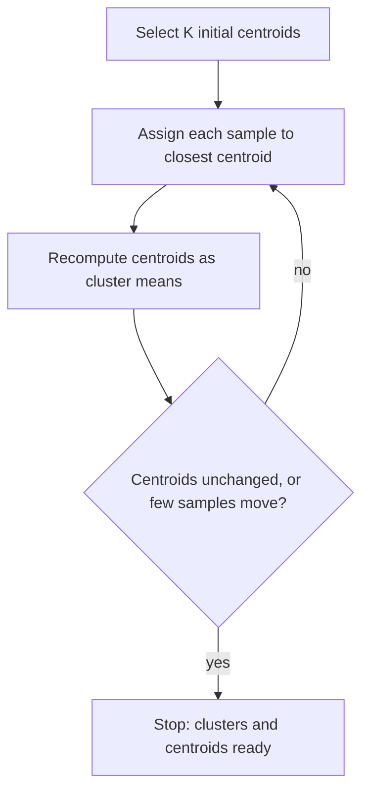

*Exam fact: initialise, then loop assign ↔ recompute, stop when centroids stop changing.*

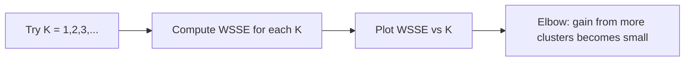

### Worked example

1-D points: 1, 2, 3, 10, 11, 12; K = 2, initial centroids 1 and 10.
Assign: 1,2,3 → centroid 1 (distances 0,1,2 vs 9,8,7); 10,11,12 → centroid 10.
Recompute: means 2 and 11.
Assign again: nothing moves → centroids unchanged → **stop**.
WSSE = (1−2)²+(2−2)²+(3−2)² + (10−11)²+(11−11)²+(12−11)² = 2 + 2 = **4**.
Try K = 3 → WSSE can only fall (e.g. 1.0); K = 6 → WSSE = 0, which is why K cannot be picked by minimising WSSE alone.

### Near-twins / traps

- WSSE lower ≠ clustering "correct"; and bigger K always lowers WSSE.
- Stopping when "accuracy is 100 %" is wrong: clustering has no labels, so accuracy is not the stopping rule — no change in centroids is.
- Euclidean (distance, small = close) vs cosine similarity (large = close, so distance = 1 − similarity).
- Cluster analysis (unsupervised, no labels) vs classification (supervised); clusters can *produce* labels for a later classifier.

### Tiny recap card

- Clustering: group similar items; similarity = Euclidean / Manhattan / cosine.
- K-means: choose K centroids → assign → recompute means → stop on no centroid change; sensitive to initial centroids.
- WSSE = compactness (lower = tighter); more K always lowers it → elbow method picks K.

### Checkpoint

1. Cluster analysis is a
   a) supervised technique  b) unsupervised technique  c) reinforcement technique  d) regression technique
2. The first step of K-means is to
   a) compute accuracy  b) select initial centroids  c) remove outliers  d) compute precision
3. Which similarity measure uses the angle between two vectors?
   a) Euclidean  b) Manhattan  c) Cosine  d) none of these
4. The within-cluster sum of squared error (WSSE) is used to
   a) measure compactness of clusters  b) measure classification accuracy  c) measure recall  d) count the number of features
5. If WSSE decreases for a fixed K between two runs, the clustering is generally
   a) more compact  b) less compact  c) overfitted  d) unlabeled
6. Statement 1: Increasing K always decreases WSSE. Statement 2: A lower WSSE proves the clustering is the "correct" one.
   a) both true  b) 1 true, 2 false  c) 1 false, 2 true  d) both false
7. In the elbow method, the point where adding clusters stops reducing WSSE much suggests
   a) the number of features  b) the value of K  c) the number of iterations  d) the learning rate
8. K-means stops iterating when
   a) accuracy reaches 100 %  b) the centroids no longer change  c) the dataset is empty  d) features decrease
9. Final K-means clusters are very sensitive to
   a) the initial centroids  b) the file format  c) the number of nodes  d) the label column
10. A new sample is received after clustering. To label it you
   a) retrain from scratch  b) assign it to the closest cluster centre and use that cluster's label  c) delete it  d) ignore it
11. A sample far from all cluster centres is called a
   a) centroid  b) cluster outlier / anomaly  c) cluster mean  d) fold
12. Choosing K as the number of product categories is the ___ approach.
   a) visualisation  b) application-dependent  c) data-driven  d) random

#### Answer key

1. **b** — no target label.
2. **b** — select initial centroids.
3. **c** — cosine similarity.
4. **a** — WSSE = compactness of clusters.
5. **a** — lower WSSE = tighter clusters (not necessarily "more correct").
6. **b** — statement 2 is false (slide).
7. **b** — elbow suggests K.
8. **b** — no change in centroids (or < threshold of samples moving).
9. **a** — slide: sensitive to initial centroids; rerun with random starts.
10. **b** — closest cluster centre, use that cluster's label.
11. **b** — cluster outliers are anomalies.
12. **b** — domain knowledge drives K.

#### Optional, after you check

- Trace two K-means iterations on 6 numbers of your own.
- Why can't you pick K by choosing the smallest WSSE?

---

## Lecture 26: Parallel K-means using Map Reduce on Big Data Cluster Analysis

### Hook (4–6 sentences)

K-means is easy on a laptop, but when there are billions of points and the data lives on many HDFS blocks across a cluster, one machine cannot loop over all of them. The trick is to notice that the **assign** step treats every point independently, so it can run on every data split at the same time, and the **recompute** step is just an average per cluster. That is already a MapReduce shape. This short lecture shows exactly what the map function emits and what the reduce function computes, so that one MapReduce job equals one K-means iteration. It also explains why an *iterative* algorithm was painful on early Hadoop and easier on Spark.

### Slide picture

*Map = classification step (emit closest-centroid, point). Reduce = recenter step (mean of each cluster, emit centroid ID and new centroid).*

### Core ideas

**One K-means iteration as one MapReduce job.** Recall the two steps: **classify** each point to its closest centroid, then **recenter** (new centroid = cluster mean). Mapping them:

- **Map = classification.** The map function receives the **set of all current centroids** (μ₁,…,μ_k) plus a data point xᵢ. It computes the distance from xᵢ to every centroid, takes the **argmin** (the centroid with the smallest distance, call it zᵢ), and **emits (key = closest-centroid ID zᵢ, value = the data point xᵢ)**. This is **data parallel**: each map task works on its own **data split** (blocks of the dataset in HDFS) independently, and every map task is given the current centroids.
- **Reduce = recenter.** The shuffle groups all emitted pairs **by centroid ID**, so one reducer sees one centroid j and the list of all points assigned to it. It **sums** the points (a for loop), **counts** them, and divides sum by count — the **normalised aggregation / mean**. It emits **(key = j, value = new centroid μⱼ)**.

Then the new centroids go back into the next iteration's map. The loop repeats until the **stopping criterion** is met.

- `EXAM` Map: input = centroids + data point; output = (closest centroid ID, data point). Reduce: input = (centroid ID, points of that cluster); output = (centroid ID, mean = new centroid).
- `PROF` The point of casting K-means in MapReduce is to make it a **data-parallel algorithm** that can analyse big data.

**Why iteration is the practical problem.** K-means is **iterative**, so it needs an *iterative* MapReduce. On **Hadoop/MapReduce v1** each iteration is a separate job that re-reads data and moves a lot of data between mapper and centres, and several research versions of "iterative MapReduce" appeared. With **Spark**, iteration is straightforward, and an **in-memory** configuration keeps the data and centres between iterations, so it is more efficient. (Spark is only pointed to here; full details come later in the course.)

### How it fits together

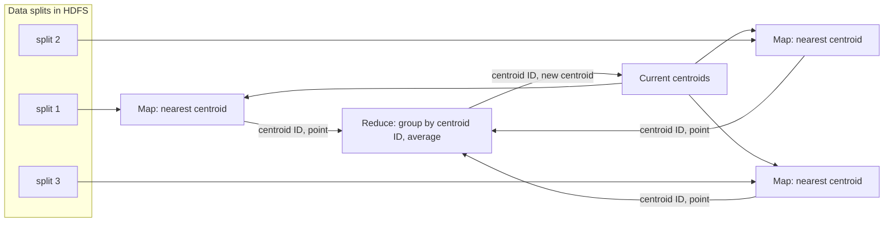

*Exam fact: map classifies, reduce recenters; the new centroids feed the next iteration.*

### Worked example

Centroids μ₁ = 0, μ₂ = 10. Data split A holds 1, 2, 9; split B holds 11, 12.
Map on A emits (1,1), (1,2), (2,9). Map on B emits (2,11), (2,12).
Group by key: key 1 → [1, 2]; key 2 → [9, 11, 12].
Reduce: key 1 → sum 3, count 2 → μ₁ = 1.5. key 2 → sum 32, count 3 → μ₂ ≈ 10.67.
Emit (1, 1.5), (2, 10.67); these become the centroids for the next map phase.

### Near-twins / traps

- It is the **map** that does the nearest-centroid assignment, **not** the reduce. The reduce computes means.
- The map **key** is the centroid ID, not the data point; the data point is the **value**.
- One MapReduce job = **one** K-means iteration, not the whole algorithm.

### Tiny recap card

- Map = classification, data parallel, emit (closest centroid ID, point).
- Reduce = recenter, group by centroid ID, mean, emit (ID, new centroid).
- Iterative ⇒ painful on Hadoop MR v1, natural on Spark (in-memory).

### Checkpoint

1. In parallel K-means on MapReduce, the map function
   a) averages points per cluster  b) assigns each point to its closest centroid and emits (centroid ID, point)  c) writes the final model  d) decides K
2. The reduce function
   a) receives all points of a centroid and emits (centroid ID, mean)  b) reads the input splits  c) emits (point, label)  d) deletes centroids
3. One MapReduce job corresponds to
   a) the entire K-means run  b) one K-means iteration  c) choosing K  d) computing WSSE
4. Why does K-means need special handling on MapReduce v1?
   a) it is unsupervised  b) it is iterative  c) it has no centroids  d) it uses labels
5. What is the *key* of the map output?
   a) the data point  b) the closest-centroid ID  c) WSSE  d) the file name
6. Which step makes the algorithm data parallel?
   a) running map on independent data splits  b) running one reducer only  c) sorting centroids  d) pruning
7. Which environment keeps data in memory across iterations, making K-means iterations efficient?
   a) MapReduce v1 only  b) Spark  c) none  d) a relational database

#### Answer key

1. **b** — classification step as map.
2. **a** — recenter step as reduce.
3. **b** — one job = one iteration.
4. **b** — iterative algorithm on a batch model.
5. **b** — key = centroid ID, value = point.
6. **a** — independent map tasks on splits.
7. **b** — in-memory Spark makes iterations cheap.

#### Optional, after you check

- Walk through one iteration with two centroids and five points, naming the key/value at each stage.
- What would break if the map only emitted the point (no centroid ID)?

---

## Week wrap

### How the lectures connect

Lecture 23 gives the map of the territory: four ML families, supervised vs unsupervised. Lecture 24 shows how any supervised model is built and judged: the five-step process, data preparation, the overfitting trap and the validation/test discipline, and the precision/recall scores. Lecture 25 takes one unsupervised family, clustering, and its star algorithm K-means, with a different quality measure (WSSE) because there are no labels to compute accuracy against. Lecture 26 scales that algorithm up by splitting its two steps into map and reduce.

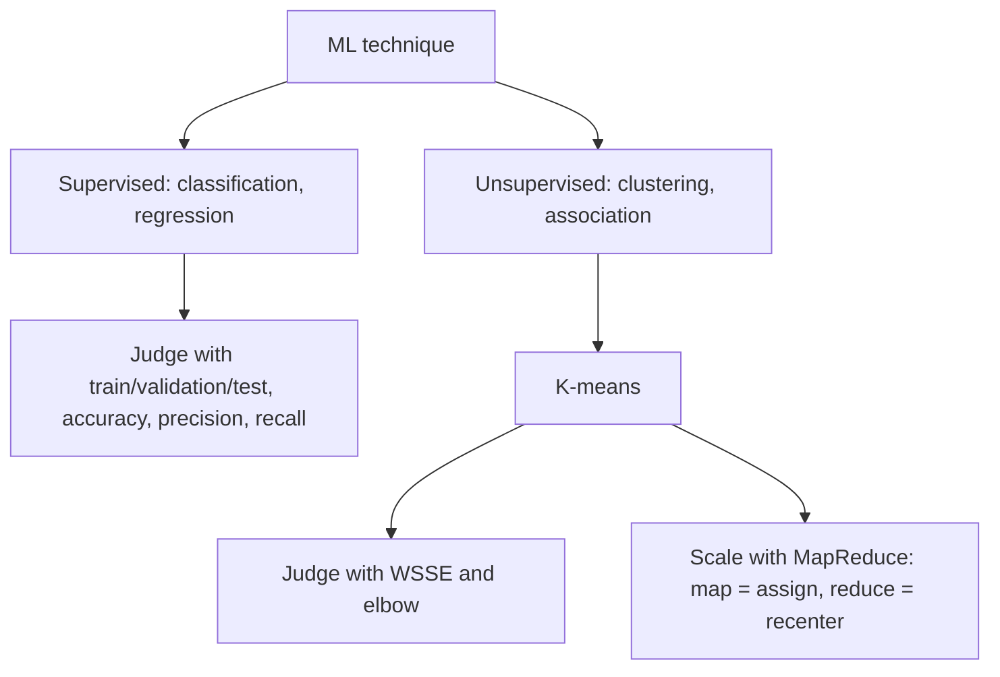

### Assignment-shaped mixed quiz

1. Cluster analysis is primarily a
   a) supervised technique  b) unsupervised technique  c) regression technique  d) deep-learning technique
2. Which technique predicts a numeric value?
   a) classification  b) regression  c) clustering  d) association analysis
3. Which similarity measure is based on the angle between vectors?
   a) Euclidean  b) Manhattan  c) cosine  d) Hamming
4. The recompute step of K-means sets each new centroid to
   a) a random point  b) the mean of the cluster's points  c) the farthest point  d) the median label
5. A model has train error 2 % and test error 30 %. It is
   a) underfit  b) overfit  c) a perfect fit  d) a regression
6. In k-fold cross-validation, every partition is the validation set
   a) never  b) exactly once  c) twice  d) K² times
7. Which pair gives the correct formulas? (Precision, recall)
   a) TP/(TP+FP), TP/(TP+FN)  b) TP/(TP+FN), TP/(TP+FP)  c) TP/total, FP/total  d) (TP+TN)/total, FN/total
8. WSSE of clustering A is lower than clustering B at the same K. We can say A is
   a) numerically more compact  b) guaranteed more correct  c) overfit  d) using more labels
9. In the ML process, "Report" comes
   a) before Acquire  b) after Analyze and before Act  c) after Act  d) after Prepare and before Analyze
10. In parallel K-means, the reducer's output is
   a) (data point, label)  b) (centroid ID, new centroid)  c) (K, WSSE)  d) (file, size)
11. Statement 1: Increasing K lowers WSSE. Statement 2: Therefore K should be the value that gives WSSE = 0.
   a) both true  b) 1 true, 2 false  c) 1 false, 2 true  d) both false
12. The test dataset should be used
   a) to tune hyperparameters  b) only to evaluate the final model  c) to decide when training stops  d) as extra training data

#### Answer key

1. **b** — clustering has no target label.
2. **b** — regression predicts numbers.
3. **c** — cosine similarity.
4. **b** — recenter = cluster mean.
5. **b** — low train, high test = overfitting.
6. **b** — each partition validates exactly once.
7. **a** — standard definitions (slide typo aside).
8. **a** — lower WSSE = numerically more compact, not "more correct".
9. **b** — Acquire, Prepare, Analyze, Report, Act.
10. **b** — reduce emits (centroid ID, new centroid).
11. **b** — statement 2 ignores that K = N gives zero WSSE but a useless clustering.
12. **b** — test set is untouched until the end.

### Last 5-minute drill

| Term | Answer to recall |
| --- | --- |
| Supervised | target label provided |
| Unsupervised | no target label |
| Regression | predict a numeric value |
| Overfitting | low train, high test error |
| LOOCV | K-fold with K equals N |
| Precision | TP over predicted positives |
| Recall | TP over actual positives |
| First K-means step | select initial centroids |
| WSSE | squared distance to own centroid |
| Elbow method | WSSE vs K bend picks K |
| Map in K-means | emit closest centroid ID, point |
| Reduce in K-means | mean per centroid, new centroid |
