# Week 7 — Decision trees, random forests and gradient boosting

> Goal: finish this week without the video or the raw PDF. Exam first, then a first reading that actually makes sense.
> Time budget: about 75–100 minutes. Lecture 29 is split into Parts A–C with a quiz after each.

## One-page cheat sheet

**If you remember only 7 things this week**

1. A **decision tree** has a **root**, **internal (decision) nodes** that test an attribute, and **leaves** that hold the prediction. It is built greedily top-down: split a node on the attribute that gives the **highest information gain**; stop when a subset is **pure**.
2. **Entropy** H(S) = −p₊log₂p₊ − p₋log₂p₋ measures impurity: **pure set = 0 bits**, **50/50 set = 1 bit**. **Information gain** = entropy before the split − weighted entropy after it. **ID3** (Quinlan 1986) → C4.5 (1993); CART (Breiman 1984).
3. A single tree is **interpretable and scalable but a weak predictor** (overfits, noisy). On big data it is built with **MapReduce** in Google's **PLANET**: one MapReduce step per tree **level**; mappers collect partial split statistics, reducers pick the best split, a master grows the tree.
4. **Bootstrap** = new dataset by **random sampling with replacement** (same size, some rows repeated, some missing). **Bagging** = bootstrap aggregation: train a model on each bootstrap sample and **average** (regression) or **majority-vote** (classification). It **reduces variance** (bias–variance trade-off).
5. **Random forest = bagging of de-correlated decision trees**: each split considers only a **random subset of m of the p features** (m = √p for classification, p/3 for regression). Trees are independent → **easy to parallelise**; predictive power better than one tree, slightly worse than GBT; **poor interpretability**.
6. **Boosting** combines many **weak classifiers** into a strong ensemble, built **iteratively**. **Gradient boosted trees (GBT)**: start with f₀ = mean label, then each step fits a tree to the **residuals** and adds it, scaled by a **learning rate ≤ 0.1**. Considered the best general-purpose method; uses hundreds–thousands of iterations; also poorly interpretable.
7. **Cross-validation** assesses model quality and **selects the best parameters** (Spark: `CrossValidator` + `ParamGridBuilder` + evaluator, e.g. 10 folds, maxDepth 1–8). Spark ML demo: breast-cancer data (569 samples, M→1, B→0), 70/30 split, tree ≈ 96–97 % accurate.

**Near-twins (left is not right)**

| This | Is not | Because |
| --- | --- | --- |
| Bagging | Boosting | Bagging: independent models on bootstrap samples, averaged → lowers variance. Boosting: sequential weak learners, each fixes the previous one's errors |
| Random forest | Plain bagged trees | RF also picks a random feature subset (m of p) at each split → de-correlated trees |
| Pre-split entropy 1 | Entropy 0 | 1 bit = 50/50 maximally impure; 0 = pure, stop splitting |
| Single tree | Forest / GBT | Single tree: interpretable, weak predictor. Ensembles: strong predictors, hard to interpret |
| RF m = √p | RF m = p/3 | √p for classification, p/3 for regression |
| Bootstrap sampling | Sampling without replacement | With replacement: rows can repeat |
| Learning rate ≤ 0.1 | Learning rate > 1 | Small steps (like gradient descent) are recommended, so more iterations are needed |

**Numbers / defaults this week**

- Play-cricket dataset: **14 days, 9 yes / 5 no**; Gain(Wind) = 0.94 − (8/14)(0.81) − (6/14)(1.0) = **0.049**.
- RF: **m = √p** (classification, minInstancePerNode = 1); **m = p/3** (regression, minInstancePerNode = 5). Forest beats single tree only after ~20 trees in the slide plot.
- GBT: learning rate **≤ 0.1**; **several hundred to several thousand** iterations; stochastic boosting samples **0.5n** points.
- Spark demos: 70/30 split; 569 examples; single tree 29 nodes depth 5 (30 features) ≈ 96 %; CV best depth 6, 47 nodes; GBT demo 100 iterations, step 0.1; 10 folds.

**Diagrams** (reused from `images/`)

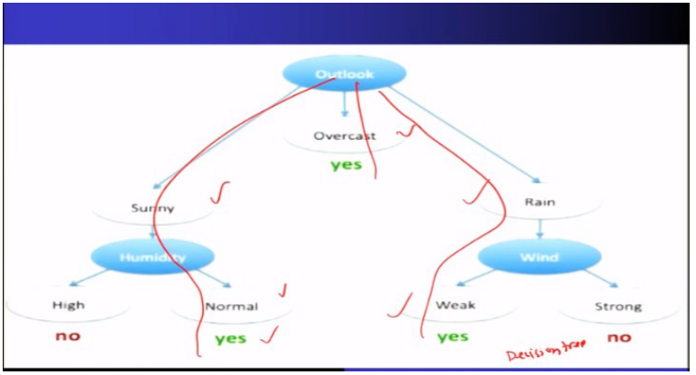

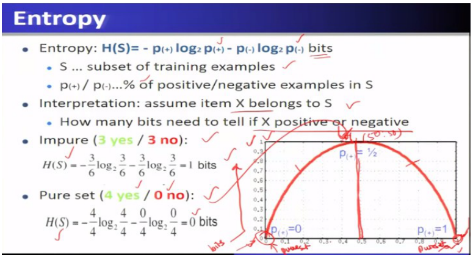

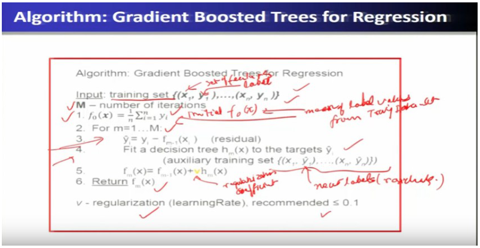

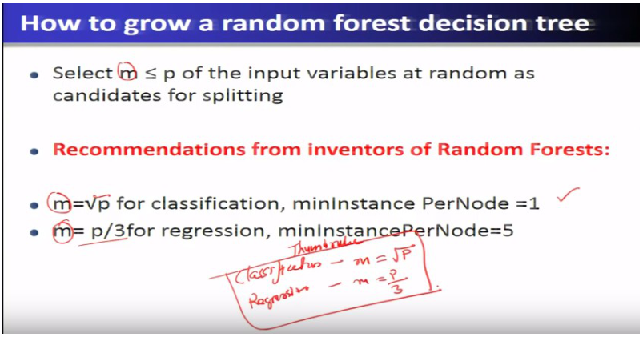

## This week's map

| Lec | Title | Why it is on the exam |
| --- | --- | --- |
| 27 | Decision Trees for Big Data Analytics | Pure/impure subsets, entropy, information gain, ID3, PLANET MapReduce |
| 28 | Big Data Predictive Analytics (Part-I) | Bootstrap, bagging, random forest (m of p features), parallelism |
| 29 | Big Data Predictive Analytics (Part-II) | Boosting, gradient boosted trees, learning rate, Spark ML RF/GBT, cross-validation |

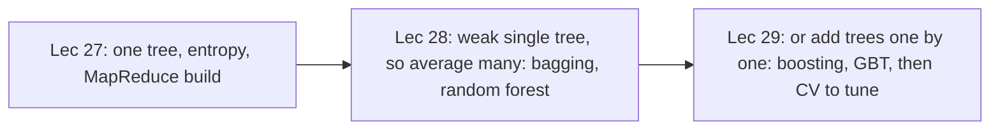

---

## Lecture 27: Decision Trees for Big Data Analytics

### Hook (4–6 sentences)

You have written down 14 days of whether a cricketer played, along with the weather each day. Tomorrow it will be raining, humid and the wind will be weak: will he play? Scanning the table does not give a clear answer, because several conditions interact. A decision tree turns the table into a flowchart of yes/no questions about the weather that ends at "play" or "do not play". This lecture builds one such tree by hand, shows the maths (entropy and information gain) for choosing each question, and then asks how you would build the same tree when the table has billions of rows and does not fit on one machine.

### Slide picture

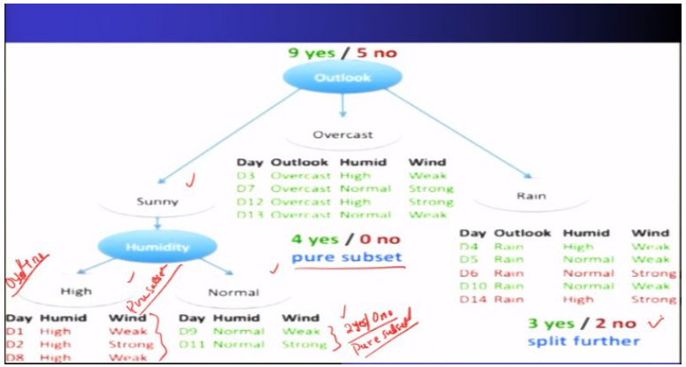

*Overcast is pure, so it becomes a "yes" leaf; sunny and rain are impure and must be split further.*

*Leaves hold the prediction; internal nodes are the decision nodes.*

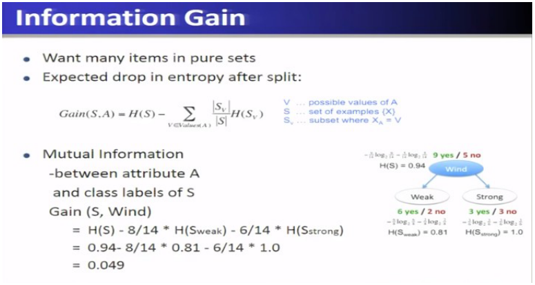

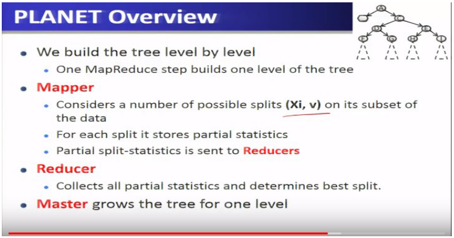

### Core ideas

**The shape of a decision tree.** A decision tree is an acyclic graph with a **root node** at the top, **internal nodes** below it and **leaf nodes** at the bottom. The root and internal nodes are **decision nodes**: each tests one attribute (outlook? humidity?). The **leaves** hold the **prediction**. To predict for a new item you start at the root, follow the branch matching each attribute value, and read the answer at the leaf you reach. You construct the tree from a **training set** (here the 14 observed days) and then **traverse** it for any new query.

- `EXAM` Root + internal nodes = decision nodes; leaves = predictions; predict by traversing the tree.

**The worked dataset.** 14 days with attributes Outlook (sunny / overcast / rain), Humidity (high / normal), Wind (weak / strong), and the label *played?*. Overall: **9 yes and 5 no**. The query is day 15: **rain, high humidity, weak wind**.

**Pure and impure subsets.** Split the data by an attribute and look at each resulting group (subset).

- A **pure subset** contains only one label (all yes or all no). You can answer with certainty and **do not split it further**. Example: Outlook = overcast → 4 yes / 0 no.
- An **impure subset** is mixed. Example: sunny → 2 yes / 3 no; rain → 3 yes / 2 no. These are split further.

Following this: sunny splits on **Humidity** — high → all no (pure), normal → all yes (pure). Rain splits on **Wind** — weak → 3 yes (pure), strong → 2 no (pure). No more splits are needed. The tree: overcast → yes; sunny & normal humidity → yes; rain & weak wind → yes; every other case → no. Query day 15 (rain, weak wind) → **yes**, with "confidence" 3/0 (three yes and no no in that leaf).

**ID3 and the split algorithm.** **ID3** (invented by **Ross Quinlan**, 1986; precursor of **C4.5**, 1993; **CART** is the statisticians' version by Breiman et al., 1984) builds the tree like this: let A be the **best attribute** to split on and make it the decision attribute of the node; create a child for each value of A; send the training examples to the matching child; **if a child's subset is pure, stop; otherwise split it recursively**.

The only open question is *which attribute is best*. The idea: choose the split that leaves you **most certain about yes/no afterwards**, i.e. the one that produces the **purest** subsets. The measure must be symmetric (4 yes/0 no is exactly as pure as 0 yes/4 no).

**Entropy — measuring impurity.** Entropy of a set S is H(S) = −p₊ log₂ p₊ − p₋ log₂ p₋, measured in **bits**, where p₊ and p₋ are the fractions of positive and negative examples. Read it as "how many bits do I need to tell whether a random item of S is positive or negative?"

- **Pure set** (4 yes / 0 no) → **0 bits** (no uncertainty).
- **Perfectly mixed** (3 yes / 3 no) → **1 bit** (a coin flip, 50 % chance of being right).
- Anything in between lies between 0 and 1 on the symmetric curve (peak at p₊ = ½).
- `EXAM` Entropy 0 = pure (stop). Entropy 1 = completely uncertain (50/50).

**Information gain — choosing the split.** Gain(S, A) = H(S) − Σ over values v of A of (|S_v|/|S|) · H(S_v). It is the **expected drop in entropy** after splitting on A (also called the mutual information between attribute A and the class labels). You want many items in pure sets, so you pick the attribute with the **largest** gain. Slide example for **Wind**: H(S) for 9 yes / 5 no = **0.94**; weak (6 yes / 2 no, 8 items) has H = **0.81**; strong (3 yes / 3 no, 6 items) has H = **1.0**. Gain = 0.94 − (8/14)(0.81) − (6/14)(1.0) = **0.049** — positive, so splitting helps.

- `EXAM` The tree is grown **greedily, top to bottom**, each split chosen to **maximise information gain**.

**When to stop.** Stop growing when (1) the node depth reaches the maximum depth parameter, (2) no split candidate gives information gain above a **minimum information gain**, or (3) no candidate produces children with at least the **minimum instances per node**. (A node whose subset is pure also stops.) Summary of properties: automatic handling of **feature interactions**, **computational scalability**, and **interpretability**.

**Building a tree with MapReduce — the PLANET idea.** With a huge dataset and many attributes, the **data is too big for one machine, but the tree itself is small** (at most about ten levels) and fits in memory. **PLANET** (*Parallel Learner for Assembling Numerous Ensemble Trees*, a Google paper) builds one binary tree as a **sequence of MapReduce jobs**, assuming hundreds of numerical attributes. Because a tree is built **level by level**, **one MapReduce step builds one level**: a 10-level tree needs about 10 steps.

- **Mapper:** holds the current tree in memory, drops each of its data points down to the appropriate leaf, and for each candidate split (Xᵢ, v) accumulates **partial statistics** about the data that reaches that leaf and its would-be left/right children. It sends these partial split statistics to the reducers.
- **Reducer:** collects all partial statistics and determines the **best split** at each node.
- **Master:** coordinates everything, monitors progress and **grows the tree by one level** using the best splits.

The master runs three kinds of MapReduce job: (1) an **initialisation** job, run **once**, that works out which split values to consider for each attribute; (2) a **FindBestSplit** job, run **repeatedly, once per level**, for nodes whose data is too large for memory; (3) an **InMemoryGrow** job, run **once**, that builds the whole subtree from a node when its data now **fits in memory**.

- `EXAM` PLANET = Parallel Learner for Assembling Numerous Ensemble Trees (Google). One MapReduce step = one tree level. Mapper = partial statistics for candidate splits; reducer = pick best split; master = grow the level.

**Case study: breast-cancer diagnosis with Spark ML.** Steps: create the **SparkContext** then the **SparkSession** (required to build DataFrames); download the dataset (an ID, a diagnosis **M** (malignant) or **B** (benign), and numeric features; **569 examples**); convert the string label to numeric (**M → 1, B → 0**) into a label column and a features column; **random split 70 % train / 30 % test**; fit a **DecisionTreeClassifier**; inspect the model (**29 nodes, depth 5, 30 features**, plus feature importances); predict on the test data and evaluate with **MulticlassClassificationEvaluator**. Accuracy ≈ **96 %**, which is fairly good. The printed tree is a set of nested if–else rules with predictions at the leaves.

### How it fits together

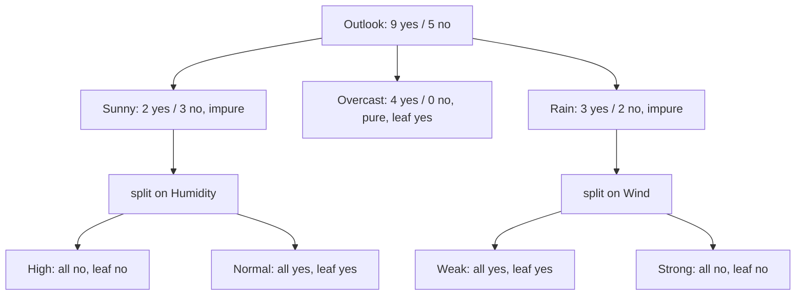

*Exam fact: pure subsets stop; impure subsets are split again on another attribute.*

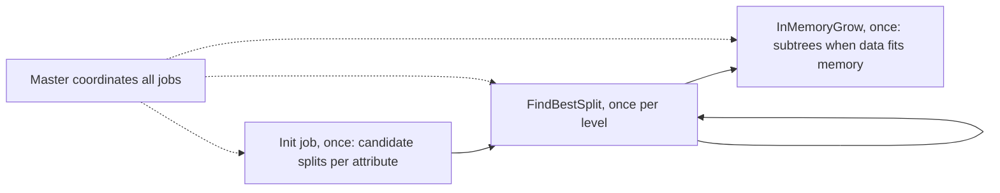

### Worked example

Compute the entropy of a node with 2 yes / 3 no (the sunny subset): p₊ = 0.4, p₋ = 0.6 → H = −0.4·log₂0.4 − 0.6·log₂0.6 ≈ 0.529 + 0.442 = **0.971** bits (impure, close to 1). After splitting on Humidity, both children are pure (H = 0), so the weighted entropy is 0 and the **gain is the full 0.971** — a perfect split, which is why the tree uses Humidity under Sunny.

### Near-twins / traps

- Pure subset (entropy 0, stop) vs impure subset (entropy up to 1, keep splitting).
- Entropy (impurity of one set) vs information gain (drop in entropy caused by a split). You maximise **gain**, not entropy.
- ID3 / C4.5 (Quinlan) vs CART (Breiman et al.): different authors/years.
- Decision nodes (root + internal) vs leaf nodes (predictions).
- PLANET: the **tree is small and in memory; the data is big**; the number of MapReduce steps ≈ number of tree levels.

### Tiny recap card

- Tree = root, internal decision nodes, leaf predictions; grown greedily by **maximum information gain**; stop on pure subset / max depth / min gain / min instances.
- Entropy: pure = 0, 50/50 = 1; gain(Wind) = 0.049.
- PLANET: one MapReduce step per level; mapper partial stats, reducer best split, master grows tree.

### Checkpoint

1. In a decision tree, the prediction is held at the
   a) root node  b) internal nodes  c) leaf nodes  d) edges
2. A subset with 4 yes and 0 no is
   a) impure with entropy 1  b) pure with entropy 0  c) impure with entropy 0.5  d) invalid
3. The entropy of a set with 3 yes and 3 no is
   a) 0  b) 0.5  c) 1  d) 2
4. ID3 chooses the attribute to split on by
   a) lowest information gain  b) highest information gain  c) alphabetical order  d) random choice
5. Information gain is
   a) the entropy after the split  b) the expected drop in entropy after the split  c) the number of leaves  d) the tree depth
6. Which statement about PLANET is correct?
   a) It builds the tree in one MapReduce job  b) One MapReduce step builds one level of the tree  c) It needs the tree to be larger than memory  d) The master computes all split statistics itself
7. In PLANET, partial split statistics are produced by the
   a) master  b) mappers and sent to reducers  c) client  d) NameNode
8. Statement 1: a pure subset is split further. Statement 2: an impure subset is split further.
   a) both true  b) 1 true, 2 false  c) 1 false, 2 true  d) both false
9. In the play-cricket tree, the query (rain, high humidity, weak wind) is predicted as
   a) no  b) yes  c) undecided  d) overcast
10. The Spark case study converts the diagnosis label M/B to
    a) 0/1 respectively  b) 1/0 respectively  c) yes/no strings  d) negative numbers

#### Answer key

1. **c** — leaves hold predictions.
2. **b** — one class only → pure, entropy 0.
3. **c** — 50/50 → 1 bit.
4. **b** — greedy, maximise information gain.
5. **b** — "expected drop in entropy after split".
6. **b** — one MapReduce step per level.
7. **b** — mappers → partial statistics → reducers choose best split.
8. **c** — only impure subsets are split.
9. **b** — rain + weak wind → yes.
10. **b** — M → 1, B → 0.

#### Optional, after you check

- Explain entropy and information gain to someone using a coin-flip picture.
- Why does PLANET need to run a FindBestSplit job once per level but InMemoryGrow only once?

---

## Lecture 28: Big Data Predictive Analytics (Part-I)

### Hook (4–6 sentences)

A single decision tree is easy to read and easy to scale, but it is a bad forecaster: it memorises noise in the training data (overfitting). If you could ask a hundred slightly different trees and take a vote, the individual mistakes would tend to cancel out. This lecture gives you the two building blocks (**bootstrap** to make slightly different datasets, **bagging** to average the models trained on them) and then **random forest**, which adds one more trick to make the trees different from each other. Understand these three words and you can answer most of Lecture 28 and half of Lecture 29.

### Slide picture

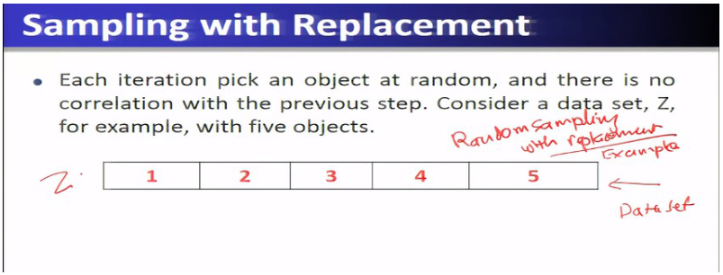

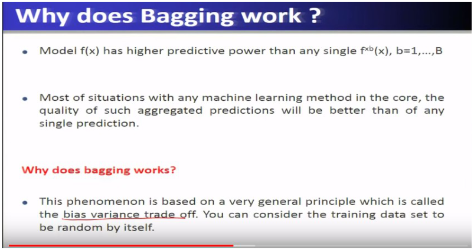

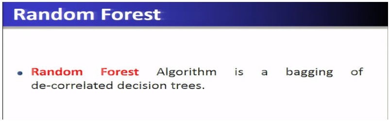

### Core ideas

**Recap: what a single tree gives you (and what it does not).** Good: it handles **feature interactions** automatically (one tree can combine several features), it is **computationally scalable** (can be built on clusters of hundreds or thousands of nodes with Spark), and it is **interpretable** (you can read the splits). Bad: its **predictive power is poor** because of overfitting to noise. So for predictive analytics on big data we augment it with the ideas below.

**Bootstrap.** A **bootstrap** is an algorithm that produces **replicas of a dataset by random sampling with replacement**. Start with dataset Z of n rows (each row is features x and label y). To make a **bootstrap dataset Z\***: pick a row at random, copy it into Z\*, put it back, and repeat n times. Because each pick is independent of the previous one, the **same row can be picked more than once** and some rows are never picked.

- `EXAM` Bootstrap = random sampling **with replacement**. The bootstrap dataset has the **same size** as the original, but a slightly different content (some objects repeated, some missing).
- Slide example: Z has objects 1–5; Z\* might become [3, 1, 5, 5, 2] (object 5 twice; 4 missing).

**Bagging (bootstrap aggregation).** Bagging is a general method for **averaging the predictions of models** and is not tied to decision trees; any learning method can be used. Algorithm: given training set Z, number of iterations **B** and a learning method **M**: for b = 1 … B, draw a bootstrap sample Z\*b of size n, apply M to it to get a model f\*b(x). The **ensemble** is the B models.

- **Regression:** the prediction is the **average** of the B model outputs.
- **Classification:** the prediction is the **majority vote** of the B models. Slide example: three trees say orange, mango, orange → orange.
- `EXAM` Bagging **reduces the variance** of predictions, so it also fights overfitting. It improves almost any ML method but is **time-consuming for large datasets**.

**Why does bagging work?** The training set is itself **random** — user clicks, sensor readings and so on would come out slightly different if you repeated the experiment. A model fitted to one such sample carries some noise; averaging models trained on many samples makes the **noisy, unstable parts cancel** and leaves the **stable, reliable part**. This is the general **bias–variance trade-off** principle: averaging reduces variance.

**Random forest.** The slide: *"Random Forest algorithm is a bagging of de-correlated decision trees."* Training: for b = 1 … B draw a bootstrap sample Z\*b and grow a **de-correlated decision tree** T_b on it; the result is the ensemble T₁…T_B. Prediction is **average** (regression) or **majority vote** (classification) over the trees.

What makes the trees "de-correlated"? In a normal tree every split looks at **all** p input features. In a random-forest tree, **at each split only a random subset of m out of the p input variables is considered** as candidates; the split among those candidates is still chosen to **maximise information gain**. Because different trees (and different nodes) see different candidate features, the trees do not all copy the same dominant feature, so their errors are less correlated and averaging works better.

- `EXAM` Rule of thumb from the inventors: **m = √p** for classification (minInstancesPerNode = 1) and **m = p/3** for regression (minInstancesPerNode = 5).
- `SLIDE` A plot compares a regular tree-bagging (all features each step, green) against the de-correlated variant (m = √p, blue): with **fewer than about 20 trees** the de-correlated variant is *worse*; beyond that it performs better and converges to a better solution.

**Properties of random forests.** (1) Handles **feature interactions** automatically. (2) **Computationally scalable and easily parallel**: each tree can be built **independently** of the others, so forests train in a distributed environment with a high degree of parallelism. (3) **Predictive power:** better than a single tree, **slightly worse than gradient boosted trees**; a good general-purpose method for classification and regression. (4) **Interpretability is poor**: a forest of hundreds or thousands of trees cannot be read by a human expert; this is the **interpretability vs predictive-power trade-off** (single tree: interpretable but weak; forest: strong but opaque).

### How it fits together

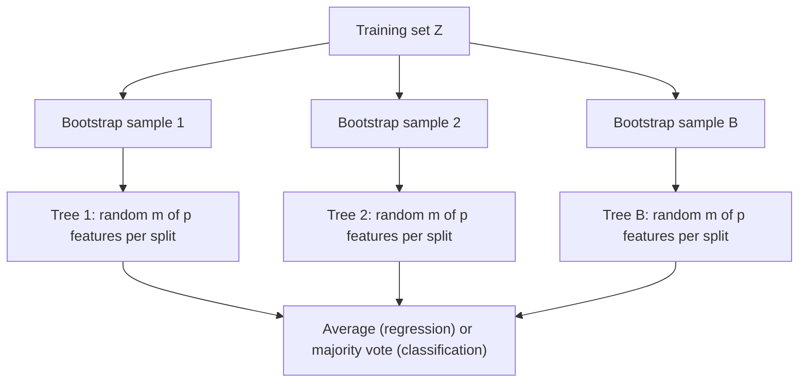

*Exam fact: random forest = bagging + random feature subset at each split; the trees are independent so they can be built in parallel.*

### Worked example

Training set Z = {1, 2, 3, 4, 5}. Bootstrap draw (n = 5 picks): 3, 1, 5, 5, 2 → Z\* = {3, 1, 5, 5, 2}: same size, 5 repeated, 4 missing.
Three trees classify a fruit: Tree 1 = orange, Tree 2 = mango, Tree 3 = orange → majority vote = **orange**.
For regression, three trees predict 10, 12, 14 → prediction = average = **12**.
If a dataset has p = 16 features, classification trees consider m = √16 = **4** candidate features per split; regression trees consider m = 16/3 ≈ **5**.

### Near-twins / traps

- Bootstrap (creates the datasets, sampling with replacement) vs bagging (aggregates models trained on them).
- Bagging a single algorithm on bootstrap samples vs random forest: RF also **randomises features** at each split.
- Classification: majority vote. Regression: average.
- Single tree = interpretable, weak predictor; random forest = strong predictor, poor interpretability; GBT is a bit better still than RF.
- Forest trees are independent (parallel); boosting (next lecture) is sequential.

### Tiny recap card

- Bootstrap = sample with replacement; bagging = average models on bootstrap samples → lower variance.
- Random forest = bagging of de-correlated trees; m of p features per split (√p / p/3).
- Parallel because trees are independent; good predictor, poor interpretability.

### Checkpoint

1. Bootstrapping refers to
   a) feature scaling  b) sampling with replacement  c) gradient computation  d) data normalisation
2. The main purpose of bagging is to
   a) increase bias  b) reduce prediction variance  c) shrink the dataset  d) increase overfitting
3. In bagging a classification problem, the final prediction is
   a) the average of labels  b) the majority vote  c) the first model's output  d) the last model's output
4. Random forest is best described as
   a) a single deep tree  b) a clustering algorithm  c) bagging of de-correlated decision trees  d) a neural network
5. At each split of a random-forest tree
   a) all features are evaluated  b) a random subset of m of the p features is evaluated  c) no feature is used  d) one fixed feature is used
6. For classification, the recommended m is
   a) p  b) √p  c) p/3  d) 1
7. Random forests train in parallel because
   a) trees are built independently  b) trees share memory  c) one processor builds all trees  d) trees need sequential execution
8. Compared with a single decision tree, a random forest has
   a) better interpretability and better predictive power  b) poorer interpretability and better predictive power  c) better interpretability and worse predictive power  d) the same of both
9. A bootstrap sample of a 5-object dataset
   a) always contains each object once  b) has 5 objects, some possibly repeated and some missing  c) has 10 objects  d) has no repeated objects
10. Statement 1: Bagging works for any learning algorithm. Statement 2: Bagging can be time-consuming on large datasets.
    a) both true  b) 1 true, 2 false  c) 1 false, 2 true  d) both false

#### Answer key

1. **b** — random sampling with replacement.
2. **b** — bagging reduces variance.
3. **b** — majority vote (average for regression).
4. **c** — slide definition.
5. **b** — random subset of features.
6. **b** — m = √p classification, p/3 regression.
7. **a** — independent trees.
8. **b** — lose interpretability, gain predictive power.
9. **b** — same size, repeats and omissions allowed.
10. **a** — both on the slides.

#### Optional, after you check

- Explain in plain words why averaging many noisy trees gives a steadier answer.
- What would happen to the "de-correlation" if m = p?

---

## Lecture 29: Big Data Predictive Analytics (Part-II)

### Hook (4–6 sentences)

Random forest averages many trees built independently. Boosting takes the opposite approach: build the trees one after another, where each new tree is trained specifically to repair the mistakes the current model still makes. The best-known version, gradient boosted decision trees, is described as the best general-purpose method for classification and regression. The second half of the lecture is hands-on: running a single tree, a gradient boosted ensemble and a random forest in Spark ML on the same dataset, and then using cross-validation to choose parameters. Take it in three parts: A boosting for regression, B boosting for classification and usage tips, C Spark ML and cross-validation.

### Part A — Boosting and gradient boosted trees for regression

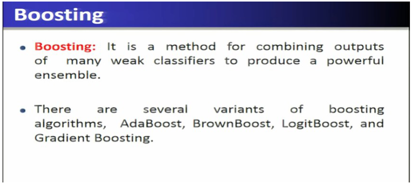

#### Core ideas

**Boosting.** **Boosting is a method for combining the outputs of many weak classifiers to produce a powerful ensemble.** Variants named on the slide: **AdaBoost, BrownBoost, LogitBoost, Gradient Boosting**.

Why would you want it? In big data there are many training examples and many features, so you would like a really complex, accurate model. There are two ways to get one:

1. Start with a **very complex model** and fit all its parameters at once — this is how **neural networks** work.
2. Build a complex model **iteratively**, where **each step trains only a simple model**. In boosting these simple models are the **weak (base) classifiers**; the final model is an **ensemble of weak classifiers**. With **decision trees** as the base learners you get **gradient boosted decision trees**.

- `EXAM` Boosting = weak classifiers combined into a strong ensemble, **built iteratively**.

**Gradient boosted trees for regression.** The goal is a function f(x) that minimises the **sum of squared errors** Σ(f(x) − y)². Build f as a sum of trees: **f(x) = h₁(x) + h₂(x) + … + h_M(x)**, where each h_m is a **decision tree**.

Algorithm (slide): input = training set {(xᵢ, yᵢ)} and M = number of iterations.

1. **f₀(x) = mean of all the labels** (the average of yᵢ) — the simplest possible starting model.
2. For m = 1 … M:
   - compute the **residual** ŷᵢ = yᵢ − f_{m−1}(xᵢ): the difference between the true label and what the current model predicts;
   - **fit a decision tree h_m(x) to the residuals** (an auxiliary training set where the residuals replace the labels);
   - update **f_m(x) = f_{m−1}(x) + v · h_m(x)**, where **v** is the **regularization coefficient (learning rate), recommended ≤ 0.1**.
3. Return f_M(x).

Think of it as a team of correctors: the first guess is the average; tree 1 learns "where am I still wrong, and by how much?", you add a *small* fraction of its correction; tree 2 learns what is still wrong after that, and so on.

**Why "gradient"?** Gradient boosting is like **gradient descent**: to minimise a function you take small steps in the direction **opposite to the gradient**, multiplying each gradient by a small constant (the **step size**). Here the "step" is adding v·h_m(x), so gradient boosting is **minimisation in the functional space**: f_m = f₀ + v·h₁ + v·h₂ + …. For squared error the negative gradient is exactly the residual, which is why the trees fit residuals.

- `EXAM` GBT for regression: start with f₀ = mean of labels; each iteration fits a tree to the **residuals** and adds it times the learning rate (≤ 0.1). GBT with decision trees is considered the **best general-purpose algorithm** for classification or regression.

#### Worked example (regression)

Labels y = [10, 20, 30]. f₀ = mean = **20**. Residuals = [−10, 0, +10]. Suppose tree h₁ fits these perfectly and v = 0.1: new predictions = 20 + 0.1·[−10, 0, 10] = [19, 20, 21]. New residuals = [−9, 0, +9]. A second tree is fitted to those, and the predictions creep towards [10, 20, 30]. A small v needs **more iterations** but is safer.

#### Checkpoint A

1. Boosting combines
   a) strong classifiers only  b) weak classifiers into a strong ensemble  c) clusters into datasets  d) databases into warehouses
2. Gradient boosting builds models
   a) in a single step  b) iteratively  c) randomly  d) without training
3. In gradient boosted trees for regression, f₀(x) is
   a) zero  b) the mean of the training labels  c) a random tree  d) the median feature
4. Each new tree in GBT regression is fitted to
   a) the original labels  b) the residuals of the current model  c) the features only  d) random noise
5. The recommended learning rate (regularization coefficient) is
   a) greater than 1  b) equal to 5  c) at most 0.1  d) equal to 10
6. Which is NOT a named boosting variant?
   a) AdaBoost  b) LogitBoost  c) BrownBoost  d) K-Means
7. Gradient boosting is analogous to
   a) gradient descent in the functional space  b) clustering  c) bootstrap sampling  d) pre-pruning
8. The base learners in gradient boosted trees are usually
   a) decision trees  b) neural networks  c) K-means clusters  d) support vectors

#### Answer key A

1. **b** — slide definition.
2. **b** — iterative construction.
3. **b** — initial f₀ = mean label.
4. **b** — auxiliary set with residuals as new labels.
5. **c** — learning rate ≤ 0.1.
6. **d** — K-Means is clustering.
7. **a** — small steps opposite to the gradient.
8. **a** — decision trees.

### Part B — Classification, stochastic boosting and usage tips

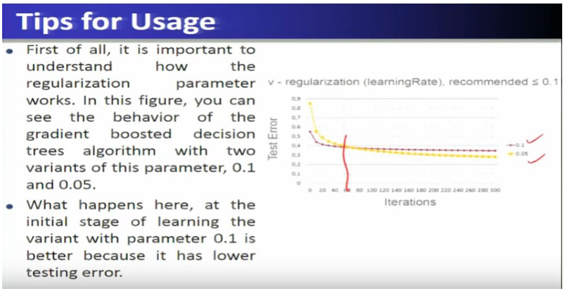

#### Core ideas

**GBT for classification.** Class labels are 0 or 1 and the goal is to minimise the number of **misclassifications**. Instead of predicting the label directly, the model predicts the **probability** that an object belongs to class 1: **P(y = 1 | x) = 1 / (1 + exp(−f(x)))**, where f(x) = Σ h_m(x) is an ensemble of trees. This function is the **sigmoid**, 1/(1+e⁻ˣ), which squeezes any real number into the range **0 to 1**, so the output is always a legitimate probability.

To fit it, use the **principle of maximum likelihood**. The **likelihood** is the probability of observing the dataset given the model; assuming independent objects it is the **product of the individual probabilities**. Because log is monotonic, maximising the likelihood is the same as maximising the **log-likelihood Q(f) = Σ log P(yᵢ | xᵢ)**. The classification algorithm mirrors the regression one: start with f₀ = log(p₁/(1−p₁)) (p₁ = fraction of class-1 objects); at each iteration compute the **gradient** of the log-likelihood, fit a tree h_m to those gradients, and update f_m = f_{m−1} + v·ρ_m·h_m, where ρ_m comes from maximising Q.

- `EXAM` Classification GBT: sigmoid turns the tree-ensemble output into a probability; trained by **maximum likelihood**; each tree is fitted to the **gradients** (the classification analogue of residuals).

**Stochastic boosting.** To make training cheaper, each iteration uses only a **random subsample** of the training data (the slide uses **k = 0.5n**, sampled with replacement — a bagging idea borrowed from random forest). Smaller samples make each iteration more efficient.

**Tips for usage.**

- **Learning rate (regularization) ≤ 0.1.** In the slide plot comparing two settings (0.1 and 0.05), the larger rate is better at the **start** (lower test error early), but the **smaller rate eventually wins**. So **do not stop after a few dozen iterations**; run until the test error stops changing (convergence). A lower learning rate converges more slowly but gives a better model.
- **Number of iterations:** the bigger your dataset the more iterations; the recommended range is **several hundred to several thousand**.
- **Tree depth:** the more features you have, the deeper the trees can be; big data with many features allows a more complex model **without overfitting**.
- **Properties:** best method for **general-purpose classification and regression**; handles **feature interactions** (decision-tree core); **computationally scalable**, runs on a Spark cluster; **very good predictive power**, better than a random forest; but **not interpretable** — the final sum of trees is very large. There is always a **trade-off between predictive power and interpretability**.

#### Near-twins / traps

- Random forest (independent trees, average/vote, m of p features) vs GBT (sequential trees, each fits residuals/gradients, learning rate).
- Regression GBT fits **residuals**; classification GBT outputs a **sigmoid probability** and uses **maximum likelihood**.
- Bigger learning rate looks better early; smaller rate wins at convergence.

#### Checkpoint B

1. The sigmoid function in GBT classification maps real values to
   a) {0, 1} only  b) the range 0 to 1  c) negative numbers  d) integers
2. GBT classification is fitted using the principle of
   a) minimum support  b) maximum likelihood  c) pre-pruning  d) leave-one-out
3. Stochastic boosting uses, per iteration,
   a) the full dataset always  b) a random subsample of the data (e.g. 0.5n)  c) no data  d) only labels
4. The recommended number of iterations for GBT is
   a) 1–5  b) a few dozen  c) several hundred to several thousand  d) exactly 10
5. In the learning-rate plot, the smaller rate
   a) is worse forever  b) starts worse but eventually reaches lower test error  c) never converges  d) is identical
6. Statement 1: GBT has better predictive power than random forest. Statement 2: GBT is highly interpretable.
   a) both true  b) 1 true, 2 false  c) 1 false, 2 true  d) both false
7. GBT scales to big data because it
   a) runs on distributed systems such as Spark  b) uses one machine only  c) has no trees  d) ignores features
8. P(y = 1 | x) in GBT classification is
   a) f(x)  b) 1/(1+exp(−f(x)))  c) exp(f(x))  d) −f(x)

#### Answer key B

1. **b** — sigmoid output lies between 0 and 1.
2. **b** — maximum likelihood.
3. **b** — k = 0.5n sample.
4. **c** — slide recommendation.
5. **b** — "variant with lower regularization eventually superior".
6. **b** — good predictor, not interpretable.
7. **a** — scalable on Spark.
8. **b** — sigmoid of the tree ensemble.

### Part C — Spark ML for trees and cross-validation

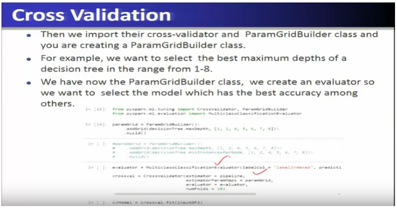

#### Core ideas

**Spark ML trees, same dataset three ways.** The set-up is the same as the Lecture 27 case study: create the **SparkContext** and **SparkSession**, load the breast-cancer data (569 examples; ID, M/B label, features) into a DataFrame, use a **StringIndexer** to turn M/B into the numeric label column (1/0), split **70 % / 30 %** into train/test, fit a classifier on the training data, **transform** the test data to get predictions, and score them with **MulticlassClassificationEvaluator**.

1. **Decision tree** (`DecisionTreeClassifier`): fits very quickly, inspect number of nodes, depth, feature importances; the model prints as if–then–else rules. Error is only about **3 %**.
2. **Gradient boosted trees** (`GBTClassifier`): same label/feature columns, run **100 iterations**, default **step size 0.1**; improves on the single tree.
3. **Random forest** (`RandomForestClassifier`): fit and transform the same way; in **this** dataset the random forest had the **lowest test error (best)**. With other data the result may differ; in general, the bigger the dataset and the more features, the better the complex methods (GBT, forest) do.

**Cross-validation in Spark ML.** Cross-validation **assesses the quality of an ML model and finds the best model among a family of models** (parameter settings). Steps (slide): create the SparkContext/Session, read the data into a DataFrame and index labels; create the **decision-tree object** and a **pipeline** containing it; import **CrossValidator** and **ParamGridBuilder**; build a **parameter grid**, e.g. **maxDepth in the range 1–8**; create an **evaluator** (MulticlassClassificationEvaluator) so the model with the **best accuracy** is selected; create the `CrossValidator` with the pipeline, the parameter grid, the evaluator and **numFolds** (slide uses **10**; folds should be not fewer than 5 or 10); call `fit` — it takes time because Spark must train and evaluate **ten times for each parameter setting**. The result lists the average accuracy for each depth; the best model has **depth 6 and 47 nodes**. You can add more parameters (e.g. minInstancesPerNode) to the grid, but each extra parameter makes training slower.

- `EXAM` Cross-validation = assess model quality + select the best parameters. Spark: `CrossValidator`, `ParamGridBuilder`, evaluator, `numFolds`.

#### How it fits together

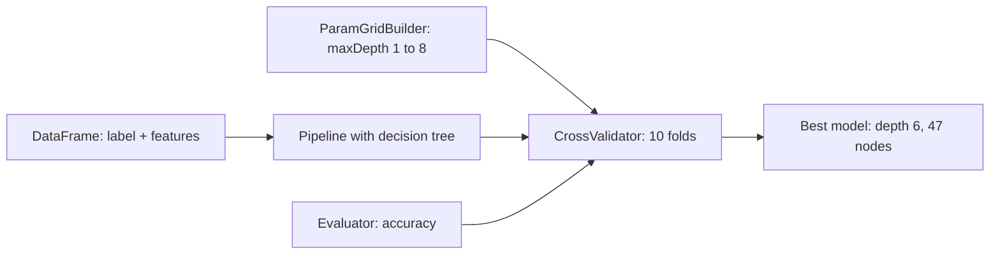

*Exam fact: grid of parameters + evaluator + folds → CrossValidator picks the best-accuracy model.*

#### Worked example

Grid of maxDepth ∈ {1, 2, 4, 5, 6, 7, 8} with 10 folds trains 7 × 10 = 70 models before the final refit. Suppose depth 6 has the highest average validation accuracy → CrossValidator returns the depth-6 model (47 nodes). The test set should still only be used for final evaluation.

#### Checkpoint C

1. Cross-validation is mainly used to
   a) increase dataset size  b) assess model quality and select the best parameters  c) reduce the number of features  d) perform clustering
2. In Spark ML, a parameter grid is built with
   a) CrossValidator  b) ParamGridBuilder  c) StringIndexer  d) RandomSplit
3. StringIndexer in the case study is used to
   a) convert M/B string labels to numeric values  b) build the tree  c) evaluate the model  d) split the data
4. In the demo, which model had the lowest test error?
   a) single decision tree  b) random forest  c) logistic regression  d) K-means
5. In the demo, the best decision-tree depth selected by cross-validation was
   a) 1  b) 3  c) 6  d) 8
6. Which evaluator is used in the demos?
   a) MulticlassClassificationEvaluator  b) ClusterEvaluator  c) MapReduceEvaluator  d) GraphEvaluator
7. Spark's cross-validation fit takes longer because
   a) it must train and evaluate the model for every fold and every parameter setting  b) it uses one core  c) it stores no data  d) it skips training

#### Answer key C

1. **b** — slide definition.
2. **b** — ParamGridBuilder.
3. **a** — string label to numeric.
4. **b** — random forest was best in this dataset.
5. **c** — depth 6, 47 nodes.
6. **a** — multiclass classification evaluator.
7. **a** — many train/evaluate repetitions.

### Tiny recap card

- Boosting: weak learners, built iteratively; GBT regression = start mean, fit residuals, learning rate ≤ 0.1.
- GBT classification: sigmoid probability, maximum likelihood; stochastic boosting samples 0.5n.
- CV (Spark): CrossValidator + ParamGridBuilder + evaluator → best parameters (depth 6).

---

## Week wrap

### How the lectures connect

Lecture 27 gives the base learner: a decision tree, chosen by information gain and scalable through MapReduce (PLANET), but a weak predictor on its own. Lecture 28 shows the first fix: train many trees on bootstrap samples with random feature subsets and average them (random forest, parallel, variance-reducing). Lecture 29 shows the second fix: add small trees one after another, each fitted to the remaining error (gradient boosting), and shows how to tune and compare these in Spark ML with cross-validation.

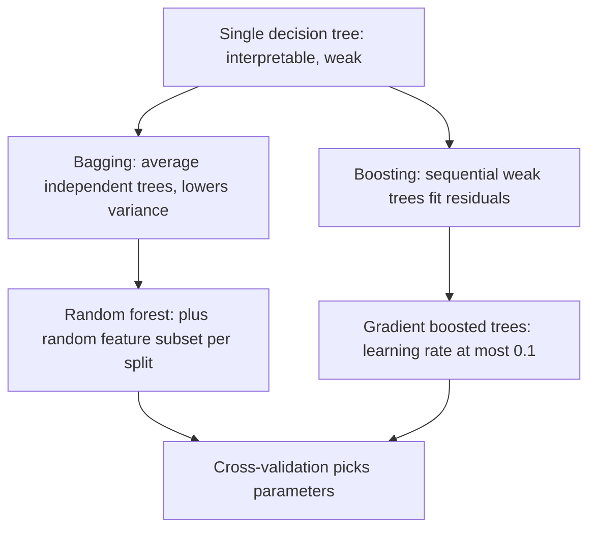

### Assignment-shaped mixed quiz

1. Random forest is best described as
   a) a single deep decision tree  b) a clustering algorithm  c) a neural-network ensemble  d) bagging of de-correlated decision trees
2. The main purpose of bagging is to
   a) increase bias  b) reduce prediction variance  c) reduce dataset size  d) increase overfitting
3. Bootstrap in bagging means
   a) sampling with replacement  b) feature scaling  c) gradient computation  d) data normalisation
4. In random forest, at each split
   a) all features are always evaluated  b) a random subset of features is selected  c) features are ignored  d) only one feature exists
5. Random forest naturally supports parallel processing because
   a) trees are built independently  b) trees share memory  c) trees use one processor  d) trees require sequential execution
6. Boosting combines
   a) strong classifiers only  b) weak classifiers into a strong ensemble  c) clusters into datasets  d) databases into warehouses
7. Gradient boosting builds models
   a) in a single step  b) iteratively  c) randomly  d) without training
8. In gradient boosted trees, the base learners are usually
   a) decision trees  b) neural networks  c) K-means clusters  d) support vectors
9. The recommended learning rate for gradient boosting is
   a) greater than 1  b) equal to 5  c) less than or equal to 0.1  d) equal to 10
10. A node with 5 yes / 0 no has entropy
    a) 1  b) 0  c) 0.5  d) 2
11. In PLANET, the job run once at the start to choose the candidate split values per attribute is the
    a) FindBestSplit job  b) initialisation job  c) InMemoryGrow job  d) reducer
12. Statement 1: single decision trees are highly interpretable but weak predictors. Statement 2: GBT is more interpretable than a single tree.
    a) both true  b) 1 true, 2 false  c) 1 false, 2 true  d) both false

#### Answer key

1. **d** — slide definition.
2. **b** — variance reduction.
3. **a** — sampling with replacement.
4. **b** — random subset of m of p features.
5. **a** — trees are independent.
6. **b** — weak into strong.
7. **b** — iterative.
8. **a** — decision trees.
9. **c** — ≤ 0.1.
10. **b** — pure → 0 bits.
11. **b** — initialisation MapReduce, run once.
12. **b** — statement 2 is false, GBT is not interpretable.

### Last 5-minute drill

| Term | Answer to recall |
| --- | --- |
| Leaf node | holds the prediction |
| Entropy of pure set | zero bits |
| Entropy of 50/50 set | one bit |
| Information gain | expected entropy drop after split |
| PLANET | one MapReduce step per tree level |
| Bootstrap | random sampling with replacement |
| Bagging | averages models, reduces variance |
| Random forest | bagging of de-correlated trees |
| m for classification | square root of p |
| Boosting | weak learners combined iteratively |
| GBT regression start | mean of the labels |
| Learning rate | at most 0.1 |
| Cross-validation | assess quality, select best parameters |
