# Week 8 — Parameter servers, PageRank and Spark GraphX

> Goal: finish this week without the video or the raw PDF. Exam first, then a first reading that actually makes sense.
> Time budget: about 75–100 minutes. Lectures 32–33 (GraphX) carry the most exam weight; lectures 30–31 are the setup.

## One-page cheat sheet

**If you remember only 7 things this week**

1. **Parameter server** = a set of **server machines** that hold the model's parameters as a **key/value store** (distributed shared memory); **workers** **pull** (query) parameters and **push** (update, `w ← w + Δ`, an addition) changes. Used for scalable iterative ML (SGD, topic models, matrix factorisation, deep nets). Spark version: **Glint**.
2. Network access is slow, so PS uses **caching** and **asynchronous** operation; pure async has **no theoretical guarantees** (delays, stragglers), so PS uses **Stale Synchronous Parallel (SSP)**: workers run at their own pace but may not drift more than **s (staleness bound τ)** clocks apart. SSP **interpolates between BSP and async** and subsumes both.
3. **PageRank** rates a page's importance from the **link structure**: links from **many** pages, and links from **high-rank** pages, both raise rank. **PR(A) = (1−d)/N + d·Σ PR(B)/L(B)**, damping **d = 0.85**, initial PR = **1/N**; iterate until convergence (or a fixed count, e.g. 30). Invented by **Larry Page and Sergey Brin** (Google).
4. **PageRank in MapReduce** shuffles the **entire graph state every iteration** (wasteful, iteration controlled outside MR). **Pregel** (Google; open source Apache Giraph, GPS, JPregel, Hama) is **vertex-centric**: one vertex program, **supersteps**, messages, **active flag**.
5. **GraphX** = Spark's graph library that **unifies data-parallel and graph-parallel analytics**. A graph is a **property graph** = **vertex property table + edge property table** (RDDs); **triplets** join an edge with both its end-vertices; tables and graphs are **composable views of the same physical data**, so no round trip through HDFS between stages.
6. **Graph-parallel pattern** = **Gather → Apply → Scatter** at each vertex, run in parallel (a superstep, bulk-synchronous). Algorithms: PageRank, connected components, **triangle counting** (more triangles = more cohesive community), shortest paths, etc. (**Shuffle Sort is NOT part of it**.)
7. **GraphX optimisations**: **mirror cache + local aggregation** (less communication), **indexing of active edges**, **join elimination** (skip joins for unused triplet fields; PageRank uses only source attributes → ~2× less communication), **indexing and bitmaps** (accelerate joins, build subgraphs fast), **substantial index and data reuse** (reuse routing tables, edge adjacency info, indices across graphs and subgraphs). Flight-data case study: airports = vertices, routes = edges; `numVertices`, `numEdges`, `triplets`, `inDegree`/`outDegree`, `pageRank`.

**Near-twins (left is not right)**

| This | Is not | Because |
| --- | --- | --- |
| Pull | Push | Pull = query parameters; push = send updates (additions) |
| BSP | SSP | BSP: barrier every iteration (strongly consistent). SSP: bounded drift of s clocks |
| SSP | Pure async | Async has no bound/guarantee; SSP bounds staleness |
| MapReduce PageRank | Pregel PageRank | MR shuffles whole graph each iteration; Pregel has one vertex program + messages |
| Gather / Apply / Scatter | Map / Shuffle / Reduce | The first is the graph-parallel pattern; Shuffle Sort is not part of it |
| `triplets` | `subgraph()` / `reverse()` | triplets joins vertices and edges; subgraph filters; reverse flips edge direction |
| Join elimination | Indexing and bitmaps | Elimination skips joins on unused fields; indexing/bitmaps speed joins and subgraph construction |
| Property graph | Plain graph | Vertices and edges carry **properties** |

**Numbers / defaults this week**

- Damping factor **d = 0.85** (random-jump term 0.15/N); initial PageRank **1/N** (4 nodes → 0.25, 5 nodes → 0.2); Pregel example stops after **30** iterations.
- Scale of graphs: social **1 B vertices / 100 M edges**; web **50 B / 1 T**; brain **100 B / 100 T**.
- PageRank on LiveJournal (10 iterations): Mahout/Hadoop **1340 s**, naive Spark **354 s**, GraphLab **22 s**. Triangle counting on Twitter: Hadoop 1536 machines/423 min vs GraphLab 64 machines/15 s (~1000×). GraphX is roughly **3× slower than GraphLab** for the pure graph computation but fastest **end-to-end** in the pipeline.
- Flight data: **January 2014**, **17 attributes**, ≈ **304–305** airports; edge filter example: distance **> 1000** miles.

**Diagrams** (reused from `images/`)

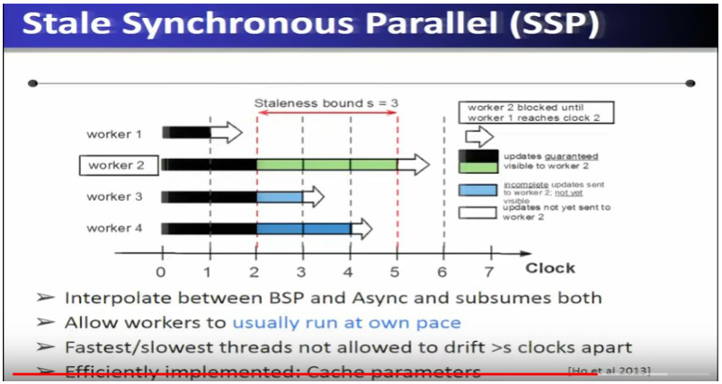

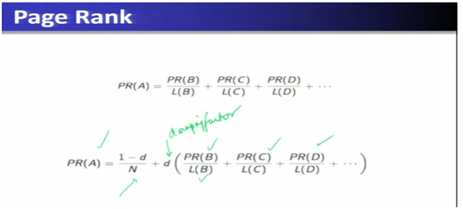

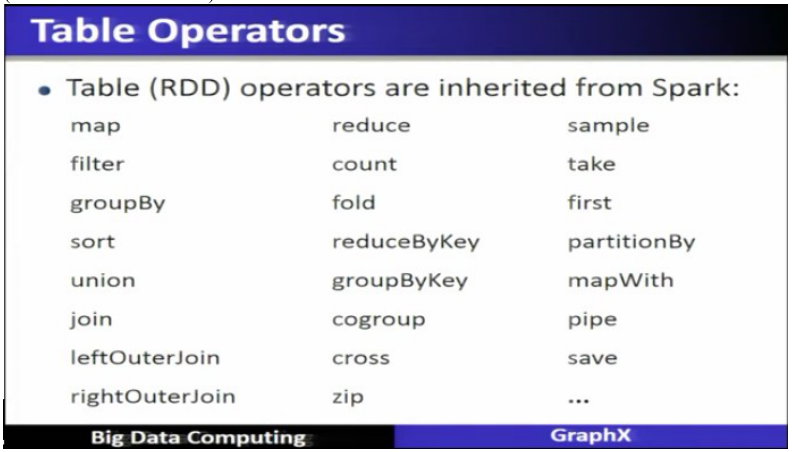

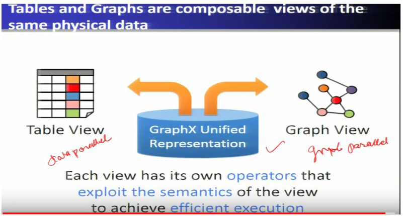

## This week's map

| Lec | Title | Why it is on the exam |
| --- | --- | --- |
| 30 | Parameter Servers | pull/push, key-value, caching, async, SSP |
| 31 | PageRank Algorithm in Big Data | formula, damping, MapReduce vs Pregel |
| 32 | Spark GraphX & Graph Analytics (Part-I) | graph-parallel pattern (gather/apply/scatter), unified view, goal of GraphX |
| 33 | Spark GraphX & Graph Analytics (Part-II) | property graph, triplets, routing table, optimisations |
| 34 | Case Study: Flight Data Analysis using Spark GraphX | airports as vertices, routes as edges, queries |

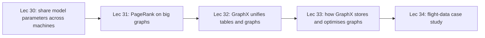

---

## Lecture 30: Parameter Servers

### Hook (4–6 sentences)

Training a big machine-learning model is a loop: look at a slice of data, nudge the model's numbers a little, repeat thousands of times, and you want a whole cluster doing that at once. But then the model's numbers (its *parameters*) have to live somewhere that every machine can read and update. Writing each iteration as a MapReduce job is wasteful, since each job re-reads data and re-saves output. A parameter server is the shared "whiteboard of numbers" the whole cluster reads from and writes to. The harder question this lecture answers is how strictly the workers must keep in step with each other, which leads to the **Stale Synchronous Parallel** model.

### Slide picture

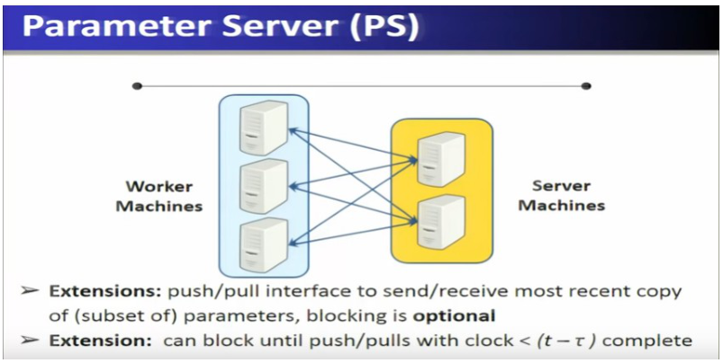

*Workers on one side, server machines holding the parameters on the other; the interface is push/pull.*

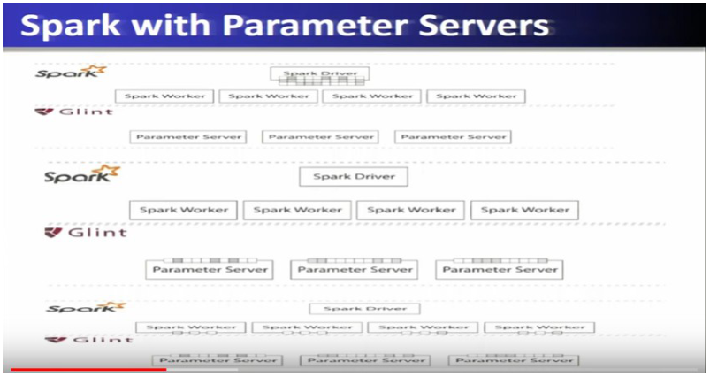


### Core ideas

**Why scalable ML needs a new abstraction.** Scalable ML algorithms (Naive Bayes on dataflow systems like Hadoop and Spark; graph algorithms on GraphLab and TensorFlow; shared-memory systems such as Bosen and DMTK) need an abstraction from the platform below them. For many iterative algorithms that abstraction is the **parameter server**, used at Google, Yahoo and in academic work (Smola, Xing).

**What it is.** A **parameter server** distributes a **model over multiple machines** — the parameters sit in **server machines** and are accessed through a **key/value interface** (a distributed shared memory, in the simplest picture a **distributed hash table** reachable over the network). **Worker machines** hold slices of the training data. They use two operations:

- **Pull** — **query** (read) the current value of some parameters.
- **Push** — **update** parameters. In most ML update equations the update is an **addition**, `w ← w + Δ`, as in **stochastic gradient descent** or collapsed Gibbs sampling for topic models, so a push is "add δ to key k".
- Extensions: multiple keys for matrix operations, multiple channels for sparse vectors, multiple clients per server. The push/pull interface sends or receives the most recent copy of a **subset** of parameters; **blocking is optional**, and one extension can **block until push/pulls with a clock < t − τ complete**.
- In **Spark**, the parameter servers are provided by **Glint** next to the Spark driver and Spark workers. During **training** the model is stored in **parameter-server shards**, and asynchronous updates are applied to the shard that owns each key.

- `EXAM` Parameter server: server machines hold parameters (key/value, distributed shared memory); workers **pull** (query) and **push** (update by addition). It supports topic models, matrix factorisation, SVMs, CNN/DNN.

**Why not just MapReduce?** Iterative ML is common (topic modelling, matrix factorisation, SVM, deep nets). In MapReduce each iteration reloads data and **redundantly saves output between stages**, which makes iteration expensive. Comparison from the slides: MapReduce has independent records as its data model, **MapReduce** as its programming abstraction and **bulk synchronous parallel (BSP)** as its execution semantics. The parameter server also uses independent records, but its abstraction is a **key/value store (distributed shared memory)**; its execution semantics is what we must now decide.

**Problem 1: the network is slow.** Every get/add goes over the network, which is much slower than local memory. Two remedies:

1. **Caching** — keep a local cached copy of parameters on the worker; this brings **cache synchronisation** into the picture (the cache must be refreshed).
2. **Asynchronous operation** — in the bulk-synchronous style each iteration ends with a **barrier**: machines compute, wait for the slowest, then all communicate, then continue. If you **remove the barriers** machines no longer wait; they read and update different parameters (W₁, W₂, W₃ on different servers) whenever ready, allowing more frequent coordination.

**Problem 2: asynchrony has no guarantees.** The distributed environment has **arbitrary network delays and stragglers** (slow machines), so asynchronous execution lacks theoretical guarantees (the delayed-SGD analysis shows the problem). We want **bounded**, not unbounded, asynchrony.

**Stale Synchronous Parallel (SSP).** With global time t, a worker may read parameters that are **out of date, but not older than t − τ**; **τ (the staleness bound, s on the slide) controls staleness**. Slide picture with **staleness bound s = 3** and workers 1–4: workers run at their own pace, but the fastest and slowest are **not allowed to drift more than s clocks apart**; a worker that gets too far ahead (worker 2 in the figure) is **blocked until the slowest (worker 1) reaches the required clock**. Colour key: updates *guaranteed* visible to worker 2, *incomplete* updates sent but not yet visible, and updates not yet sent.

- `EXAM` SSP **interpolates between BSP and async and subsumes both**: s = 0 behaves like BSP; very large s behaves like async. Workers usually run at their own pace; fastest and slowest never drift more than s clocks apart; implemented efficiently by **caching parameters**.
- `EXAM` Consistency matters: BSP is strong consistency; SSP relaxes it but bounds staleness; a suitable delay gives bigger speed-up while keeping the guarantees async lacks.

### How it fits together

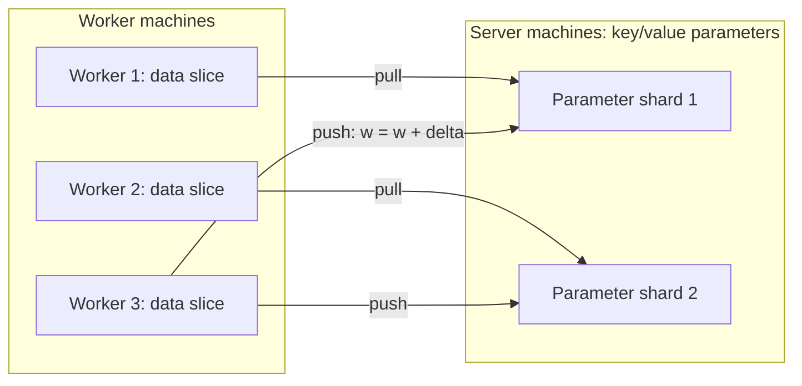

*Exam fact: workers pull to read, push to add updates; the parameters live on the server machines.*

### Worked example

Three workers each compute a gradient step for weight w₁ (stored on server shard 1): Worker A computes Δ = +0.2, B computes −0.1, C computes +0.3. Each **pushes** its Δ; the server adds them: w₁ ← w₁ + 0.2 − 0.1 + 0.3 = w₁ + 0.4. Before each next step each worker **pulls** the latest w₁ (possibly from its cache). Under SSP with s = 3, worker A is allowed to be at most 3 clocks ahead of the slowest worker; at clock slowest + 3 it **waits**.

### Near-twins / traps

- Pull = read; push = update (usually addition). Easy to swap in a quiz.
- BSP (barrier each iteration, strongest consistency) vs async (no barrier, no guarantee) vs SSP (bounded drift).
- MapReduce's abstraction is map/reduce; the parameter server's is a key/value store.

### Tiny recap card

- PS: server machines hold parameters; workers pull (query) and push (update by +).
- Slow network → caching + asynchrony; async lacks guarantees → SSP (bounded staleness s/τ).
- SSP = between BSP and async; fastest and slowest workers ≤ s clocks apart.

### Checkpoint

1. In a parameter server, the operation that updates model parameters is
   a) pull  b) push  c) shuffle  d) sort
2. The operation that queries model parameters is
   a) push  b) pull  c) reduce  d) join
3. Parameter servers store the model as
   a) a key/value store (distributed shared memory)  b) a relational table only  c) a graph only  d) HDFS blocks
4. Which is the main drawback of pure asynchronous execution?
   a) too many barriers  b) no theoretical guarantees because of delays and stragglers  c) it needs sorted keys  d) it cannot use caches
5. In SSP, τ (or s) is
   a) the learning rate  b) the staleness bound  c) the number of workers  d) the number of servers
6. SSP relative to BSP and async:
   a) it replaces both  b) it interpolates between them and subsumes both  c) it is identical to BSP  d) it is identical to async
7. In the SSP figure with s = 3, worker 2 is blocked until
   a) worker 1 reaches the required clock  b) all workers finish  c) the server restarts  d) the cache is deleted
8. Statement 1: In ML updates, a push is usually an addition. Statement 2: In MapReduce, each iteration of an iterative ML algorithm is cheap because output is never saved between stages.
   a) both true  b) 1 true, 2 false  c) 1 false, 2 true  d) both false
9. Which is a parameter-server implementation for Spark named in the lecture?
   a) Glint  b) Giraph  c) Hama  d) Flume
10. The network is slow compared with local memory. A remedy named in the lecture is
    a) removing all parameters  b) caching with cache synchronisation  c) using only one worker  d) disabling workers

#### Answer key

1. **b** — push = update.
2. **b** — pull = query.
3. **a** — key/value interface over distributed shared memory.
4. **b** — async lacks guarantees under delays/stragglers.
5. **b** — τ/s bounds how stale values may be.
6. **b** — slide: interpolates and subsumes both.
7. **a** — blocked until worker 1 reaches the clock.
8. **b** — statement 2 is false; MapReduce saves output redundantly between stages, which is costly.
9. **a** — Glint.
10. **b** — caching (plus asynchrony).

#### Optional, after you check

- Explain in one sentence why s = 0 behaves like BSP.
- What breaks if two workers push updates to the same key and no one tracks their order or staleness?

---

## Lecture 31: PageRank Algorithm in Big Data

### Hook (4–6 sentences)

Search engines had a problem in the 1990s: the web held hundreds of millions of pages, many of them junk, and keyword matching alone could not say which pages were worth reading. Larry Page and Sergey Brin's answer was to let the web itself vote: a page is important if many pages link to it, and especially if important pages link to it. That score is **PageRank**. This lecture states the formula, runs it by hand on a tiny graph, and then compares two ways of running it on a huge graph: **MapReduce** (works, but wasteful) and **Pregel** (written for graphs).

### Slide picture

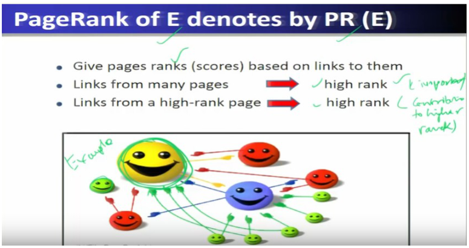


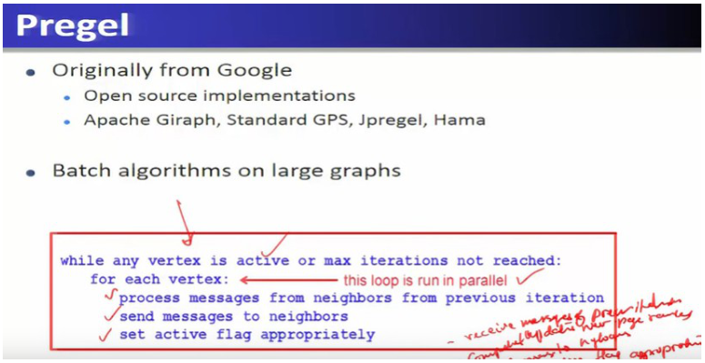

### Core ideas

**Why big graphs are a challenge.** A **social-scale graph** has about **1 billion vertices and 100 million edges** (vertices = people, edges = relations); a **web-scale graph** about **50 billion vertices and 1 trillion edges** (pages and links); a **brain-scale graph** about **100 billion vertices (neurons) and 100 trillion edges**. Computing on graphs this large is the challenge.

**What PageRank is.** PageRank is a method for **rating the importance of web pages objectively and mechanically using the link structure of the web**. Picture the web as a graph, pages as vertices, hyperlinks as edges. It gives each page a score based on the links pointing to it:

- Links from **many pages** → **high rank**.
- Links from a **high-rank page** → **high rank** (a link from an important page counts for more).
- PageRank was developed by **Larry Page and Sergey Brin** (Google), a research project that began in **1995** and gave a working prototype in **1998**; it was the first algorithm Google used to rank search results.

**The formula.** Let pages p₁…p_N, let B(p) be the pages that link to p, and let L(q) be the number of **outbound links** of page q. Then

**PR(A) = (1 − d)/N + d · [ PR(B)/L(B) + PR(C)/L(C) + PR(D)/L(D) + … ]**

where **d is the damping factor (0.85)**. Reading it in words: every page splits its current score equally among the pages it links to (the PR/L terms); a page's new score is the sum of what it receives, multiplied by d, plus a small constant (1−d)/N that every page gets regardless. Start all pages at **1/N**. Repeat for a fixed number of iterations or until the changes are tiny (**convergence**).

- `EXAM` Initial PageRank = 1/N (4 nodes → 0.25). Damping factor d = 0.85, so (1−d) = 0.15. PageRank is computed **iteratively** until convergence.

**PageRank with MapReduce.** Each iteration is one MapReduce job.

- **Map** (input: node ID n with its current PageRank and adjacency list): compute **p = PR(n) / number of neighbours** and **emit (m, p) for every neighbour m**; also emit **(n, the node object itself)** so the graph structure is not lost.
- **Reduce** (for node m): collect the incoming values; if a value is the **node object**, keep it; otherwise **sum** the rank contributions into s. New rank = **s × 0.85 + 0.15 / N**. Emit **(m, node with new rank)**.

**What is wrong with that?** (1) The **entire state of the graph is shuffled on every iteration**, though only the new **rank contributions** need to move. (2) The **iterations must be controlled outside MapReduce**. Newer graph systems (**Pregel, GraphLab, Giraph, GraphX**) solve this.

**PageRank with Pregel.** **Pregel** (originally from **Google**; open-source relatives **Apache Giraph, Stanford GPS, JPregel, Hama**) is for **batch algorithms on large graphs** and does **not use MapReduce**. You write **one vertex program**; the framework runs it on every vertex in parallel:

```
while any vertex is active or max iterations not reached:
    for each vertex (in parallel):
        process messages from neighbours (previous iteration)
        send messages to neighbours
        set active flag appropriately
```

One round of this loop is a **superstep**. For PageRank a vertex sums the incoming messages, applies d = 0.85 and (0.15/N), and — while the iteration count is below 30 — sends its new rank divided by its number of out-edges to each neighbour; when there is nothing more to do it **halts** (becomes passive / inactive).

- `EXAM` Pregel: vertex-centric, messages between vertices, supersteps, active flag, halts when no vertex is active; open-source: Giraph, GPS, JPregel, Hama.

### How it fits together

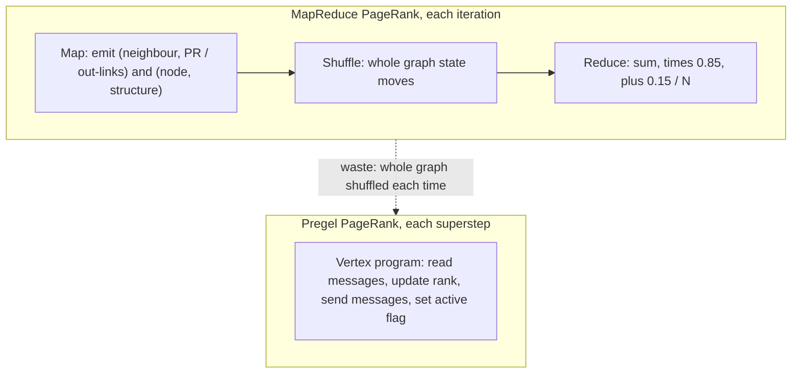

*Exam fact: MapReduce re-shuffles the whole graph every iteration; Pregel just exchanges messages between vertices.*

### Worked example

Four pages A, B, C, D. B, C, D all link to A; B also links to C; nothing else. Initial PR = 1/4 = 0.25 each.
B has 2 out-links (A and C), so it sends 0.25/2 = **0.125** to each; C has 1 out-link (A) and sends 0.25; D has 1 out-link (A) and sends 0.25.
A receives 0.125 + 0.25 + 0.25 = 0.625. With d = 0.85: PR(A) = 0.15/4 + 0.85 × 0.625 = 0.0375 + 0.53125 = **0.569**.
C receives 0.125 from B: PR(C) = 0.0375 + 0.85 × 0.125 = **0.144**.
B and D receive nothing: PR = 0.0375 each. A, with the most in-links, ends up highest.

### Near-twins / traps

- PageRank initial value is **1/N**, not 1 or 0.
- d (0.85) multiplies the link contributions; (1−d)/N is the base amount every page gets.
- MapReduce version emits **both** rank contributions **and** the node structure; the Pregel version sends only messages.
- Pregel is **not** MapReduce, and it is **vertex-centric**.

### Tiny recap card

- PageRank rates pages by incoming links (many + from high-rank pages); PR = (1−d)/N + d·ΣPR/L, d = 0.85.
- MapReduce version shuffles the whole graph each iteration; Pregel uses a vertex program, supersteps and messages.
- Pregel relatives: Giraph, GPS, JPregel, Hama.

### Checkpoint

1. PageRank rates a page's importance using
   a) its word count  b) the link structure of the web  c) its file size  d) its server location
2. A page gets a high PageRank if it has
   a) links from many pages and links from high-rank pages  b) no links  c) many outgoing links only  d) a long title
3. In the PageRank formula the damping factor is
   a) 0.15  b) 0.5  c) 0.85  d) 1
4. In a 4-page graph the initial PageRank of each page is
   a) 1  b) 0.5  c) 0.25  d) 0
5. A major inefficiency of MapReduce PageRank is that it
   a) cannot add numbers  b) shuffles the entire graph state on every iteration  c) has no reducer  d) needs no iterations
6. Pregel programs are written as
   a) a single vertex program run in parallel on all vertices  b) a sequence of SQL queries  c) map and reduce functions  d) a shell script
7. Which is NOT an open-source Pregel-style system named in the lecture?
   a) Apache Giraph  b) Hama  c) Stanford GPS  d) Apache Flume
8. A vertex in Pregel that has nothing more to do
   a) stays active forever  b) sets its flag to inactive/halts  c) deletes the graph  d) restarts all vertices
9. The algorithm was developed by
   a) Larry Page and Sergey Brin  b) Ross Quinlan  c) Jeff Dean  d) Doug Cutting
10. Statement 1: a link from a high-rank page contributes more to rank. Statement 2: PageRank is computed once, without iteration.
    a) both true  b) 1 true, 2 false  c) 1 false, 2 true  d) both false

#### Answer key

1. **b** — link structure of the web.
2. **a** — both effects raise rank.
3. **c** — d = 0.85.
4. **c** — 1/N = 1/4.
5. **b** — slide: entire graph shuffled every iteration.
6. **a** — vertex-centric programming.
7. **d** — Flume is not a graph system; the lecture lists Giraph, GPS, JPregel and Hama.
8. **b** — inactive/halts.
9. **a** — Page and Brin.
10. **b** — PageRank is iterative until convergence.

#### Optional, after you check

- Explain damping to someone: why does every page get a (1−d)/N base score?
- Trace one extra iteration of the worked example.

---

## Lecture 32: Spark GraphX & Graph Analytics (Part-I)

### Hook (4–6 sentences)

Real data jobs mix two shapes: **tables** (rows and columns, where Spark/Hadoop shine) and **graphs** (things and the relationships between them, where Pregel and GraphLab shine). Take Wikipedia: you clean raw text with table operations, build a hyperlink graph, run PageRank on it, then turn the result back into a table to list the top 20 pages. If each step lives in a different system you spend most of your time copying data through HDFS. **GraphX** exists to remove that waste: one system, one data representation, usable as a table or as a graph. This lecture says what graphs are good for, what the *graph-parallel pattern* is, and why a unified system wins.

### Slide picture

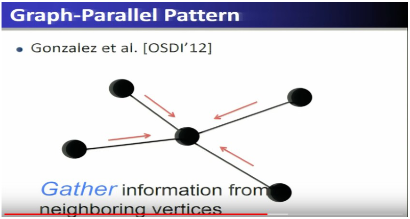

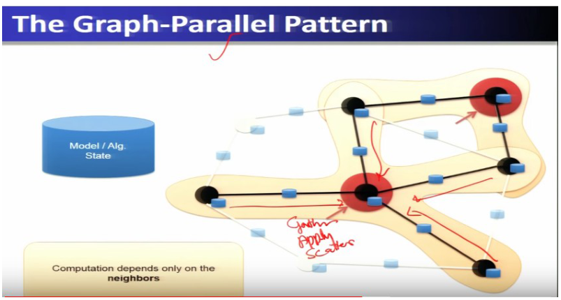

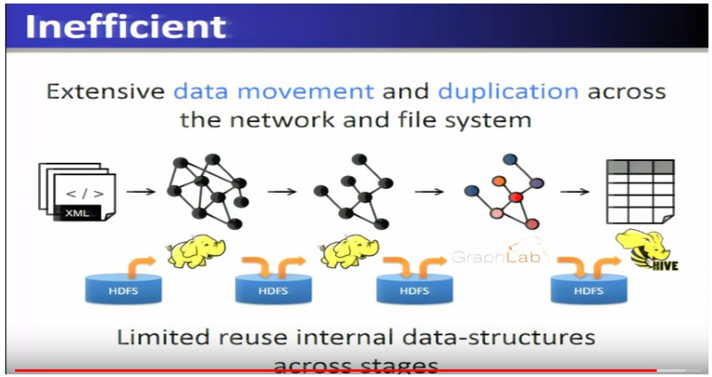


### Core ideas

**What GraphX is.** **GraphX is Spark's distributed graph-computation framework, built on Spark Core, that unifies graph-parallel and data-parallel computation for big-data analytics.** (Its position is next to Spark SQL, Streaming and MLlib, all sitting on Spark Core.) Data model: Spark's **RDD**s. A graph's vertices are a **VertexRDD**, its edges an **EdgeRDD**; together they form a **property graph**. The *triplet* view combines an edge with its two end-vertices. GraphX ships a library of iterative graph algorithms in optimised form.

**Graphs are everywhere.** In each case, name the vertices and the edges:

| Graph | Vertices | Edges |
| --- | --- | --- |
| Social network | people / users (or posts) | relationships (or likes) |
| Web graph (e.g. Wikipedia climate-change pages, political blogs) | web pages | links |
| Bitcoin transaction network | people / organisations | currency exchanges |
| Internet communication network | routers / devices | network flows |
| Enron email graph (fraud analysis) | users | emails exchanged |
| User–item graph (**bipartite**) | users and items | ratings (weights) |

**Graph analytics and pipelines.** From **raw Wikipedia** you can build a *text table* → **hyperlink graph** → run **PageRank** → *top-20 pages* table; or a *term–document graph* → **topic model** → word/topic table; or a *discussion table* → **editor graph** → **community detection** → user communities; combine to *topic communities*. The chain of stages that turns raw data into insight is the **analytics pipeline**.

**Graph algorithms (all iterative).** **PageRank** (rank vertices; update `R[i] = 0.15 + Σ w_ji · R[j]` over neighbours, iterated to convergence), **connected components**, **triangle counting**, degree distribution, average path length, **single-source shortest paths**, graph colouring, community detection, **k-core / k-truss**; for ML: graph-based semi-supervised learning, **CoEM**, collaborative filtering (**ALS**, SGD, tensor factorisation).

- **Triangle counting** measures **cohesiveness**: count the triangles passing through a vertex. A vertex in many triangles sits in a **strong, tightly-knit community**; **fewer triangles = weaker community**.

**The graph-parallel pattern (the most testable item).** In most graph algorithms, the computation at one vertex **depends only on its neighbours**. So each vertex repeats three steps, **in parallel at all vertices**:

1. **Gather** information from neighbouring vertices (e.g. their PageRanks).
2. **Apply** — compute the new value for this vertex (update its rank).
3. **Scatter** — send the new information out to neighbours.

One round of gather–apply–scatter is a **superstep**; the whole thing is **iterative bulk synchronous execution** (communicate, barrier, compute, communicate…). Different systems name the pieces differently but do the same basic operations.

- `EXAM` Graph-parallel pattern = **Gather, Apply, Scatter**. Shuffle Sort is **not** part of it.

**Graph systems.** **Pregel** (Google) — **vertex-centric** ("think like a vertex"), no MapReduce, vertex programs interact by **sending messages**; per-vertex PageRank: receive messages → aggregate → **apply** update → **scatter**. **Apache Giraph** — an open-source Pregel-style system. **GraphLab** — **pull abstraction**: the vertex program directly reads adjacent vertices and edges; data movement is handled by the system. These specialised APIs give **orders-of-magnitude** gains over general data-parallel systems: PageRank on the LiveJournal graph (10 iterations): **Mahout/Hadoop 1340 s, naive Spark 354 s, GraphLab 22 s**; triangle counting on Twitter: Hadoop 1536 machines/423 min vs GraphLab 64 machines/15 s (**≈ 1000×**).

**The problem GraphX solves: separate table and graph views.** Data starts as a *table*, becomes a *graph* for algorithms, then returns to a *table* for the final report. With one system per step, each hand-off writes to **HDFS** and reads it back: **extensive data movement and duplication across the network and file system**, and **limited reuse of internal data structures across stages**. Having separate systems for each view is hard to use and inefficient.

**GraphX's answer: a unified view.** GraphX is a unified approach where the data **stays in memory** and need not be stored in HDFS between stages. The slide: **tables and graphs are composable views of the same physical data**; **each view has its own operators** that exploit the semantics of that view for efficient execution. The distinction between tables and graphs is blurred; **data-parallel and graph-parallel systems are combined**, so users can **express the entire graph-analytics pipeline in one system**. Implementation idea: **encode the graph as distributed tables**, express graph computation in **relational algebra**, and recast graph-system optimisations as **distributed join optimisation** and **incremental materialised-view maintenance**.

- `EXAM` Main goal of GraphX: **unify data-parallel and graph-parallel analytics** (not replace Spark SQL or HDFS).

### How it fits together

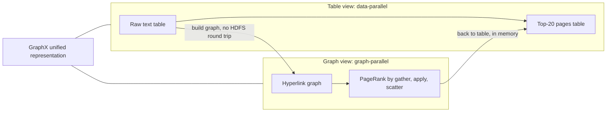

*Exam fact: one GraphX representation serves both the table view and the graph view; no HDFS round trip between stages.*

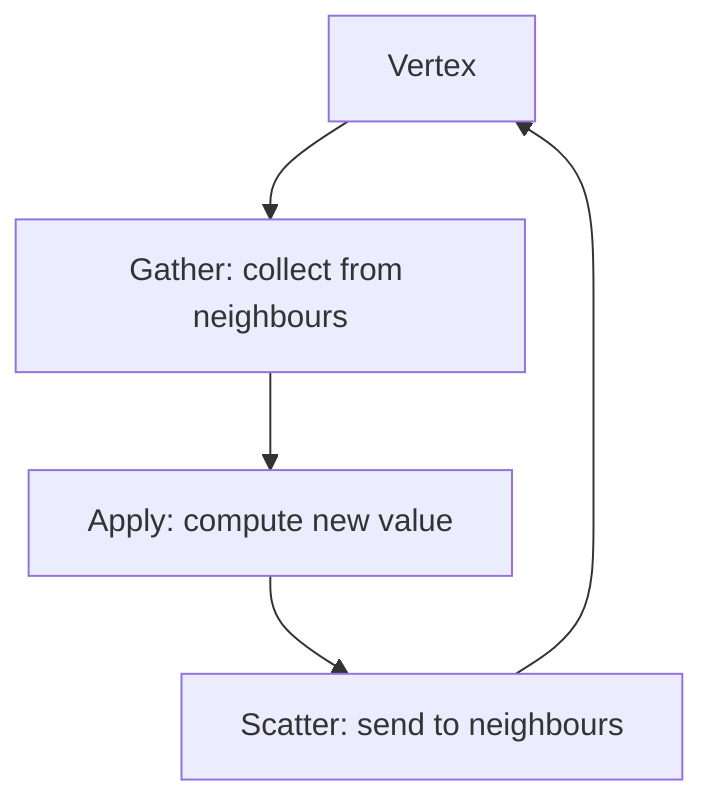

### Worked example

PageRank of one vertex in one superstep: neighbours B and C have ranks 0.2 and 0.4 and each has 2 out-links. **Gather**: from B receive 0.2/2 = 0.1, from C 0.4/2 = 0.2 → sum 0.3. **Apply**: new rank = 0.15/N + 0.85 × 0.3 (or the lecture's simplified R[i] = 0.15 + Σ w·R[j]). **Scatter**: send new rank/out-degree on each out-edge so neighbours can gather it next superstep.

### Near-twins / traps

- Gather/Apply/Scatter vs Map/Shuffle/Sort/Reduce: different paradigms.
- Pregel (messages, vertex-centric) vs GraphLab (pull from adjacent vertices) vs GraphX (unified tables + graphs).
- Graph-parallel (graph view, neighbour dependencies) vs data-parallel (table view, independent records).
- Triangle counting is about **cohesiveness/community strength**, not sorting.

### Tiny recap card

- GraphX = Spark library unifying data-parallel (tables) and graph-parallel (graphs) analytics on one in-memory representation.
- Graph-parallel pattern: Gather → Apply → Scatter, iterative BSP.
- Pregel (messages), Giraph (open-source Pregel), GraphLab (pull); triangle count ⇒ community cohesiveness.

### Checkpoint

1. The main goal of GraphX is to
   a) replace HDFS  b) unify data-parallel and graph-parallel analytics  c) replace Spark SQL  d) manage databases
2. Which phase is NOT part of the graph-parallel pattern?
   a) Gather  b) Apply  c) Scatter  d) Shuffle Sort
3. In GraphX the graph's vertices are stored as
   a) a VertexRDD  b) a hash index only  c) an HDFS file only  d) a DataFrame only
4. In a bipartite user–item graph the edges represent
   a) users  b) items  c) ratings  d) routers
5. Triangle counting is mainly used for
   a) sorting vertices  b) measuring cohesiveness / community strength  c) data compression  d) replication
6. Separate systems for table and graph stages are inefficient mainly because
   a) data is moved and duplicated through HDFS between stages  b) graphs cannot be stored  c) tables cannot be joined  d) Spark does not exist
7. Which graph system uses a vertex-centric model with messages and no MapReduce?
   a) Pregel  b) Hive  c) Sqoop  d) Flume
8. Statement 1: Tables and graphs are composable views of the same physical data in GraphX. Statement 2: GraphX needs separate storage for the table view and the graph view.
   a) both true  b) 1 true, 2 false  c) 1 false, 2 true  d) both false
9. In the Enron email graph the vertices are
   a) emails  b) users  c) servers  d) words
10. A PageRank iteration on a vertex follows the order
    a) apply, gather, scatter  b) gather, apply, scatter  c) scatter, gather, apply  d) sort, shuffle, reduce

#### Answer key

1. **b** — unify data-parallel and graph-parallel.
2. **d** — Shuffle Sort belongs to MapReduce.
3. **a** — VertexRDD.
4. **c** — ratings are the (weighted) edges.
5. **b** — cohesiveness of communities.
6. **a** — slide: extensive data movement and duplication.
7. **a** — Pregel.
8. **b** — statement 2 is false: unified representation.
9. **b** — vertices are users; edges are emails.
10. **b** — gather, apply, scatter.

#### Optional, after you check

- Describe gather-apply-scatter for the "oldest follower" problem (hint: see lecture 33).
- Why does a unified view avoid HDFS round trips?

---

## Lecture 33: Spark GraphX & Graph Analytics (Part-II)

### Hook (4–6 sentences)

Last time we learned that GraphX presents one dataset as either a table or a graph. How is that possible? This lecture opens the box. A graph is stored as two tables (vertices and edges) spread across machines, plus a third small *routing table* that tells each vertex which machines hold its edges. On top of that sit operators (`triplets`, `subgraph`, `reverse`, join) and a set of optimisations that explain why GraphX is fast: caching vertex copies next to the edges, indexing only the *active* edges, and skipping joins that are not needed. Most of the week's multiple-choice questions come from this lecture.

### Slide picture


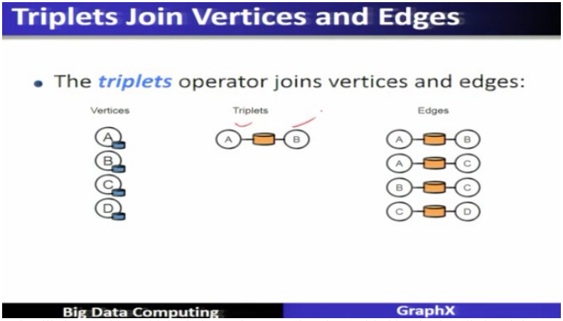

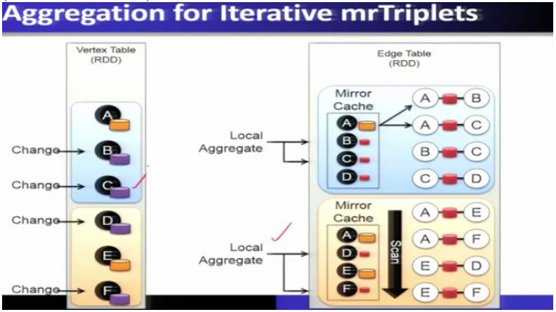

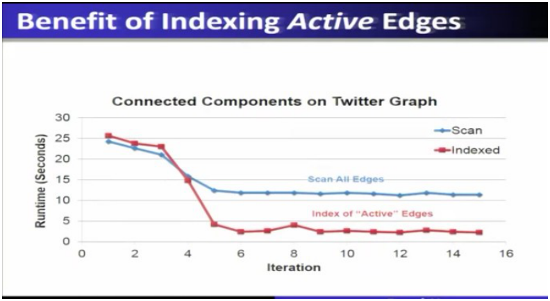

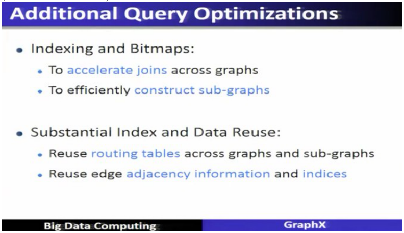

### Core ideas

**The property graph.** The graph in GraphX is a **property graph**. Every **vertex** has a **vertex ID** and a **property** (e.g. a professor from Berkeley); the vertex IDs and properties are kept in the **vertex property table**. Every **edge** has the **source ID**, **destination ID** and a **property** (e.g. "coworker"); these are kept in the **edge property table**. So **a property graph = vertex property table + edge property table**, and it can be viewed either as a graph or as those tables. Graph is the class `Graph[VD, ED]` built from the vertex and edge RDDs.

- `EXAM` Property graph = vertices **and** edges that **carry properties**, stored as a vertex property table and an edge property table.

**Distributed storage of a graph: vertex table, routing table, edge table.** A big graph does not fit on one machine, so GraphX **cuts it across the vertices** (a *2D vertex-cut heuristic*) into parts. Part 1 and part 2 live on different machines, and each part has its own slice of the **vertex table** and its own slice of the **edge table** (slide example: part 1 edges AB, AC, BC, CD; part 2 edges AF, AE, FE, ED). Because vertex A is used by edges in both parts, A's edges must be able to reach A's data on whichever machine it lives. The **routing table** records, **for each vertex, which edge partitions refer to it**: A → {1, 2}, B → {1}, C → {1}, D → {1, 2}, E → {2}, F → {2}. Together: **vertex table + routing table + edge table = the property graph as distributed tables.**

- `EXAM` **Routing table** = which partitions each vertex is referenced in; used so vertices and edges stored on different machines can talk.

**Table operators and graph operators.** GraphX inherits the Spark **RDD (table) operators** (map, filter, groupBy, sort, join, leftOuterJoin, reduceByKey, …). Graph-level transformations include **`reverse`** (flip every edge direction), **`subgraph`** (select a subset of the graph by predicates on vertices/edges), **`mapV`/`mapE`** (transform vertex/edge properties), **joins** with other data, and computations on the graph. **`filter`/subgraph does not delete parts of the graph; it marks them with a tombstone** and generates a subgraph from the main graph.

**Triplets.** The **`triplets` operator joins vertices and edges**. A **triplet** is **an edge plus both of its end vertices** (and their properties): for edge A→B you get (A's property, the A–B edge property, B's property). Because the triplet carries everything needed to look at both endpoints, it is the natural unit for building graph algorithms. The **`mrTriplets` (map-reduce triplets)** operator **maps over each triplet and reduces (aggregates) the results at a vertex**: the map emits a message for the vertex, the reduce merges them.

- Slide example, **"oldest follower"**: for each user, what is the age of their oldest follower? In `mrTriplets` the **map** emits, along each edge, the follower's age to the followed user, and the **reduce takes the maximum** of the ages arriving at each user. On the slide's small graph the largest oldest-follower age is 75.

- `EXAM` `triplets` joins vertices and edges. (Not `subgraph`, `reverse` or `mapV`.)

**System design: why GraphX is fast.** All optimisations below come from the lecture:

1. **Mirror cache and local aggregation.** Each edge partition keeps a **mirror cache** of the vertices it needs (copies of vertex properties). When a vertex changes, the change is sent to the mirror caches; when edges are scanned, partial results are **aggregated locally** and only the aggregate is sent back to the vertex table. This **reduces communication** (slide: network traffic on a connected-components run over the Twitter graph falls from thousands of MB to almost nothing after the early iterations).
2. **Indexing of active edges.** Only the **active vertices/edges** (those that changed) need processing. Indexing the active edges avoids scanning all edges every iteration, cutting runtime drastically in later iterations (connected components on Twitter: scan-all-edges stays at ~12 s while the indexed version falls to ~2–3 s).
3. **Join elimination.** The triplet view conceptually joins vertex and edge data, but if the computation does not use some fields (**PageRank only accesses the source attribute**), GraphX **identifies and bypasses the join for unused triplet fields** — a **factor of two reduction in communication**.
4. **Additional query optimisations.**
   - **Indexing and bitmaps** — **accelerate joins across graphs** and **efficiently construct subgraphs**.
   - **Substantial index and data reuse** — **reuse routing tables across graphs and subgraphs**; **reuse edge adjacency information and indices**.

- `EXAM` Join elimination = avoid unnecessary joins (reduces communication). Indexing and bitmaps = speed joins and build subgraphs. Substantial index and data reuse = reuse routing tables, edge adjacency info and indices across graphs/subgraphs.

**Performance picture.** For the pure graph computation GraphX is **roughly 3× slower than GraphLab**, which is acceptable because very large graphs become computable inside the general-purpose Spark system. In an **end-to-end pipeline** (Spark preprocessing of raw Wikipedia → hyperlink graph → PageRank → Spark post-processing to the top-20 pages) **GraphX is the fastest overall, even faster than GraphLab**, because the table and graph views are unified and nothing is written to HDFS between stages; other frameworks lose time moving data between two systems. GraphX stack: a few lines of code on Spark, with algorithms available through the Pregel or GraphLab-style APIs or directly as GraphX library functions. (GraphX was an alpha release as part of Spark 0.9.)

**Other points from the lecture.** Graphs can also be queried with relational/SQL-style operations and distributed joins (graph "through the lens of a database"). Active research: time-evolving graph models; serving graph-structured data to external systems. Graphs are central to data mining and ML: find **influential people**, **communities**, shared interests, model complex data dependencies; **bipartite graphs** for recommendations (products, movies); belief propagation and conditional random fields for user-behaviour analysis; **triangle count** to measure local community cohesiveness (**fewer triangles = weaker community, more triangles = stronger**). Tracking **active vertices** improves performance because only part of the graph changes per iteration.

### How it fits together

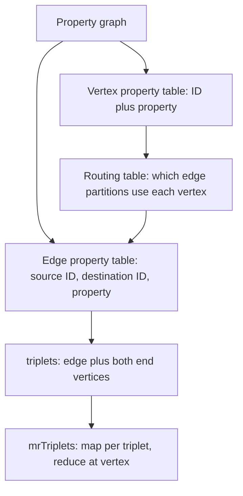

*Exam fact: a graph is stored as vertex table + routing table + edge table; `triplets` joins vertices and edges.*

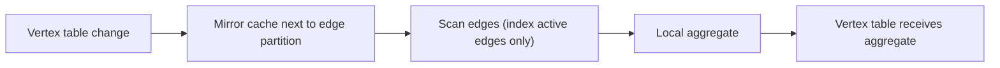

### Worked example

Graph with 6 vertices A–F cut into part 1 (edges AB, AC, BC, CD) and part 2 (AF, AE, FE, ED).
Routing table: A → {1,2} because A appears in edges of both parts; B → {1}; C → {1}; D → {1,2} (CD in part 1, ED in part 2); E → {2}; F → {2}.
If A's rank changes, GraphX sends the new value to the mirror caches of **both** parts but B's change goes to part 1 only. If an iteration changes only vertices A and D, only edges attached to A and D are scanned thanks to the **active-edge index**. With PageRank only reading the **source** vertex attribute of each triplet, **join elimination** skips fetching the destination attribute.

### Near-twins / traps

- **Routing table** (where a vertex is referenced) ≠ **mirror cache** (local copies of vertex data next to edges).
- **Join elimination** (skip unused fields/joins) vs **indexing and bitmaps** (speed up joins and subgraph construction) vs **index and data reuse** (reuse routing tables, adjacency information, indices across graphs/subgraphs) — three separate named optimisations, a favourite "which optimisation" question.
- `subgraph` / `filter` do not delete data (tombstones); `reverse` flips edge direction; `triplets` joins vertices and edges.
- GraphX vs GraphLab speed: ~3× slower on pure graph computation, faster end-to-end because of the unified view.

### Tiny recap card

- Property graph = vertex property table + edge property table; stored as vertex table, routing table, edge table; triplet = edge + both vertices.
- Optimisations: mirror cache + local aggregation, active-edge indexing, join elimination, indexing and bitmaps, index/data reuse.
- GraphX ≈ 3× slower than GraphLab for pure graph work, fastest end-to-end.

### Checkpoint

1. In GraphX a property graph consists of
   a) only vertices  b) only edges  c) vertices and edges with properties  d) tables only
2. Which operator joins vertices and edges together?
   a) mapV()  b) subgraph()  c) triplets  d) reverse()
3. The routing table stores
   a) edge weights  b) for each vertex, the edge partitions that reference it  c) the top-20 pages  d) HDFS block locations
4. Which optimisation reduces communication by avoiding unnecessary joins?
   a) join elimination  b) data duplication  c) replication factor  d) hash partitioning
5. Which feature helps accelerate joins and construct subgraphs efficiently?
   a) Bloom filters  b) indexing and bitmaps  c) commit logs  d) memtables
6. Reusing routing tables, edge adjacency information and indices across graphs and subgraphs is called
   a) substantial index and data reuse  b) active edge indexing  c) join elimination  d) Pregel messaging
7. Indexing active edges mainly
   a) avoids scanning all edges every iteration  b) deletes edges  c) disables caching  d) sorts vertices
8. When a graph is cut across machines, the vertex table slices and edge table slices are connected through
   a) the routing table  b) a SQL view only  c) Flume channels  d) YARN containers
9. Statement 1: `subgraph`/filter immediately deletes the removed part from memory. Statement 2: GraphX marks removed parts with tombstones and builds a subgraph.
   a) both true  b) 1 true, 2 false  c) 1 false, 2 true  d) both false
10. In the "oldest follower" example, the map and reduce of mrTriplets
    a) emit the follower's age to the followed user, then take the maximum  b) sort all vertices alphabetically  c) count triangles  d) compute PageRank
11. For PageRank only the source attribute of each triplet is needed, so GraphX
    a) eliminates the join for unused fields (about 2× less communication)  b) increases replication  c) disables indexing  d) uses HDFS
12. Which statement best describes GraphX?
    a) Graph-only processing framework  b) Batch-only framework  c) Unified analytics framework for graph and data processing  d) SQL replacement

#### Answer key

1. **c** — vertices and edges with properties.
2. **c** — `triplets` joins vertices and edges.
3. **b** — routing table lists the partitions that use each vertex.
4. **a** — join elimination.
5. **b** — indexing and bitmaps.
6. **a** — substantial index and data reuse.
7. **a** — only active edges are processed.
8. **a** — routing table.
9. **c** — tombstones.
10. **a** — map emits ages; reduce takes the max.
11. **a** — join elimination, ≈ 2× communication saving.
12. **c** — unified graph + data analytics framework.

#### Optional, after you check

- Draw the vertex, routing and edge tables for a 4-vertex graph cut into two parts.
- Why does a mirror cache reduce network traffic?

---

## Lecture 34: Case Study: Flight Data Analysis using Spark GraphX

### Hook (4–6 sentences)

To see all of this working, the lecture analyses real US flight data. Airports are naturally vertices and routes between them are edges, so questions such as "which airport has the most incoming flights?", "what are the longest routes?" and "which airports are the most important?" become one-line GraphX calls on the graph. The data come from the US Department of Transportation for January 2014. Treat this as a template for how any table becomes a graph in GraphX.

### Slide picture

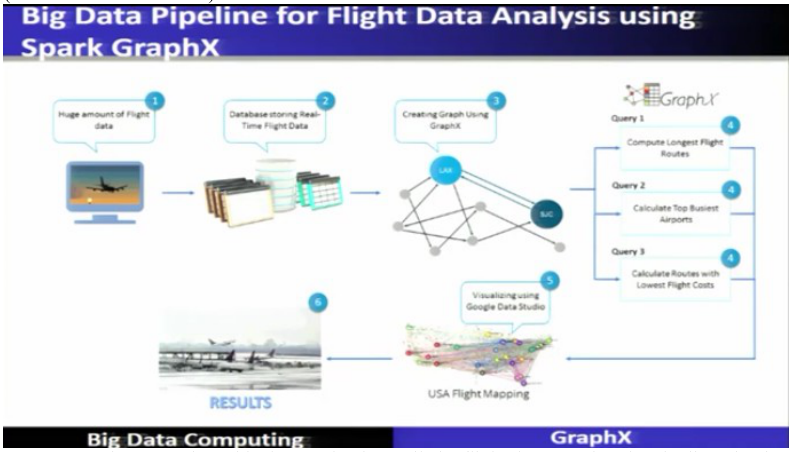

*Pipeline: huge flight data → database → create the graph with GraphX → queries (longest routes, busiest airports, cheapest routes) → visualise USA flight map → results.*

### Core ideas

**Problem and dataset.** **Problem statement:** analyse real-time flight data using Spark GraphX, provide **near real-time** computation results and **visualise** them. **Dataset:** US **Department of Transportation (DOT), Bureau of Transportation Statistics**, which tracks **on-time performance of domestic flights** by large carriers; summary figures for on-time, **delayed, cancelled and diverted** flights are published in DOT's monthly Air Travel Consumer Report. The case study uses **January 2014** delays and cancellations. There are **17 attributes**, among them: day of month, day of week, carrier code, tail number, flight number, origin ID / origin airport, destination ID / destination airport, scheduled and actual departure time, **departure delay minutes** (early departures set to 0), scheduled/actual arrival time, **arrival delay minutes**, elapsed time and **distance**.

**Use cases:** monitoring air traffic at airports, monitoring flight delays, analysing overall routes and airports, analysing routes and airports **per airline**.

**Objectives (questions to answer):** total number of **airports**; total number of **routes**; **longest** flight routes (compute and sort); airports with the **highest incoming** flights; airports with the **highest outgoing** flights; **most important airports according to PageRank**; routes with the **lowest flight cost** (with airport codes).

**Building the graph (code outline).**

1. Define a **Flight class** with the 17 fields and a **parse function** that converts a text line into a Flight.
2. Create the **SparkContext** (application name), read the text file → an **RDD**, map it with the parse function into a Flight RDD.
3. **Vertices:** an RDD of airports as (airport ID, airport name); define a **default vertex "nowhere"** for edges that reference an unknown airport.
4. **Edges:** a routes RDD (source ID, destination ID, **distance**) turned into an **Edge RDD**.
5. Build the graph: **Graph(airports, routes, nowhere)** — **airports are vertices, routes are edges**.

**Queries (graph operations).**

| Question | Operation |
| --- | --- |
| How many airports? | **number of vertices** (`graph.numVertices`, ≈ 304–305 here) |
| How many routes? | **number of edges** (`numEdges`) |
| Routes longer than 1000 miles | **filter on distance > 1000** → a **subgraph** (nothing deleted; **tombstones**) |
| Top 10 longest / lowest flights | use **triplets**, **sort** by distance, **take** 10 |
| Airport with most incoming flights | **inDegrees** joined with airport vertices, take the max |
| Airport with most outgoing flights | **outDegrees** joined with airport vertices, take the max |
| Most important / influential airports | **PageRank** over the graph, join with airport names, take the top 10 (most to least influential) |
| Cheapest route | sort routes by cost (via triplets) |

**Conclusion of the lecture:** the growing scale and importance of graph data has driven specialised graph engines; **GraphX is a distributed framework that unifies graph-parallel and data-parallel computation** in one system and can express and execute the **entire graph-analytics pipeline** efficiently.

### How it fits together

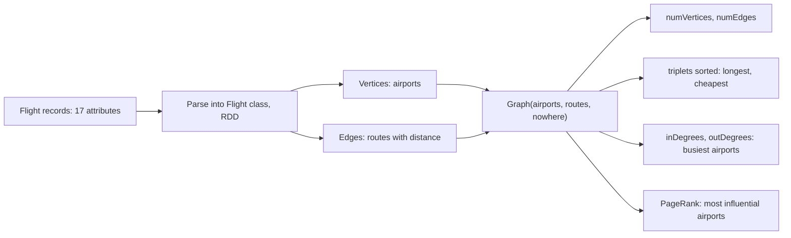

*Exam fact: airports are vertices, routes are edges; the number of vertices answers "how many airports".*

### Worked example

Tiny dataset with three flights: LAX→JFK (2475 miles), JFK→ORD (740), LAX→ORD (1745).
Vertices: LAX, JFK, ORD → `numVertices` = 3; edges: 3 routes → `numEdges` = 3.
Filter distance > 1000 → subgraph edges LAX→JFK, LAX→ORD.
Triplets sorted by distance, top: LAX→JFK (2475) then LAX→ORD (1745).
inDegree: JFK 1, ORD 2 → ORD has the most incoming flights. outDegree: LAX 2 → LAX has the most outgoing flights. PageRank would also rank ORD high (two incoming links).

### Near-twins / traps

- Airports = vertices; routes/flights = edges (not the reverse).
- Highest incoming = in-degree; highest outgoing = out-degree; "most important" = PageRank (not degree).
- Filtering by distance creates a **subgraph with tombstones**, it does not delete the original graph.
- The default vertex "nowhere" handles edges whose airport is missing.

### Tiny recap card

- Dataset: US DOT BTS, January 2014, 17 attributes; graph: airports = vertices, routes = edges.
- Queries: numVertices/numEdges, filter → subgraph, triplets sort, inDegree/outDegree, PageRank.
- Takeaway: GraphX unifies data-parallel and graph-parallel in one pipeline.

### Checkpoint

1. In the flight-data graph, vertices are
   a) airports  b) flights  c) airlines  d) delays
2. The number of airports is found with
   a) number of edges  b) number of vertices  c) triplet count  d) a sort
3. The airport with the most incoming flights is found with
   a) outDegrees  b) inDegrees  c) subgraph  d) reverse
4. Filtering routes with distance > 1000 produces
   a) a new empty graph  b) a subgraph using tombstones  c) deletion of the original graph  d) an HDFS file
5. The "most influential airports" are obtained with
   a) PageRank  b) K-means  c) Apriori  d) bagging
6. The dataset in the case study covers
   a) January 2014 on-time, delayed, cancelled and diverted flights from US DOT  b) all flights since 1950  c) a Twitter graph  d) a Wikipedia dump
7. The "nowhere" vertex is
   a) a default vertex for routes with missing airports  b) a sink for deleted data  c) the busiest airport  d) a routing table
8. How many attributes does the dataset have?
   a) 5  b) 10  c) 17  d) 30
9. Sorting triplets by distance answers
   a) which airport has most incoming flights  b) the longest (or shortest) routes  c) PageRank  d) the number of airports
10. Statement 1: Routes are edges. Statement 2: Departure-delay minutes for early departures are set to 0.
    a) both true  b) 1 true, 2 false  c) 1 false, 2 true  d) both false

#### Answer key

1. **a** — airports are vertices.
2. **b** — `numVertices`.
3. **b** — inDegrees.
4. **b** — filter creates a subgraph with tombstones.
5. **a** — PageRank.
6. **a** — DOT, January 2014.
7. **a** — default vertex.
8. **c** — 17 features.
9. **b** — triplets sorted by distance.
10. **a** — both on the slides.

#### Optional, after you check

- Write in words the sequence of GraphX calls to find the busiest outgoing airport.
- Why is PageRank a better definition of "important airport" than raw in-degree?

---

## Week wrap

### How the lectures connect

Lecture 30 shows how a cluster can share the numbers of an ML model (parameter servers with pull/push, and Stale Synchronous Parallel to balance speed against consistency). Lecture 31 turns to graph data: PageRank is the canonical big-graph algorithm, and running it in MapReduce exposes the waste of re-shuffling the whole graph each iteration; Pregel's vertex-centric supersteps fix that. Lecture 32 generalises the Pregel/GraphLab idea into the gather–apply–scatter pattern and introduces GraphX, whose goal is to remove the table-to-graph hand-offs through HDFS by presenting one data representation as both. Lecture 33 shows how GraphX stores a graph (vertex table, routing table, edge table; triplets) and why it is efficient (mirror cache, active-edge indexing, join elimination, indexing and bitmaps, index and data reuse). Lecture 34 applies it to flight data.

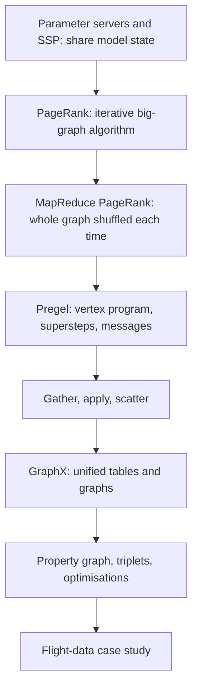

### Assignment-shaped mixed quiz

1. The main goal of GraphX is to
   a) manage databases  b) unify data-parallel and graph-parallel analytics  c) replace Spark SQL  d) replace HDFS
2. Which phase is NOT part of the graph-parallel pattern?
   a) Gather  b) Apply  c) Scatter  d) Shuffle Sort
3. Which operator joins vertices and edges together?
   a) mapV()  b) subgraph()  c) triplets  d) reverse()
4. A GraphX property graph consists of
   a) only vertices  b) only edges  c) vertices and edges with properties  d) tables only
5. Which algorithm is commonly used to identify influential vertices?
   a) K-Means  b) PageRank  c) Apriori  d) FP-Growth
6. Triangle counting is mainly used for
   a) sorting vertices  b) community detection  c) data compression  d) replication
7. Which optimisation reduces communication by avoiding unnecessary joins?
   a) join elimination  b) data duplication  c) replication factor  d) hash partitioning
8. Which GraphX feature accelerates joins and constructs subgraphs efficiently?
   a) Bloom filters  b) indexing and bitmaps  c) commit logs  d) memtables
9. Which optimisation reuses routing tables, edge adjacency information and indices across graphs and subgraphs?
   a) substantial index and data reuse  b) active-edge indexing  c) join elimination  d) Pregel messaging
10. In a parameter server, workers update the model with
    a) pull  b) push  c) join  d) sort
11. SSP differs from asynchronous execution because it
    a) bounds how far workers may drift apart  b) uses no cache  c) needs no workers  d) forbids updates
12. In the PageRank formula PR(A) = (1−d)/N + d·ΣPR(B)/L(B), the usual d is
    a) 0.15  b) 0.5  c) 0.85  d) 1.0

#### Answer key

1. **b** — unify data-parallel and graph-parallel.
2. **d** — Shuffle Sort is MapReduce.
3. **c** — triplets.
4. **c** — vertices and edges with properties.
5. **b** — PageRank.
6. **b** — community detection (cohesiveness).
7. **a** — join elimination.
8. **b** — indexing and bitmaps.
9. **a** — substantial index and data reuse.
10. **b** — push updates, pull queries.
11. **a** — bounded staleness s/τ.
12. **c** — d = 0.85.

### Last 5-minute drill

| Term | Answer to recall |
| --- | --- |
| Parameter server | servers hold parameters, key/value |
| Pull / push | query / update (addition) |
| SSP | bounded staleness between BSP and async |
| PageRank | importance from link structure |
| Damping factor | 0.85; random term (1 − d)/N |
| MapReduce PageRank flaw | whole graph shuffled each iteration |
| Pregel | vertex-centric, messages, supersteps |
| GraphX goal | unify data-parallel and graph-parallel |
| Graph-parallel pattern | gather, apply, scatter |
| Property graph | vertex table plus edge table, with properties |
| Triplet | edge plus both end vertices |
| Routing table | partitions that reference each vertex |
| Join elimination | skip unneeded joins, less communication |
| Indexing and bitmaps | faster joins, subgraph construction |
| Index and data reuse | reuse routing tables and indices |
| Triangle counting | community cohesiveness |
